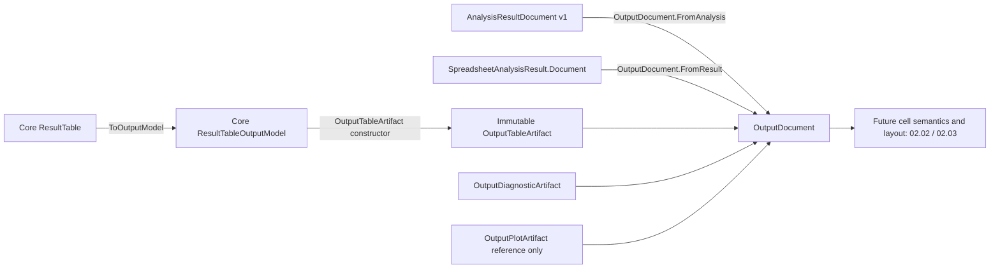

# Batch 02.01 — Shared output artifact document

Implementation in progress, pending independent review. Source baseline: `0eb51e2`
(accepted 01.10), matching local `main`, on the existing `codex/02-01` branch.
The working tree already contains the approved Revision 1.4 planning update and
its companion audit. Both are preserved byte-for-byte, as are the two stashes.
The plan retains **222 total / 19 implemented / 203 outstanding**, with all 74
04A batches planned after 04.07 and the 04A.74 gate before Phases 05–11.
This batch does not mark 02.01 complete.

## Source audit and responsibility

Core `ResultTable.ToOutputModel()` already assembles titles, top headers, left
headers/body, and footnotes, including rectangular padding. Core needs no change.
`ResultTableOutputModel` retains the actual matrix and section counts, result-table
flag and one-based body-relative p-value columns/cells. It is a mutable legacy DTO.
Core `ResultTableWriterBase` and `ProcessListofResultTables` retain their established
writer behavior; neither becomes a new document contract.

00.04 `AnalysisResultDocument` owns analysis ID, success/failure status, metrics,
ordered tables, warnings/faults and typed detail. Its v1 structural snapshot omits
table cells and raw typed details. That entire API and serialization boundary is
unchanged. `SpreadsheetAnalysisResult` retains both constructors and its original
`Tables`, `Metrics`, `Detail`, `.Document`, `Run` and `RunDocument` behavior.

The new **OutputDocument** owns an ordered snapshot of presentation content.
It does not duplicate the analysis envelope, calculate statistics or inspect raw
typed details. It is intentionally **in-memory only**, without a serialization
schema, JSON export or promise that arbitrary Object graphs are portable.



## Contract and order

All new production types live in `BESHStat.Excel.Common/src/Output/OutputDocument.vb`
under `BESHStatNG.ExcelCommon`, with `Option Strict On`. Common still references
only Core and the standard framework. No host dependency or package is added.

| Type | Content |
|---|---|
| `OutputDocument` | Read-only ordered artifact sequence; no analysis state or destination |
| `OutputArtifact` | Nonblank document-local `Id`, `Kind`, optional `Caption`; closed construction boundary |
| `OutputTableArtifact` | Complete copied Core matrix and metadata through copied `Model`, plus row/column counts |
| `OutputDiagnosticArtifact` | Warning/fault severity, required code/message, optional field path |
| `OutputPlotArtifact` | Required logical reference key and purpose; optional caption/description |

`New OutputDocument(artifacts)` preserves exactly the caller's order, including
arbitrary interleaving. Null sequences/items and duplicate IDs are rejected.
IDs use ordinal case-sensitive uniqueness, are never generated randomly, and
identify artifacts within a document, not across changed analysis executions.

`FromTable(table)` uses `ToOutputModel()`; `FromModel(model)` adapts an existing
Core DTO. Both make one `table-0` artifact. `OutputTableArtifact.FromTable` also
allows an explicit ID/caption for composite results.

`FromAnalysis(source, optionalTrailingArtifacts)` copies tables in the existing
analysis table order, then warnings in source order, then faults in source order,
then explicitly supplied trailing artifacts. IDs are `table-{index}`,
`warning-{index}`, `fault-{index}` using invariant decimal indices. Caller-supplied
IDs must not collide. Diagnostics stay structured artifacts, never synthetic
table rows. Metrics and typed detail stay in the analysis envelope; the bridge
does not invent tables or plots for them. `FromResult(result)` reads its captured
`.Document`, so subsequent mutation of legacy `.Tables` does not change output.
There is no chronology between the separate source warning/fault collections;
the bridge's documented grouping is deterministic. Use the constructor when
presentation requires diagnostics or plots between tables.

## Table values, metadata and isolation

The `Model` property returns a new Core DTO and matrix on each access, including
independent p-value lists. Cache that returned copy locally when reading many
cells. Constructor inputs and returned matrices/lists cannot mutate stored data.
Artifact classes are sealed, properties are read-only, and the document copies
the input sequence into a read-only collection. Sharing already immutable
diagnostic/plot artifacts is safe. Concurrent mutation of inputs while taking a
snapshot is not supported; snapshot creation is not a synchronization mechanism.

The supported raw cell values are `Nothing`, `String`, `Boolean`, and the exact
CLR numeric scalars `SByte`, `Byte`, `Int16`, `UInt16`, `Int32`, `UInt32`, `Int64`,
`UInt64`, `Single`, `Double`, `Decimal`. Numeric runtime types and values are kept,
including zero, NaN and positive/negative infinity for Single/Double. `Nothing`
and empty string remain distinct. Formula-like strings (`=1+1`) and error-like
strings (`#N/A`) remain literal strings; this contract neither executes nor
classifies them as formulas or native errors.

Other payloads are rejected with `ArgumentException` identifying the type:
arrays, collections, arbitrary mutable objects, host objects, enums, `DBNull`,
`Char` and dates are not accepted. No `ToString()` fallback or arbitrary object
deep cloning occurs. Because every accepted cell is an immutable scalar, cloning
the matrix suffices for payload isolation. A general shallow clone would not
protect nested objects. Date/error/formula canonicalization and serialization
belong to 02.02. Existing `ResultTableWriteRequestFactory` still independently
normalizes nonfinite values to its existing strings; that behavior is untouched.

Null models/matrices and nonzero array lower bounds are rejected clearly.
Zero-length dimensions and Core's ordinary empty-table 1x1 blank assembly are
supported. Negative section counts, counts whose title + top-header + footer rows
exceed matrix rows, or left-header counts exceeding columns are rejected. The
row-count sum uses Int64 to avoid overflow. No actual unpadded body extent can be
recovered from the assembled DTO, and none is invented.

P-value indices stay **one-based and body-relative**. For a table with two title
rows, two top-header rows and one left-header column, annotation `(1,2)` still
means body row 1/column 2, even though the corresponding array cell is `(4,2)`.
No worksheet coordinate or presentation style is created. Core `ResultTable`
`AddPvalue*` methods already ignore duplicate/out-of-range additions. In contrast,
the Core DTO constructor accepts arbitrary annotations without validation; the
new bridge preserves those exact lists, including duplicates, negative/zero and
out-of-range entries. It does not silently sanitize an existing DTO or reinterpret
padding as proof of original body size. Later consumers must not assume annotations
are validated placement instructions. Structural section validation is separate.

The composite fixture's actual matrix is:

| Array row | Column 0 | Column 1 | Column 2 |
|---:|---|---|---|
| 0 | Title one | blank | blank |
| 1 | Title two | blank | blank |
| 2 | blank | Estimate | P |
| 3 | blank | blank | Second |
| 4 | A | Int32 zero | Double 0.04 |
| 5 | B | blank | Boolean True |
| 6 | Footnote one | blank | blank |
| 7 | Footnote two | blank | blank |

Metadata: titles 2, top headers 2, left headers 1, footers 2, p-value column 2
and cell `(1,2)`. Core's shorter second header remains right-aligned/padded as
assembled. Table titles/footnotes are **actual matrix cells in their original
rows**. A separate artifact `Caption` is optional document presentation text;
the bridge does not duplicate table titles/footnotes into caption/text artifacts.

## Deterministic ANOVA preview

`OutputDocumentTests.AnovaMultiTablePreview_IsDeterministicAndIncludesActualTitleFooterCells`
uses the existing `anova-all-posthoc` fixture and reads the new document only.
It writes this diagnostic text through MSTest `TestContext`, available in the
focused TRX. Its warning and plot reference are explicitly supplied preview
examples, not outcomes or graphics generated by ANOVA. The actual ANOVA tables
have **zero title rows**: their captions are top-header cell content. Welch is
included in the first table's columns, not a fabricated separate table.

```text
table-0 | Table |  | 4x9
  header[0]=Source of Variation | SS | df | MS | F | P-value | Welch DF Error | Welch F | Welch P-value
table-1 | Table |  | 5x5
  header[0]=Fisher's LSD multiple comparisons | Mean difference (CI) | SE difference | t | P-value
  footer[4]=Confidence interval level = 95% (alpha = 0.05). | <blank> | <blank> | <blank> | <blank>
table-2 | Table |  | 5x5
  header[0]=Bonferroni adjusted multiple comparisons | Mean difference (CI) | SE difference | t | P-value
  footer[4]=Confidence interval level = 95% (alpha = 0.05). Bonferroni-adjusted critical values were used. | <blank> | <blank> | <blank> | <blank>
table-3 | Table |  | 5x5
  header[0]=Tukey-Kramer multiple comparisons | Mean difference (CI) | SE difference | q | P-value
  footer[4]=Confidence interval level = 95% (alpha = 0.05). | <blank> | <blank> | <blank> | <blank>
table-4 | Table |  | 5x6
  header[0]=Games-Howell multiple comparisons | Mean difference (CI) | SE difference | q | DF | P-value
  footer[4]=Confidence interval level = 95% (alpha = 0.05). | <blank> | <blank> | <blank> | <blank> | <blank>
warning-0 | Diagnostic | Warning preview.example: Read-only preview diagnostic (preview)
preview-plot | Plot | Plot placeholder | reference=anova-plot-reference | purpose=Illustrative placeholder
```

The same preview helper checks actual title text from the composite fixture.
Preview formatting is test-only diagnostic text, not an exported document schema,
production rendering UI or host writer. The existing WasmSmoke read/run/write
workflow needs no change.

## Fixtures and compatibility

New tests compare every matrix cell **and its runtime type**, dimensions, all
section counts, result flag and both complete p-value lists against the source
models for the five existing Stage304 fixtures: `anova-base`,
`anova-welch-tukey`, `anova-all-posthoc`, `kw-base`, `kw-dunn`. Existing golden
assertions independently continue checking frozen numerical/output contracts.
No original tests or fixtures are modified. ANOVA optional Welch/Fisher/
Bonferroni/Tukey/Games–Howell and Kruskal–Wallis/Dunn remain in their native order.

Additional cases cover empty/minimal/header-only/zero-dimension tables, padding,
multiple titles/footnotes, raw cell types, invalid payloads/counts/nulls/IDs,
unvalidated DTO annotations, mutation in both directions, failure-only/plot-only
documents, legacy constructor/envelope behavior, immutable public properties and
the portable assembly/API boundary. A generic 21-artifact fixture interleaves
seven independent tables, warnings/faults and plot placeholders without analysis
IDs or assumptions about the number/type of statistical tables.

Core, writer requests, Excel-DNA writer, Office.js writer, analysis-result v1
and project files are unchanged. Core/Common stay `netstandard2.0`, modern tests
and WasmSmoke `net10.0`, legacy host/tests Framework 4.8. No source compatibility
change is required; existing hosts do not consume the opt-in new contract yet.

## Revision 1.4 / future Phase 04A boundary

Future extracted Windows report builders can adapt their existing Core tables
through the same bridge, keep structured diagnostics and supply logical plot
references, independent of forms or statistical families. This supports future
table parity work (04A.02/.07/.16) without an ANOVA/KW-only artifact contract.
No form reports, UDF wrappers, numerical algorithms or chart calculations are
extracted in 02.01. The 74 Phase 04A batches are future work, unrelated to the
74 passing Office.js tests in the baseline.

`OutputPlotArtifact` is only a logical reference/purpose/caption/description. It
does not load resources, guarantee a plot exists, carry raw analysis detail,
encode chart data/geometry, or prescribe CI/alpha styling. Actual plot payloads
and rendering remain with 02.07 and future chart-specific 04A work, especially
04A.34/.71. The three generic artifact kinds do not enumerate selected methods
or claim to cover all future chart semantics.

02.02 owns canonical cells, errors/formulas, semantic styles, p-value presentation
and a supported serialization scheme. 02.03 owns destinations, absolute placement,
spacing, collision/overlap and bounds. 02.04/.05 own host writer refactors;
02.06–.08 own overwrite/capability/cancellation policies, chart insertion,
composite layout and write outcomes. None is implemented here. No LibreOffice,
new production UI, catalog change, deployment, installer or signing work occurs.

## Validation and review

Fresh pre-edit portable baseline: Core **1,024**, Common **251**, zero failures or
skips, exit **0**. Other baseline counts below are the accepted post-01.10 run.

Commands run from the repository root:

```powershell
powershell.exe -NoProfile -ExecutionPolicy Bypass -File .\scripts\verify-beshstatng.ps1

dotnet test BESHStat.Excel.Common.Tests/BESHStat.Excel.Common.Tests.vbproj -c Debug --no-restore --filter 'FullyQualifiedName~OutputDocumentTests|FullyQualifiedName~AnalysisResultDocumentTests|FullyQualifiedName~Stage304ContractSnapshotTests' --logger 'trx;LogFileName=batch-02-01-focused.trx' --results-directory TestResults/Codex

powershell.exe -NoProfile -ExecutionPolicy Bypass `
  -File .\scripts\verify-beshstatng.ps1 `
  -Python `
  -PythonExe "C:\Users\peter\Desktop\WPy64-31150\python-3.11.5.amd64\python.exe" `
  -Js -Wasm -Legacy -VisualStudio 2026
```

Focused final run: **37 passed**, zero failed/skipped, exit **0**. Initial new-test
iterations exited **1** for a missing settings namespace import and an incorrect
preview assumption that existing ANOVA has title rows. The import was fixed;
the preview now checks the actual top-header representation and separately checks
real composite title rows. No production statistical/table behavior or existing
test was changed to address these failures.

Full required validation: exit **0**, **1,963 tests passed**, zero failed/skipped,
including **22 new Common cases** (five data rows exercise all existing goldens).

| Suite/build | Accepted 01.10 baseline | Final 02.01 | Outcome |
|---|---:|---:|---|
| Core | 1,024 | 1,024 | Passed |
| Common | 251 | 273 | Passed; +22 |
| Windows legacy | 561 | 561 | Passed |
| Office.js | 74 | 74 | Passed; syntax check also passed |
| Python tooling / docs / interpreter discovery | 21 + 5 + 5 | 21 + 5 + 5 | All OK |
| WASM .NET 10 Debug | Passed | Passed | Zero compiler warnings/errors |
| VS2026 Framework 4.8 Debug / Excel-DNA | Passed | Passed | Build and x86/x64 packing; zero compiler warnings/errors |

The verification script checks each child process and completed successfully.
Frozen inventory, methods catalog, generated metadata `--check` and retired-helper
audit passed. The existing legacy discovery advisory remains:
`UTA001: TestClass attribute defined on non-public class BESHStatNG.Test.MatrixTestHelpers`.
It did not fail or skip any executed tests. TRX overwrite notices reflect reuse
of the existing report names. PowerShell's redirected log formats successful
Python unittest stderr as `NativeCommandError`; all three summaries are OK and
the verification process returned 0. No compiler warnings or errors were emitted
by the final modern builds/tests. Debug's existing post-build configuration guard
exits before PreRelease signing; no signing, installer or publishing is executed.

Ignored local evidence:
`TestResults/batch-02-01-baseline.log`,
`TestResults/batch-02-01-focused.log`,
`TestResults/batch-02-01-full-validation.log`, and
`TestResults/Codex/{Core,Common,Legacy,batch-02-01-focused}.trx`.
The focused TRX includes the generated ANOVA preview. No Release build, live
Excel, browser-host smoke or LibreOffice run was performed.

Help generation rewrote timestamps in `HelpLinks.vb` and `HelpContext.vb` during
the Windows build. Their generated copies were archived in ignored TestResults;
only those two files were restored from their pre-build byte captures. SHA-256
equality was confirmed for both help files, `VersionAttributes.vb`, the master
plan and companion audit. Git prints a CRLF-to-LF notice for the preserved
`VersionAttributes.vb`; its captured bytes remain identical. No broad
restore/reset/clean or stash change occurred.
Final `git diff --check` passes; the original plan modification and untracked
companion audit remain, alongside exactly these three new batch paths:

- `BESHStat.Excel.Common/src/Output/OutputDocument.vb`
- `BESHStat.Excel.Common.Tests/src/OutputDocumentTests.vb`
- `docs/architecture/batch-02-01-output-document.md`

Manual checks for independent review (not executed by Codex):

1. Read the test-generated multi-table preview above; compare all five table
   headings, shapes and footer strings with the unchanged ANOVA golden workflow.
   This is the read-only host-neutral batch preview; it performs no sheet writes.
2. Optional host regression: with synthetic input A={1,2,3}, B={2,3,4}, C={5,6,7},
   run ANOVA with all post-hoc options in Windows Excel and the existing WASM
   workflow in Excel Online. Check existing table order/footnotes/p-value display;
   run KW/Dunn as a second case. No live Excel/browser session was started here.

Suggested commit after independent review:
`feat(common): add batch 02.01 shared output artifact document`.
No commit, push, merge, branch switch, 02.02 files or Phase 04A implementation.
