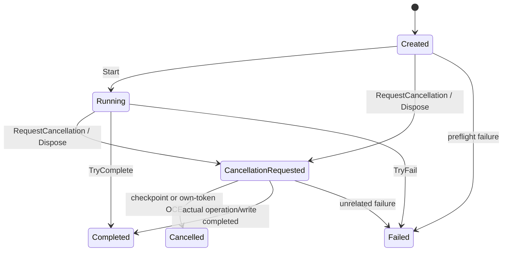

# Batch 03.03 — execution state, progress and cooperative cancellation

Status: **IN PROGRESS / PENDING OWNER REVIEW**. Live Windows Excel-DNA and
Excel Online acceptance is required. No 03.04 or Phase 04A implementation.

## Source audit and boundaries

The initial working tree was clean. Existing `codex/03-03` and accepted `main`
both pointed at `7a65a4837b830273d88f0b3cd582805a8b824684` (03.02). No ZIP was
overlaid. `AGENTS.md`, the Revision 1.5 master plan, Core infrastructure,
Common diagnostics/acquisition contracts, Windows `UibyID`/shared output seam,
and the Office prototype were inspected before implementation.

The owner's accepted 03.02 checkpoint supersedes the stale plan header:
**223 total / 29 accepted / 194 outstanding**. Active summary, Phase 03 and §17
now reflect that status; historical revision narratives remain annotated as
superseded. Gate B E1–E7, the 223-batch schedule and all 75 unimplemented 04A
batches remain intact.

Core's exact `BESHStatNG.AppInfrastructure.IProgressReporter` is reused.
`RegressionComputationCoordinator` and Core algorithms are untouched. The
pilot's legacy grouped importer is retained with checkpoints around acquisition
and each column, rather than switching parsing semantics to another adapter.
Existing token-capable raw acquisition APIs and size-limit policies are unchanged.
Core/Common remain `netstandard2.0`; Windows remains Framework 4.8; WASM and
modern tests remain .NET 10. Output DTOs, source rows, numerics, p-value semantics,
settings schemas and diagnostic allowlists are unchanged.

## Public Common contract

`ExecutionCoordinator` owns one `CancellationTokenSource`; no static/ambient
run or token exists. A host owns a separate `DiagnosticRunContext` and pairs
the two locally. Execution snapshots contain no diagnostic ID, cell data,
free-form messages or exceptions. The diagnostic context remains an event
lifetime, not a state manager.



- `Start()` is single-use. Pre-start cancellation throws an own-token
  `OperationCanceledException` before work. Repeated starts otherwise fail.
- `RequestCancellation()` is idempotent, thread safe and harmless after
  success/failure/disposal. A request alone is not a terminal cancellation.
- `ThrowIfCancellationRequested()` atomically observes a request, records
  Cancelled and throws an OCE with the original run token. Awaited cancellable
  operations can also observe that token; `TryFail(exception)` recognizes it.
- `TryFail(exception)` classifies only an OCE carrying this requested token as
  cancellation. Ordinary failures and unrelated/default-token OCEs remain
  failures. It never logs, retains, wraps or throws the supplied exception.
  Hosts use bare rethrow when propagation is needed.
- `TryComplete()` records actual success, including a completed write with a
  late request. No checkpoint follows a successful write. Exactly one terminal
  transition wins; later finishes/reports cannot change it.
- `EnterStage(ExecutionStage, nullablePercent)` accepts fixed public stage
  labels. The coordinator directly implements the existing `IProgressReporter`;
  `Report` discards its optional message. There is no automatic telemetry.
- `Snapshot` returns one immutable atomic projection: state, fixed stage,
  nullable percentage, request flag, monotonic version and terminal predicate.
  Unknown starts as `Nothing`; an unknown update retains an established
  percentage. Optional suppression retains `Nothing` throughout. Determinate
  reports clamp to 0..99 and cannot regress. Only successful completion sets
  100. Reports before start and after terminal/disposal are ignored.
- `Changed` callbacks and cancellation-token callbacks run outside the state
  lock. Each observer failure is isolated. Callbacks are synchronous and should
  be short; no waits, dispatchers or UI pumps are embedded. Reentrant/concurrent
  notifications can arrive out of order: consumers read `Snapshot` or compare
  `Version`. Snapshot values themselves remain atomic and monotonic.
- `Dispose()` requests cancellation of unfinished work and releases the CTS
  after in-flight cancellation callbacks unwind. It does not pretend active
  work has ended. Owners must still observe/unwind/finalize. The cached token
  remains readable; new token registrations should belong to the operation's
  lifetime. Finish/checkpoint operations remain usable while unwinding.

## Windows pilot

Only ANOVA/Kruskal-Wallis in `btCompute_Click` register a `WindowsExecutionRun`.
A form-owned `WindowsExecutionDispatcher` rejects repeat/reentrant Compute.
Input controls are temporarily disabled and restored in `Finally`; each
invocation creates and disposes its own coordinator. Other analyses retain
their existing synchronous paths and progress reporter.

The pilot adds a bottom tool strip without changing Designer files: Cancel,
an opt-in **Safe yielding demo before run**, stage/progress and terminal state
with diagnostic run ID. Extra form height reserves space for it. The demo
yields 50 times for 100 ms before acquisition; cancelling it prevents all later
analysis/output. Its percentage occupies only 0..4% of the whole invocation.
Normal preflight also yields once for 100 ms before a cancellation checkpoint.
These are ordinary awaited message-loop continuations; there is no `DoEvents`
or background COM work.

Checkpoints surround input/column acquisition, precede analysis, follow the
shared synchronous computation and precede output planning/writing. The
writer's existing consent, partial-write and failure outcomes are retained.
Cancel is disabled throughout the synchronous output/consent transaction;
existing overwrite No remains the supported output choice there. Closing an
active form requests cancellation and defers closure; the user can close it
after unwind. The completed write outcome wins over a late request.

The safe fixture is the reliable responsive Windows cancellation demonstration.
The UI cannot service a click inside noncooperative synchronous statistics or
COM writing. A request observed at a later checkpoint prevents later work;
there is no preemptive abort or rollback claim. Live layout/Excel ownership and
overwrite behavior still require the owner smoke checks below.

## Office prototype

`Home.razor` registers an `OfficeExecutionRun` and busy guard before diagnostics
or other awaits. It captures analysis, source fields, grouped parser options,
effective preferences and output target first. It retains the synchronous
`SharedAnalysisApplicationService.Run` call on the WASM UI thread.

`OfficeExecutionRun` is a small C# seam used by the real page and independently
compiled tests. It owns checkpoints after awaited acquisition, before blocking
analysis, before output and before consent continuation. The separate consent
await still waits for actual buttons via `overwriteChoice.Task`; cancellation
or disposal releases that await and prevents later output. Cancellation after
approval but before continuation also fails the checkpoint. Component disposal
during initial output inspection cannot open an orphaned consent dialog.

Cancel is available during supported awaits and the opt-in synthetic fixture;
it is unavailable during an Office.js write transaction or after a terminal
outcome. An in-flight write is awaited and its actual outcome recorded. Disposal
does not relabel a successful write. A small JS `discardOutputConfirmation`
operation invalidates abandoned consent tokens without starting `Excel.run`;
the existing exact-cell/identity/fingerprint overwrite protocol is unchanged.
All busy paths unwind in `Finally`. Diagnostic `EndAsync` runs there before
the coordinator is disposed; sink delivery remains best effort as in 03.02.

**Developer demo: cooperative cancellation (03.03)** is independent of host
availability and worksheet input. It yields on real cancellable 100 ms timers
50 times (about five seconds), reports stages and stops before subsequent work
when cancelled. It never schedules analysis or output. Diagnostic records use
the existing allowlisted ANOVA operation; the page explicitly labels this as
a synthetic fixture and displays its distinct run ID. No new diagnostic payload
fields are introduced. This remains WasmSmoke, not the Phase 04 production UI.

## Changed paths

New:

- `BESHStat.Excel.Common/src/Infrastructure/ExecutionCoordinator.vb`
- `BESHStat.Excel.Common.Tests/src/ExecutionCoordinatorTests.vb`
- `BESHstatNG/src/AppInfrastructure/WindowsExecutionRun.vb`
- `BESHStatNG.Test/src/ExecutionAdapterTests.vb`
- `BESHStat.WasmSmoke/Infrastructure/OfficeExecutionRun.cs`
- `BESHStat.WasmSmoke/tests/Execution/Execution.Tests.csproj`
- `BESHStat.WasmSmoke/tests/Execution/OfficeExecutionTests.cs`
- `BESHStat.WasmSmoke/tests/execution.test.cjs`
- This architecture note.

Modified:

- `BESHstatNG/src/UI/UibyID.vb` — pilot lifecycle/controls/checkpoints only.
- `BESHstatNG/BESHStatNG.vbproj`, `BESHStatNG.Test/BESHStatNG.Tests.vbproj`
  — explicit compile entries.
- `BESHStat.WasmSmoke/Pages/Home.razor` — per-run capture, cancellation,
  truthful progress, fixture and consent lifetime.
- `BESHStat.WasmSmoke/wwwroot/js/officeBridge.js` — consent invalidation only.
- `BESHStat.WasmSmoke/BESHStat.WasmSmoke.csproj` — exclude test C# files.
- `scripts/verify-beshstatng.ps1` — run independent C# execution tests with
  `-Wasm`, using the repository's existing MSTest package versions.
- `planning/BESHStatNG_CrossPlatform_MasterPlan.md` — status reconciliation.

## Validation evidence

The owner baseline 2,709 is an input reference. Actual final suites passed:

| Suite | Passed | Failed / skipped |
|---|---:|---:|
| Core | 1,024 | 0 / 0 |
| Common (20 new) | 580 | 0 / 0 |
| Windows legacy (10 new) | 755 | 0 / 0 |
| JavaScript (2 new) | 350 | 0 / 0 |
| Python (22 + 5 + 5) | 32 | 0 / 0 |
| Independent C# Office execution seam (new) | 14 | 0 / 0 |
| **Total distinct tests** | **2,755** | **0 / 0** |

Focused commands, run before the full gate (then rerun as fixes/additional
edge cases required):

```powershell
dotnet test BESHStat.Excel.Common.Tests/BESHStat.Excel.Common.Tests.vbproj --no-restore --filter FullyQualifiedName~ExecutionCoordinatorTests
dotnet restore BESHStat.WasmSmoke/tests/Execution/Execution.Tests.csproj --source .\packages
dotnet test BESHStat.WasmSmoke/tests/Execution/Execution.Tests.csproj --no-restore
node --test BESHStat.WasmSmoke/tests/execution.test.cjs
node --test BESHStat.WasmSmoke/tests/safeOverwrite.test.cjs BESHStat.WasmSmoke/tests/outputPlanWriter.test.cjs
& 'C:\Program Files\Microsoft Visual Studio\18\Community\MSBuild\Current\Bin\MSBuild.exe' BESHStatNG.Test/BESHStatNG.Tests.vbproj /t:Build /p:Configuration=Debug /m /v:minimal /nologo /p:PythonExe=C:\Users\peter\Desktop\WPy64-31150\python-3.11.5.amd64\python.exe
& 'C:\Program Files\Microsoft Visual Studio\18\Community\Common7\IDE\Extensions\TestPlatform\vstest.console.exe' BESHStatNG.Test/bin/Debug/BESHStatNG.Test.dll /TestCaseFilter:FullyQualifiedName~ExecutionAdapterTests '/Logger:trx;LogFileName=ExecutionAdapter.trx' /ResultsDirectory:TestResults/Codex
```

Final focused counts: Common **20**, C# **14**, Windows **10**, new JS **2**;
unchanged focused output/overwrite JS **161**. The new test project reuses the
existing MSTest/Test SDK versions from the local cache; no new NuGet dependency
or network package installation was required.

Full gate (the initial command without `-PythonExe` also discovered this same
existing interpreter; the explicit supported override makes the final run
reproducible):

```powershell
powershell -NoProfile -ExecutionPolicy Bypass -File .\scripts\verify-beshstatng.ps1 -VisualStudio 2026 -Legacy -Wasm -Js -Python -PythonExe C:\Users\peter\Desktop\WPy64-31150\python-3.11.5.amd64\python.exe
```

All six suites above pass, including the new C# tests through `-Wasm`; WASM
Debug builds successfully. The final full verification process returned
**exit code 0** (explicitly captured after completion). Both full solution
commands returned exit code 0:

```powershell
& 'C:\Program Files\Microsoft Visual Studio\18\Community\MSBuild\Current\Bin\MSBuild.exe' .\BESHStatNG.sln /t:Build /p:Configuration=Debug /p:PythonExe=C:\Users\peter\Desktop\WPy64-31150\python-3.11.5.amd64\python.exe /m /v:minimal /nologo
& 'C:\Program Files\Microsoft Visual Studio\18\Community\MSBuild\Current\Bin\MSBuild.exe' .\BESHStatNG.sln /t:Build /p:Configuration=Release /p:PythonExe=C:\Users\peter\Desktop\WPy64-31150\python-3.11.5.amd64\python.exe /m /v:minimal /nologo
```

The solution's existing platform is Any CPU; each configuration builds/packs
both `BESHStatNG-AddIn-packed.xll` and `BESHStatNG-AddIn64-packed.xll`. No x86/x64
solution configurations were added. WASM Debug and Release also build through
the solution. These artifacts were neither installed nor loaded in Excel.

No existing test was weakened, removed or skipped. Initial compilation caught
missing VB imports/a reserved identifier and those were fixed. The first full
gate exposed an existing JS source assertion about the consent await; the real
await was retained through the safe wrapper and unchanged tests pass. A later
legacy build hit the unchanged help generator's transient `OSError: [Errno 22]`
writing `HelpLinks.vb`; the subsequent full run regenerated it and passed.
NuGet advisory lookups emit **NU1900** because the external vulnerability feed
is unavailable; cached builds/tests still pass. The existing MSTest discovery
warning about non-public `MatrixTestHelpers` remains. No suite was skipped.

Local logs/TRX evidence is under `TestResults/Codex`: `Batch0303-Final.log`,
`Batch0303-Solution-Debug.log`, `Batch0303-Solution-Release.log`, `Core.trx`,
`Common.trx`, `Legacy.trx`, `OfficeExecution.trx`, `ExecutionAdapter.trx`.
Generated help/version timestamp-only build changes are restored before
handoff; the final status/diff checks verify only the 17 paths listed above.

Final repository checks:

```powershell
git -c safe.directory=C:/Users/peter/source/repos/BESHstatNG diff --check
git -c safe.directory=C:/Users/peter/source/repos/BESHstatNG status --short
git -c safe.directory=C:/Users/peter/source/repos/BESHstatNG diff --stat
```

`diff --check` exits 0. Status contains eight approved modified paths and nine
new files (Git groups the two C# test files under their directory). The tracked
diff stat is eight files, 284 insertions and 110 deletions; untracked files are
listed separately in the inventory above. Git emits line-ending normalization
warnings, with no content diff in restored generated version/help files. The
command-scoped `safe.directory` option handles this sandbox account's different
Windows owner SID; no global Git setting, staging, commit or remote was changed.

No live Excel/browser smoke, installer, signing, deployment, commit, push,
merge, framework change or network/package installation is claimed.

## Owner smoke acceptance (not executed by Codex)

1. **Excel Online / Office:** open the developer cooperative-cancellation
   details, start the safe yielding fixture and observe responsive stages.
   Press Cancel during it. Expect Cancelled, no subsequent analysis/output,
   restored busy state, a distinct 32-character run ID and the browser-console
   `diagnostic.run.ended` record (sink availability permitting). Repeat to
   successful completion. Run ordinary ANOVA/KW to a new sheet. Separately
   choose occupied current-sheet No/Yes and verify exact-cell behavior;
   cancellation of consent must not allow stale approval. Do not interpret
   Cancel as interruption/rollback of a running Office.js write or blocking
   synchronous statistical call.
2. **Windows Excel-DNA:** on the ANOVA/KW form enable **Safe yielding demo
   before run**, Compute, and press **Cancel current execution** during the
   fixture (or close the form). Expect Cancelled, no worksheet mutation, no
   uncaught exception, restored controls and fresh run ID; closing is deferred
   until unwind. Repeat Compute and verify a different ID; complete a run with
   the demo unchecked. Exercise ANOVA/KW current/new sheet/new workbook and
   occupied-output No/Yes, including supplementary charts/options. Confirm
   strip layout at the owner's DPI. Synchronous statistics/COM writing remain
   uninterruptible; output-time Cancel is disabled and overwrite No is retained.

Stop at 03.03 pending owner review. **03.04 — stable fault-code mapping and user
error model** is the next potential dependent batch, not authorized work.
