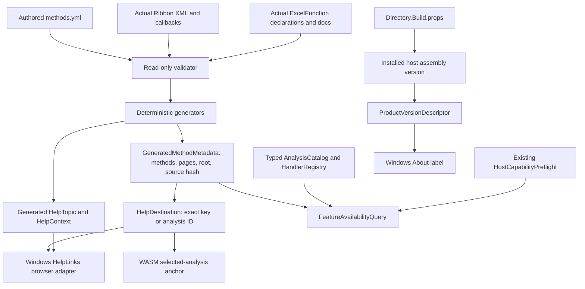

# Batch 03.05 — Common help, version and feature availability

Status: **IMPLEMENTED / PENDING OWNER REVIEW**, 21 October 2026. Owner passed the
original Windows/Online smoke. The version-first acceptance amendment below is
implemented and tested locally; documentation publication, activation and amended
live routing acceptance remain pending. No acceptance, commit or merge claimed.

## Checkout and source audit

Initial status was clean on local `main`, base
`7d08ad622d09fa277ecd899a7baf4949316c47ad` (`Stable safe presentation mapping`).
The owner confirms accepted/merged 03.04, Windows and Online smoke, restored
normal ANOVA/KW appearance and the three corrected validation-code regression
cases. All three are present in this checkout. The independent pre-edit Debug
gate confirms **2,838 passing**, including Common **638**, rather than the
pre-correction report's 635 / 2,835 total. A separate pre-edit Release baseline
was not rerun; both final configurations were run.

Created `codex/03-05` once from that clean base; HEAD remains the base SHA.
Git requires command-local
`-c safe.directory=C:/Users/peter/source/repos/BESHstatNG` because the sandbox
account has a different Windows SID. No global Git configuration changed.
The required `switch main` and `switch -c codex/03-05` needed explicit sandbox
approval because `.git` is read-only in the sandbox; both succeeded. No fetch,
pull, reset, stash, branch deletion or remote change occurred.

Read the root `AGENTS.md`, master plan including §2A/§2B and 03.05/03.06,
03.01 settings, 03.02 diagnostics, 03.03 execution and 03.04 fault reports;
catalog validator/generators/tests; Common metadata, descriptors, registrations,
IDs and capability preflight; Windows Help/HelpContext/HelpWiring, UibyID,
About and AppGlobals; build version attributes; MkDocs version configurations;
WASM Razor and lifecycle tests; existing verification runner.

The actual catalog has **76 methods, 2 utility pages, 2 linked Common IDs,
12 categories, 79 method/Ribbon mappings, 84 Ribbon buttons, 5 utility commands
and 79 curated navigation entries**. The UDF source remains 268 exports.
Before this batch Common already generated descriptive latest URLs and used
them for the two pilot descriptors. Windows independently generated relative
paths, tried `/v<assembly version>/`, synchronously probed the website, then
tried latest/home. Its generator inserted a UTC timestamp. About read the
installed Windows assembly and its BuildDate metadata. WASM had no selected
analysis Help link. Availability/preflight and typed handlers already existed.

The intended change inventory and compatibility approach were presented before
edits: additive Common contracts, generated utility metadata, deterministic
Windows generator/adapter, installed-version About adapter, small WASM Help
binding, focused tests and the report/plan. The narrow verification-runner
addition checks Windows generated output; `.gitignore` admits its new Python
test. No execution, UI layout, numerical or writer implementation changed.

## Authority and contract



`methods.yml` remains the only authored method/title/category/slug mapping.
Ribbon XML remains Windows callback authority, and source attributes remain
UDF export authority. The validator pins `site.baseUrl` to the existing trusted
HTTPS help root; this security constraint is not a second method mapping.
No runtime YAML, reflection-based catalog loading or new registry was added.

Additive public Common APIs, all with Option Explicit/Strict On:

| API | Contract |
|---|---|
| `GeneratedMethodMetadata.TryGetByKey` | Ordinal, null-safe counterpart to the existing throwing getter |
| `GeneratedMethodMetadata.Pages` | Read-only utility records, separate from the unchanged 76-method `All`; no analysis IDs |
| `SiteBaseUrl`, `HomeUrl`, `SourceRevision` | Generated trusted root, canonical latest home, YAML-byte SHA256 |
| `HelpDestination.ForMethodKey`, `ForAnalysisId`, `ForPageKey` | Immutable metadata/URL/fallback result; exact lookup, no caller string interpolation into URLs |
| `HelpDestination.TryMethodKey`, `TryAnalysisId` | Boolean lookup with a usable home-fallback result even on failure |
| `ProductVersionDescriptor.TryParse`, `FromVersion` | Immutable installed-version presentation; explicit unavailable result |
| `FeatureAvailabilityQuery.ByMethodKey`, `ByAnalysisId` | Immutable documentation/registration/concrete-host run-and-write projection, with reason code/text |

Help and availability results have no property setters. Existing and new
metadata collections are read-only wrappers over private arrays. Availability
does not retain the mutable host transport snapshot, create options, execute a
handler, read a workbook, log a payload or change execution/consent state.

## URL policy, compatibility and fallbacks

Compatibility URLs remain **canonical `/latest/`**. The amended launch policy is
**verify the exact running version's page, then the identical latest page**,
through the staged documentation-origin resolver described below. Installed
versions and `HelpVersion` do not establish deployment of `/v<four-part-version>/`.
`mkdocs.version.yml` describes a possible versioned build and
`mkdocs.latest.yml` describes latest; neither is a live deployment assertion.
No remote probing or documentation deployment was performed.

Examples:

```text
https://www.beshstat.eu/beshstatng/help/latest/methods/one-way-anova/
https://www.beshstat.eu/beshstatng/help/latest/methods/kruskal-wallis-test/
https://www.beshstat.eu/beshstatng/help/latest/global-settings/
https://www.beshstat.eu/beshstatng/help/latest/export-chart/
https://www.beshstat.eu/beshstatng/help/latest/
```

Known method keys and analysis IDs are separate, case-sensitive ordinal
identities. No trimming, case folding, display-title inference or ambiguous
match is attempted. Wrong namespace, unknown/null/empty input, whitespace,
path traversal, query/fragment text, Unicode spoof, JavaScript and external
URL input return home with `IsFallback=True`. Utility keys resolve only via
the separate page API. Known documentation-only methods keep their Help URLs.
Generated URLs retain the exact authored slugs and trailing slashes.

Windows retains public HelpTopic numeric order, BaseUrlRoot/FallbackBaseUrl,
GetUrl/OpenTopic/OpenUrl, generated Tag/title/form-class discrimination,
shared-form fallback and HelpWiring. GetUrl now delegates to Common. BaseUrl
is the latest root without a trailing slash, and generated destinations include
their normal trailing slash. OpenUrl accepts only exact generated method/page
URLs or home, plus strictly validated resolver queries only when activated,
replaces other input with home, and handles shell-launch failure.
The previous synchronous GET/HTML checks, URL cache and TLS changes were removed
at this boundary. While resolver activation is off, Help opens the relevant latest
page directly. After publication/activation, the native browser tab verifies
version/latest as described in the amendment; Excel never waits on HTTP probes.
Offline failures are handled in the browser, with no cached/offline website claim.

Automated comparison against `7d08ad6` proved **all 79 enum values/order and
relative paths identical**, and the entire HelpContext body identical apart
from its deterministic header. Only the versioned-first URL policy is corrected.
All 268 UDF declarations/HelpTopic attributes, Ribbon XML and UibyID are untouched.
Windows-only methods continue resolving through the full documented catalog.

WASM adds one ordinary anchor bound to the current ANOVA/KW enum through the
existing descriptor ID and Common resolver. It opens a separate tab with
`rel="noopener noreferrer"`, without an event handler, JS transport, execution
mutation, consent approval or task-pane navigation. No method selector expansion
or production Office navigation was added.

## Product version and source revision

`Directory.Build.props` remains unchanged at `BeshVersion=1.2.6.0`, deriving
Version/AssemblyVersion/FileVersion/InformationalVersion, BeshVersion3 for MSI
and HelpVersion. Existing SDK/Windows MSBuild version-attribute generation is
unchanged. No second authored version file, stale version cache, runtime props
file dependency or Common filesystem/process/network dependency was introduced.

The host supplies `System.Version` to `ProductVersionDescriptor.FromVersion`.
The parser requires exactly four ASCII unsigned decimal components in 0..65535,
rejects incomplete/negative/signed/overflow/whitespace/suffixed/spoofed values
and all-zero, and canonicalizes leading zeros. Valid display is
`Version 1.2.6.0`; invalid/missing is `Version unavailable` with empty product
version. Parsing/display is invariant under en-US/sk-SK. HelpRoutePolicy is
`verified-version-first` for available versions and `latest` for unavailable ones.
This describes desired policy; `HelpLaunchTarget.UsesResolver` separately records
whether the publication/activation gate actually permits resolver launching.

`AppGlobals.InstalledProductVersion` projects its actual executing assembly.
About uses the shared display label plus the existing actual BuildDate, yielding
the same normal label as before. `gAddinVersion`, update-check code, MSI,
branding, signing and installer behavior are unchanged. WASM does not display
an installed/released Office-add-in version claim. YAML SourceRevision is a
metadata provenance hash, distinct from installed product version, Git base
revision and published documentation route.

## Availability truth table and limits

`IsSupportedOnHost` specifically means the **existing Common pilot run-and-write
flow**, including selection and the requested destination. It is not a Windows
Ribbon support inventory. There is no new assertion of support for the other
74 documented methods or for any non-Excel product.

| Case | Documented | Common registered | Supported on concrete host | Reason |
|---|---:|---:|---:|---|
| ANOVA/KW, identified Windows host with required operations, new workbook | Yes | Yes | Yes | Existing preflight succeeds |
| ANOVA/KW, Office.js with required operations, current/new worksheet | Yes | Yes | Yes | Existing preflight succeeds |
| ANOVA/KW, Office.js new workbook, even if stale capability claims it | Yes | Yes | No | `output.destination-unsupported` |
| ANOVA/KW, missing selection/write capability | Yes | Yes | No | `host.capability-missing` |
| ANOVA/KW, missing destination capability / invalid destination | Yes | Yes | No | `output.destination-unsupported` / `output.target-invalid` |
| ANOVA/KW, absent/unidentified host | Yes | Yes | No | `host.unavailable` |
| Histogram/Box and Whiskers or another documentation-only method | Yes | No | No | `analysis.unsupported`; no executable Common registration |
| Unknown/malformed ID or unregistered planned ID | No | No | No | `analysis.unknown`, home Help fallback |
| GlobalSettings/ExportChart via method query | No method | No | No | Utility pages remain separate; page Help works |

The query requires ImplementedInCommon **and** real registry coverage for each
descriptor input type with matching options, then delegates all concrete host
rules to `HostCapabilityPreflight.CheckRunAndWrite`. Planned alone never supplies
a handler. Tests prove the existing registration validator rejects a planned
handler and that discovery cannot execute its options factory/handler.
The existing selector offers only the two pilots; documentation-only features
are never added as runnable choices. Consumers can disable unsupported features
using the returned Boolean and safe reason. Results remain unchanged if the
caller later mutates its host capability list.

No settings, diagnostic IDs, fault mapper, numerical calculations, typed inputs,
descriptors, dispatch, result/output/writer DTOs or overwrite semantics changed.
Core/Common retain netstandard2.0; Windows/legacy retain Framework 4.8.

## Original 03.05 deterministic generation and automated evidence

The original 2,888-test evidence below is retained as history. The acceptance
amendment and its current counts/evidence follow at the end of this report.

Both generators validate YAML and emit deterministic source; Windows headers now
use the YAML SHA256 instead of clock time. Windows `--check` compares both files
without creating files/directories or writing stale output. It is included in
the existing runner's Python preflight. Tests cover repeated byte-identical
generation, checked-in parity, absent/stale checks without mutation, all URLs,
all authored form discriminators, duplicate titles in different forms, rejected
conflicts and defensive ambiguous-title fallback. Existing UDF tests still
check 268 unique exports and complete/reproducible docs. The existing metadata
count assertion now distinguishes 76 method records and 2 separate page records;
no existing method count or behavior assertion was weakened.

| Suite | Accepted post-correction Debug baseline | Final Debug | Final Release | Added |
|---|---:|---:|---:|---:|
| Core | 1,024 | 1,024 | 1,024 | 0 |
| Common | 638 | 674 | 674 | 36 |
| Windows legacy | 767 | 771 | 771 | 4 |
| Office C# lifecycle | 27 | 32 | 32 | 5 |
| Office.js | 350 | 350 | 350 | 0 |
| Python (tools + MkDocs + runner) | 22+5+5 = 32 | 27+5+5 = 37 | 27+5+5 = 37 | 5 |
| **Distinct total** | **2,838** | **2,888** | **2,888** | **50** |

Final gates have **zero failures and zero skipped tests**. Both include WASM
build success. Both full solution builds also exited 0. Focused tests passed:
Common 36, Windows 4, Office C# 5, new Python 5 and existing metadata-generator 3.

Commands below were run from the repository root. The PATH `python.exe` alias
was inaccessible; subsequent preflights/gates used the existing Python 3.11.5
installation explicitly. No Python/package installation was attempted.
To keep restore offline, the shell environment set `NuGetAudit=false` and
`RestoreSources` to the existing repository `packages` directory. Thus no live
advisory retrieval was requested; NU1900 was not observed. The known legacy
UTA001 non-public `MatrixTestHelpers` discovery advisory remains, as do normal
TRX overwrite notices. Neither represents a functional failure.

```powershell
$pythonExe = 'C:\Users\peter\Desktop\WPy64-31150\python-3.11.5.amd64\python.exe'
$env:NuGetAudit = 'false'
$env:RestoreSources = (Join-Path (Get-Location) 'packages')
& $pythonExe -B .\BESHstatNG\tools\validate_methods_catalog.py
& $pythonExe -B .\BESHstatNG\tools\generate_analysis_metadata.py --check
& $pythonExe -B .\BESHstatNG\tools\generate_help_links.py --methods-yml .\BESHStatNG_Help_MkDocs\docs\_meta\methods.yml --project-dir .\BESHstatNG --check

# Pre-edit baseline (Debug only; default runner successfully discovered this Python).
powershell -NoProfile -ExecutionPolicy Bypass -File .\scripts\verify-beshstatng.ps1 -Legacy -Wasm -Js -Python -VisualStudio 2026 -Configuration Debug

# Final gates, each exited 0.
powershell -NoProfile -ExecutionPolicy Bypass -File .\scripts\verify-beshstatng.ps1 -Legacy -Wasm -Js -Python -VisualStudio 2026 -Configuration Debug -PythonExe C:\Users\peter\Desktop\WPy64-31150\python-3.11.5.amd64\python.exe
powershell -NoProfile -ExecutionPolicy Bypass -File .\scripts\verify-beshstatng.ps1 -Legacy -Wasm -Js -Python -VisualStudio 2026 -Configuration Release -PythonExe C:\Users\peter\Desktop\WPy64-31150\python-3.11.5.amd64\python.exe

# Focused checks (each final run passed).
dotnet test BESHStat.Excel.Common.Tests/BESHStat.Excel.Common.Tests.vbproj --no-restore --filter FullyQualifiedName~HelpVersionAvailabilityTests -c Debug
dotnet test BESHStat.WasmSmoke/tests/Execution/Execution.Tests.csproj --no-restore --filter FullyQualifiedName~HelpMetadataTests -c Debug
& $pythonExe -B -m unittest discover -s BESHstatNG/tools/tests -p 'test_help_metadata.py' -v
& $pythonExe -B -m unittest discover -s BESHstatNG/tools/tests -p 'test_generate_analysis_metadata.py' -v
& 'C:\Program Files\Microsoft Visual Studio\18\Community\MSBuild\Current\Bin\MSBuild.exe' BESHStatNG.Test/BESHStatNG.Tests.vbproj /t:Build /p:Configuration=Debug /p:PythonExe=C:\Users\peter\Desktop\WPy64-31150\python-3.11.5.amd64\python.exe /m /v:minimal /nologo
& 'C:\Program Files\Microsoft Visual Studio\18\Community\Common7\IDE\Extensions\TestPlatform\vstest.console.exe' BESHStatNG.Test/bin/Debug/BESHStatNG.Test.dll /TestCaseFilter:FullyQualifiedName~HelpMetadataTests '/Logger:trx;LogFileName=03-05-focused-legacy.trx' /ResultsDirectory:TestResults/Codex

# Full solution, approved Debug/Release workflow, each exited 0.
& 'C:\Program Files\Microsoft Visual Studio\18\Community\MSBuild\Current\Bin\MSBuild.exe' BESHStatNG.sln /t:Build /p:Configuration=Debug /p:PythonExe=C:\Users\peter\Desktop\WPy64-31150\python-3.11.5.amd64\python.exe /m /v:minimal /nologo
& 'C:\Program Files\Microsoft Visual Studio\18\Community\MSBuild\Current\Bin\MSBuild.exe' BESHStatNG.sln /t:Build /p:Configuration=Release /p:PythonExe=C:\Users\peter\Desktop\WPy64-31150\python-3.11.5.amd64\python.exe /m /v:minimal /nologo
```

Development failures were corrected before the final gates: a new Python test
initially rejected repeated same-method form associations; a C# call initially
used `out` for VB ByRef and was changed to `ref`; the first full Debug attempt
stopped on a new utility-record assertion that also counted the array declaration.
The corrected assertion counts actual records. The focused checks and full gates
were rerun successfully; there are no unresolved failures attributed to this batch.

Local ignored evidence is retained under `TestResults/Codex/`: `03-05-baseline-debug.log`,
`03-05-debug-attempt1.log`, `03-05-debug.log`, `03-05-release.log`,
`03-05-focused-*.log`, `03-05-solution-debug.log`, `03-05-solution-release.log`.
Per-configuration TRX copies are in `03-05-Debug/` and `03-05-Release/`.
The local `audit-03-05.py` compares accepted-base Help enum/relative paths/context
body; its check passed. These logs/helpers are review evidence, not new runners.

Packed artifacts verified after full solution builds:

| Path under `BESHstatNG/bin/` | Architecture | Bytes |
|---|---|---:|
| `Debug/BESHStatNG-AddIn-packed.xll` | x86 | 1,944,576 |
| `Debug/BESHStatNG-AddIn64-packed.xll` | x64 | 1,870,336 |
| `Release/BESHStatNG-AddIn-packed.xll` | x86 | 1,876,480 |
| `Release/BESHStatNG-AddIn64-packed.xll` | x64 | 1,802,240 |

No packed add-in was installed, signed or loaded into Excel. No live website,
browser, Excel, updater, installer or publishing test was run.

## Original 03.05 changed paths (before the acceptance amendment)

21 source/documentation paths; initial Git status clean, original handoff intentionally
dirty on `codex/03-05`, with 14 modified and 7 new files. None staged or committed.

```text
.gitignore
BESHStat.Excel.Common.Tests/src/HelpVersionAvailabilityTests.vb (new)
BESHStat.Excel.Common/src/Analysis/GeneratedMethodMetadata.vb (generated)
BESHStat.Excel.Common/src/Infrastructure/FeatureAvailability.vb (new)
BESHStat.Excel.Common/src/Infrastructure/HelpVersion.vb (new)
BESHStat.WasmSmoke/Pages/Home.razor
BESHStat.WasmSmoke/tests/Execution/HelpMetadataTests.cs (new)
BESHStatNG.Test/BESHStatNG.Tests.vbproj
BESHStatNG.Test/src/HelpMetadataTests.vb (new)
BESHstatNG/src/AppInfrastructure/AppGlobals.vb
BESHstatNG/src/Help/HelpContext.vb (generated)
BESHstatNG/src/Help/HelpLinks.vb (generated)
BESHstatNG/src/UI/Ui11AboutAddin.vb
BESHstatNG/tools/generate_analysis_metadata.py
BESHstatNG/tools/generate_help_links.py
BESHstatNG/tools/tests/test_generate_analysis_metadata.py
BESHstatNG/tools/tests/test_help_metadata.py (new)
BESHstatNG/tools/validate_methods_catalog.py
docs/architecture/batch-03-05-help-version-feature-metadata.md (new)
planning/BESHStatNG_CrossPlatform_MasterPlan.md
scripts/verify-beshstatng.ps1
```

Original handoff hygiene commands used the same command-local Git ownership setting:
`git diff --check`, `git status --short`, `git diff --stat`. The status inventory
includes untracked new files; ordinary `git diff --stat` describes tracked changes
only. Generated VersionAttributes may produce an existing CRLF normalization
notice during Git inspection but has no content change or final modified status.
That diff check exited 0; status matched the 21-path original inventory above.
The tracked-only stat was 14 files, 161 insertions and 464 deletions; seven new
files remain untracked for owner review. Post-build catalog and both generator
checks also passed, as did the 79-topic accepted-base comparison.

## Owner acceptance still required

The owner reports the following original checklist passed. This is owner-reported
live smoke, not automated validation. The amendment's new routing acceptance
matrix below remains pending publication and activation:

1. **Windows Help:** open ANOVA and KW in UibyID; each Help button must open the
   matching method URL above. Record the URL and a screenshot if mismapped.
   Also open a Windows-only method, a shared-form title variant, Settings or
   Export Chart and general Help; unknown form/title should fall back to home.
2. **Windows compatibility:** About must show the actual installed four-part
   version and build date. Compare ANOVA/KW against the already accepted layout:
   no demo checkbox/extra row; real Cancel/status remains. Run valid ANOVA and KW
   to a new worksheet and compare output. No updater/installer behavior change.
   Optionally disconnect briefly: Help resolution must not block Excel on a
   website probe; the browser may report offline. Full website offline use is
   not an acceptance claim.
3. **Excel Online Help:** select ANOVA, open Help, switch to KW and open Help;
   verify the two exact destinations, separate browser context and preserved task
   pane. Only the existing supported pilot analyses are runnable.
4. **Excel Online execution/consent:** run one valid analysis, check ordinary
   output and occupied-output No/Yes behavior. Opening Help must not approve
   stale overwrite consent or change a Completed write's status.

The acceptance gate remains accurate availability, one authored help mapping,
deterministic output, truthful version/help routing and successful owner Windows
and Online UI/output checks.

## Planning checkpoint and retained fixture

Revision 1.5 is **223 total / 31 accepted / 192 outstanding**. 03.04 is
COMPLETE / ACCEPTED / MERGED by owner confirmation, including fault-code
corrections and restored ordinary UI. 03.05 is IMPLEMENTED / PENDING OWNER
REVIEW. Gate B E1–E7 remain intact. Historical validation notes were preserved.

03.06, Phase 04 and all 75 Phase 04A batches are unstarted. No commit, push,
PR, merge, deployment, release, installation, signing, version increment or
framework change was performed.

The hidden Windows `SyntheticFixtureAsync`, `DeveloperFixtureEnabled`,
`BESHSTAT_DEV_EXECUTION_FIXTURE` opt-in and artificial timers are unchanged.
They remain temporarily necessary for the already planned 03.06 responsive
close/disposal smoke. Their mandatory removal before 03.06 acceptance / Phase 03
exit is preserved in the plan, including retirement of fixture-only tests and
changing source assertions to require absence. The new 03.05 source test also
must change at that gate. Preserve production Cancel/status, normal dimensions,
UI-thread ownership and fault/write protections. The owner's accepted screenshots
already establish that visible demo controls/extra row are gone; this batch does
not reintroduce them or claim live revalidation of that appearance.

## 03.05 version-first Help acceptance amendment

This section supersedes the original latest-only launch policy and original
handoff inventory/counts above. It is an amendment to the existing uncommitted
03.05, not 03.06 or another batch. Initial amendment status was exactly the
expected **14 modified / 7 new unstaged paths** on existing `codex/03-05`, HEAD
`7d08ad622d09fa277ecd899a7baf4949316c47ad`. Read-only branch/status/log/diff checks
passed; all original pending work was preserved. No branch creation/switch,
cleanup, snapshot overlay, reset or remote operation was performed.

The owner reports that the **original Windows and Online 03.05 smoke passed**.
The routing correction below is implemented/tested locally. Its site component
is **NOT DEPLOYED by this task**, and its live version-first smoke is **NOT
PASSED/CLAIMED**. Final default builds deliberately retain latest launching
until the owner publishes/verifies the resolver and authorizes activation.

### Shared browser architecture and request flow

```mermaid
sequenceDiagram
    participant H as Windows Help or native Office anchor
    participant C as Common pure launch plan
    participant B as New browser tab at documentation origin
    participant S as Same-origin published documents
    H->>C: Known identity + actual running assembly version
    alt Publication flag off, invalid version or unknown identity
        C-->>H: Compatible latest page (unknown -> latest home)
        H->>B: Native browser launch; no host HTTP
    else Published resolver explicitly activated
        C-->>H: Trusted resolver URL with version + catalog key
        H->>B: Native browser launch; no async popup
        B->>S: Exact version page HEAD then bounded GET identity check
        alt Exact page confirmed
            B->>B: replace(exact version page)
        else Missing, redirect, unusable or timed out
            B->>S: Identical latest page HEAD/GET check
            alt Latest page confirmed
                B->>B: replace(identical latest page)
            else Also unavailable
                B->>B: Accessible unavailable state + trusted home link
            end
        end
    end
```

The chosen source is an **unlisted standalone static HTML file**,
`BESHStatNG_Help_MkDocs/docs/help-resolver/index.html`, plus two local modules.
Required publication URL:
`https://www.beshstat.eu/beshstatng/help/latest/help-resolver/`.
MkDocs copies the HTML unchanged, preserving the module script at
`../assets/javascripts/help-resolver.mjs`; its generated `help-routes.mjs` import
resolves under the same latest assets root. The page is not processed by the
Material layout or instant-navigation system. Navigation order, 76 methods,
two utilities and 79 ordered Windows topics remain unchanged.

`generate_help_resolver_routes.py` validates the existing YAML and deterministically
projects its method/utility keys and exact relative paths, plus Home, into frozen
browser data using the trusted authored site root and source hash. There is no
hand-curated second mapping. Existing Common generated metadata bytes and its
generator are unchanged by this amendment; `--check` still passes. HelpContext's
body and enum identities/relative paths still match accepted base.

HelpDestination.Url, ForMethodKey/ForAnalysisId/ForPageKey and Try semantics
remain unchanged. New immutable HelpLaunchTarget, exposed through
HelpDestination.GetLaunchTarget, supplies latest/home, exact version candidate,
resolver candidate, actual launch URL and UsesResolver. Unknown/null identities
have only latest home and no version candidate. Explicit CreateHome supports
version-first home checking. These APIs perform no network, filesystem, YAML
loading, process/browser work, options creation or analysis execution. Feature
availability and descriptor/handler registrations are unchanged.

ProductVersionDescriptor keeps its four-part validation and display. Desired
policy is now `verified-version-first` for an available version, `latest` otherwise;
that is distinct from activation. Windows uses the actual installed
AppGlobals.InstalledProductVersion. The WASM pilot reads
`typeof(App).Assembly.GetName().Version`, generated through existing build
metadata. No hardcoded Office/product version, runtime props read or source hash
is used as the version. BeshVersion remains **1.2.6.0**; MSI, HelpVersion,
framework targets, About version/build date and update behavior are unchanged.

Windows GetUrl remains the compatible latest URL for every existing topic.
New generated GetLaunchUrl uses the shared plan; OpenTopic opens it through
OpenUrl. The latter still uses an exact Common allowlist, with only canonical
known-route resolver queries admitted after activation; arbitrary HTTPS or raw
version URLs are not accepted. There is no synchronous HTTP on Excel's UI thread.
The Office anchor remains native `_blank` with `noopener noreferrer`, now bound
to GetLaunchTarget's URL. It has no click handler, async popup, task-pane fetch,
navigation callback or execution/consent coupling.

### Verification, trust and failure rules

Only `?version=<canonical four-part ASCII value>&route=<known exact key>` is
accepted, in that order. No decoding is performed. Percent escapes, separators,
paths, URLs, extra/duplicate/reordered parameters, fragments, backslashes, Unicode
spoofs, prototype names and unknown keys cannot supply a destination. Host/domain
data are never accepted. Valid versions select **only that exact version**, never
a previous/nearby publication. Invalid/missing version in Common goes directly
to the corresponding latest page without a resolver/version candidate.

The browser checks the exact resolver origin/path before probing, preventing
checks from another origin or local preview. Requests are same-origin, no-store,
credentials omitted, no-referrer, with redirects rejected. No `no-cors` or opaque
status approximation is used. HEAD checks the **specific page**, never its version
root. A 200 HEAD is followed by GET because it cannot detect a custom HTTP-200
404 by itself. HEAD 405/501 also uses bounded GET; other failures fall back.
Both responses must identify the exact final URL without redirect, and GET must
be HTTP 200 HTML with the exact canonical URL, a Material document article and
nonempty, non-error heading. Opaque/malformed/non-HTML/empty/error/landing responses
and over-512-KiB bodies are not confirmation.

HEAD, GET and streaming body share one **1,500 ms abortable deadline per candidate**,
at most two candidates / approximately three seconds plus browser scheduling.
The timeout race completes even if an injected transport ignores abort. Verified
pages open with location.replace in the already opened tab. If neither page is
confirmed, the resolver stays accessible with an offline/unavailable message and
latest home link, avoiding loops. Without JavaScript, the static latest home link
and noscript explanation remain. If the resolver HTML cannot load offline, the
browser may show its ordinary offline failure; host execution never waits on HTTP.

Hosting ambiguity is an explicit publication check: a server which fabricates
both a matching canonical URL and a normal Material heading on an HTTP-200 error
can defeat those signals. Accurate canonicals/statuses must be verified before
activation. Old version pages without accurate canonical identity are conservatively
unconfirmed. Unexpected redirects, even benign server rewrites, are rejected.
No live server route, MIME, CSP or legacy-page behavior was tested.

### Publication dependency and staged activation

Default `BeshHelpResolverPublished=false` in Directory.Build.props defines a single
Common compilation flag consumed by both hosts. True/false validation rejects
other build values. This adds no runtime cache, environment setting or visible
product control. Unit seams can project either policy; production UI uses the
shared compiled flag. Final Debug/Release binaries were inspected: both have
**ResolverPublished=False**. Temporary activated tests were followed by normal
full gates and solution builds.

The owner must publish the latest resolver HTML and **both modules**, retaining
existing version directories, through the existing publication workflow. No new
version directory or DNS change is required. Verify HTTP 200, canonical www origin,
JavaScript MIME for `.mjs` and same-origin script/connect CSP. Test direct resolver
version/missing-page cases before building both hosts with
`BeshHelpResolverPublished=true`. The default prevents release-facing clicks from
reaching an unpublished resolver 404. Readiness/activation/rollback instructions
are in `BESHStatNG_Help_MkDocs/README.md`. **Publication and live routing acceptance
are owner dependencies; this task neither deploys nor marks those checks passed.**

### Current local validation evidence

All original 2,888 cases remain covered; only intentionally superseded latest-only
policy/binding assertions changed to version-first staging. Original version
validation, latest compatibility and UI/privacy assertions were retained.

| Suite | Original 03.05 | Amended Debug | Amended Release | Added |
|---|---:|---:|---:|---:|
| Core | 1,024 | 1,024 | 1,024 | 0 |
| Common | 674 | 708 | 708 | 34 |
| Windows legacy | 771 | 774 | 774 | 3 |
| Office C# lifecycle | 32 | 36 | 36 | 4 |
| Office.js | 350 | 350 | 350 | 0 |
| Documentation resolver Node | 0 | 71 | 71 | 71 |
| Python (tools + MkDocs + runner) | 27+5+5 = 37 | 27+9+5 = 41 | 27+9+5 = 41 | 4 |
| **Distinct total** | **2,888** | **3,004** | **3,004** | **116** |

Both full gates exited 0 with **zero failures/skips**, including successful WASM
builds. Both complete solution builds exited 0. The standalone final local MkDocs
latest build exited 0. Python tests additionally build a fresh temporary site,
prove preserved static HTML/module paths and execute the browser document verifier
on **all 79 actual built documents** plus the generated 404. Node fake-HTTP/navigation
cases cover exact 1.2.5.0/1.2.6.0 pages, pilots, utilities, Windows-only method/home,
status/redirect/custom-404/root-only/HEAD-fallback/body/timeouts, latest missing and
URL injection. No test uses live HTTP or Excel data.

Focused suites passed: Common help/launch 70, Windows help 7, Office help 9,
documentation Python 4. Activated builds using BeshHelpResolverPublished=true
also passed Common 70, Office 9 and Windows 7; reflection verified true before
normal builds restored false. These are local activation tests, not publication
or live acceptance. A preliminary Common run caught the old expected `latest`
policy assertion; it was changed to the required policy plus explicit inactive/
latest assertions, then rerun successfully. No unresolved test/tooling failure.

Exact final commands (existing Python and offline restore; no installs):

```powershell
$env:NuGetAudit = 'false'
$env:RestoreSources = (Join-Path (Get-Location) 'packages')
$pythonExe = 'C:\Users\peter\Desktop\WPy64-31150\python-3.11.5.amd64\python.exe'
powershell -NoProfile -ExecutionPolicy Bypass -File .\scripts\verify-beshstatng.ps1 -Configuration Debug -Legacy -Wasm -Js -Python -VisualStudio 2026 -PythonExe C:\Users\peter\Desktop\WPy64-31150\python-3.11.5.amd64\python.exe
powershell -NoProfile -ExecutionPolicy Bypass -File .\scripts\verify-beshstatng.ps1 -Configuration Release -Legacy -Wasm -Js -Python -VisualStudio 2026 -PythonExe C:\Users\peter\Desktop\WPy64-31150\python-3.11.5.amd64\python.exe
& $pythonExe -B BESHstatNG/tools/validate_methods_catalog.py
& $pythonExe -B BESHstatNG/tools/generate_analysis_metadata.py --check
& $pythonExe -B BESHstatNG/tools/generate_help_links.py --methods-yml BESHStatNG_Help_MkDocs/docs/_meta/methods.yml --project-dir BESHstatNG --check
& $pythonExe -B BESHStatNG_Help_MkDocs/generate_help_resolver_routes.py --check
& $pythonExe -B -m mkdocs build --config-file BESHStatNG_Help_MkDocs/mkdocs.latest.yml
node --test BESHStatNG_Help_MkDocs/tests/help-resolver.test.mjs
& $pythonExe -B -m unittest discover -s BESHStatNG_Help_MkDocs/tests -p test_help_resolver.py -v
& 'C:\Program Files\Microsoft Visual Studio\18\Community\MSBuild\Current\Bin\MSBuild.exe' BESHStatNG.sln /t:Build /p:Configuration=Debug /p:PythonExe=C:\Users\peter\Desktop\WPy64-31150\python-3.11.5.amd64\python.exe /m /v:minimal /nologo
& 'C:\Program Files\Microsoft Visual Studio\18\Community\MSBuild\Current\Bin\MSBuild.exe' BESHStatNG.sln /t:Build /p:Configuration=Release /p:PythonExe=C:\Users\peter\Desktop\WPy64-31150\python-3.11.5.amd64\python.exe /m /v:minimal /nologo
```

Focused/activated runs used existing projects sequentially: dotnet test with
`--no-restore -c Debug`, the Common filter
`FullyQualifiedName~HelpVersionAvailabilityTests|FullyQualifiedName~HelpLaunchTargetTests`
and Office filter `FullyQualifiedName~HelpMetadataTests`. Activated reruns added
`-p:BeshHelpResolverPublished=true`. Windows used the existing test-project MSBuild
and VSTest commands with `/TestCaseFilter:FullyQualifiedName~HelpMetadataTests`;
the activated build added `/p:BeshHelpResolverPublished=true`. The runner invokes
the route-generator check under Python and the documentation Node suite under Js.

Local evidence under `TestResults/Codex/` has prefix `03-05-amendment-`:
`debug.log`, `release.log`, `solution-debug.log`, `solution-release.log`, `mkdocs.log`,
`focused-*.log`, `activated-*.log`; TRX copies are in `03-05-amendment-Debug/` and
`03-05-amendment-Release/`. Standard UTA001 MatrixTestHelpers and TRX overwrite
notices remain; NU1900 was not observed with advisory retrieval disabled. MkDocs
reports the pre-existing unlisted `methods/family-link-covmat.md` informational note.

Final packed artifacts under `BESHstatNG/bin/`:

| Path | Architecture | Bytes |
|---|---|---:|
| `Debug/BESHStatNG-AddIn-packed.xll` | x86 | 1,944,064 |
| `Debug/BESHStatNG-AddIn64-packed.xll` | x64 | 1,869,824 |
| `Release/BESHStatNG-AddIn-packed.xll` | x86 | 1,876,480 |
| `Release/BESHStatNG-AddIn64-packed.xll` | x64 | 1,802,240 |

### Combined pending inventory and owner acceptance

All 21 original paths remain; 11 additional paths bring the combined pending
inventory to **32 paths: 17 modified / 15 new, unstaged**. Exact combined inventory:

```text
.gitignore
BESHStat.Excel.Common/BESHStat.Excel.Common.vbproj
BESHStat.Excel.Common.Tests/src/HelpLaunchTargetTests.vb (new)
BESHStat.Excel.Common.Tests/src/HelpVersionAvailabilityTests.vb (new)
BESHStat.Excel.Common/src/Analysis/GeneratedMethodMetadata.vb (generated; original 03.05 bytes retained)
BESHStat.Excel.Common/src/Infrastructure/FeatureAvailability.vb (new; original 03.05 retained)
BESHStat.Excel.Common/src/Infrastructure/HelpLaunchTarget.vb (new)
BESHStat.Excel.Common/src/Infrastructure/HelpVersion.vb (new)
BESHStat.WasmSmoke/Pages/Home.razor
BESHStat.WasmSmoke/tests/Execution/HelpMetadataTests.cs (new)
BESHStatNG.Test/BESHStatNG.Tests.vbproj
BESHStatNG.Test/src/HelpMetadataTests.vb (new)
BESHStatNG_Help_MkDocs/README.md
BESHStatNG_Help_MkDocs/docs/assets/javascripts/help-resolver.mjs (new)
BESHStatNG_Help_MkDocs/docs/assets/javascripts/help-routes.mjs (new; generated)
BESHStatNG_Help_MkDocs/docs/help-resolver/index.html (new)
BESHStatNG_Help_MkDocs/generate_help_resolver_routes.py (new)
BESHStatNG_Help_MkDocs/tests/help-resolver.test.mjs (new)
BESHStatNG_Help_MkDocs/tests/test_help_resolver.py (new)
BESHstatNG/src/AppInfrastructure/AppGlobals.vb
BESHstatNG/src/Help/HelpContext.vb (generated; original 03.05 retained)
BESHstatNG/src/Help/HelpLinks.vb (generated)
BESHstatNG/src/UI/Ui11AboutAddin.vb
BESHstatNG/tools/generate_analysis_metadata.py
BESHstatNG/tools/generate_help_links.py
BESHstatNG/tools/tests/test_generate_analysis_metadata.py
BESHstatNG/tools/tests/test_help_metadata.py (new)
BESHstatNG/tools/validate_methods_catalog.py
Directory.Build.props
docs/architecture/batch-03-05-help-version-feature-metadata.md (new)
planning/BESHStatNG_CrossPlatform_MasterPlan.md
scripts/verify-beshstatng.ps1
```

After publication and explicit activation, verify both Windows and Online against
the same matrix. Direct resolver queries verify site readiness first; actual host
smoke must use the running build's assembly version.

| Installed/build version | Specific page published? | Expected final browser destination |
|---|---|---|
| 1.2.5.0 | ANOVA and KW published | Matching `/v1.2.5.0/methods/one-way-anova/` and `/v1.2.5.0/methods/kruskal-wallis-test/` |
| 1.2.6.0 | Exact page absent, latest present | Matching `/latest/methods/…/` |
| Valid version | Only version root exists; method absent | Matching `/latest/methods/…/`, never version root |
| Invalid/unavailable version | Not applicable | Corresponding `/latest/…/` directly |
| Unknown/malformed identity | Not applicable | Trusted latest Help home |
| Valid version | Both pages absent/unconfirmed | Resolver unavailable state and trusted latest home link |
| Slow/offline | Cannot verify | Bounded fallback/safe browser failure; Excel remains responsive |

Also verify utility/Home and Windows-only/shared-form routes, canonical www origin,
native separate-tab Office launching after selection changes, actual About/build
date, normal ANOVA/KW layout/output and unchanged overwrite/Completed state. Do
not count original latest-link smoke as proof of live version-first operation.
Publication, activation and this matrix remain **pending owner action**.

Final scope remains 03.05 pending owner acceptance, **223 total / 31 accepted /
192 outstanding**. Gate B E1–E7 and mandatory 03.06 hidden-fixture removal are
unchanged. 03.06, Phase 04/04A were not started. No commit, push, merge, signing,
MSI install, upload, remote probing or site deployment occurred.

Final command-local Git diff check exited 0; short status matched the 32-path
inventory, with no staged files. The tracked-only diff stat is 17 files,
277 insertions / 460 deletions; 15 new files remain untracked for owner review.
Catalog and all three generator checks pass after the full builds. The accepted-base
comparison again confirms 79 ordered topics/relative paths and the unchanged
HelpContext body; version-aware launch is a separate additive API.
