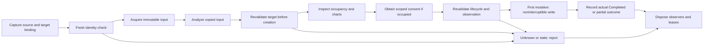

# Batch 03.06 — document lifecycle and Windows fixture removal

Status: **IMPLEMENTED / PENDING OWNER REVIEW**; **not owner-accepted**.
The named Phase 03 exit smoke gate is **Restored ANOVA/KW appearance and actual output**.
No Phase 04 or Phase 04A work is included.

## Source and initial audit

Accepted local `main` base: `8bbf15a3316a34eb492b28cdf8a4e8264f56e2d2`.
Initial `git status --short` and `--porcelain`: empty. Initial branch: `main`.
Recent commits included `8bbf15a` (plan) and `44354e5` (accepted 03.05).
Verified tracked resolver modules/page, route generator/tests, `mkdocs_hooks.py`,
persistent base-config registration, wrapper failure handling, and MIME tests
before creating `codex/03-06`. The branch did not previously exist. No fetch,
pull, rebase, reset, stash, commit, push, merge, signing, installer or deployment.
Git required the command-local safe-directory override below. Sandbox approval
was required for `.git/index.lock` and creating the branch; no global Git config
or repository ACL was changed.

Read `AGENTS.md`, the master plan including §10 and the mandatory Phase 03 exit
criterion, Gate B E1–E7, and the 03.03–03.05 reports. Inspected range identity,
execution, diagnostics, capability, write-intent/consent/outcome, target/layout
and associated tests; Windows UibyID, importer, RefEdit event ownership, host
infrastructure, native/shared writers; Office bridge, Home, execution adapter,
acquisition/range/overwrite/execution tests; version props and verification script.

Findings before edits:

- Common already carried optional identities/revisions, immutable consent and
  authoritative output states. It lacked an operation-owned lifecycle binding.
- Windows RefEdit owned `Workbook.SheetActivate` behavior, but there was no
  run-wide lifecycle observer. ANOVA/KW retained real Cancel/status and the UI
  synchronization context; target COM objects were retained only after output
  resolution. The importer resolved sheet-qualified strings in the active book.
  The hidden Windows environment opt-in and 50 × 100 ms fixture remained.
- Office had private, single-use, five-minute document/sheet/fingerprint consent,
  but no acquisition-to-write lease or component-owned event subscriptions.
  `workbookId` was unknown; worksheet IDs and the actual Office document object
  were usable. No physical workbook ID or selection revision could be invented.

The audit/inventory and proposed host-faked seams were presented before source
edits. Baseline totals must include the accepted MIME amendment's seven added
Python documentation tests: the prior full Debug evidence totals 3,011
(1,024 Core / 708 Common / 774 legacy / 36 Office C# / 350 Office JS /
71 resolver JS / Python 27 + 16 + 5), rather than the earlier 3,004 checkpoint.
This is the accepted-checkpoint evidence, not a fresh checkout-before-edit test run.

## Ownership and changed paths

All paths below are relative to the repository root. No statistical module,
existing frozen request/result JSON, framework target, catalog, Help routing,
resolver activation, signing or publication settings are changed.

| Path | Responsibility |
| --- | --- |
| `BESHStat.Excel.Common/src/Host/DocumentLifecycle.vb` | Immutable bounded snapshot, explicit status/reasons, sticky operation lease, typed safe exception |
| `BESHStat.Excel.Common/src/Results/Faults.vb` | Whitelisted lifecycle presentation; mutation/Completed precedence retained |
| `BESHStat.Excel.Common.Tests/src/DocumentLifecycleTests.vb` | Identity, selection, isolation, unknown, bounds, disposal and execution compatibility |
| `BESHstatNG/src/AppInfrastructure/WindowsDocumentLifecycle.vb` | Scoped native event owner, object membership reconciliation and injected observation/subscription seams |
| `BESHstatNG/src/AppInfrastructure/WindowsExecutionRun.vb` | Lease checks/cleanup; Windows fixture and unused Tasks import removed |
| `BESHstatNG/src/UI/UibyID.vb` | Capture before yield, acquisition guard, pinned destination, lifecycle integration, disposal safeguards, fixture invocation removed |
| `BESHstatNG/src/DM/ResultWriter/ExcelDnaSharedOutputPlanAdapter.vb` | Native lifecycle callback before acquisition/inspection, stale-consent failure projection |
| `BESHstatNG/BESHStatNG.vbproj` | Include new native adapter |
| `BESHStatNG.Test/src/DocumentLifecycleAdapterTests.vb` | Host-faked identities/events, cleanup, independent destinations, UI-thread rejection |
| `BESHStatNG.Test/src/DataManagement/SharedOutputPlanTests.vb` | Real orchestration rejects before creation and after cell/chart consent |
| `BESHStatNG.Test/src/ExecutionAdapterTests.vb` | Retire five opt-in-only cases; require fixture absence while retaining production execution assertions |
| `BESHStatNG.Test/src/HelpMetadataTests.vb` | Fixture absence at accepted UI/Help boundary |
| `BESHStatNG.Test/BESHStatNG.Tests.vbproj` | Include native lifecycle tests |
| `BESHStat.WasmSmoke/wwwroot/js/officeBridge.js` | Bounded JS leases, genuine capability-gated events, target/source revalidation, scoped consent invalidation and cleanup |
| `BESHStat.WasmSmoke/Infrastructure/OfficeDocumentLifecycle.cs` | Component/run-owned scope, safe late-callback guard, one cleanup delegate |
| `BESHStat.WasmSmoke/Infrastructure/OfficeExecutionRun.cs` | Checkpoints, acquisition and terminal-aware notification/cleanup integration |
| `BESHStat.WasmSmoke/Pages/Home.razor` | Async disposal, guarded UI callbacks, metadata-only acquisition handoff, leased pilot writes and previews |
| `BESHStat.WasmSmoke/tests/documentLifecycle.test.cjs` | Supported/unsupported APIs, native event/registration/removal failures, races, tokens, identity and outcome tests |
| `BESHStat.WasmSmoke/tests/helpers/recordingWorkbook.cjs` | Realistic getItem/selected-range/context overload and event mocks; default trace compatibility preserved |
| `BESHStat.WasmSmoke/tests/Execution/OfficeDocumentLifecycleTests.cs` | Disposal during acquisition/consent/write, late notification, cleanup and fresh runs |
| `BESHStat.WasmSmoke/tests/Execution/Execution.Tests.csproj` | Link scope implementation into host-free C# tests |
| `planning/BESHStatNG_CrossPlatform_MasterPlan.md` | Accepted 03.05 reconciliation; 223 total / 32 accepted / 191 outstanding; 03.06 pending owner smoke |
| `docs/architecture/batch-03-06-document-lifecycle.md` | Audit, policy, verification and owner handoff |

## Identity and lifecycle policy



This coordinates the existing ExecutionCoordinator; it is not another execution
state machine. Common keeps no COM/Office/UI objects, worksheet values, filesystem
or network state. Snapshots contain bounded opaque workbook/context/sheet IDs,
display/name-addressing metadata, immutable coordinates and optional revision.
Empty identity never proves equality. Optional context identity proves only a
host session object's continuity and is explicitly distinct from workbook ID.
Invalidation is sticky and operation-owned; repeated invalidation/disposal is
idempotent. Independent operations/documents do not share mutable lease state.

| Binding | Selection changes | Rename/delete/replacement/unknown |
| --- | --- | --- |
| Explicit pinned RefEdit/A1 source | Other cell selection is benign; read original coordinates or reject unsafe acquisition | Conservatively reject until refreshed; never resolve a same-name replacement |
| Volatile active-selection source/areas before copying | Event invalidation or bounded coordinate reconciliation rejects changed selection | Reject unknown/stale identity |
| Copied immutable input | Analysis may continue after selection changes; no reread or retarget | Original document/sheet still revalidated; source removal/name change is conservatively rejected |
| Pinned output | Selection/activation alone does not retarget it | Revalidate original ID, name, writability, bounds and occupancy immediately before mutation |

Common volatile references require a verified selection revision; missing revision
is unavailable. Office does **not** populate such a revision. Its host adapter
instead checks actual selection coordinates before the copy, plus supported
events, while Common/C# guards the resulting immutable snapshot and context.
This does not claim atomic multi-chunk input or detection of every transient
change when Office has no event/revision support. All writes independently
revalidate their destination and occupancy; a copied input is never write consent.

## Windows adapter and cleanup

The pilot validates and captures source worksheet/workbook, immutable native
RefEdit source/group address strings, and destination COM objects before the
existing production `Task.Yield()`. RefEdit workbook ownership is respected.
Disabled controls alone do not freeze RefEdit's host-event updates: acquisition
uses the run's once-bound addresses, not a later live control value. The existing
address grammar (including disjoint columns) remains in the original importer.
Native address metadata is bounded to 16,384 characters per reference and cleared
on run disposal; a disposed/already-bound run cannot bind again.
The legacy importer remains unchanged; before acquisition and each column import,
the pilot verifies that its source workbook is still active, rejecting an unsafe
switch rather than reading another book's same-named sheet. After copying, pinned
output may still use the verified original book even if another book became active.

Physical identities reuse salted `TargetIdentity` hashes of apartment-local
IUnknown identity. Names and workbook filenames are not physical identities.
Every boundary reconciles the retained objects against the actual Workbooks and
Worksheets collections, with 256-book / 4,096-sheet safety bounds. Membership,
name and identity uncertainty fail closed. No raw native pointers or workbook
paths/values are added to diagnostics. The pilot's pre-existing raw exception
logging is replaced with mapped code/run/stage metadata so native exception
messages cannot enter its default log. Existing run correlation is retained.

Native subscriptions belong to the live pilot run, not an add-in singleton.
All capture/revalidation/detach work stays on the captured Excel/WinForms thread.
Unexpected event threads invalidate metadata without COM. Metadata enumeration is
guarded; detached listeners and disposed leases ignore late events. Every native
detach is attempted on completion, failure or form disposal. Borrowed/shared RCWs
are not manually released. If native hookup fails, partial subscriptions are
removed and object reconciliation remains mandatory. No timer, background COM,
global event framework or additional message pump is introduced.

Current-sheet output uses the captured sheet. NewWorksheet pins the captured
owner workbook. NewWorkbook uses the object returned from Workbooks.Add, then
binds the created workbook/sheet. Intentional creation activation is benign to
pinned bindings. The form does not reread ActiveWorkbook or RefEdit to pick an
output destination after yielding/creation. Preflight, protection/merge checks,
cell overwrite and separate chart-overlap confirmation retain their existing rules.

## Host event support and Office fallback

| Host signal | Supported seam/API | Policy |
| --- | --- | --- |
| Windows workbook close | AppEvents.WorkbookBeforeClose(Workbook, ByRef Boolean) | Invalidate matching bound book; a cancelled close still requires a fresh run |
| Windows workbook deactivation | AppEvents.WorkbookDeactivate(Workbook) | Pinned owners remain pinned; no output retarget |
| Windows sheet deletion | AppEvents.SheetBeforeDelete(Object) | Invalidate matching physical sheet |
| Windows selection | AppEvents.SheetSelectionChange(Object, Range) | Pinned RefEdit coordinates ignore unrelated cell selection |
| Windows sheet rename/membership | Fresh COM object reconciliation | No invented Excel rename event |
| Office sheet selection/activation/deletion | ExcelApi 1.7 **and** actual event object's add/remove support | Collection subscriptions filtered to each lease |
| Office sheet rename | ExcelApi 1.17 **and** actual onNameChanged | Older hosts use fresh ID/name reconciliation |
| Office selected RangeAreas | ExcelApi 1.9 | Existing bounded area reader; single-range fallback where unsupported |
| Office document unload/context replacement | pagehide plus retained Office.context.document equality | Invalidate; no unconditional host batch on unload or another document |

References: [Excel AppEvents](https://learn.microsoft.com/en-us/dotnet/api/microsoft.office.interop.excel.appevents),
[WorksheetCollection events](https://learn.microsoft.com/en-us/javascript/api/excel/excel.worksheetcollection),
[ExcelApi 1.17](https://learn.microsoft.com/en-us/javascript/api/requirement-sets/excel/excel-api-1-17-requirement-set),
and [event removal using its original RequestContext](https://learn.microsoft.com/en-us/office/dev/add-ins/excel/excel-add-ins-events).
Native delegate signatures were also checked by compiling against the installed PIA.

JS keeps at most eight live leases, up to 1,024 bounded source areas per lease,
and the existing maximum eight pending overwrite tokens/five-minute expiry.
WorkbookId and SelectionRevision stay empty. Context tokens describe retained
Office document objects, never URLs, filenames or fabricated workbook identity.
The C# handoff sends only identity/coordinate metadata, never copied cell rows.

Event callbacks only invalidate private metadata, clear their own consent and
notify the guarded component. Removal is deferred outside the native callback,
using the original context. Unsupported/missing/failed event registration falls
back to bounded per-boundary reads. Failed native removal disables further event
subscriptions for that bridge instance, preventing accumulation; closed callbacks
stay inert and future leases use reconciliation. Actual host removal failure cannot
be claimed as successful native detachment. Unload/context replacement never
opens a batch in a different/defunct workbook.

Before mutation, source and original target sheet IDs/names are reloaded in the
same Excel.run as occupancy/protection checks. New-sheet creation is also guarded
after its preflight sync. A pinned target resolves by actual sheet ID, not whichever
sheet is active later. A changed plan destination cannot reuse the lease. Consent
also retains exact plan, document, sheet, fingerprint and single-use rules; discard
and invalidation affect only the owning lease's token. Schema v1 is unchanged.

Preview scopes remain live until invalidation, refresh, a real run or component
disposal. Where events are unavailable, previews are immutable acquired snapshots;
the next read/run boundary refreshes or rejects them. Analysis never writes from
an old preview: it acquires a new bound snapshot. Component IAsyncDisposable and
run-finally cleanup guard .NET callbacks, pending consent, queued UI refresh and
late events. A completed run ignores later lifecycle notifications. Both host
wrappers also reject a new acquisition/write/confirmation checkpoint on a terminal
or disposed run, including a completed run whose cancellation token is not set.
This blocks retained-reference callbacks without changing the completed outcome;
an already in-flight write still records its actual result before cleanup.

## Outcome walkthroughs

- Stale source before acquisition: reject before analysis/output. Volatile selection
  changed while acquiring: no valid input handoff; clear/retry preview. Pinned
  references survive unrelated cell selection, but not unverified physical identity.
- Switch/rename/delete: reconcile original objects/IDs; no name-based substitute.
  Original pinned output may remain valid across activation; an unsafe Windows
  active-book source read is explicitly rejected. Source name/deletion is conservative.
- Occupied output: No returns the existing genuine cancellation outcome without
  output mutation. Yes still requires fresh lifecycle and occupancy/chart checks;
  stale consent is not an overwrite preference.
- Destination creation: revalidate before Add; retain its returned native object.
  Once creation is attempted, subsequent failure/cancellation may leave that object;
  report PartiallyWritten/mutation uncertainty with no rollback promise.
- Writer started: no attempt to interrupt synchronous Core/COM or an active Excel.js
  batch. Native failures after a queued/attempted mutation retain partial semantics.
  A confirmed Completed writer stays Completed after cancellation, close or late events.
- Form close/component unload: supported stages request cancellation and unwind;
  detach/close scopes deterministically. In-flight writes still report actual outcomes.
  A later run gets a fresh lease; it cannot inherit another run's token or event state.

## Mandatory Windows fixture removal

Removed `DeveloperFixtureEnabled`, `SyntheticFixtureAsync`, the artificial 50 ×
100 ms timers and the Windows Tasks import. Removed the environment-variable
branch from UibyID. Retired `DeveloperFixtureRequiresExplicitOptIn` (five cases).
Both named source regression tests now require absence of that opt-in and the
Windows fixture while preserving Cancel/status, normal single row, UI-thread,
ExecutionFormClosing and actual writer outcome checks. Shared
ExecutionStage.SyntheticFixture and the independent Office cooperative fixture
remain. Normal Windows dimensions remain the accepted designer size plus only
the operational 36-pixel Cancel/status row; no demo control/footer is introduced.

Symbol evidence command (expected no matches in production Windows source):

```powershell
rg -n 'BESHSTAT_DEV_EXECUTION_FIXTURE|DeveloperFixtureEnabled|SyntheticFixtureAsync|Task\.Delay' BESHstatNG/src/UI/UibyID.vb BESHstatNG/src/AppInfrastructure/WindowsExecutionRun.vb
```

**Screenshots are requested from the owner, not captured or invented here.** Live
Excel was not run. Compare both ordinary ANOVA/KW forms against the accepted 03.04
screenshots at the owner's DPI, using real data and actual output.

## Verification ledger

Existing Python: `C:\Users\peter\Desktop\WPy64-31150\python-3.11.5.amd64\python.exe`
(3.11.5, MkDocs 1.6.1); VS 2026 MSBuild/VSTest; existing .NET 10 SDK and Node.
The PATH Python Store alias is not used. No toolchain/package installation.
Offline gates set NuGetAudit=false and RestoreSources to repository packages.
Final full Debug/Release and solution build results are recorded below.

Focused commands run from the repository root:

```powershell
$env:NuGetAudit = 'false'
$env:RestoreSources = Join-Path (Get-Location) 'packages'
dotnet test BESHStat.Excel.Common.Tests/BESHStat.Excel.Common.Tests.vbproj -c Debug --filter FullyQualifiedName~DocumentLifecycle --logger 'trx;LogFileName=LifecycleCommon.trx' --results-directory TestResults/03-06
dotnet test BESHStat.WasmSmoke/tests/Execution/Execution.Tests.csproj -c Debug --no-build --filter FullyQualifiedName~OfficeDocumentLifecycle --logger 'trx;LogFileName=OfficeLifecycle.trx' --results-directory TestResults/03-06
node --test BESHStat.WasmSmoke/tests/documentLifecycle.test.cjs
& 'C:\Program Files\Microsoft Visual Studio\18\Community\MSBuild\Current\Bin\MSBuild.exe' BESHStatNG.Test/BESHStatNG.Tests.vbproj /t:Build /p:Configuration=Debug /p:PythonExe=C:\Users\peter\Desktop\WPy64-31150\python-3.11.5.amd64\python.exe /m /v:minimal /nologo
& 'C:\Program Files\Microsoft Visual Studio\18\Community\Common7\IDE\Extensions\TestPlatform\vstest.console.exe' BESHStatNG.Test/bin/Debug/BESHStatNG.Test.dll '/TestCaseFilter:FullyQualifiedName~DocumentLifecycle|FullyQualifiedName~ExecutionAdapterTests|FullyQualifiedName~HelpMetadataTests|FullyQualifiedName~SharedOutputPlanTests' '/Logger:trx;LogFileName=WindowsLifecycle.trx' /ResultsDirectory:TestResults/03-06
```

Focused results: Common 19 passed; Office C# 9 passed; Office JS lifecycle 27
passed; Windows lifecycle/execution/help/shared-output filter 201 passed,
including frozen RefEdit and terminal/disposed-run regressions. Zero
failures/skips in those final focused runs. Initial compilation/type errors and
mock-trace assertion failures were investigated and corrected, not skipped.
Existing Office JS suite also passed with the earlier 22-case lifecycle subset;
the final full gate includes all added cases. Logs/TRX: `TestResults/03-06/`.

### Final automated results

Both complete configurations passed on the final source: **3,079 tests per
configuration**, zero failures and zero skipped tests. This is a test count;
the unchanged plan count is 223 total / 32 accepted / 191 outstanding.

| Suite | Debug passed | Release passed |
| --- | ---: | ---: |
| Core | 1,024 | 1,024 |
| Common | 727 | 727 |
| Windows legacy | 787 | 787 |
| Office execution/lifecycle C# | 45 | 45 |
| Office bridge JavaScript | 377 | 377 |
| Help resolver JavaScript | 71 | 71 |
| Python tooling | 27 | 27 |
| Python documentation, including real direct/wrapper MIME builds | 16 | 16 |
| Python verification-script tests | 5 | 5 |
| **Total** | **3,079** | **3,079** |

Compared with the accepted 3,011 baseline: Common adds 19; Windows adds 18 and
retires the five explicitly mandated fixture-only cases (net +13); Office C#
adds nine; Office JS adds 27. No unrelated tests were weakened or skipped.
Initial iterations found and fixed compilation issues, mock trace expectations,
default logging privacy and the RefEdit host-event address-update gap. The final
gates were repeated after source corrections; these counts describe the final runs.

Exact full-gate and solution commands, repository root (with offline environment
from the focused commands above):

```powershell
powershell -NoProfile -ExecutionPolicy Bypass -File scripts/verify-beshstatng.ps1 -Legacy -Wasm -Js -Python -VisualStudio 2026 -Configuration Debug -PythonExe C:\Users\peter\Desktop\WPy64-31150\python-3.11.5.amd64\python.exe
powershell -NoProfile -ExecutionPolicy Bypass -File scripts/verify-beshstatng.ps1 -Legacy -Wasm -Js -Python -VisualStudio 2026 -Configuration Release -PythonExe C:\Users\peter\Desktop\WPy64-31150\python-3.11.5.amd64\python.exe
& 'C:\Program Files\Microsoft Visual Studio\18\Community\MSBuild\Current\Bin\MSBuild.exe' BESHStatNG.sln /t:Build /p:Configuration=Debug /p:PythonExe=C:\Users\peter\Desktop\WPy64-31150\python-3.11.5.amd64\python.exe /m /v:minimal /nologo
& 'C:\Program Files\Microsoft Visual Studio\18\Community\MSBuild\Current\Bin\MSBuild.exe' BESHStatNG.sln /t:Build /p:Configuration=Release /p:PythonExe=C:\Users\peter\Desktop\WPy64-31150\python-3.11.5.amd64\python.exe /m /v:minimal /nologo
```

All four commands exited 0. Both WASM builds succeeded, zero warnings/errors.
Both legacy project builds succeeded, zero warnings/errors. Both complete solution
builds succeeded. Packed Excel-DNA x86 and x64 products exist in both Debug and
Release; PE machine headers were checked, with sizes/hashes recorded in
`TestResults/03-06/package-evidence.json`. No PreRelease configuration or signing
routine was run. The unchanged post-build signing branch is conditional on PreRelease.

Logs: `TestResults/03-06/verify-Debug.log`, `verify-Release.log`,
`solution-Debug.log`, `solution-Release.log`, `windows-focused-build.log`,
`windows-focused-tests.log`, and `js-lifecycle.log`. Parsed final counts are also saved in `TestResults/03-06/validation-summary.json`. Final TRX copies are
`TestResults/03-06/Debug/{Core,Common,Legacy,OfficeExecution}.trx` and the same
four paths under `Release/`. Focused TRX files are `LifecycleCommon.trx`,
`WindowsLifecycle.trx` and `OfficeLifecycle.trx` directly under `TestResults/03-06/`.

Existing advisory: MSTest UTA001 for non-public `MatrixTestHelpers`; it is not a
test failure or a skipped test. TRX overwrite notices are expected. Git may print
CRLF normalization notices for generated version attributes; content is unchanged.
PowerShell may wrap native stderr (Python tests and MkDocs INFO) in NativeCommandError
formatting even when the native process exits 0; results above use actual exit codes.
NuGet advisory retrieval was disabled for the offline gates; no live dependency
audit is claimed. No environmental blocker prevented requested automated checks.

Read-only method catalog, generated Common metadata, Windows help, resolver routes,
retired-helper audit and frozen inventory checks all passed inside each full gate.
The 16 documentation tests exercise real direct MkDocs builds with custom output,
real wrapper builds from both working directories, repeated repair, failures and
versioned exclusion. The existing help/resolver/MIME sources are unchanged.

The owner wrapper was also run against the actual checkout after both gates:

```powershell
$env:PATH = 'C:\Users\peter\Desktop\WPy64-31150\python-3.11.5.amd64\Scripts;' + $env:PATH
$env:PYTHONDONTWRITEBYTECODE = '1'
& 'C:\Users\peter\Desktop\WPy64-31150\python-3.11.5.amd64\python.exe' -B BESHStatNG_Help_MkDocs/mkdocs_beshstatng.py --mode build --project BESHStatNG_Help_MkDocs --props Directory.Build.props
Get-Content BESHStatNG_Help_MkDocs/.site/latest/assets/javascripts/.htaccess
Test-Path BESHStatNG_Help_MkDocs/.site/latest/assets/javascripts/help-resolver.mjs
Test-Path BESHStatNG_Help_MkDocs/.site/latest/assets/javascripts/help-routes.mjs
```

Wrapper exit 0; both module existence checks True. Latest artifact is exactly 67
UTF-8/LF bytes with one trailing newline at
`BESHStatNG_Help_MkDocs/.site/latest/assets/javascripts/.htaccess`. The current
versioned site also built; `.site/v1.2.6.0/assets/javascripts/.htaccess` is absent.
Both modules and resolver HTML are byte-identical to their authored sources.
No HTTP/FTP/Apache/live hosting check was performed. Wrapper log:
`TestResults/03-06/mkdocs-owner-build.log`.

| Packed product | Bytes | PE machine |
| --- | ---: | --- |
| `BESHstatNG/bin/Debug/BESHStatNG-AddIn-packed.xll` | 1,947,136 | x86 (0x14c) |
| `BESHstatNG/bin/Debug/BESHStatNG-AddIn64-packed.xll` | 1,872,896 | x64 (0x8664) |
| `BESHstatNG/bin/Release/BESHStatNG-AddIn-packed.xll` | 1,879,552 | x86 (0x14c) |
| `BESHstatNG/bin/Release/BESHStatNG-AddIn64-packed.xll` | 1,805,312 | x64 (0x8664) |

Generated VersionAttributes retains all three 1.2.6.0 version attributes and
BuildDate 2026-10-21, with no content diff or manual override. Directory.Build.props,
Core statistical source, and all accepted MkDocs/Help sources have no content diff.

## Owner acceptance checklist — NOT RUN

- **Restored ANOVA/KW appearance and actual output**: ordinary Windows DPI,
  both real forms, screenshots against 03.04; no demo checkbox/hidden timer/footer;
  real Cancel/status remains. Real grouped ANOVA and KW; current/new sheet/new
  workbook; unchanged tables, styling, p-values and chart/options. Both bitness
  packages where available. Do not use a synthetic fixture as evidence.
- Workbooks A/B with same sheet names: pin in A, switch to B before output.
  Reject unsafe acquisition or use the verified pinned A; never silently write B.
  Select another cell after copying; verify documented pinned policy.
- Rename/delete/recreate target/source, close book, protect destination; safe
  sanitized no-write failure, no same-name substitute. No/Yes overwrite and
  separate chart confirmation; change target/contents while a prompt is open.
  Retry and close at supported boundaries; no lingering callbacks/crashes.
- Excel Online: switch sheet/selection during preview/acquisition, delete/rename/
  recreate sheets, another tab/context, close/reopen pane; stale preview/consent
  cannot cross contexts. Verify no-event fallback where APIs are unsupported.
  No/Yes occupied output, changed contents/destination, successful Completed then
  cancellation/close. No promise to stop an active Excel.js batch.
- Normal ANOVA/KW Help still uses the accepted method-specific version-first
  resolver. Publish nothing as part of 03.06. Local MkDocs artifact tests cannot
  establish live HTTP MIME. For later owner publication, include hidden `.htaccess`
  and verify both modules return 200 with JavaScript MIME; preserve version trees.

No live Windows/Online/Mac smoke or screenshots, installed Apache checks, signing,
installer, deployment, numerical rewrite, production Office host or Phase 04 work.
Proceed to owner smoke only after the final automated ledger is green; acceptance
and the Phase 03 exit remain the owner's decision.

## Final Git state

Branch `codex/03-06`; HEAD remains base `8bbf15a3316a34eb492b28cdf8a4e8264f56e2d2`.
Initial tree was clean. Final changes are exactly the 23 inventory paths above;
no unrelated tracked edits. No commit, merge, push or remote operation.

```text
 M BESHStat.Excel.Common/src/Results/Faults.vb
 M BESHStat.WasmSmoke/Infrastructure/OfficeExecutionRun.cs
 M BESHStat.WasmSmoke/Pages/Home.razor
 M BESHStat.WasmSmoke/tests/Execution/Execution.Tests.csproj
 M BESHStat.WasmSmoke/tests/helpers/recordingWorkbook.cjs
 M BESHStat.WasmSmoke/wwwroot/js/officeBridge.js
 M BESHStatNG.Test/BESHStatNG.Tests.vbproj
 M BESHStatNG.Test/src/DataManagement/SharedOutputPlanTests.vb
 M BESHStatNG.Test/src/ExecutionAdapterTests.vb
 M BESHStatNG.Test/src/HelpMetadataTests.vb
 M BESHstatNG/BESHStatNG.vbproj
 M BESHstatNG/src/AppInfrastructure/WindowsExecutionRun.vb
 M BESHstatNG/src/DM/ResultWriter/ExcelDnaSharedOutputPlanAdapter.vb
 M BESHstatNG/src/UI/UibyID.vb
 M planning/BESHStatNG_CrossPlatform_MasterPlan.md
?? BESHStat.Excel.Common.Tests/src/DocumentLifecycleTests.vb
?? BESHStat.Excel.Common/src/Host/DocumentLifecycle.vb
?? BESHStat.WasmSmoke/Infrastructure/OfficeDocumentLifecycle.cs
?? BESHStat.WasmSmoke/tests/Execution/OfficeDocumentLifecycleTests.cs
?? BESHStat.WasmSmoke/tests/documentLifecycle.test.cjs
?? BESHStatNG.Test/src/DocumentLifecycleAdapterTests.vb
?? BESHstatNG/src/AppInfrastructure/WindowsDocumentLifecycle.vb
?? docs/architecture/batch-03-06-document-lifecycle.md
```

Final commands (command-local ownership exception, no global Git setting):

```powershell
git -c safe.directory=C:/Users/peter/source/repos/BESHstatNG branch --show-current
git -c safe.directory=C:/Users/peter/source/repos/BESHstatNG rev-parse HEAD
git -c safe.directory=C:/Users/peter/source/repos/BESHstatNG status --short
git -c safe.directory=C:/Users/peter/source/repos/BESHstatNG diff --check
git -c safe.directory=C:/Users/peter/source/repos/BESHstatNG diff --stat
```

`git diff --check` passed (exit 0); new untracked text files were also checked
for trailing whitespace. Status/stat/check outputs are retained in
`TestResults/03-06/final-status.txt`, `final-diff-stat.txt`, and
`final-diff-check.log`. The status includes untracked source/report files;
Git diff --stat lists only tracked changes until the owner stages new files.

All 21 code paths match their saved pre-gate hashes in
`TestResults/03-06/source-hashes.json`; only plan/report text changed after the
last source freeze.

Recommendation: proceed to owner source review and Windows/Excel Online smoke.
Automated checks are green; real event/DPI/Excel visual behavior still requires
the owner checklist and screenshots above. Keep 03.06 pending owner acceptance
and the Phase 03 exit unaccepted until those checks pass.
