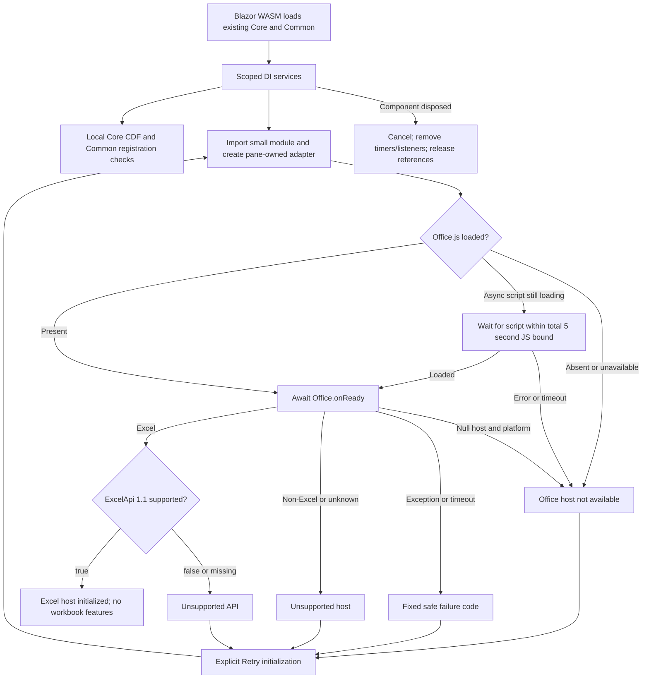

# Batch 04.01 — production Office.js host foundation

**IMPLEMENTED / PENDING OWNER SOURCE REVIEW AND LIVE EXCEL ACCEPTANCE.**
No 04.02 or Phase 04A work is authorized or implemented. Gate C remains pending
until after 04.07. The new host is a foundation proof, not a reusable ANOVA/KW UI.

## Start gate and source evidence

Local `main` and feature-branch `codex/04-01` HEAD:
**`db85ff8640523004f23175e3aa6c082dcb83e6f0`**, “Operation-owned document/selection
leases”, committed by the owner on 22 October 2026. All 04.01 work is uncommitted.
The accepted predecessor is `8bbf15a3316a34eb492b28cdf8a4e8264f56e2d2`.

The owner's Batch 04.01 instruction confirms completed Phase 03 owner smoke,
including deleted-sheet RefEdit `user.document-changed` safe rejection and no
wrong-worksheet write. Inspection of **local main**, rather than the older ZIP,
confirms that `db85ff8` contains the final fix in
`BESHstatNG/src/UI/Refedit/Excel2007RefEdit.vb`: SheetActivate rebinds from its event
argument without reading the disconnected previous worksheet; txtAddress_Enter
contains stale-reference recovery and retains Address for lifecycle validation.
The same commit contains operation leases, Windows fixture removal, tests and the
03.06 report. A separate merge commit is not required: this is already main's
tip. No assertion about remote branches is made and no fetch was performed.

Evidence commands, using a command-local ownership exception because this sandbox
account differs from the repository owner:

```powershell
git -c safe.directory=C:/Users/peter/source/repos/BESHstatNG status --short
git -c safe.directory=C:/Users/peter/source/repos/BESHstatNG branch --show-current
git -c safe.directory=C:/Users/peter/source/repos/BESHstatNG log -6 --oneline
git -c safe.directory=C:/Users/peter/source/repos/BESHstatNG branch --list main codex/04-01
git -c safe.directory=C:/Users/peter/source/repos/BESHstatNG log main -10 --oneline
git -c safe.directory=C:/Users/peter/source/repos/BESHstatNG show -s --format=fuller main
git -c safe.directory=C:/Users/peter/source/repos/BESHstatNG show main -- BESHstatNG/src/UI/Refedit/Excel2007RefEdit.vb
git -c safe.directory=C:/Users/peter/source/repos/BESHstatNG switch -c codex/04-01
git -c safe.directory=C:/Users/peter/source/repos/BESHstatNG rev-parse HEAD main
```

Initial branch was already main; the requested explicit `switch main` and branch
creation were initially denied by sandbox `.git` write permissions. Branch
creation then succeeded with owner-approved escalation, retaining sandbox
permissions for normal work. No global safe-directory setting or ACL was changed.
Initial status contained only ` M BESHstatNG/Generated/VersionAttributes.vb`.
It was backed up byte-for-byte before builds and restored afterward, preserving
that pre-existing change. Initial/final SHA-256:
`0F22C5A1AD446546E773E59B495E647C58F5FF08A70750AFE7372680798D2F2D`.

Read AGENTS.md, Revision 1.6 plan including Phase 03 closure, 04.01–04.07 and
Gate C, the 03.05/03.06 reports and Gate B freeze; inspected solution, version
props, verification script, all requested WasmSmoke boot/manifest/README/bridge
files, Common catalog/registry/capabilities and the Core distribution API before
implementation. Concrete scope was announced before edits.

Revision 1.7 reconciles **03.06 / Phase 03 COMPLETE / ACCEPTED / MERGED** using
owner evidence plus local main. Counts are **223 total / 33 accepted / 190
outstanding**. 04.01 is included among the outstanding batches. Historical
reports remain unchanged; active plan checkpoints supersede their pending text.
04.02–04.07, all 75 Phase 04A rows and Gate C's requirement remain unchanged.

## Exact path inventory

The original foundation inventory below predates the corrective investigation;
the readiness debugging amendment at the end records its additional paths and
supersedes the original readiness/test-count claims. All paths are relative to
the repository root. The original delivery had **20 added files and 2 modified
files**, in addition to the preserved pre-existing generated file.

| Path | Change and purpose |
|---|---|
| `BESHStat.OfficeAddin/BESHStat.OfficeAddin.csproj` | New net10.0 Blazor WASM host, references existing Core/Common; excludes nested tests from host compilation/assets |
| `BESHStat.OfficeAddin/Program.cs` | WASM root and actual production DI registration |
| `BESHStat.OfficeAddin/App.razor` | Minimal readiness/probe display, explicit retry, disposal; no Office globals |
| `BESHStat.OfficeAddin/_Imports.razor` | Component/service imports |
| `BESHStat.OfficeAddin/Infrastructure/FoundationServices.cs` | Idempotent scoped registration of readiness and probe abstractions |
| `BESHStat.OfficeAddin/Infrastructure/OfficeHostReadiness.cs` | Injected JS module/object ownership, cached startup, retry, cancellation and bounded cleanup |
| `BESHStat.OfficeAddin/Infrastructure/HostStatus.cs` | Safe immutable host status, interop projection, fixed messages/codes |
| `BESHStat.OfficeAddin/Infrastructure/FoundationProbe.cs` | Actual Core CDF and Common registration validation, safe result |
| `BESHStat.OfficeAddin/Properties/launchSettings.json` | Distinct HTTPS development profile, port 7141 |
| `BESHStat.OfficeAddin/manifest-dev.xml` | Distinct Workbook task-pane identity with minimal permission |
| `BESHStat.OfficeAddin/wwwroot/index.html` | Originally async Office.js CDN; corrected blocking head reference, Blazor startup and safe framework reload fallback |
| `BESHStat.OfficeAddin/wwwroot/css/app.css` | Small responsive readable task pane |
| `BESHStat.OfficeAddin/wwwroot/js/officeHost.mjs` | Tiny testable pane-owned readiness adapter; no workbook operations |
| `BESHStat.OfficeAddin/package.json` | Dependency-free Node syntax/tests command |
| `BESHStat.OfficeAddin/tests/OfficeAddin.Tests.csproj` | Host-free net10.0 MSTest project linking exact production bootstrap sources |
| `BESHStat.OfficeAddin/tests/FoundationTests.cs` | DI, Core/Common, startup, failures, retries, disposal, manifest/launch contracts |
| `BESHStat.OfficeAddin/tests/officeHost.test.mjs` | Mock Office/CDN initialization, host/API checks, races, safe errors and cleanup |
| `BESHStat.OfficeAddin/README.md` | Prerequisites, launch/sideload, fallback, diagnostics and owner smoke |
| `scripts/verify-office-foundation.ps1` | Separate narrow build/test/static-asset gate for either configuration |
| `docs/architecture/batch-04-01-office-host-foundation.md` | This source, architecture, validation and acceptance handoff |
| `BESHStatNG.sln` | Add host and tests; Debug/Release mappings and PreRelease → Release for both new projects |
| `planning/BESHStatNG_CrossPlatform_MasterPlan.md` | Reconcile accepted 03.06/Phase 03 and implemented/pending 04.01 only |

## Architecture and dependencies

The host references the **existing** `BESHStat.Core` and
`BESHStat.Excel.Common` netstandard2.0 projects. No statistical algorithm,
contracts, frozen schema or Common lifecycle/execution coordinator is copied or
changed. Windows host/tests stay .NET Framework 4.8. WasmSmoke remains independent
and unchanged. No production type depends on WasmSmoke.

Runtime dependencies match the checkout: Blazor WebAssembly/DevServer **10.0.13**,
net10.0 with nullable and implicit usings enabled. Tests reuse MSTest **3.6.4** and
Microsoft.NET.Test.Sdk **17.12.0**. The host-free test project uses the installed
Microsoft.AspNetCore.App framework for DI/JSInterop; the production browser host
does not acquire a server-runtime dependency. Node tests use built-in APIs, with
no npm packages. SDK **10.0.402**, Node **24.20.0**, VS2026 Community were available.
No SDK, package, extension or tool installation/download was needed. Restore
sources were restricted to the existing local package cache for these runs.

`AddOfficeFoundation` registers one **scoped** `IOfficeHostReadiness` and one
`IFoundationProbe`. Root component startup after first render calls both through
DI. The probe calculates **Core `Distributions.PNorm(0) = 0.5`** with a numerical
check, then loads Common's actual catalog/handler registry and calls
`ValidateRegistrations`. Current actual values: **2 descriptors / 4 handlers**.
It verifies an actual ANOVA registration, not authored metadata's mere presence.
These are local fixed-input probes, without an input/output workbook.

The JS module creates an object reference per readiness service; it has no
session singleton. Concurrent initialization coalesces; completed results are
cached until explicit retry. Cancellation of one caller stops its wait without
poisoning other callers. Root disposal cancels the owned service, drains pending
.NET interop, disposes the JS adapter and releases object/module references.
Repeated disposal is safe. This bootstrap seam introduces no new Common execution
or workbook lifecycle state machine.



Only `Office.onReady` completion can lead to Excel status. Reading cached
Office.context.host is deliberately not a shortcut. Requirement metadata is
checked **after** readiness and must return Boolean true. Unknown/non-Excel host
is rejected. Standalone browser success never proves Excel activation.
Platform is whitelisted to PC/Mac/OfficeOnline; automated platform cases do not
certify those live hosts.

JS bounds script/readiness work to **5 seconds**, returning a fixed safe status.
.NET has a **12-second outer interop bound** and a **2-second cleanup bound**.
Callbacks from a timed-out/disposed attempt cannot inspect context or replace a
later attempt's result. Owned script event listeners and timers are removed.
Office.js's promise itself has no unsubscribe API; late continuations are inert.
No workbook event handler is registered. Framework load failure is handled by
static loading guidance and Blazor's safe reload UI; it is not falsely rendered
as a successful host probe.

## Security and compatibility boundaries

The JS adapter only inspects readiness/requirement metadata. It never calls
Excel.run, opens Office.context.document, acquires selection or reads/writes
cells. HostStatus only projects whitelisted state/code/platform combinations.
Neither exception messages, stack traces, workbook addresses/contents/URLs,
credentials nor HTTP bodies are displayed or sent to diagnostics. No telemetry,
data logging, diagnostic sink, server API or service worker is added. Razor uses
ordinary escaped text. No raw HTML is rendered from interop.

The Microsoft CDN is an external trusted script boundary; it is async so blocked
Office.js does not block parsing/WASM startup. No broad CSP policy is invented
without host testing. HTTPS and certificate trust are owner environment setup.
The foundation advertises **no workbook capabilities**: ExcelApi availability is
metadata, not proof of a read/write adapter. Existing Common preflight and host
capability profiles are unchanged and are not used to claim unsupported work.

Gate B compatibility: no frozen output/analysis/transport ledger entry changes;
E1–E7 remain. `BeshHelpResolverPublished=true`, `BeshVersion=1.2.6.0`, generated
method identities and Windows/Office smoke behavior remain unchanged. No existing
framework or package version is edited. The new assemblies inherit BeshVersion
from Directory.Build.props; dev manifest Version 1.0.0.0 is its sideload manifest
revision, not a hardcoded application-release version.

## Manifest and local URLs

| Item | Foundation | Existing WasmSmoke, unchanged |
|---|---|---|
| Manifest | `BESHStat.OfficeAddin/manifest-dev.xml` | `BESHStat.WasmSmoke/office-manifest.xml` |
| GUID | `5f70b95c-dc4a-4f38-b78d-0a7348657e19` | `88e027e2-e1aa-4e03-96a9-9deb6fe0c82e` |
| Display name | BESHStatNG Office Foundation Dev | BESHStatNG Shared Excel Stage 3 |
| SourceLocation | `https://localhost:7141/` | `https://localhost:7131/` |
| Type / host | TaskPaneApp / Workbook | TaskPaneApp / Workbook |
| Minimum set | ExcelApi 1.1 | ExcelApi 1.1 |
| Permission | Restricted | ReadWriteDocument |

Reviewed Microsoft's supported add-in-only XML namespace
`http://schemas.microsoft.com/office/appforoffice/1.1`, TaskPaneApp element order,
Workbook host, ExcelApi set and Permissions definitions. No command/Ribbon schema,
VersionOverrides, production domains or published URLs are introduced. Automated
tests parse real XML, enforce namespace/type/order, compare identities and check
HTTPS URL equality with launchSettings. A Microsoft XSD-validator download was
not performed; actual sideload acceptance remains the owner's gate.

## Automated verification and actual outcomes

The existing full gate was run in **both configurations on the unchanged local
03.06 regression sources**, establishing the actual local baseline. Production
host work was then verified separately; the existing gate was not expanded or
weakened. No duplicate Debug/Release execution is counted as a new distinct case.

| Suite | Local baseline Debug | Local baseline Release | 04.01 added Debug | 04.01 added Release |
|---|---:|---:|---:|---:|
| Core | 1,024 passed | 1,024 passed | 0 | 0 |
| Common | 727 passed | 727 passed | 0 | 0 |
| Windows legacy | 787 passed | 787 passed | 0 | 0 |
| WasmSmoke C# | 45 passed | 45 passed | 0 | 0 |
| WasmSmoke Node | 377 passed | 377 passed | 0 | 0 |
| Help resolver Node | 71 passed | 71 passed | 0 | 0 |
| Python tooling/help/discovery | 27 + 16 + 5 passed | 27 + 16 + 5 passed | 0 | 0 |
| OfficeAddin C# | — | — | **27 passed** | **27 passed** |
| OfficeAddin Node | — | — | **40 passed** | **40 passed** |
| **Total** | **3,079** | **3,079** | **+67** | **+67** |

Combined distinct-case inventory: **3,146 per configuration**, not 6,292 distinct
cases. No failures or skipped cases. C# exercises real registrations/numerics and
the production readiness service through mocked IJSRuntime; Node exercises the
actual module, mocked Office promises and script events. Tests cover absence,
unsupported/unknown host, exact API checks, safe projection, import/ready failure,
concurrent/repeated startup, recovery, cancellation, disposal during import/create/
initialize, late completion and script cleanup. They require no workbook/network.

Build results: new host **Debug and Release successful, zero warnings/errors**;
new test project both successful; existing WasmSmoke both successful; full
`dotnet build BESHStatNG.sln` **Debug and Release successful, zero warnings/errors**.
No VS MSBuild fallback was needed for the solution. The legacy verification script
uses installed VS2026 MSBuild/vstest and also succeeded. Existing non-failing
`UTA001 MatrixTestHelpers` discovery advisory and TRX overwrite notices remain.
An early development pass had 25 C#/35 JS cases; final source has 27/40, and the
recorded final foundation gates ran those complete suites in both configurations.

Exact gate commands, from the repository root (stdout/stderr were captured under
ignored `TestResults/04-01` using `cmd.exe /d /c '... > file.log 2>&1'`):

```powershell
# Environment restriction for these runs: restore only from already installed packages.
$env:RestoreSources = 'C:/Users/peter/.nuget/packages'

# Established local 03.06 baseline: both exit 0.
powershell -NoProfile -ExecutionPolicy Bypass -File scripts/verify-beshstatng.ps1 -Configuration Debug -VisualStudio 2026 -Legacy -Wasm -Js -Python -PythonExe C:/Users/peter/Desktop/WPy64-31150/python-3.11.5.amd64/python.exe
powershell -NoProfile -ExecutionPolicy Bypass -File scripts/verify-beshstatng.ps1 -Configuration Release -VisualStudio 2026 -Legacy -Wasm -Js -Python -PythonExe C:/Users/peter/Desktop/WPy64-31150/python-3.11.5.amd64/python.exe

# Final new host gates: both exit 0.
powershell -NoProfile -ExecutionPolicy Bypass -File scripts/verify-office-foundation.ps1 -Configuration Debug
powershell -NoProfile -ExecutionPolicy Bypass -File scripts/verify-office-foundation.ps1 -Configuration Release

# Full solution consistency: both exit 0.
dotnet build BESHStatNG.sln -c Debug
dotnet build BESHStatNG.sln -c Release

git -c safe.directory=C:/Users/peter/source/repos/BESHstatNG diff --check
git -c safe.directory=C:/Users/peter/source/repos/BESHstatNG status --short --untracked-files=all
```

The new gate executes these exact child commands for Debug, then Release:

```powershell
dotnet build BESHStat.OfficeAddin/BESHStat.OfficeAddin.csproj -c Debug
dotnet test BESHStat.OfficeAddin/tests/OfficeAddin.Tests.csproj -c Debug --logger 'trx;LogFileName=OfficeAddin-Debug.trx' --results-directory C:/Users/peter/source/repos/BESHstatNG/TestResults/04-01
# Working directory BESHStat.OfficeAddin:
npm.cmd test
# npm: node --check wwwroot/js/officeHost.mjs && node --test tests/*.test.mjs

# Release uses the same commands with -c Release and OfficeAddin-Release.trx.
```

An earlier standalone Debug host build and standalone Debug C# test command also
passed; the final script supersedes those development runs. Evidence logs:
`baseline-Debug.log`, `baseline-Release.log`, `foundation-Debug.log`,
`foundation-Release.log`, `solution-dotnet-Debug.log`,
`solution-dotnet-Release.log`, `OfficeAddin-Debug.trx`, `OfficeAddin-Release.trx`
under `TestResults/04-01`. Existing gate TRX reports live under
`TestResults/Codex`; logs retain separate per-configuration totals even when that
gate overwrites its stable TRX filenames. All remain ignored local artifacts.

The new script verifies index.html, CSS and JS through the generated
`obj/{Configuration}/net10.0/staticwebassets.build.json` (Blazor build serves
source assets through this manifest rather than copying them into bin/wwwroot).
It checks one fingerprinted Core, Common and OfficeAddin `.wasm` assembly in
`bin/{Configuration}/net10.0/wwwroot/_framework` and absence of test static assets.
This proves build packaging, not browser or Excel activation. No publish command
was run.

Actual packed output verification:

```powershell
Get-ChildItem BESHstatNG/bin/Debug,BESHstatNG/bin/Release -Filter '*packed.xll' | Select-Object FullName,Length
```

| Output under `BESHstatNG/bin/` | Actual bytes |
|---|---:|
| `Debug/BESHStatNG-AddIn-packed.xll` (x86) | 1,947,648 |
| `Debug/BESHStatNG-AddIn64-packed.xll` (x64) | 1,873,408 |
| `Release/BESHStatNG-AddIn-packed.xll` (x86) | 1,881,600 |
| `Release/BESHStatNG-AddIn64-packed.xll` (x64) | 1,807,360 |

Both solution logs also record successful x86/x64 ExcelDnaPack operations. No
PreRelease build, signing, installer or live XLL load was executed.

## Owner acceptance and missing live evidence

**Not run by Codex:** browser WASM activation, real Excel Online/Windows sideload,
live Excel-DNA GUI, Mac, HTTPS certificate trust, dev server launch, deployment,
installer or signing. No browser screenshot is offered as Excel evidence. No
large E2E/component framework was introduced for this foundation.

Use the [host README](../../BESHStat.OfficeAddin/README.md) for exact prerequisite,
launch and sideload instructions. The owner should retain evidence for:

1. Open **https://localhost:7141/** standalone: safe **Office host not available**,
   actual Core **0.5** / Common **2 descriptors / 4 handlers** passed, no crash or
   fabricated Excel status. Capture the diagnostic and browser/runtime errors, if
   any, without workbook data.
2. Sideload the distinct new manifest in real Excel Online: **BESHStatNG Office
   Foundation Dev** appears alongside WasmSmoke; after real onReady, pane shows
   `office.excel-ready`, actual Core/Common values and appropriate platform.
   Record client/platform/date, manifest identity, probe values and lack of
   uncaught console/WASM errors. Repeat reload, retry, close and reopen without
   hanging or accumulating script listeners. Selection, sheet and values remain
   unchanged. Windows desktop Office.js is an additional useful smoke target.
3. Independently reopen WasmSmoke at **7131** and verify its existing manifest;
   confirm accepted Windows ANOVA/KW, 03.05 Help/versioning and 03.06 lifecycle
   behavior remain unchanged. Mac is a later target, not claimed passed.

Owner evidence status: **PENDING**. No assertion that Core/Common already loaded
in a real production-host Excel task pane is made. A successful host-free probe
and WASM build do not close that acceptance requirement.

## Deferred responsibilities and final scope check

04.02 owns typed/mockable workbook range/sheet/write adapter and transport;
04.03 catalog navigation/editors; 04.04 range picker/output/overwrite UX;
04.05 formula/repeated-data builders; 04.06 full settings/help/progress/errors/
localization shell; 04.07 commands, production lifecycle and E2E infrastructure.
Phase 04A, statistics porting, charting, custom functions and release engineering
remain deferred. No changes to accepted RefEdit/lifecycle, Help resolver/MIME,
Core numerics, frozen outputs, authored methods or existing host behavior.

Final `git diff --check`: exit 0. Final status is the exact inventory above plus
the byte-preserved pre-existing VersionAttributes modification; no bin/obj,
node_modules, reports or launch-generated files are delivery artifacts.
No commit, push, merge, reset, rebase, deployment, publication, signing, installer,
SDK/package/extension install or destructive cleanup was performed. Work stops
on `codex/04-01` for owner source review and live Excel acceptance.

Microsoft sources reviewed for schema/readiness choices:
[initialization and browser null-host behavior](https://learn.microsoft.com/en-us/office/dev/add-ins/develop/initialize-add-in),
[add-in-only XML structure](https://learn.microsoft.com/en-us/office/dev/add-ins/develop/xml-manifest-overview),
[host/API declarations and supported CDN](https://learn.microsoft.com/en-us/office/dev/add-ins/develop/specify-office-hosts-and-api-requirements),
[permission values](https://learn.microsoft.com/en-us/javascript/api/manifest/permissions),
[manual Excel Online sideloading](https://learn.microsoft.com/en-us/office/dev/add-ins/testing/sideload-office-add-ins-for-testing).

## Post-implementation readiness debugging amendment — 22 October 2026

**Acceptance-blocking corrective investigation; 04.01 remains PENDING.** This
amendment supersedes the original readiness assumptions and counts above. Current
baseline remains **33 / 223 accepted, 190 outstanding**. No 04.02/04A work began.

### Authoritative checkout and preservation

The first requested plain Git commands failed the sandbox account's ownership
check. Repeating them with command-local `-c safe.directory=...` established
`codex/04-01`, HEAD `db85ff8`, and the original uncommitted foundation inventory:
solution, master plan, OfficeAddin tree, this report and foundation script, plus
the independent `BESHstatNG/Generated/VersionAttributes.vb` modification. No global
Git setting, branch or index was changed. AGENTS.md, current master plan Phase
04.01 acceptance, this report, host README, all host bootstrap/DI/component/tests,
both manifests and launch profiles, and the independent WasmSmoke bootstrap/bridge
were inspected before correction.

There was a material discrepancy with the described post-ZIP hotfix: the actual
local `index.html` **still had `async`**, although the local test already required
a blocking head script. Initial `npm.cmd test`: **40 passed / 1 failed / 41 total**.
The blocking reference is restored to the intended, tested ordering; removing
`async` is **not** presented as the root-cause fix. Existing foundation changes
were retained. Builds' generated-version side effect was restored byte-for-byte
from the bytes read immediately before each full gate. Initial/final SHA-256:
`0F22C5A1AD446546E773E59B495E647C58F5FF08A70750AFE7372680798D2F2D`.

### Proven failure and remaining hypotheses

**Confirmed application defect: double-wrapped JavaScript object reference.**
C# requests `InvokeAsync<IJSObjectReference>("create")`. Blazor's actual loaded
runtime already applies its JSObjectReference conversion to the returned object.
The original `create()` instead returned `DotNet.createJSObjectReference(adapter)`,
a marker with `__jsObjectId`, without `initialize`. Blazor therefore referenced
that marker. The subsequent adapter invocation failed before the application's
`Office.onReady` was reached. The catch projected `office.initialization-failed`,
hiding the distinction between interop and Office readiness.

This was reproduced in actual Edge/Blazor at localhost: module HTTP **200 /
text/javascript**, actual import successful, `DotNet.createJSObjectReference`
available, probes **0.5 / 2 / 4**, public initialization failed; direct inspection
of `create()` showed `hasInitialize=false`, `isReferenceMarker=true`. Returning
the adapter directly changed the actual application to `office.timeout` without
changing readiness, isolating the bridge defect. A separate browser fixture then
restored only the old wrapping while supplying simulated ready Office: actual
Blazor reproduced **`bootstrap.interop-invoke-failed`**, with **no
`bootstrap.onready-started`**. Corrected bridge with the same fixture reports
ready and verifies the API. This is stronger evidence than a Node-only mock.

**Separately observed real standalone CDN behavior:** in a fresh isolated Edge
profile, primary `office.js` returned **200 / application/javascript**, then
threw `hostInfo validation failed` in that script in the **localhost top-level
document**. Its real `onReady` remained pending; no secondary Office resource
requests were observed. A controlled browser experiment removed async and called
real `Office.onReady` immediately after the blocking primary script, before
Blazor: it still remained pending. Therefore an earlier call or removing async
alone did not repair this standalone environment. No CDN replacement, empty
`Office.initialize`, deadline increase or suppression of third-party errors was
introduced. The bounded top-level result now safely projects unavailable.

| Hypothesis | Evidence / disposition |
|---|---|
| Module MIME/import or missing DotNet bridge | Ruled out in the observed standalone run: real import and runtime factory worked; it was the returned object shape that failed |
| DTO/camel-case projection | Not the observed cause; added real-shaped JSON projection coverage, and browser Blazor fixtures traverse serialization successfully |
| Missing/late onReady | Original app never reached it because invocation failed. Current app calls it after first render. Early pre-Blazor control remained pending in standalone; live Excel timing still needs owner evidence |
| Primary script absent/blocked | Ruled out for the observed standalone request: HTTP 200. Its runtime exception is a separate observed condition |
| Secondary Office scripts blocked | Possible in owner environment, **unproven there**. None requested in the real standalone trace. Forced strings failure is tested only as a simulated fixture |
| Timeout too short | No evidence of late real Excel completion. Five-second JS and twelve-second C# limits retained; boundary and delayed-resolution tests added |
| Wrong selected frame | Cannot attribute earlier owner console results from `baseFrame...`. Codex's trace is positively localhost/top-level; genuine localhost Office iframe is still unobserved |
| Opera/VPN/extensions/tenant restriction | Unresolved owner-environment hypothesis; isolated Edge comparison does not reproduce the authenticated Opera task pane |
| people.aspx 500, sandbox about:blank, icons/preloads | Owner-reported, not observed/attributed by Codex. May be shell events; no causality asserted, sandbox flags unchanged |

Microsoft's [initialization documentation](https://learn.microsoft.com/en-us/office/dev/add-ins/develop/initialize-add-in)
describes null host/platform outside Office and a promise that can remain pending
when library files are blocked. Its [framework guidance](https://learn.microsoft.com/en-us/office/dev/add-ins/develop/connect-to-javascript-frameworks)
normally starts frameworks after onReady. This foundation intentionally renders
its independent progress/local probe UI first, corresponding to the documented
standalone/progress exception; all Office metadata remains gated on actual
onReady resolution. The promise pattern also supports calls after the library
is ready. This is not evidence that every Excel startup dependency is healthy.
[Issue 6040](https://github.com/OfficeDev/office-js/issues/6040) supports the blocked
strings hypothesis in general, not its occurrence in this owner's frame.

### Startup stages and frame attribution

| Stage | Original path | Corrected path |
|---|---|---|
| HTML/CDN | Async primary in actual initial checkout; load/error could precede module listeners | Blocking head primary; optional diagnostic listeners attach before it; no CSP was present or added |
| Office dependencies | Primary controls its secondary requests, independently of WASM | Same; only captured resource errors/CSP justify dependency-failed stage |
| Framework | Blazor auto-starts, downloads WASM, DI registers scoped readiness/probe, App first renders | Same local/progress path; no workbook operations |
| C# deadline | Twelve seconds begins before module import | Unchanged; safe diagnostic distinguishes import/create/invoke transport failures |
| Import/create | Module import succeeds; create returns a reference marker; Blazor wraps it again | Plain adapter returned; Blazor performs the only reference conversion |
| Invocation/onReady | C# initialize call fails on marker; no application JS deadline/onReady call | JS five-second attempt starts; real onReady called; requirement metadata only after resolution |
| Bound/retry/dispose | Separate manual JS initialization could time out; Retry accumulated pending onReady waits | Top-level pending Office becomes unavailable; embedded/unknown timeout remains failure. Same pending Office wait is reused; attempt subscribers/listeners/timers detach |

One successful real Edge standalone run, milliseconds relative to the optional
diagnostic installation: primary request starts **11**, duration **440**; primary
runtime exception **438**; import/create **1594**; invoke **1601**; real onReady
called **1602**; JS timeout and standalone fallback **6608**. C# completes before
its outer deadline. Primary response is 200 according to CDP; Resource Timing's
cross-origin `status: 0` is inconclusive, not contradictory failure evidence.
Three explicit retries passed. A pending wait is observed once per unchanged
Office/onReady identity; late resolution is usable on explicit Retry, but cannot
change a previously returned result or access context on a disposed attempt.

All Codex real-browser events here come from a freshly created localhost
top-level tab. No Excel shell, authenticated session, sandboxed about:blank
child, disposable workbook or genuine task-pane frame was available to inspect.
The simulated ready case resolved at **1194 ms**, after onReady started at
**1167 ms**, but is explicitly **not live Excel evidence**.

### Exact corrective paths

| Path | Corrective change |
|---|---|
| `BESHStat.OfficeAddin/wwwroot/js/officeHost.mjs` | Return plain adapter; bounded top-level fallback; coalesced Office wait and removable attempt subscribers; fixed diagnostic stages |
| `BESHStat.OfficeAddin/wwwroot/index.html` | Intended blocking CDN order; attach optional diagnostic before CDN events |
| `BESHStat.OfficeAddin/wwwroot/js/officeDiagnostics.js` (new) | Inactive-by-default local stage snapshot, bounded history, allowlisted resource categories and captured failure evidence; pagehide cleanup; no telemetry |
| `BESHStat.OfficeAddin/Infrastructure/OfficeHostReadiness.cs` | Fixed optional import/create/invoke failure diagnostics; retain safe public status and bounded cleanup |
| `BESHStat.OfficeAddin/Infrastructure/HostStatus.cs` | Truthful unavailable wording when readiness cannot be established |
| `BESHStat.OfficeAddin/tests/officeHost.test.mjs` | Preserve all cases; add bridge, standalone/frame, delayed/pending/retry and exact deadline coverage |
| `BESHStat.OfficeAddin/tests/officeDiagnostics.test.mjs` (new) | Opt-in/privacy, dependency evidence, frame categorization, event bound/copy/teardown |
| `BESHStat.OfficeAddin/tests/FoundationTests.cs` | Stage assertions, diagnostic failure isolation, camel-case JSON projection |
| `BESHStat.OfficeAddin/tests/browser/readiness-browser.mjs` (new) | Opt-in installed-browser CDP driver; actual module/Blazor/probes/retries; sanitized output; clearly simulated failure/ready fixtures |
| `BESHStat.OfficeAddin/README.md` | Changed behavior, exact frame selection, diagnostic/network procedure and browser runner |
| `scripts/verify-office-foundation.ps1` | Check diagnostic script in built asset manifest |
| `docs/architecture/batch-04-01-office-host-foundation.md` | This evidence amendment; original delivery retained as history |

No corrective change to master plan, solution, manifests, launch settings,
WasmSmoke, Core/Common, Windows sources, targets, parser/writer/help contracts,
03.04 fault taxonomy, package versions or public HostStatus shape. The pre-existing
solution/master-plan/version modifications remain in the final checkout.

### Actual validation and command outcomes

No installed Playwright/Puppeteer/browser connector was found. Installed Edge
plus Node's built-in fetch/WebSocket provided a dependency-free CDP runner. The
sandbox account could not access the owner's development HTTPS certificate;
the first server start failed. Owner-approved execution of the same server
under the owner context succeeded using the existing certificate. The isolated
headless browser launch was also approved. No authentication, certificate change,
package/browser/tool installation or policy bypass occurred.

An intermediate browser run hit stale cached framework fingerprints after a
rebuild, producing local 404/startup failures. The driver now disables browser
cache; the dev server was restarted to refresh its static-asset manifest. All
final scenarios below passed. This harness/environment issue was not treated as
an Office readiness fix.

| Suite | Debug | Release |
|---|---:|---:|
| Core | 1,024 passed | 1,024 passed |
| Common | 727 passed | 727 passed |
| Windows legacy | 787 passed | 787 passed |
| WasmSmoke C# / JS | 45 / 377 passed | 45 / 377 passed |
| Help resolver JS | 71 passed | 71 passed |
| Python | 27 + 16 + 5 passed | 27 + 16 + 5 passed |
| OfficeAddin C# / Node | **29 / 56 passed** | **29 / 56 passed** |
| **Distinct inventory per configuration** | **3,164** | **3,164** |

No failures or skips in final gates. Original 3,146 used 27/40 host cases; the
initial checkout had a 41st host JS script-order test (failing). The correction
adds **2 C# + 15 JS** over that checkout, removing none: **3,147 → 3,164**. Repeated
Debug/Release executions are not additional distinct cases. Both foundation and
WasmSmoke builds passed with zero warnings/errors. Full regression retains its
non-failing MSTest discovery/TRX overwrite advisories. Full solution build and
publish were not rerun in this corrective investigation; legacy MSBuild and
WasmSmoke/foundation builds were executed by the exact scripts.

Exact final gates, from repository root, with existing cached dependencies only:

```powershell
$env:RestoreSources = 'C:/Users/peter/.nuget/packages'
powershell -NoProfile -ExecutionPolicy Bypass -File .\scripts\verify-office-foundation.ps1 -Configuration Debug
powershell -NoProfile -ExecutionPolicy Bypass -File .\scripts\verify-office-foundation.ps1 -Configuration Release
powershell -NoProfile -ExecutionPolicy Bypass -File .\scripts\verify-beshstatng.ps1 -Configuration Debug -VisualStudio 2026 -Legacy -Wasm -Js -Python -PythonExe C:/Users/peter/Desktop/WPy64-31150/python-3.11.5.amd64/python.exe
powershell -NoProfile -ExecutionPolicy Bypass -File .\scripts\verify-beshstatng.ps1 -Configuration Release -VisualStudio 2026 -Legacy -Wasm -Js -Python -PythonExe C:/Users/peter/Desktop/WPy64-31150/python-3.11.5.amd64/python.exe
git -c safe.directory=C:/Users/peter/source/repos/BESHstatNG diff --check
git -c safe.directory=C:/Users/peter/source/repos/BESHstatNG status --short
```

All four final gates exited **0**. Output was redirected with PowerShell `*>` to
ignored `TestResults/04-01/corrective-foundation-{Debug,Release}.log` and
`corrective-regression-{Debug,Release}.log`. The full gates were wrapped in
`try/finally` to restore the independently modified generated-version bytes if
the legacy build regenerated them. Preliminary direct `npm.cmd test` and Debug
C# runs were also executed; final scripts supersede their counts.

Actual server/browser commands are in the README; Codex used:

```powershell
dotnet run --project BESHStat.OfficeAddin/BESHStat.OfficeAddin.csproj --launch-profile https --no-restore --no-build
node BESHStat.OfficeAddin/tests/browser/readiness-browser.mjs
# Each separately:
node BESHStat.OfficeAddin/tests/browser/readiness-browser.mjs --fixture=excel
node BESHStat.OfficeAddin/tests/browser/readiness-browser.mjs --fixture=pending
node BESHStat.OfficeAddin/tests/browser/readiness-browser.mjs --fixture=unsupported
node BESHStat.OfficeAddin/tests/browser/readiness-browser.mjs --fixture=missing
node BESHStat.OfficeAddin/tests/browser/readiness-browser.mjs --fixture=dependency
node BESHStat.OfficeAddin/tests/browser/readiness-browser.mjs --fixture=bridge-regression
```

**Seven Debug browser scenarios passed**, each with real module import, Blazor
interop, probe checks and three retries. Only the default uses real Office CDN
behavior. Every fixture is simulated: ready Excel/API, never-ready, unsupported
host, failed primary, explicitly blocked strings and restored bridge defect.
These seven are separate from the unit inventory, not seven tests per build
configuration. Sanitized summaries: ignored `browser-live-Debug.json` and
`browser-{fixture}-Debug.json`. The real run records no application exception,
but does record the external primary-script hostInfo exception. No screenshot,
HAR, workbook data, full network URL, raw error stack, headers or credentials is
part of these diagnostic summaries. Browser Release, authenticated Excel Online,
Opera, Mac and live WasmSmoke/Excel-DNA manual smoke remain unexecuted by Codex.

### Owner gate: exact isolation and acceptance

Use the [README's read-only diagnostic procedure](../../BESHStat.OfficeAddin/README.md#read-only-owner-diagnostic-no-workbook-access).
Select **`https://localhost:7141/` in DevTools' execution-context/frame dropdown**;
verify the origin Boolean before running anything. The procedure preserves
Office query/hash parameters when enabling diagnostics. It does not inspect a
parent frame, raw pre-ready Office context or workbook. Share only the sanitized
snapshot and minimal per-resource status/MIME/redirect/block reason, not full URLs
or HAR exports. Resource timing alone cannot reveal every browser block reason.

If genuine onReady remains pending, inspect the actual localhost frame's primary
and strings/locale/host requests and script/CSP errors. Attribute sandbox errors
to their actual frame, and leave third-party sandbox flags alone. Compare the
same disposable-workbook environment with independent WasmSmoke and, when
practicable, owner-run Edge without VPN/content blockers versus Opera. If both
fail with demonstrated blocked CDN dependencies, classify that as environmental
and resolve policy/connectivity with the owner; do not fabricate Excel-ready.
Microsoft's [onReady debugging procedure](https://learn.microsoft.com/en-us/office/dev/add-ins/testing/debug-initialize-onready)
supports reopening the pane with DevTools attached for initialization breakpoints.

Final owner checklist:

- [ ] Standalone **7141**: `office.unavailable` / Standalone, **0.5 / 2 / 4**,
  Retry completes, no application exceptions. Attribute external Office errors.
- [ ] Genuine Excel Online **localhost iframe**: real onReady resolution,
  `office.excel-ready`, **OfficeOnline**, verified **ExcelApi 1.1**, **0.5 / 2 / 4**;
  Retry and repeated close/reopen stay bounded, without accumulating owned
  listeners/timers/references. Disposable workbook selection/sheets/values unchanged.
- [ ] Independent WasmSmoke **7131** with original manifest still works; accepted
  Windows smoke remains unchanged. Automated regressions passed, live smoke pending.

The bridge defect is corrected and standalone safe behavior is observed. Genuine
Excel initialization/dependency-chain success is **not yet established**. Work
stops at the owner live gate on **`codex/04-01`**, uncommitted and unmerged; 04.01
is outstanding, and no next batch is authorized.

Final checks: `git diff --check` exited **0**; additional whitespace checks covered
all twelve corrective paths, including untracked files. `git status --short`
retained the original top-level inventory, with additions confined to OfficeAddin,
its existing verification script and this report. The version-file hash above is
unchanged. Both final foundation gates were rerun after diagnostic review and
passed **29 C# / 56 Node**; the simulated dependency browser case was rerun and
passed. The isolated Edge instance and Codex-started localhost server were closed.
No stage, commit, push, merge, deployment, installer or signing action occurred.
