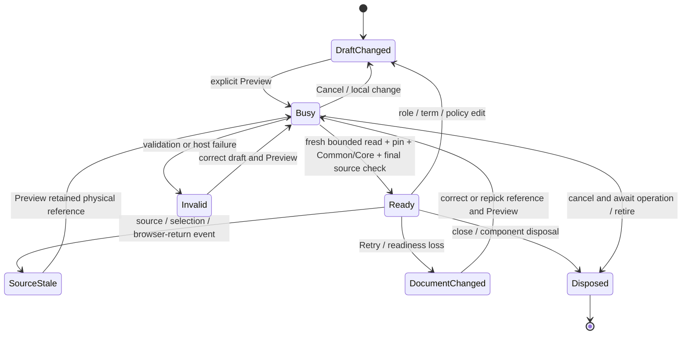
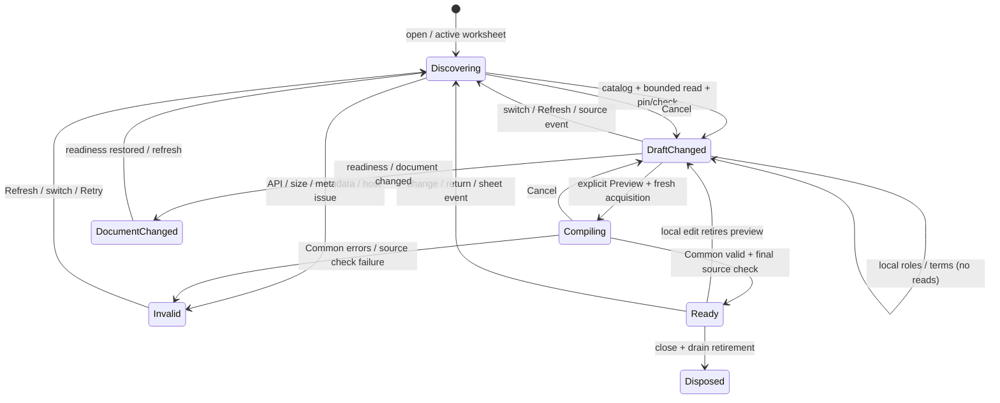

# Batch 04.05 — reusable model and column-role specification builders

**IMPLEMENTED / UNSTAGED / UNCOMMITTED / PENDING OWNER ACCEPTANCE.** Office gates,
both complete Debug/Release gates, builds and 16 simulated browser scenarios pass
after the owner-authorized numeric post-hoc fixture reconciliation below. Initial
four-failure evidence is retained as history. Genuine Excel builder smoke/owner
acceptance remains outstanding, so acceptance is not yet recommended. No
unsupported statistical method is fitted or written. The current worksheet-based
discovery amendment and its validation evidence supersede the earlier range-based
builder acquisition contract; see the final amendment sections below.

## Base, preservation and scope

Authoritative base: local `main` / `origin/main` / `codex/04-04` at
`659d4fbf1720678a90389ea1114d42b362f9ea9b`, containing accepted 04.04 including
the queued retirement and numeric/null-fill readback corrections. The referenced
`BESHstatNG(20261025-075740).zip` is not present in the checkout and was not used
to overwrite source. The owner confirms 04.04 acceptance in this conversation.
Initially the only modification was the master-plan row marking 04.04 complete.
Work paused at that prerequisite; the owner approved carrying that modification
forward and continuing. No commit was made. Branch: `codex/04-05`.

Git ownership required invocation-local `-c safe.directory=C:/Users/peter/source/repos/BESHstatNG`;
no global Git configuration was changed. Branch metadata creation required sandbox
approval and was approved. Source edits and validation use project-local paths.
Preservation hashes were captured before editing in
`TestResults/04-05/preservation-before.json` for the 15 tracked READMEs and tracked
assembly/version attributes. No README edits are part of this batch.

The proposed scope recorded before implementation was Office draft/controller
services, `Components/RoleEditors` and `Components/ModelBuilder`, a small
App/analysis handoff, Office managed/browser tests, this report and active plan
status. The audit subsequently identified a necessary additive retry method in
`RangeReferenceState`; the existing pilot resolution path is unchanged.
The exact delivered inventory below refines those proposed directories.

## Current contract map and source audit

| Existing authority | Contract reused | Gap filled by 04.05 |
|---|---|---|
| Common `ModelInput.vb`, `ModelInputCompiler.vb`; Core `RegressionFormulaParser`, `RegressionVariableCatalog`, `RegressionFormulaDesignService` | Zero-based response/predictor/factor roles, RHS-only formula, intercept, immutable design/category/source-row results; sole grammar and expansion | Local role/term editing, canonical visual term serialization, manual RHS entry, explicit read-only compilation |
| Common `LongitudinalInputs.vb`, `LongitudinalParsers.vb` | Repeated/mixed options; subject, visit, response, treatment, fixed covariates and random grouping; duplicate/order/date/missing checks | Role selectors with explicit distinction between individuals and treatment categories |
| Common `RectangularCategoricalInputs.vb`, `RectangularCategoricalParsers.vb`, `SpreadsheetValidation.vb` | Frame headers/columns, tagged category identity and order, case/missing/error rules, stable issue severity/coordinates | Reusable categorical input and factor-role editors, deliberate label inspection |
| `RangeReferenceState`, `RangeReferencePicker`, `IRangeCaptureHost` | Worksheet-qualified RefEdit, bounded whole columns, capture owner/generation, retained physical handles | Explicit preview retry after transient resolution errors without throwing away physical identity |
| `IWorkbookAdapter`, `WorkbookAdapter`, `WorkbookTransport`, `IPilotHost` | Existing bounded `ReadRangeAsync`, source pin/check, event callbacks and serialized lease retirement | Borrowed by a component-owned specification controller; no alternate transport or writer |
| `PhysicalInputView`, `GroupedInput`, `RangePicker`, `ValidationPreview`, `OutputPicker`, `AnalysisPilotState` | Existing grouped acquisition/alignment, run/write/consent/readback/uncertainty behavior | Reused unchanged. Builder uses one rectangle; it does not reinterpret grouped IDs as subjects |
| `AnalysisEditorRegistry`, `AnalysisNavigationState`, `AnalysisOptionDraft`, `FoundationServices` | Verified ANOVA/KW editor/handler registration, method availability and scoped adapter | Reused unchanged. Builder is explicitly opted into inside Analysis, outside handler availability |
| `App`, `AnalysisShell`, `AnalysisPilot` | Sticky Analysis/Diagnostics tabs, readiness/Retry, keyboard navigation and draft preservation | Preview-only surface and exclusive workflow handoff; no third permanent tab |

The 01.06/01.07 and rectangular-category tests were inspected along with Office
component/navigation/pilot/production/corrective tests and existing Edge scenarios.
Their existing contract tests are retained in the full gates. No portable contract
gap justified modifying Common. No Core algorithm, framework target, serialization
schema, setting schema, handler registry, metadata, UDF or Windows UI change exists.

## Components and typed options

`SpecificationDraft` is transient UI state. It maps directly to
`SpreadsheetModelParseOptions`, `SpreadsheetMixedModelParseOptions` (also usable
as repeated options), and `SpreadsheetCategoricalVectorParseOptions`.
Every array passed to Common is a fresh copy. Visual terms are typed column-index
records. All indices are zero-based within the selected rectangle; controls display
one-based positions, names discovered by Common, and physical Excel columns.

`ColumnRoleEditor` and `VariableList` provide labelled selectors and checkbox lists.
`CategoricalRoleEditor` adds factor assignments and Core reference codes.
`SubjectVisitRoleEditor` maps repeated/mixed roles and date/order switches.
`FormulaBuilder` serializes structured main, interaction and polynomial terms.
`ModelSpecificationEditor` owns the scoped controller and `SpecificationPreview`
renders bounded summaries/issues without observation or design-matrix values.

Opening **Open specification builder preview (no fit / write)** is the explicit
opt-in. Analysis navigation is unavailable while it is open. The existing analysis
component stays alive with `HostAvailable=false`, retiring result/consent while
retaining its range/options draft. Close awaits builder disposal and host retirement.
Returning to ANOVA/KW requires a fresh explicit Run. Ordinary Analysis/Diagnostics
tab switching preserves the current builder; Retry invalidates its preview while
retaining the draft. Unsupported menu methods remain unavailable.

## Finite preview/source lifecycle



Draft edits perform no workbook read, Core parse/expansion, statistics, output
inspection or write. They clear the validated specification immediately and queue
awaitable host retirement. Column metadata and explicitly labelled last-preview
factor mappings may remain locally for editing; they are not a valid spec.
Source edits/host invalidation clear those mappings. No old preview authorizes
execution or output, and this controller has no execution/output operation.

Preview waits for all retirements, resolves the retained reference handle, reads
through `IWorkbookAdapter.ReadRangeAsync`, verifies physical rectangle/sheet identity,
pins the original/effective source using the existing host, compiles, then performs
a final `CheckSourceAsync`. The ready envelope contains immutable workbook/sheet,
range and snapshot revision strings plus the private host session identity.
Common's model arrays are defensively copied; repeated/category observations are
immutable typed contracts. A late result cannot publish after a generation change,
Cancel or disposal. Cleanup failures cannot authorize Ready; a subsequent explicit
attempt retries retirement. No reload-only `input.preview-stale` state exists.

## Formula, role and data policies

- Names must follow Core's actual grammar: relative predictor letters (`A`, `B`)
  or single-quoted names (`'Dose'`). Visual serialization doubles embedded
  apostrophes. It never inserts an unescaped caption or evaluates an expression.
  The example model is `'Dose' + factor('Treatment', ref=1)`; response and intercept
  are separate options. Core normalizes it and constructs the design.
- With no explicit visual terms, selected predictors become main effects. With
  explicit terms, only listed terms are used. Role removal does not silently
  delete an existing term: `spec.term-role` requires correction. Categorical
  factors must also be predictors; response cannot overlap predictors.
- Manual RHS text and visual terms are deliberately separate drafts. The control
  explains that switching restores the other draft. There is no UI grammar/parser
  or unsupported automatic synchronization; malformed/manual expressions return
  Common/Core errors. Interactions use `:`; polynomial powers use `^`.
- The factor editor uses Core numeric `ref=` codes. Numeric/Boolean levels retain
  native coding; text/mixed codes follow Common complete-case first appearance.
  A reference chosen from discovered levels retains its typed key. A changed
  code-to-level mapping rejects with `spec.reference-stale`; it cannot silently
  choose a different category. Clear the reference, preview current levels and
  choose again. With no intercept Core retains all factor columns as usual.
- Required/None/Auto, Reject/explicit Skip, and category case are mapped directly
  to Common. Empty/case-duplicate headers, native errors, nonfinite values and
  ambiguous Auto cases retain existing errors and coordinates. Skip is opt-in and
  warnings remain visible. Raw error metadata is retained in Common's frame.
- Subject, visit, response and treatment are distinct source columns. Subject plus
  visit duplicates always reject. Numeric ascending visits are checked in original
  row order; no sorting occurs. Date interpretation requires a verified source
  date system/origin. Mixed mode supports no visit and source-typed fixed/random
  covariates, exactly as Common allows; no mixed-model design or fit is claimed.
  The unchanged Office reader currently supplies no verified date-system metadata,
  so actual Office calendar-date interpretation rejects honestly; this limitation
  is explained beside the control. Numeric visits work without that metadata.

## Explicit limits and privacy/threat analysis

One rectangular, same-sheet source only. Existing bounded whole-column resolution
is retained, with the original physical scope protected by the source handle.
No full-column payload is read. Existing reader budget remains at most 10,000
cells; this builder additionally supports at most 128 source/design columns,
2,048 RHS characters, 32 visual terms and polynomial powers 2–6.
Before expansion, Core's own AST is inspected to conservatively bound categorical
interaction width using Common category parsing. A bound over 128 rejects with
`spec.design-budget`; the bound can reject a design whose complete cases would
later be narrower. It never approximates a design matrix. Common still applies
its exact design width, finite-value, row-count and rank rules.

Risks addressed: expression/caption injection (escaping/Core parser), accidental
workbook mutation (no output/fitting path), stale document/workbook/sheet identity
(existing native handle/session lease plus final check), late async callbacks
(generation/cancellation/disposal), accidental consent reuse (exclusive handoff),
and explosive design allocation (bounded input/AST guard). The persistent native
`output.mutation-uncertain` latch also disables builder Preview; Retry cannot clear it.

Source names/addresses and header metadata are deliberately shown in the Analysis
preview, not diagnostic logs. Factor/category labels are collapsed by default.
No raw observation or design matrix values are rendered. New code logs no workbook
names, labels, addresses, values, expressions or native exceptions. Existing Office
diagnostics remain allowlisted/redacted; Core uses its existing `NullLogger` in
this host. 04.06 must preserve that privacy boundary when adding logging.

## Initial implementation validation and outcomes (historical)

The corrective amendment later in this report records the owner-authorized fixture
reconciliation and subsequent gates. Results in this section describe the initial
04.05 delivery; they are retained as evidence rather than rewritten.

Focused tests initially exposed unquoted fixture names (corrected to actual Core
grammar), Common's native error code `cell.excel-error`, and the transient resolver
retry dead end (fixed without changing the pilot path). Tests were not weakened.
The first existing Office suite passed 316/316. Current focused additions pass
57/57 (54 compiler/state cases and three rendered integration cases).

All results below were independently executed in this working tree. The existing
01.06/01.07/category parser/compiler tests are included in Common's 727 checks;
none of the four Common failures belongs to those input/compiler suites.

| Suite | Debug passed / failed | Release passed / failed | Skipped |
|---|---:|---:|---:|
| Core MSTest | 1,024 / 0 | 1,024 / 0 | 0 |
| Common MSTest | 723 / 4 | 723 / 4 | 0 |
| Windows legacy MSTest | 787 / 0 | 787 / 0 | 0 |
| Office C#/components | 373 / 0 | 373 / 0 | 0 |
| WasmSmoke managed execution | 45 / 0 | 45 / 0 | 0 |
| Office Node | 380 / 0 | 380 / 0 | 0 |
| Help Node | 71 / 0 | 71 / 0 | 0 |
| WasmSmoke Node | 377 / 0 | 377 / 0 | 0 |
| Python: catalog/help tools, MkDocs, verification scripts | 27 + 16 + 5 / 0 | 27 + 16 + 5 / 0 | 0 |
| **Distinct checks** | **3,828 / 4** | **3,828 / 4** | **0** |

The owner-reported 04.04 baseline **3,775** reconciles to the actual suite totals:
1,024 + 727 + 787 + 316 + 45 + 380 + 71 + 377 + 48. This batch adds **57** Office
cases (316 → 373), giving **3,832 executed checks per configuration**, not an
invented new baseline. Repeated focused runs and duplicate gates are not counted
again. Python/Help/Wasm Node commands were repeated for both configuration passes
although those suites are configuration-independent.

### Pre-existing Common failures — no baseline refresh

Both required full verifier invocations exit **1** at Common. The four failures are:

- `ActualInteropJson_MatchesReviewedWireAndCommonPlans ("anova-welch-tukey")`
- `ActualInteropJson_MatchesReviewedWireAndCommonPlans ("anova-all-posthoc")`
- `NormalizedSemanticFixtures_AreStableForBothFutureAdapters ("anova-welch-tukey")`
- `NormalizedSemanticFixtures_AreStableForBothFutureAdapters ("anova-all-posthoc")`

The golden fixtures expect rounded **text** post-hoc p-values (`0.48272717` and
`0.2665697`), while accepted 04.04 returns numeric binary64 values
(`0.48272718037296836` and `0.26656970338006847`). `git diff HEAD --quiet --
BESHStat.Core BESHStat.Excel.Common BESHStat.Excel.Common.Tests` exits 0:
those projects/tests/fixtures are identical to the accepted base and do not depend
on the new Office builders. No fixture, assertion, numerical algorithm or baseline
was changed to hide these failures. The accepted numeric behavior is preserved.
Reconcile these historical fixture expectations separately before recommending
04.05 against the required completely green full gates.

Since the full verifier stops at Common, every remaining suite/build was executed
independently using the same established project commands, without filtering out
any tests. These independent results do not make the failed full verifier green.

### Exact commands and artifacts

From the repository root, the required verifier commands were:

```powershell
powershell -NoProfile -ExecutionPolicy Bypass -File scripts/verify-beshstatng.ps1 -Configuration Debug -VisualStudio 2026 -Legacy -Wasm -Js -Python
powershell -NoProfile -ExecutionPolicy Bypass -File scripts/verify-beshstatng.ps1 -Configuration Release -VisualStudio 2026 -Legacy -Wasm -Js -Python
powershell -NoProfile -ExecutionPolicy Bypass -File scripts/verify-office-foundation.ps1 -Configuration Debug
powershell -NoProfile -ExecutionPolicy Bypass -File scripts/verify-office-foundation.ps1 -Configuration Release
```

First two: exit 1, the four Common mismatches above. Last two: exit 0 on the final
source, Office build/C#/Node/static assets/fingerprinted WASM/manifest checks pass.
The first Debug restore emitted `NU1900` because vulnerability metadata could not
be queried from nuget.org. Installed dependencies were used; no packages were
installed. Subsequent SDK gates used the existing cache and local-only source:

```powershell
$env:RestoreSources = (Resolve-Path -LiteralPath packages).Path
$env:NuGetAudit = 'false'
```

Installed tool locations: `$msbuildPath` =
`C:/Program Files/Microsoft Visual Studio/18/Community/MSBuild/Current/Bin/MSBuild.exe`;
`$vstestPath` =
`C:/Program Files/Microsoft Visual Studio/18/Community/Common7/IDE/Extensions/TestPlatform/vstest.console.exe`.
`$env:PythonExe` was already configured to
`C:/Users/peter/Desktop/WPy64-31150/python-3.11.5.amd64/python.exe`.
These commands all exited 0:

```powershell
& $msbuildPath BESHStatNG.sln /t:Build /p:Configuration=Debug '/p:Platform=Any CPU' "/p:PythonExe=$env:PythonExe" /p:BuildDate=2026-10-22 /m
& $msbuildPath BESHStatNG.sln /t:Build /p:Configuration=Release '/p:Platform=Any CPU' "/p:PythonExe=$env:PythonExe" /p:BuildDate=2026-10-22 /p:PostBuildEvent= /m
foreach ($configuration in @('Debug','Release')) {
    & $msbuildPath BESHStatNG.Test/BESHStatNG.Tests.vbproj /t:Build "/p:Configuration=$configuration" "/p:PythonExe=$env:PythonExe" /p:BuildDate=2026-10-22 /p:PostBuildEvent= /m
    & $vstestPath "BESHStatNG.Test/bin/$configuration/BESHStatNG.Test.dll" "/Logger:trx;LogFileName=Legacy-$configuration.trx" '/ResultsDirectory:TestResults/04-05'
    dotnet test BESHStat.WasmSmoke/tests/Execution/Execution.Tests.csproj -c $configuration --no-restore --logger "trx;LogFileName=WasmExecution-$configuration.trx" --results-directory TestResults/04-05
}
```

Both solution and legacy builds: **0 warnings / 0 errors**. Both production Office
and independent WasmSmoke hosts build in Debug and Release. Debug's existing
post-build script exits immediately outside `PreRelease`; no signing routine ran.
Release/legacy invocations additionally blank the post-build event. No XLL was
loaded; no installer/signing key/release/deployment workflow ran.

The legacy target regenerates `VersionAttributes.vb`; the original bytes were
saved in `TestResults/04-05/VersionAttributes.before.bin` and copied back in a
`finally` block around each legacy/full build. Fixed `BuildDate` matches the
original source. SHA-256 before and after:
`0F22C5A1AD446546E773E59B495E647C58F5FF08A70750AFE7372680798D2F2D`.
`preservation-before.json` / `preservation-after.json` verify **all 15 README files
plus four assembly/version files byte-identical, zero mismatches**. Git can emit
its existing CRLF→LF normalization warning for the generated file; its actual
bytes and final tracked content remain preserved.

Read-only MZ/PE checks of the final packed products passed:

| Configuration | x86 packed bytes / machine | x64 packed bytes / machine |
|---|---:|---:|
| Debug | 1,947,648 / `0x014C` | 1,873,408 / `0x8664` |
| Release | 1,880,064 / `0x014C` | 1,805,824 / `0x8664` |

Executed once for each configuration validation pass, all exit 0:

```powershell
node --test BESHStatNG_Help_MkDocs/tests/help-resolver.test.mjs
npm.cmd --prefix BESHStat.WasmSmoke test
& $env:PythonExe -B tools/verify_stage304_inventory.py
& $env:PythonExe -B BESHstatNG/tools/validate_methods_catalog.py
& $env:PythonExe -B BESHstatNG/tools/generate_analysis_metadata.py --check
& $env:PythonExe -B BESHStatNG_Help_MkDocs/generate_help_resolver_routes.py --check
& $env:PythonExe -B BESHstatNG/tools/generate_help_links.py --methods-yml BESHStatNG_Help_MkDocs/docs/_meta/methods.yml --project-dir BESHstatNG --check
& $env:PythonExe -B BESHstatNG/tools/audit_transitional_officejs.py
& $env:PythonExe -B -m unittest discover -s BESHstatNG/tools/tests -p 'test_*.py' -v
& $env:PythonExe -B -m unittest discover -s BESHStatNG_Help_MkDocs/tests -p 'test_*.py' -v
& $env:PythonExe -B -m unittest discover -s scripts/tests -p 'test_*.py' -v
```

Focused implementation commands (final focused set 57/57; all later included in
the full 373/373 Office gates):

```powershell
dotnet test BESHStat.OfficeAddin/tests/OfficeAddin.Tests.csproj -c Debug --no-restore --filter FullyQualifiedName~SpecificationBuilderTests --logger 'trx;LogFileName=Specification-focused.trx' --results-directory TestResults/04-05
dotnet test BESHStat.OfficeAddin/tests/OfficeAddin.Tests.csproj -c Debug --no-restore --filter 'FullyQualifiedName~Specification|FullyQualifiedName~BuilderHandoff|FullyQualifiedName~RepeatedRoleControls' --logger 'trx;LogFileName=Specification-components.trx' --results-directory TestResults/04-05
```

The first focused command ran before the last six cases were added (48/48);
the second ran after additions (57/57). Later rendered checkbox assertions were
verified in both complete Office gates. Screenshot review found a literal checked
attribute rendering defect; it was corrected and assertions added, then the full
gates and builder browser scenario were repeated against the rebuilt source.

### Simulated Edge, independently executed

Approved local HTTPS certificate access and installed headless Edge were used
with a fresh project-local profile. No authenticated profile or live Excel was
opened. Local server startup first failed inside the sandbox because its account
could not access the existing certificate; the approved escalation succeeded.
No certificate/browser/package was installed.

```powershell
dotnet run --project BESHStat.OfficeAddin/BESHStat.OfficeAddin.csproj --no-build --launch-profile https
Start-Process -FilePath 'C:/Program Files (x86)/Microsoft/Edge/Application/msedge.exe' -WindowStyle Hidden -ArgumentList @('--headless=new','--disable-gpu','--no-first-run','--remote-debugging-port=9227','--user-data-dir=C:/Users/peter/source/repos/BESHstatNG/TestResults/04-05/edge-profile','about:blank') -PassThru
node BESHStat.OfficeAddin/tests/browser/specification-builder-browser.mjs
node BESHStat.OfficeAddin/tests/browser/pilot-browser.mjs
node BESHStat.OfficeAddin/tests/browser/pilot-browser.mjs --uncertain
node BESHStat.OfficeAddin/tests/browser/range-capture-browser.mjs
node BESHStat.OfficeAddin/tests/browser/format-input-browser.mjs
node BESHStat.OfficeAddin/tests/browser/corrective-workflow-browser.mjs
node BESHStat.OfficeAddin/tests/browser/options-browser.mjs
node BESHStat.OfficeAddin/tests/browser/options-browser.mjs --standalone
node BESHStat.OfficeAddin/tests/browser/workbook-browser.mjs
node BESHStat.OfficeAddin/tests/browser/workbook-browser.mjs --pending-sync
foreach ($fixture in @('excel','pending','unsupported','missing','dependency','bridge-regression')) {
    node BESHStat.OfficeAddin/tests/browser/readiness-browser.mjs "--fixture=$fixture"
}
```

**16/16 simulated browser scenarios pass**, zero runtime errors in the new builder
scenario. This comprises the 15 accepted 04.04 scenarios plus one new builder
scenario. They are excluded from the distinct unit-check totals above. Existing
workflow coverage includes ANOVA/KW, significant numeric p-value formatting, whole
columns, two-range long input, numbered new sheets, option rerun, No/Yes consent,
strict readback and unrelated-cell preservation. The unchanged Node suites retain
15-significant-digit and native null-fill readback checks.

| New builder evidence | Outcome |
|---|---|
| Quoted Unicode sheet, bounded entire columns, response/predictor/factor roles | 8 observations, width 3; no mutation |
| Explicit reference, interaction and polynomial | Widths 3 → 4 → 5; normalized Core RHS |
| Local terms before Preview | Zero value-payload loads and zero writes |
| Malformed manual RHS / switching back | Common error; visual draft retained |
| Repeated / duplicate visit / mixed covariates / categories | Correct ready/error states; zero writes |
| Selection/source/browser-return invalidation and next explicit Preview | Recover without reload |
| Analysis/Diagnostics tabs; 320/360/400px viewport | Two tabs retained; no horizontal document overflow |
| Return to ANOVA | Unsupported menu entries still disabled; explicit ANOVA run/write verifies Completed |

Screenshots below were visually inspected: bounded narrow-pane controls, sticky
header and normal vertical scrolling; input/design values are hidden. Source names
and synthetic formula metadata are intentionally visible.


Logs/TRX, browser summaries, preservation hashes and PE evidence remain under
`TestResults/04-05` (ignored local artifacts). Existing browser scripts also retain
their normal 04.04 screenshot locations. Final `git diff --check` exits 0; all 13
new files also have zero `git diff --no-index --check -- NUL <path>` whitespace
diagnostics (exit 1 denotes their expected new-file differences). The index is
empty. Exactly the 20 inventory paths below are modified/new.

### Not run / acceptance limitation

No live authenticated Excel Online, desktop/Mac Excel or interactive standalone
WasmSmoke browser session was run. WasmSmoke's managed/Node checks and both builds
passed; interactive Core 0.5/Common probes remain a separate owner check if desired.
No installers, ZIPs, signing, publishing, deployment, commits, pushes or merges.
No claim of live Office acceptance follows from simulated Edge results.
Do **not** recommend owner acceptance against the full gate until the four
pre-existing fixture failures are separately reconciled and the required gates
rerun successfully. The real Excel checklist below remains outstanding.

## Genuine Excel owner smoke — requires explicit approval

These are the original range-builder checkpoint steps. The current worksheet-based
owner checklist in the amendment below supersedes source acquisition in steps 1–2.

Use a disposable workbook and an untouched control sheet with the existing dev
manifest. This is not approval to start a live Excel session.

1. Create sheet `Hárok 1`, headers `Response`, `Dose`, `Treatment` in A1:C1 and
   eight rows `(2,1,Control)`, `(5,2,Active)`, `(6,3,Control)`, `(9,4,Active)`,
   `(11,5,Control)`, `(14,6,Active)`, `(15,7,Control)`, `(18,8,Active)`.
   Open the preview, choose `'Hárok 1'!A1:C9` (also try bounded `A:C`), select
   Response, Dose/Treatment predictors, Treatment factor, reference code 1 and
   intercept. Preview: eight observations, three design columns, Control/Active
   codes 1/2. Add explicit Dose and Treatment main effects plus
   Dose:factor(Treatment): width four. Add Dose^2: width five. Inspect normalized
   RHS and provenance. Edit locally: no read/write until Preview; edit source or
   switch browser tabs: preview becomes stale and explicit Preview recovers.
2. In A1:D7 create Subject, Visit, Response, Treatment with S1/S2/S3 each at
   visits 1 and 2, responses 10–15, Control/Active/Control by subject. Select
   distinct roles in repeated mode and ascending visits. Preview: three subjects,
   six observations, original source rows. Duplicate S1/visit 1, remove a visit,
   choose treatment as subject or use text with date/order enabled: validation
   must reject with actionable Common codes and coordinates. Restore and preview.
3. Return to analysis; only ANOVA/KW remain runnable. Run the accepted ANOVA/KW
   fixture with post-hoc options, verify numeric significant p-value presentation,
   option-change rerun and existing occupied No/Yes/new-numbered-sheet writes.
   Check the control sheet and unrelated cells. Builder actions must leave all
   sheets, cell values and output consent unchanged except retiring obsolete consent.

Record sanitized UI/control evidence and native Excel outcomes separately from
simulated Edge. No unsupported model is fitted or written in either example.

## Deferred work

04.06 global Options/persistent preferences/logging, 04.07 Ribbon, Phase 04A,
Gate C and future fitting/analysis families remain future. No survival, LMM/MMRM/GEE,
Mann–Whitney, Friedman, chart/export/UDF or new handler is implemented. 04.04 is
owner-accepted; its historical pending report/README wording remains history.
Accepted count stays 37/223 (186 outstanding) until 04.05 owner acceptance;
only then would it become 38/223 (185 outstanding).

## Corrective amendment — accepted numeric post-hoc fixtures

The owner authorized this amendment on the existing uncommitted `codex/04-05`
tree. At entry, all 20 initial implementation paths remained present and unstaged.
`git diff main -- BESHStat.Core BESHStat.Excel.Common BESHStat.Excel.Common.Tests`
was empty. No owner source change was replaced, and no builder/adapter/Core/Common
production implementation needed changing. The exact amendment scope is four
reviewed golden files, one existing Common test file, this report and active plan
status. Stage304 inputs, all other golden fixtures and the original builder
implementation remain unchanged.

### Reproduction and actual output discovery

Each configuration was rebuilt with:

```powershell
dotnet build BESHStat.Excel.Common.Tests/BESHStat.Excel.Common.Tests.vbproj -c Debug -t:Rebuild --no-restore
dotnet build BESHStat.Excel.Common.Tests/BESHStat.Excel.Common.Tests.vbproj -c Release -t:Rebuild --no-restore
dotnet test BESHStat.Excel.Common.Tests/BESHStat.Excel.Common.Tests.vbproj -c Debug --no-build --no-restore --filter 'FullyQualifiedName~ActualInteropJson_MatchesReviewedWireAndCommonPlans|FullyQualifiedName~NormalizedSemanticFixtures_AreStableForBothFutureAdapters' --logger 'trx;LogFileName=before-Debug.trx' --results-directory TestResults/04-05/corrective/before-Debug
dotnet test BESHStat.Excel.Common.Tests/BESHStat.Excel.Common.Tests.vbproj -c Release --no-build --no-restore --filter 'FullyQualifiedName~ActualInteropJson_MatchesReviewedWireAndCommonPlans|FullyQualifiedName~NormalizedSemanticFixtures_AreStableForBothFutureAdapters' --logger 'trx;LogFileName=before-Release.trx' --results-directory TestResults/04-05/corrective/before-Release
```

Both rebuilds exited 0; both initial focused runs exited 1 with exactly **10
passed / 4 failed / 0 skipped**. All data rows of the two methods ran. The wire
test's actual path was derived from its `AppContext.BaseDirectory` relative path:
`TestResults/Codex/Batch0205/Wire/{fixture}.json`. The semantic test writes beneath
its MSTest `TestContext.TestRunDirectory`; these actual directories were located
under the selected results roots and checked alongside their TRX:

- Debug: `TestResults/04-05/corrective/before-Debug/Deploy_peter 20261025T095556_6460/OutputSemanticActual/`
- Release: `TestResults/04-05/corrective/before-Release/Deploy_peter 20261025T095628_9984/OutputSemanticActual/`

Actual files were captured separately under
`TestResults/04-05/corrective/actual-{Debug,Release}/{Wire,Semantic}/` before the
next configuration could overwrite the shared wire location. Corresponding
Debug/Release actual files are **byte-identical**. Original expected bytes are
retained under `corrective/expected-before/`.

### Reviewed structural differences and root cause

| Reviewed source fixture | Changed p-value cells | Structural leaf differences |
|---|---:|---:|
| `BESHStat.WasmSmoke/tests/fixtures/output-plans/anova-welch-tukey.json` | 3 | 13 |
| `BESHStat.WasmSmoke/tests/fixtures/output-plans/anova-all-posthoc.json` | 12 | 52 |
| `BESHStat.Excel.Common.Tests/TestData/OutputSemantics/anova-welch-tukey.json` | 3 | 24 |
| `BESHStat.Excel.Common.Tests/TestData/OutputSemantics/anova-all-posthoc.json` | 12 | 96 |

These represent the same **15 logical post-hoc probabilities in two projections**,
not 30 different statistical results. The first wire difference is table index 1,
row 1, column 4: `value.kind="text"`, `textValue="0.48272717"`,
`numberValue=null` becomes `kind="number"`, `numberValue=0.48272718037296836`,
`textValue=null`. The first semantic difference at the corresponding cell replaces
`{"kind":"Text","text":"0.48272717"}` with
`{"kind":"Number","representation":"Binary64","binary64":"0.48272718037296836","bits":"3FDEE5008B25E67A"}`.
For all-post-hoc, the first value similarly changes from text `0.2665697` to
`0.26656970338006847`, binary64 bits `3FD10F7A5F87CBD0`.

The real program-generated post-hoc values are:

| Procedure | Comparisons A–B, A–C, B–C (in existing order) |
|---|---|
| Fisher LSD | `0.26656970338006847`, `0.0027136820350937008`, `0.010401720935464098` |
| Bonferroni | `0.7997091101402054`, `0.008141046105281102`, `0.031205162806392295` |
| Tukey–Kramer (both scenarios) | `0.48272718037296836`, `0.006493500753989023`, `0.024228838299015898` |
| Games–Howell | `0.5014654057218035`, `0.017515427113387272`, `0.04545807235144328` |

No rounded historical string was reconstructed as a double. Core already returns
the full `Double` in accepted 04.04. Every semantic round-trip string was checked
against its exact 64-bit representation, and the wire number's bits agree exactly
with the semantic bits. The two scenarios preserve one nonsignificant and two
significant comparisons per procedure at alpha 0.05: across the 15 reviewed cells,
10 change from nonsignificant/non-strong to significant/strong; five remain
nonsignificant/non-strong. Semantic indicators become lowercase `"significant"`
only for those ten cells. All 15 semantic previews change from null to the
existing invariant Common display formatting. `IsPValue` remains true and body
roles, semantic p-value format/precision and wire Excel number-format definitions
remain unchanged.

The review exhaustively compared JSON fields. After substituting only the
explicitly reviewed p-value cell changes, **every other field equals the prior
golden**: statistical/ANOVA values, non-p-value text, group and artifact ordering,
table count/shape/layout/positions, source metadata, alpha, destination, policy,
formats and unrelated styling. `corrective/structural-review.json` records all
before/after fields and exact binary64 bits; `final-fixture-audit.log` confirms
the applied files match those reviewed outputs and corresponding wire/semantic
values agree. No unexpected difference needed accepting or suppressing.

Only the four explicitly listed source fixtures were refreshed from these actual
snapshots. Their UTF-8, no-BOM, LF and trailing-newline conventions and deterministic
JSON serialization/order were preserved; semantic JSON stays compact, wire JSON
stays indented. The Common project continues linking the two wire files from
WasmSmoke into `TestData/OfficeOutput`; no `bin/` file is the edited source. No
general snapshot-update mechanism was added, and all strict equality assertions
remain intact.

### Positive regression assertions

Four new data rows in `PValuePresentationPlanTests.vb` exercise Fisher LSD,
Bonferroni, Tukey–Kramer and Games–Howell through the real
`SharedAnalysisApplicationService`, then the existing semantic and wire contracts.
They assert source values are `Double`, binary64 bits survive both projections,
all three post-hoc cells retain `IsPValue`/body roles, significance is exactly the
existing `p <= alpha` policy (0.05, 0.01 and alpha exactly equal to the first p),
strong emphasis/accessibility indicators agree, and display/Excel p-value formats
come from the existing presentation policy. Each procedure exercises significant
and nonsignificant values. Comparison, mean/CI, SE/statistic and Games–Howell DF
text columns remain text/General and are not annotated as p-values. No numerical
tolerance or production behavior was added.

```powershell
dotnet test BESHStat.Excel.Common.Tests/BESHStat.Excel.Common.Tests.vbproj -c Debug --no-restore --filter 'FullyQualifiedName~OfficeOutputPlanAdapterTests|FullyQualifiedName~PValuePresentationPlanTests' --logger 'trx;LogFileName=focused-after-Debug.trx' --results-directory TestResults/04-05/corrective/after-Debug
dotnet test BESHStat.Excel.Common.Tests/BESHStat.Excel.Common.Tests.vbproj -c Release --no-restore --filter 'FullyQualifiedName~OfficeOutputPlanAdapterTests|FullyQualifiedName~PValuePresentationPlanTests' --logger 'trx;LogFileName=focused-after-Release.trx' --results-directory TestResults/04-05/corrective/after-Release
```

Both affected suites pass **60/60 per configuration, exit 0**, including all four
previous failures and the four new data rows. These focused invocations are not
counted again in the complete-gate totals.

### Complete corrective validation — independently executed

All four required commands completed with **exit 0** against the corrected source,
without filtering away any full-gate data rows:

```powershell
powershell -NoProfile -ExecutionPolicy Bypass -File scripts/verify-beshstatng.ps1 -Configuration Debug -VisualStudio 2026 -Legacy -Wasm -Js -Python
powershell -NoProfile -ExecutionPolicy Bypass -File scripts/verify-beshstatng.ps1 -Configuration Release -VisualStudio 2026 -Legacy -Wasm -Js -Python
powershell -NoProfile -ExecutionPolicy Bypass -File scripts/verify-office-foundation.ps1 -Configuration Debug
powershell -NoProfile -ExecutionPolicy Bypass -File scripts/verify-office-foundation.ps1 -Configuration Release
```

The same installed Python/Visual Studio tools documented above were used. SDK
restores used existing packages with local-only
`$env:RestoreSources=(Resolve-Path -LiteralPath packages).Path` and
`$env:NuGetAudit='false'`; no network/package installation was needed. Each full
gate's legacy build regenerates version attributes, so its invocation was wrapped
in `try/finally`, restoring exact original bytes from
`TestResults/04-05/corrective/VersionAttributes.before.bin`. No build target was
changed. Debug/Release post-build signing is guarded out by the existing
non-PreRelease early exit; no signing/deployment/installer ran.

| Distinct suite | Debug passed | Release passed | Failed / skipped |
|---|---:|---:|---:|
| Core MSTest | 1,024 | 1,024 | 0 / 0 |
| Common MSTest | 731 | 731 | 0 / 0 |
| Windows legacy MSTest | 787 | 787 | 0 / 0 |
| Office C#/components | 373 | 373 | 0 / 0 |
| WasmSmoke managed execution | 45 | 45 | 0 / 0 |
| Office Node | 380 | 380 | 0 / 0 |
| Help Node | 71 | 71 | 0 / 0 |
| WasmSmoke Node | 377 | 377 | 0 / 0 |
| Python catalog/help tools, MkDocs and verification scripts | 27 + 16 + 5 | 27 + 16 + 5 | 0 / 0 |
| **Total distinct checks** | **3,836** | **3,836** | **0 / 0** |

Common grows from 727 to 731 because the four positive procedure data rows are
new. The previous four failing rows now pass; they were not removed. The owner's
3,775 accepted-baseline checks + 57 original builder cases + 4 new regression rows
= **3,836**. Focused repeats and Office foundation's duplicated Office C#/Node
runs are counted once per configuration. Complete TRX and log-derived counts,
including the exact four formerly failing names/outcomes, are in
`corrective/validation-summary.json`. Both hosts build in both configurations;
all recorded host/legacy builds have zero build warnings/errors.

**16/16 existing simulated Edge scenarios were rerun and pass, all exit 0.** The
new builder scenario verifies LM widths 3 → 4 → 5, explicit factor reference,
interaction/quadratic, no payload read during local term editing, zero writes from
builder actions, repeated duplicate rejection, mixed/category roles, source-change
repreview, two-tab stability and return to a verified ANOVA Run/Write. The remaining
15 scenarios retain ANOVA/KW, numeric significant p-value highlighting, option
reruns, whole columns/two-range long input, fresh occupied No/Yes, numbered sheets,
uncertainty, strict readback and unrelated-cell preservation. The unchanged Office
Node suite also retains the 15-significant-digit/native null-fill readback checks.
These browser scenarios are additional evidence, not part of the 3,836 totals.

The exact server/Edge and 16 Node scenario commands are the ones listed in the
simulated Edge section above, rerun for this amendment using a new isolated profile
at `TestResults/04-05/corrective/edge-profile`. No authenticated profile was used.
Per-scenario exits are in `corrective/browser-outcomes.json`, with
`browser-specification.log` recording the read-only builder and handoff stages.
The isolated browser and local dev server were shut down after validation.

Read-only MZ/PE checks of all four newly built packed XLLs passed; none was loaded:

| Configuration | x86 packed bytes / machine | x64 packed bytes / machine |
|---|---:|---:|
| Debug | 1,948,160 / `0x014C` | 1,873,920 / `0x8664` |
| Release | 1,881,600 / `0x014C` | 1,807,360 / `0x8664` |

### Corrective preservation, exact scope and owner gate

The amendment modifies exactly seven paths: the four reviewed golden files, the
existing `PValuePresentationPlanTests.vb`, this report, and active master-plan
status. Overall 04.05 delivery now has **25 paths: 12 modified tracked files and
13 new files**, all unstaged/uncommitted on `codex/04-05`. All 18 existing Office
implementation/test paths from the initial delivery retain their pre-amendment
bytes. All **15 owner READMEs**, the **three AssemblyInfo files and generated
VersionAttributes file**, and all **five Stage304 statistical scenario fixtures**
are byte-identical to the amendment entry checkpoint. No other historical golden
fixture or production implementation changed. The original four fixtures'
before/after SHA-256 and unchanged newline conventions are recorded individually
in `corrective/fixture-preservation.json`.

Generated `BESHstatNG/Generated/VersionAttributes.vb` SHA-256 before and after:
`0F22C5A1AD446546E773E59B495E647C58F5FF08A70750AFE7372680798D2F2D`.
`corrective/preservation-before.json` and `preservation-after.json` contain the
per-path SHA-256 pairs; there are zero unexpected changes. Git's existing CRLF→LF
advisory for this file does not indicate a byte change. Other warnings are only
TRX replacement notices from repeated existing result filenames; the clean gates
exited 0 and no failure was suppressed.

Final whitespace/scope checks cover tracked and all 13 new files. `git diff --check`
exits 0, all new files have zero no-index whitespace diagnostics, the index is
empty, and the 25-path inventory below matches `git status` exactly. No commit,
push, merge, reset, checkout, deletion, ZIP, installer or deployment was performed.

**Live authenticated Excel Online was not run for this amendment.** An authorized
private runner/session was not identified/granted; the existing runner was only
inspected as source. An available browser connector is not authorization to access
private credentials or workbook data. The genuine LM/repeated preview and ANOVA/KW
owner checklist above remains required. Do not infer live acceptance from the
simulated scenarios or historical accepted 04.04 evidence.

Active plan now records green automated gates and pending genuine Excel owner
acceptance. Counts stay **223 total / 37 accepted / 186 outstanding**; only owner
acceptance would move them to 38 / 185. 04.06/04.07, Phase 04A and Gate C remain
future. **No recommendation to accept 04.05 until the owner validates the new UI
in genuine Excel.**

## Worksheet-discovery amendment — current source contract

The preceding range-based builder description and corrective counts record the
earlier checkpoints. This owner-requested amendment supersedes the builder's
range-selection contract only. The ANOVA/KW RefEdit pickers, output writer,
numeric post-hoc fixture correction and statistical authorities remain intact.
The actual `codex/04-05` checkout at `659d4fb` was inspected before editing;
the owner-referenced `BESHstatNG(20261025-092730).zip` was not used to replace it.
The incoming 25-path uncommitted delivery was preserved. Proposed additions were
Office-private worksheet catalog/discovery and physical projection services,
their existing-runner tests, and changes to the current builder/transport/UI,
browser fixture and static-asset verification list. No portable schema extension
was required. Core/Common production source is unchanged from accepted main.

### Windows naming and component/transport reuse

`BESHstatNG/src/DM/UIprocedures.vb`, `VarNamesToLBox`, and callers in
`Ui19LMM.vb` / `Ui18MMRM.vb` provide the parity rule. Worksheet order and active
worksheet default are retained. All Excel worksheets, including Hidden and
VeryHidden, are listed; hidden choices are labelled. Charts are excluded by using
the WorksheetCollection. A usable row-1 cell produces `HeaderText | VarX`;
blank/error/whitespace headers produce `VarX` when lower data exists. Numeric and
Boolean headers may have interface captions, but they do not acquire statistical
header validity: Common still decides that. The general discovery scan retains
text, Boolean, numeric, native-error and header-only columns. Only columns whose
entire acquired payload is typed Blank are omitted.

The existing `IWorkbookAdapter.ReadRangeAsync` tiled reader, input-size limits,
WorkbookTransport initialization/deadlines, IPilotHost source pin/check and queued
invalidation are reused. A small Office-private `IWorksheetDiscoveryHost` is
implemented by WorkbookTransport; existing workbook/analysis contracts and fakes
need no new production method. `worksheetDiscovery.mjs` performs metadata/event
work; `workbookAdapter.mjs` exposes it behind the existing operation guard. It
never uses `getSelectedRange` to select a dataset. Existing pin lifecycle tracking
may observe selection, but the data read is always the chosen worksheet ID/bounds.

Discovery deliberately requires and feature-tests **ExcelApi 1.17**: collection
rename events are needed to invalidate an exact source. It fails closed on
missing methods/events. The API authority is Microsoft's
[Worksheet documentation](https://learn.microsoft.com/en-us/javascript/api/excel/excel.worksheet)
and [WorksheetCollection documentation](https://learn.microsoft.com/en-us/javascript/api/excel/excel.worksheetcollection).
`getUsedRangeOrNullObject(true)` excludes formatting-only cells; metadata-only
formula areas additionally catch formulas returning empty text outside those
bounds. Neither operation loads a worksheet-wide values matrix.

The worksheet selector replaces the specification RefEdit only. On first open,
sheet switch and Refresh, it acquires a worksheet catalog and bounded data,
populates all role/term controls automatically, and checks a fresh source pin.
Local role/term edits perform no workbook read, Core computation or write. Preview
alone explicitly invokes Common/Core compilation after fresh acquisition. Shared
captions are used by response, predictor, factor/reference, repeated/mixed roles,
visual term controls and summaries. Formula tokens use separate raw parser names
and the existing quoting/escaping helper; no caption is spliced into the grammar.

### Physical/logical invariant and header interpretation

`WorksheetColumnCatalog` owns an immutable deep copy of the **real** bounded
rectangle and a separate parser projection. Each variable carries document
session identity, worksheet ID, one-based physical worksheet column, one-based
selected-column offset within that rectangle, and zero-based compact parser
index. DOM option values use document/sheet/physical-column identity, not the
compact index; stale callbacks cannot silently select an unrelated new variable.
For example, source A:E with B/D empty projects A/C/E to parser indices 0/1/2,
while retaining physical columns 1/3/5 and captions VarA/VarC/VarE.

All worksheet rows from row 1 through the last used row are retained, in order;
leading blank rows are not silently discarded. The parser-only view has an empty
address and unknown absolute StartColumn=0, never a claimed synthetic Excel
rectangle. The host snapshot/pin and preview envelope retain the original real
address, document/sheet IDs, dates, revision and source identity. After compilation,
validation coordinates and typed categorical, repeated-response, mixed-covariate
and categorical-observation provenance are translated back through the mapping.
Model source-row pairs and matrices remain exactly those returned by Common.
Factor reference keys use real selected-column offsets after translation.

Caption discovery never consumes row 1. `None` passes it as data and uses Common's
generated parser names; `Required` and `Auto` retain raw typed header cells and
Common ambiguity/empty/duplicate-name validation. Duplicate headers gain distinct
VarX captions without changing raw names or weakening parser errors. Native Excel
errors and typed missing/category values are retained. No rows are filtered,
reordered or fabricated by discovery/projection.

### Lifecycle, limits and privacy



Discovery and compilation share a serialized, cancellation-aware generation
queue. Rapid switches cancel prior work; late replies and old owner/watch callbacks
are rejected. Source leases are retired through an awaitable retirement queue;
each next operation and disposal drains it. Workbook activation rotates the
opaque document session even if Office reuses its document proxy. Sheet rename,
delete/add, data change, focus and visible-tab return invalidate and rediscover.
Bounds/document identity are rechecked after pinning, and source content is
checked before Ready. Empty sheets retain metadata watches and remain refreshable.

Changing worksheet/document or changing source cells/bounds/headers conservatively
resets roles, formula terms, manual RHS and references with an unobtrusive notice.
An unchanged Refresh may retain the draft, but always retires its compiled preview.
No per-sheet observation cache or draft restoration is used. Removed sheets stay
unavailable until a current choice is made. Errors/cancel/Retry do not require a
page reload. No builder operation grants output/overwrite permission; analysis
handoff still retires prior permissions and respects mutation-uncertain recovery.

Bounds are row 1 through the last value/formula row and the first through last
physical used columns. Limits are 10,000 cells, **128 physical columns in that
span**, 64 formula areas and 256 worksheets; existing payload/byte limits and model
expansion limits still apply. Even a sparse over-wide span is rejected rather than
silently truncating or claiming unexplored columns are empty. Metadata work has a
5-second deadline, managed operation work a 30-second bound; native serialization
remains held until timed-out work settles. Cleanup unregisters events and old
callbacks are inert. A header-only variable remains discoverable but cannot create
usable observations. No whole-column/whole-sheet payload is requested.

Worksheet names, addresses, raw headers and optional source-level labels are shown
only in the Analysis view. Discovery callbacks and failures contain opaque owners
and allowlisted codes; native exception text, workbook values, names and addresses
are not emitted to diagnostics. Existing diagnostic redaction remains in force.
Unicode/apostrophes and formula-looking captions are encoded by Razor, while Core
retains sole grammar/design authority. No eval, new statistical handler, fit,
output destination, write, consent reuse, Common schema or global option was added.

### Worksheet amendment verification and preservation

Evidence lives under `TestResults/04-05/worksheet-discovery/` (ignored local
artifacts). Tests stay in the existing Office MSTest and Node projects. The
managed additions are 29 worksheet/projection data rows and two transport rows;
21 Node tests exercise the new metadata boundary. Existing compilation equivalence
and lifecycle/component tests were adapted to automatic worksheet discovery;
existing statistical, RefEdit and writer assertions were retained.

| Coverage | Observed behavior |
|---|---|
| Active sheet / Unicode / hidden / separate selected cell | Automatic six owner captions; selected worksheet ID determines payload; all worksheet visibilities supported |
| Sparse A/C/E / later starting column | Only occupied columns offered, physical letters/indices retained; model matrix matches Common, widths 3 → 4 → 5 |
| Required / None / Auto | Raw row 1 preserved; missing/duplicate/ambiguous headers retain Common diagnostics; numeric row 1 remains data when appropriate |
| Text / Boolean / native error / header-only | Discovery retains typed nonblank columns; Common rejects unusable numeric roles/observations with real coordinates |
| Repeated / mixed / categorical | Six observations, source rows and physical diagnostics; duplicate visit rejection; distinct subject/group and mapped covariates |
| Host failures / size / empty | No payload on metadata rejection; bounded empty-sheet recovery; missing APIs, native faults and oversized geometry fail closed |
| Fast switch / cancel / document / rename / source change | Superseded generations cannot publish; fresh source pin/check; deterministic reset and recovery; old owner callbacks inert |
| Local edits / readiness / privacy | No additional reads, Core compile or writes until Preview; readiness blocks native loads; only safe codes leave discovery |
| Existing ANOVA/KW | Existing Run/Write, consent/readback, numeric p-value policy and no-handler guards remain green |

Focused checks, independently executed:

```powershell
dotnet test BESHStat.OfficeAddin/tests/OfficeAddin.Tests.csproj -c Debug --no-restore --filter 'FullyQualifiedName~Specification|FullyQualifiedName~WorksheetDiscovery|FullyQualifiedName~BuilderHandoff|FullyQualifiedName~RepeatedRoleControls' --logger 'trx;LogFileName=focused.trx' --results-directory TestResults/04-05/worksheet-discovery
node --test BESHStat.OfficeAddin/tests/worksheetDiscovery.test.mjs
```

Outcomes: **88/88 managed**, **21/21 Node**, zero failed/skipped. Full checks use
the installed VS 2026 toolchain and existing cached packages, with no network or
package install. In the command shell, `RestoreSources` was set to the repository's
`packages` directory and `NuGetAudit=false`; the established scripts/targets were
not relaxed. The local Python alias is inaccessible, so the existing resolver
selects the installed WinPython interpreter; all required Python checks execute.

```powershell
powershell -NoProfile -ExecutionPolicy Bypass -File scripts/verify-beshstatng.ps1 -Configuration Debug -VisualStudio 2026 -Legacy -Wasm -Js -Python
powershell -NoProfile -ExecutionPolicy Bypass -File scripts/verify-beshstatng.ps1 -Configuration Release -VisualStudio 2026 -Legacy -Wasm -Js -Python
powershell -NoProfile -ExecutionPolicy Bypass -File scripts/verify-office-foundation.ps1 -Configuration Debug
powershell -NoProfile -ExecutionPolicy Bypass -File scripts/verify-office-foundation.ps1 -Configuration Release
```

Final full-gate counters and exits are recorded in `validation-summary.json`,
`full-Debug.log`, `full-Release.log`, their configuration-specific TRX directories
and `*.exit`. Foundation logs record the additional manifest/static-asset guards.
Repeated focused/full/foundation invocations count once per configuration.

| Suite | Debug passed | Release passed | Failed / skipped per configuration |
|---|---:|---:|---:|
| Core MSTest | 1,024 | 1,024 | 0 / 0 |
| Common MSTest | 731 | 731 | 0 / 0 |
| Windows .NET Framework MSTest | 787 | 787 | 0 / 0 |
| Office C# MSTest | 404 | 404 | 0 / 0 |
| WasmSmoke managed execution | 45 | 45 | 0 / 0 |
| Office Node | 401 | 401 | 0 / 0 |
| Help Node | 71 | 71 | 0 / 0 |
| WasmSmoke Node | 377 | 377 | 0 / 0 |
| Python catalog/help/MkDocs/scripts | 27 + 16 + 5 | 27 + 16 + 5 | 0 / 0 |
| **Distinct total** | **3,888** | **3,888** | **0 / 0** |

All four mandatory commands exit **0**. This is the incoming 3,836 plus **31
managed + 21 Node** additions. The four reviewed wire/semantic post-hoc fixture
rows and four positive procedure rows pass in both Common runs. Their incoming
fixture/test bytes are unchanged by this worksheet amendment. No snapshot refresh
or statistical implementation change was used to get green results.

Both WASM hosts build in Debug and Release with zero build warnings/errors.
Foundation passes **404 C# / 401 Node** per configuration and verifies the new
discovery static asset without leaking test assets. Read-only MZ/PE checks pass
for Debug x86/x64 packed XLLs (1,948,160 / 1,873,920 bytes) and Release x86/x64
(1,881,600 / 1,807,360 bytes), machines `0x014C` / `0x8664`. No XLL was loaded,
installer run, signature generated or publishing/deployment performed.

**16/16 simulated Edge scenarios exit 0**, separately from the 3,888 checks. The
builder scenario verifies active six captions, no range field, Unicode/apostrophe
switching, sparse physical names, LM widths 3/4/5, explicit references, duplicate
visit coordinates, source-reset/refresh, mixed/category controls, local zero reads,
zero builder mutations, two-tab/320–400px reflow, disabled unsupported menu and
return to ANOVA RefEdit Run/Write. The other 15 scenarios retain accepted numeric
significance, KW, long/whole-column acquisition, options, numbered sheets, occupied
No/Yes, strict readback, unrelated-cell and uncertain-write guards.

Exact browser invocation was
`node BESHStat.OfficeAddin/tests/browser/specification-builder-browser.mjs`, plus
the other 15 command variants recorded in the earlier simulated Edge section.
The local host command remained
`dotnet run --project BESHStat.OfficeAddin/BESHStat.OfficeAddin.csproj --no-build --launch-profile https`.
Edge used a fresh hidden headless profile at `worksheet-discovery/edge-profile`,
port 9227, with intercepted synthetic Office fixtures. `browser-outcomes.json`,
`browser-builder.log`, `browser-summary.json` and sanitized screenshots record the
outcomes. One intermediate repeat against the server after its fingerprinted WASM
assets had been rebuilt failed at bootstrap, before any builder action; its log
and failure screenshot were retained. Restarting that local server and repeating
the scenario passes with zero page errors. Final isolated browser/server are
closed. This evidence does not establish authenticated Excel behavior.

`preservation-before.json` / `preservation-after.json` record **29 protected
byte-identical paths**: 15 owner READMEs, four assembly/version attributes, five
Stage304 inputs, four reviewed numeric fixtures and their positive test file.
The generated VersionAttributes SHA-256 remains
`0F22C5A1AD446546E773E59B495E647C58F5FF08A70750AFE7372680798D2F2D`.
The mandatory legacy builds regenerate that file; its captured exact bytes are
restored in an outer `finally`, without changing build targets. Per-path hashes
are retained rather than claiming unchanged source merely from Git's text diff.

Overall delivery now contains **36 paths: 18 tracked modifications and 18 new
files**, listed below; all remain unstaged/uncommitted on `codex/04-05`. The index
is empty. `git diff --check` and no-index checks of all new files have no whitespace
diagnostics. Only Git's existing CRLF/LF advisories and repeated TRX-name notices
remain. Core/Common production and frozen contracts, productionWriter,
rangeCapture, statistical inputs/metadata, Windows source and owner READMEs have
no worksheet-amendment changes. The active plan changes only current status/04.05
checkpoint wording; historical reports/ledger statements remain historical.

### Current worksheet-based owner acceptance checklist

Genuine authenticated Excel Online is **not run** for this amendment. AGENTS.md
requires explicit approval; no authorized live session/disposable workbook was
identified. A question was presented while automated work continued. The fresh
headless Edge profile used below contains only synthetic Office fixtures and
establishes no live Office acceptance.

1. In disposable Excel, make `Hárok 1` active with row-1 A:F headers `y`, `trtn`,
   `age`, `base`, `subject`, `period` and observations below. Select an unrelated
   cell, then open **Analysis → Open specification builder preview (no fit /
   write)**. Confirm Source worksheet defaults to this sheet and selectors
   immediately contain `y | VarA` through `period | VarF`, with no range field or
   extra acquisition click. Switch to `Hárok2` and a sheet with spaces/apostrophes;
   confirm correct independent lists. Try a blank middle column, missing header,
   duplicate headers and a hidden worksheet; check physical letters and honest
   Common errors. Rename/delete a source sheet and refresh; no old Ready survives.
2. Create the eight-row Response/Dose/Treatment model fixture described above,
   optionally in A/C/E with B/D empty. Select that worksheet, numeric Response,
   Dose/Treatment predictors, Treatment factor and explicit Control reference.
   Preview main effects: eight observations, width 3; add interaction: width 4;
   add Dose^2: width 5. Confirm normalized RHS uses raw names, source shows real
   bounds, and rows/factor references stay correct. Change the selected cell to
   another sheet: the chosen worksheet still determines data. Local terms cause
   no reads; explicit Preview reacquires. Verify no workbook mutation.
3. On a repeated sheet, create three subjects × visits 1/2, responses 10–15 and
   treatment Control/Active/Control. Choose distinct subject/visit/response/group
   roles, including sparse physical columns if convenient. Preview six
   observations/three subjects. Duplicate subject+visit: Common rejects with real
   worksheet coordinates. Restore/change the source: automatic rediscovery must
   retire Ready, explain role reset, and allow fresh role selection/Preview.
4. Exit the builder. ANOVA/KW still Run/Write normally through their unchanged
   RefEdit controls. Check option-change rerun, numeric significant post-hoc
   highlighting and occupied-output No/Yes with fresh consent, plus unrelated
   cells/control sheet. No unsupported method may fit or write from the builder.

Keep sanitized screenshots/control outcomes and workbook mutation evidence
separate from simulations. 04.05 remains **pending owner acceptance**;
**223 total / 37 accepted / 186 outstanding**. 04.06, 04.07, Phase 04A and Gate C
remain future work.

## Changed-file inventory

| Path | Purpose |
|---|---|
| `BESHStat.OfficeAddin/Services/SpecificationDraft.cs` | Local typed roles, visual terms/manual draft and direct Common option mapping |
| `BESHStat.OfficeAddin/Services/SpecificationCompilation.cs` | Existing Common/Core compilation, preview envelope and conservative resource guard |
| `BESHStat.OfficeAddin/Services/SpecificationBuilderState.cs` | Source/preview lifecycle, generations, cancellation and awaitable retirement |
| `BESHStat.OfficeAddin/Services/RangeReferenceState.cs` | Additive explicit preview-resolution retry retaining the physical handle |
| `BESHStat.OfficeAddin/Components/RoleEditors/ColumnRoleEditor.razor` | Labelled single-column role selector |
| `BESHStat.OfficeAddin/Components/RoleEditors/VariableList.razor` | Accessible multi-column selection |
| `BESHStat.OfficeAddin/Components/RoleEditors/CategoricalRoleEditor.razor` | Typed factor roles/reference codes |
| `BESHStat.OfficeAddin/Components/RoleEditors/SubjectVisitRoleEditor.razor` | Subject/visit/response/treatment/mixed role controls |
| `BESHStat.OfficeAddin/Components/ModelBuilder/FormulaBuilder.razor` | Structured term editing and separate manual RHS |
| `BESHStat.OfficeAddin/Components/ModelBuilder/ModelSpecificationEditor.razor` | Opt-in read-only specification surface |
| `BESHStat.OfficeAddin/Components/ModelBuilder/SpecificationPreview.razor` | Accessible summary, issues and collapsed metadata |
| `BESHStat.OfficeAddin/Components/AnalysisShell.razor` | Exclusive preview/analysis handoff and preserved analysis draft |
| `BESHStat.OfficeAddin/App.razor` | Development batch label |
| `BESHStat.OfficeAddin/_Imports.razor` | Reusable component namespaces |
| `BESHStat.OfficeAddin/wwwroot/css/app.css` | Bounded responsive preview controls |
| `BESHStat.OfficeAddin/tests/SpecificationBuilderTests.cs` | Deterministic Common/Core equivalence, edge cases and lifecycle tests |
| `BESHStat.OfficeAddin/tests/AnalysisComponentTests.cs` | Real rendered event wiring, accessibility, tabs/Retry and consent handoff |
| `BESHStat.OfficeAddin/tests/browser/specification-builder-browser.mjs` | Simulated Edge preview/selection/handoff scenario |
| `BESHStat.WasmSmoke/tests/fixtures/output-plans/anova-welch-tukey.json` | Reviewed accepted numeric Tukey wire p-values and existing significance metadata |
| `BESHStat.WasmSmoke/tests/fixtures/output-plans/anova-all-posthoc.json` | Reviewed accepted numeric wire p-values for all four post-hoc procedures |
| `BESHStat.Excel.Common.Tests/TestData/OutputSemantics/anova-welch-tukey.json` | Reviewed binary64 semantic Tukey probabilities, previews and significance |
| `BESHStat.Excel.Common.Tests/TestData/OutputSemantics/anova-all-posthoc.json` | Reviewed binary64 semantic probabilities, previews and significance for all four procedures |
| `BESHStat.Excel.Common.Tests/src/PValuePresentationPlanTests.vb` | Four positive end-to-end numeric/metadata/alpha/formatting/text regression rows; strict existing assertions retained |
| `planning/BESHStatNG_CrossPlatform_MasterPlan.md` | Active acceptance/status reconciliation only |
| `docs/architecture/batch-04-05-model-role-builders.md` | This audit, evidence, limits and owner gate |
| `BESHStat.OfficeAddin/Services/WorksheetDiscovery.cs` | Private typed catalog/bounds API and fail-closed reply validation |
| `BESHStat.OfficeAddin/Services/WorksheetColumnCatalog.cs` | Immutable real source, sparse projection and physical provenance translation |
| `BESHStat.OfficeAddin/Services/WorkbookTransport.cs` | Read-only discovery transport, deadlines, redacted callbacks and cleanup |
| `BESHStat.OfficeAddin/wwwroot/js/worksheetDiscovery.mjs` | Bounded worksheet metadata, document identity and event lifecycle |
| `BESHStat.OfficeAddin/wwwroot/js/workbookAdapter.mjs` | Discovery exports behind the existing operation guard |
| `BESHStat.OfficeAddin/tests/WorksheetDiscoveryTests.cs` | Worksheet naming, sparse provenance, headers, identity, cancellation and limits |
| `BESHStat.OfficeAddin/tests/worksheetDiscovery.test.mjs` | Metadata/API/timeout/event/privacy and no-selection-source regressions |
| `BESHStat.OfficeAddin/tests/WorkbookAdapterTests.cs` | Typed discovery transport, callback redaction and native failure behavior |
| `BESHStat.OfficeAddin/tests/AnalysisPilotTests.cs` | Extend existing host test double with independent worksheet metadata |
| `BESHStat.OfficeAddin/tests/helpers/pilotWorkbook.mjs` | Simulated worksheet metadata and formula-area support for browser regressions |
| `scripts/verify-office-foundation.ps1` | Verify the new discovery module is included in built static assets |
