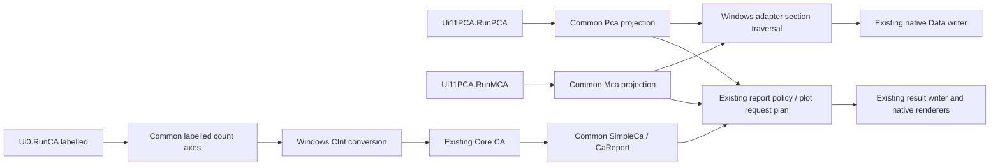

# Batch 04A.18 owner review

**READY_FOR_OWNER_04A18_ACCEPTANCE_REVIEW — extraction only; the unlabelled CA correction remains gated and unapplied.** This is a software extraction review; native/scientific acceptance remains gated. All changes are unstaged, uncommitted and unpushed.

## 1. Verified baseline and scope

Branch `codex/04A-18` was newly created from verified local `main`, HEAD/base **`f539d4e31779a2083d4c135e2784314c0083cff4`**. That commit contains the accepted 04A.17 source, dossier and evidence; its ancestry includes `13c6364` (04A.16) and `60bb832` (04A.15). The initial tracked worktree/index were clean. Only the new batch verifier was initially untracked. No owner edits were absorbed. The owner-maintained Rev. 2.8 Master Plan is unchanged; its official 04A.17–20 rows govern scope despite stale progress prose.

Prechange source SHA-256, byte counts, encodings/newlines and exact method boundaries are in [prechange-method-inventory](../../evidence/04A18/prechange-method-inventory.json). The private initial map pins every tracked file; its own raw hash is recorded in [source-preservation](../../evidence/04A18/source-preservation.json). The original Data-write statements were frozen before production edits in `LegacyMultivariate18Layout.vb`; [provenance](../../evidence/04A18/legacy-layout-provenance.json) pins the derivative separately from its original methods. Historical files were never regenerated or rebaselined.

## 2. Real shipping integration and API



| Shipping method | Actual delegated path | Preserved ownership and verification |
|---|---|---|
| `Ui11PCA.RunPCA` | `MultivariateComponentProjectionPolicy.Pca` → adapter `WritePcaData` → Common `VisitPca`; `projection.ToReport` → existing `LegacyTables`; adapter `RenderPca(projection, model)` | Original acquisition, Core input/settings/one Calculate, Data then PCA results worksheets, report writer and chart lifetime. 72 profile cases and 13 real adapter cases. |
| `Ui11PCA.RunMCA` | Existing post-acquisition subset → `MultivariateMcaTransformIntent` → Common `Mca` → adapter `WriteMcaData`/Common `VisitMca`; `ToReport`; adapter `RenderMca(projection, model)` | Import flags, categorical conversion, Core DataMultiple/Calculate and workbook/result destinations. 18 profiles and six real adapter cases. |
| `Ui0OneRefeditMulticol.RunCA`, labelled | Adapter `CaptureLabelledCa` → Common `Labelled`; adapter `ConvertLabelledCaCounts` uses Common column mapping and original Windows CInt; existing Core data/Calculate → `SimpleCa`/`CaReport` → existing ProcessList/writer → adapter `RenderCa` | Original label acquisition, overwrite prompt, output anchor, workbook/current-sheet destination and five native plots. 12 profiles and 12 real adapter cases, including exceptions and two writer anchors. |
| Same CA method, unlabelled | Original `Else` allocation/loop and Core calls remain byte-equivalent within the frozen method segment | Existing failure is retained. The dormant correct mapping is never called from this path. |

The portable additions are `MultivariateContingencyInput`/`MultivariateCorrespondenceInputPolicy`, `MultivariateMcaTransformIntent`, semantic `MultivariateAxisItem`/`AxisMap`, section/shape/plot descriptors, and `MultivariateComponentProjectionPolicy`. Read-only collections and cloned headers/identity arrays detach plans. Full raw/design/score matrices and Core model/workspace objects are not stored in projections. Immediate synchronous visitors borrow existing arrays; callbacks must not mutate or retain them. Existing `AnalysisResultDocument`, ResultTable output/rehydration and the accepted 04A.17 report policy remain the output contract.

Example: after the existing Core PCA Calculate, `Pca(intent, model, options, originalCells)` captures axes/sections; `WritePcaData(writer, originalCells, model, projection)` consumes those sections using the native writer. Likewise `Mca(New MultivariateMcaTransformIntent(postSubsetIntent, firstRowRemoved), model, originalCells)` captures the already-transformed Core dimensions. `CaReport(projection, counts, model.wrapResults())` prepends the existing contingency table without appending to the caller's list.

Core PCA/CA numerics, public multivariate UDFs/importers, Designers/resx, authored help metadata, native plot renderers and writer implementations remain unchanged. Other Ui11 routes (SPM, k-means, hierarchical, FA and DA), acquisition/label helpers and every other Ui0 method are unchanged. The only extra Ui0 edit is the required Common import; the test project adds three explicit test links/includes. Existing adapter `Capture` and `RenderFactor` remain unchanged, while old RenderPca/RenderMca report overloads remain available and delegate the same native calls. Targets/packages are unchanged: Common/Core netstandard2.0, Windows Framework 4.8.

## 3. Before/after behavior and mapping contract

| Axis/section | Before and after, unchanged output |
|---|---|
| PCA identity | Source post-import RowIds remain distinct from array indices and optional labels. Header `Row ID` without optional labels, `Record ID` with labels; optional `Group ID`. Blank selected labels use source RowId text; blank groups `(missing)`. Duplicate labels are not merged. |
| PCA Data layout | Header row 1/body row 2. With metadata width M (1 or 2), original variables begin column M+1, standardized variables M+P+1, reduced scores M+2P+1. All pointers describe output positions, never inferred source A1 coordinates. |
| PCA axes | Raw/standardized N×P; scores N×K; loadings P×K. Retained components differ from all eigencomponents used by scree. Original standardized naming and `Reduced_Data_PC` headings remain. Existing covariance/correlation preprocessing and retention stay Core-owned. |
| PCA plots | Scree, 2D scores, 2D loadings, biplots 0/0.5/1, 3D scores, 3D loadings. Existing dimensional guards/signs/geometry stay in native renderer/Core. |
| MCA identity/transform | Existing ckFirstRow subset runs before capture. Post-subset physical RowIds/order preserved; N×Q raw observations, N×K indicators, K×K Burt table. No encoder/Burt implementation is added. |
| MCA Data layout | ID at row1/col1 and body row3; raw headings row1/col2 and body row3. `Design MatrixType:` row1/colQ+2; Burt variable block headings row1/colQ+3; category headings row2/colQ+3; design values row3/colQ+3. Raw second header row stays blank. |
| MCA category axes | Core `rowNames`/`ColumNames` here are K category labels, not N observation IDs. BurtVarNames supplies variable block headings. Observation and category coordinate axes are distinct; native MCA correspondence shows categories. Core trims values and sorts levels using current culture. Repeated category text in distinct variables stays separate. Duplicate variable display names yield candidate ambiguous source ownership, never a guessed source key. |
| MCA results/plots | Original wrapResults sequence; correspondence then column contributions on axes 0 and 1. Low-dimensional behavior/renderer exceptions are not suppressed or newly guarded. |
| Labelled CA | Source column 0 is row labels; source j≥1 maps to count column j−1. Count conversion remains Windows CInt, preserving culture, rounding and failure precedence. Row/column count axes remain distinct from MCA individual/category axes. |
| CA result/plots | `Analyzed contingency table` then unmodified wrapResults order. Row contribution axes 0/1, column contribution axes 0/1, correspondence plot. Both existing writer destinations/overlap behavior preserved. |

Candidate diagnostics are bounded (at most 32 projection diagnostics), deterministic and nonblocking. Shape/ownership diagnostics never become a new Windows validation gate. Repeated projections do not mutate options, Core arrays or report lists; headers and read-only views are tested. Ordinary null/malformed/empty/low-dimensional cases retain observed Core/host exceptions or nonfinite outcomes rather than fabricated statistics. A projection of partial Core state is metadata, not a successful analysis.

## 4. Numerical and presentation evidence

All new comparison evidence is **NOT_GOLDEN / same-Core compatibility only**. The oracle is the actual prechange Data-write sequence, with the original CInt loops and unlabelled failure separately retained. Fixed tolerance was chosen before execution: finite doubles use `max(1e-9, abs(expected)*1e-9)`; CLR cell kinds, dimensions, names, nonfinite classes, positions, block/table order, report metadata and final pointers compare exactly. No sign/subspace canonicalization or timing mask is used. The layout comparison does not mean redundant pointer setter calls execute in exactly the same count; their effective writes and final positions match.

The [new comparison corpus](../../evidence/04A18/pca-ca-mca-projection-comparisons-v1.json) records dataset digest, source rows, culture, runtime/configuration, option choices, axes/sections/plot requests, numeric digest or exact exception classification. It contains **916 execution records**, with 380 content-addressed shared profile payloads (canonical public JSON SHA, not raw XML hash). Outcomes: CORE_RETURNED=784, EXISTING_CORE_RETURNED_NOT_SCIENTIFICALLY_VALIDATED=48, LEGACY_FAILURE_RETAINED=16, EXISTING_CORE_REJECTED=32, HOST_CINT_REJECTED=24, DORMANT_CORE_RETURNED_NOT_NATIVE=4, CORE_REJECTED=8. These are populated from final TRX, not guessed from passing test counts. Twenty-four CORE_RETURNED CA records retain nonfinite result cells for negative counts, zero totals or zero margins; they are compatibility records, not validated fits. Core returns containing nonfinite values are explicitly distinguished from scientific success. [Test inventory](../../evidence/04A18/test-inventory.json) maps executable identities to requirements. The unchanged Core/Windows PCA/CA reference tests run in the full suites; new presentation profiles are synthetic source-backed fixtures. Original PCA native-case metadata is retained as authority evidence, not recast as a scientific oracle dataset.

The 1,224 accepted 04A.17 comparisons (including 120 Core rejections and 72 FA nonconvergences) and 100 frozen mixed-model captures are preserved byte-for-byte, not regenerated. Prior evidence, their registry/manifest hashes and byte sizes are in [frozen-capture-hashes](../../evidence/04A18/frozen-capture-hashes.json). The mixed 04A.15 same-Core fit ledger is also retained. Independent R, native workbook/chart capture, Mac/Office browser testing and golden promotion were **NOT RUN / NOT AUTHORIZED**.

## 5. One bounded native disposition: C17-CA-NOLABEL-INDEX-01

**OPEN; correction UNAPPLIED.** The original no-label loop assigns source j=0 to destination −1. Nonempty numeric fixtures throw IndexOutOfRangeException before Core calculation/output. Invalid/overflowing first-cell CInt conversion may throw first; tests retain that distinction. The portable reproducer uses the frozen exact loop. Its successful test means the expected old failure was observed, not that the GUI path succeeded.

Correct candidate mapping is source j→destination j for an unlabelled R×C count matrix. `DormantUnlabelled` and isolated tests demonstrate this mapping and one candidate Core call; the shipping labelled converter explicitly refuses a dormant intent. No form invokes it. The versioned [unapplied patch](../../evidence/04A18/C18-CA-NOLABEL-ACTIVATION-01.UNAPPLIED.patch) changes only that no-label target index. `git apply --check` succeeds; it was never applied.

Activation disposition **`C18-CA-NOLABEL-ACTIVATION-01`** is fully pinned in [decision record](../../evidence/04A18/c17-ca-nolabel-disposition.json): actual current source SHA, exact unchanged original branch SHA, candidate source SHA, patch SHA/bytes and original 39 host controls/seven linked OPEN obligations. Activation needs a separate exact owner authorization/timing exception for this patch/source or satisfaction of the original native prechange gate, including loaded-build/workbook/form/chart attribution and later regression. Conservative risks include input coercion, row/category alignment, current-sheet overlap and native five-chart/output lifecycle. This request is only a future disposition; software extraction can be accepted with the correction still dormant. No release/discharge follows from acceptance.

Other retained limitations: PCA `>` descriptive caption versus Core `>=` boundary (`C18-PCA-THRESHOLD-CAPTION-01`, candidate only); eigenvector sign/tied-subspace/native biplot geometry remain unvalidated; duplicate MCA variable names can make public category ownership ambiguous (`C18-MCA-CATEGORY-OWNER-01`), while data/order remain unchanged. No scientific algorithm is corrected in this batch.

## 6. Validation and failure accounting

Both Debug and Release have the following independently recorded counts (pass/total). Zero skips in these managed suites.

| Suite | Entry Debug | Entry Release | Final Debug | Final Release | Final exit |
|---|---:|---:|---:|---:|---:|
| Core net10 | 1,058/1,058 | 1,058/1,058 | 1,058/1,058 | 1,058/1,058 | 0 |
| Common net10 | 3,059/3,064 | 3,059/3,064 | 3,181/3,186 | 3,181/3,186 | 1 |
| Windows net48 | 3,072/3,074 | 3,072/3,074 | 3,226/3,228 | 3,226/3,228 | 1 |
| Office C# net10 | 505/505 | 505/505 | 505/505 | 505/505 | 0 |
| Office/WASM managed execution | 45/45 | 45/45 | 45/45 | 45/45 | 0 |
| ControlMitigation | 61/61 | 61/61 | 61/61 | 61/61 | 0 |
| **Distinct logical managed** | **5,998/6,004** | **5,998/6,004** | **6,152/6,158** | **6,152/6,158** | **nonpassing** |
| **Raw managed executions** | **7,800/7,807** | **7,800/7,807** | **8,076/8,083** | **8,076/8,083** | **nonpassing** |
| Node: Office + Help + WASM | 916/916 | 916/916 | 916/916 | 916/916 | 0 |
| Python distinct methods | 702/783 | 702/783 | 707/791 | 707/791 | 1 |

Each final aggregate exits **1**. Six managed logical failures (seven raw executions) are inherited, with no changed managed failure identity. Python has **84 nonpasses: 74 FAIL / 10 ERROR**, consisting of **81 at entry plus three newly triggered frozen source-layout assertions**. The eight new Python methods pass. Baseline 04A.17's 704/783 is historical; current entry has two extra frozen 17 assertions: branch mismatch and CA Help publication pin (old CRLF SHA versus merged-main LF bytes).

New managed coverage is **154/154 logical tests** (122 Common, plus 32 Windows-only); its two runtime executions total 276/276 per configuration and are included, not added again, in the full totals. Final focused Release is **122/122 Common and 154/154 Windows**; final focused source contracts **8/8**, all exits 0. Fresh unchanged C02 semantic observations are 15/15 per configuration and excluded from logical/raw aggregate counts as repeats. Office/WASM builds pass; no browser execution is implied.

Historical strict and profile both remain **exit 1** at entry and final: strict reports stale `UibyID`/`NormalPlot` review dependency; profile reports `INTEGRITY_FAILURE`. No gate bypass. Strict MkDocs on final Help bytes exits **0**; its entry build also exits 0. Toolchain: VS2026 MSBuild 18.11.1 / VSTest 18.11.0, .NET SDK 10.0.403, Python 3.14.7, Node v24.20.0, existing configured installations only. Existing compiler/discovery warnings remain; no new dependency or package install.

Both complete final suites follow all final production, managed-test, Python-contract and Help edits. No production/test/Help edit follows them. Later descriptor deduplication, accounting/publication helper, evidence and dossier edits receive schema/hash/link/privacy and final source checks. The final focused checks supplement the aggregates; they do not turn their nonzero exits into passes.

Full entry and final matrices execute the repository verifier through an exact-anchor safety derivative: the original default writes `TestResults/Codex`, restores packages and invokes packaging hooks. The derivative redirects every output to the new exclusive batch root, uses existing packages with no restore, isolates test assemblies, skips packaging/signing and continues unaffected suites while retaining nonzero exits. [Execution adaptations](../../evidence/04A18/execution-adaptations.json) pins original/executed script SHA and exact changes. [Command outcomes](../../evidence/04A18/command-outcomes.json) supplies sanitized exact commands, exits and raw receipt hashes; raw machine-specific logs/TRX remain private locally.

Reproducible orchestration (existing configured Python, no installation):

```text
<PYTHON_EXE> -B scripts/verify-04a18.py final --evidence TestResults/04A-18-20261104-run01 --name final-Debug --configuration Debug
<PYTHON_EXE> -B scripts/verify-04a18.py final --evidence TestResults/04A-18-20261104-run01 --name final-Release --configuration Release
<PYTHON_EXE> -B scripts/verify-04a18.py docs --evidence TestResults/04A-18-20261104-run01 --name final-mkdocs
```

The derivative invokes PowerShell `-NoProfile -ExecutionPolicy Bypass -File <ISOLATED_VERIFIER> -Legacy -Wasm -Js -Python -VisualStudio 2026 -PythonExe <PYTHON_EXE> -Configuration <CONFIG>`. It includes Core/Common/Windows, Office C# and managed execution, WASM builds, Office/Help/WASM Node suites, all three established Python discovery roots plus Common Python, fresh unchanged C02 semantic observations and ControlMitigation. No native Excel or browser execution is part of these commands. Strict MkDocs is `-B -m mkdocs build --config-file BESHStatNG_Help_MkDocs/mkdocs.latest.yml --site-dir <NEW_BATCH_SITE> --strict`.

The six inherited logical managed failures are five Common identities (three `PairedDisjointCountContractAndPureSemanticProjection` rows, `ExistingEquivalenceCoreDomainAndPairedOverflowAreNotReinterpreted`, `ConstantAndSeparatedBinomialPreserveActualFitWarnings(True)`) plus Windows `PairedCompatibilityEvidenceIsExplicitlyLegacy_NotACorrectedGolden`. The constant-binomial test also executes/fails in Windows, hence seven raw failures. Existing expected refusal/exception versus accepted return behavior and paired statistical assertion differences remain unchanged. Full class/row names, assertion details and provenance are in [nonpasses](../../evidence/04A18/nonpasses.json).

All named nonpasses are retained below. Root causes, current/entry exact terminal details and separate raw log/decoded traceback hashes are in nonpasses.json; ERROR entries are not treated as passes. Some inherited method identities acquire additional current source-pin detail; both receipts are retained.

| Managed framework identity | Classification |
|---|---|
| `BESHStat.Excel.Common.Tests.ProportionsPolicyTests.PairedDisjointCountContractAndPureSemanticProjection (20,15,40)` | inherited |
| `BESHStat.Excel.Common.Tests.ProportionsPolicyTests.ExistingEquivalenceCoreDomainAndPairedOverflowAreNotReinterpreted` | inherited |
| `BESHStat.Excel.Common.Tests.ProportionsPolicyTests.PairedDisjointCountContractAndPureSemanticProjection (20,30,50)` | inherited |
| `BESHStat.Excel.Common.Tests.Regression10PolicyTests.ConstantAndSeparatedBinomialPreserveActualFitWarnings (True)` | inherited |
| `BESHStat.Excel.Common.Tests.ProportionsPolicyTests.PairedDisjointCountContractAndPureSemanticProjection (0,0,0)` | inherited |
| `BESHStatNG.Test.ContingencyAdapterTests.PairedCompatibilityEvidenceIsExplicitlyLegacy_NotACorrectedGolden` | inherited |
| `BESHStatNG.Test.Regression10PolicyTests.ConstantAndSeparatedBinomialPreserveActualFitWarnings (True)` | inherited |

The three newly triggered Python predecessors have specific source-layout causes:

`test_04a07_workflow_successor.Anova07SuccessorTests.test_actual_four_shipping_routes_and_native_bodies`: Frozen 07 verify_sources requires the exact historical set of changed methods in the shared Ui0OneRefeditMulticol form. The additional authorized RunCA labelled extraction makes that set differ. All original ANOVA methods and every other Ui0 method are byte-equivalent under the successor method inventory; the old assertion remains FAIL.

`test_04a17_multivariate.Multivariate17SourceContracts.test_actual_six_handlers_delegate_and_keep_one_calculation`: Frozen 17 expects direct MultivariateReportPolicy.Project and RenderPca/RenderMca(report,...) inside the form. PCA/MCA now use projection.ToReport and Render(projection,...); the same accepted report policy/render dispatch is consumed through the actual adapter. Successor Common and real adapter block/type/order tests pass.

`test_04a17_multivariate.Multivariate17SourceContracts.test_native_writer_statements_and_spm_dispatch_stay_identical`: Frozen 17 compares literal Data-sheet set/write statements inside RunPCA/RunMCA. Those statements are now Common section traversal and the real Windows WritePcaData/WriteMcaData bridge. Frozen actual statements remain in LegacyMultivariate18Layout; functional successor comparisons prove equal effective write blocks/payloads/metadata/final pointers. SPM and all other listed form methods remain unchanged.

| Python identity | Outcome | Relative to entry |
|---|---|---|
| `test_04a02_checkpoint09.Native09Tests.test_unapplied_patch_routes_every_active_selection_binding_and_guards_workbook` | FAIL | entry |
| `test_04a02_checkpoint11.Namespace11Tests.test_exact_retained_bytes_reproduce_only_compiler_rejection` | FAIL | entry |
| `test_04a02_checkpoint11.Provenance11Tests.test_both_authorized_case_pins_pass_and_frozen_false_is_not_owner_decision` | ERROR | entry |
| `test_04a02_checkpoint12.Diagnosis12Tests.test_both_authorized_case_pins_keep_original_compiler_and_scientific_policy` | ERROR | entry |
| `test_04a02_checkpoint12.Diagnosis12Tests.test_exact_owner_bytes_negative_for_frozen_v5` | FAIL | entry |
| `test_04a02_checkpoint13.Startup13Tests.test_corrupt_receipt_hash_fails_even_with_exit_zero` | FAIL | entry |
| `test_04a02_checkpoint13.Startup13Tests.test_real_successful_owner_startup_all_pins_and_native_identities` | ERROR | entry |
| `test_04a02_checkpoint13.Startup13Tests.test_tampered_stdout_hash_stops_before_parser` | FAIL | entry |
| `test_04a02_checkpoint14.Actual14Tests.test_actual_two_owner_publications_and_both_cultures_reproduce` | ERROR | entry |
| `test_04a02_source_specs.SourceSpecifications.test_all_native_blockers_and_anchored_mappings` | ERROR | entry |
| `test_04a03_control_mitigation.ControlMitigationSourceTests.test_per_mode_consumers_and_branch_order` | FAIL | entry |
| `test_04a03_control_mitigation.ControlMitigationSourceTests.test_sealed_sources_are_reconciled_never_rewritten` | FAIL | entry |
| `test_04a03_control_mitigation.NativeGateNegativeTests.test_review_packet_source_pins_match_current_sources` | FAIL | entry |
| `test_04a03_selection.UnivariateSelectionSourceTests.test_all_native_lifetime_cancel_write_and_reporting_methods_unchanged` | FAIL | entry |
| `test_04a03_selection.UnivariateSelectionSourceTests.test_only_two_form_methods_change` | FAIL | entry |
| `test_04a04_alignment.PairedBlockSourceGates.test_exact_crosswalk_and_authorities` | FAIL | entry |
| `test_04a04_alignment.PairedBlockSourceGates.test_legacy_geometry_ambiguity_is_not_hidden` | FAIL | entry |
| `test_04a05_completion_successor.Completion05SuccessorTests.test_independent_candidate_provenance_not_core_or_golden` | FAIL | entry |
| `test_04a05_completion_successor.Completion05SuccessorTests.test_nonpaired_code_and_unrelated_forms_are_unchanged_from_partial` | FAIL | entry |
| `test_04a05_completion_successor.Completion05SuccessorTests.test_owner_bound_successor_and_source_hashes` | FAIL | entry |
| `test_04a05_contingency.ContingencySourceGates.test_historical_ledgers_and_importer_unchanged` | FAIL | entry |
| `test_04a05_contingency.ContingencySourceGates.test_other_multicol_members_including_04a04_selection_unchanged` | FAIL | entry |
| `test_04a05_contingency.ContingencySourceGates.test_prior_04a04_whole_file_source_check_remains_frozen_and_disclosed` | FAIL | entry |
| `test_04a05_contingency.ContingencySourceGates.test_scientific_ambiguity_is_not_a_permanent_portable_wrong_table` | FAIL | entry |
| `test_04a05_contingency.ContingencySourceGates.test_ui82x2_source_wiring_explicitly_withheld` | FAIL | entry |
| `test_04a05_contingency.ContingencySourceGates.test_versioned_successor_sources_and_case_boundaries` | FAIL | entry |
| `test_04a06_assumptions_successor.Assumptions06SuccessorTests.test_actual_form_routes_and_unchanged_native_tails` | FAIL | entry |
| `test_04a06_assumptions_successor.Assumptions06SuccessorTests.test_importer_udf_designers_core_and_old_tests_unchanged` | FAIL | entry |
| `test_04a06_assumptions_successor.Assumptions06SuccessorTests.test_native_population_is_union_not_sum` | FAIL | entry |
| `test_04a06_assumptions_successor.Assumptions06SuccessorTests.test_new_scientific_candidates_are_explicitly_unmodified` | FAIL | entry |
| `test_04a06_assumptions_successor.Assumptions06SuccessorTests.test_no_duplicate_statistics_in_form_or_windows_adapter` | FAIL | entry |
| `test_04a06_assumptions_successor.Assumptions06SuccessorTests.test_production_sources_and_exact_open_ledger_lineage` | FAIL | entry |
| `test_04a07_workflow_successor.Anova07SuccessorTests.test_actual_four_shipping_routes_and_native_bodies` | FAIL | **new frozen layout** |
| `test_04a07_workflow_successor.Anova07SuccessorTests.test_core_old_tests_importer_udfs_designers_and_help_unchanged` | FAIL | entry |
| `test_04a07_workflow_successor.Anova07SuccessorTests.test_exact_source_and_original_ledger_rows` | FAIL | entry |
| `test_04a07_workflow_successor.Anova07SuccessorTests.test_no_fabricated_obligation_for_previously_source_qualified_controls` | FAIL | entry |
| `test_04a07_workflow_successor.Anova07SuccessorTests.test_restriction_unions_and_timing_exceptions_not_generalized` | FAIL | entry |
| `test_04a08_authoring_successor.Authoring08SuccessorTests.test_exact_id_crosswalk_retains_original_row_hashes_and_open_counts` | FAIL | entry |
| `test_04a08_authoring_successor.Authoring08SuccessorTests.test_original_numerics_and_shipping_forms_are_unchanged` | FAIL | entry |
| `test_04a09_regression_successor.Regression09SuccessorTests.test_exact_six_changed_members_and_unchanged_native_surroundings` | FAIL | entry |
| `test_04a09_regression_successor.Regression09SuccessorTests.test_frozen_tests_numerics_and_public_04a08_evidence_preserved` | FAIL | entry |
| `test_04a09_regression_successor.Regression09SuccessorTests.test_real_six_routes_use_common_options_counts_and_reports` | FAIL | entry |
| `test_04a09_regression_successor.Regression09SuccessorTests.test_runtime_baselines_are_incremental_and_complete` | FAIL | entry |
| `test_04a10_regression_projection.Regression10ProjectionTests.test_baselines_are_actual_gaussian_and_binomial_and_not_goldens` | FAIL | entry |
| `test_04a10_regression_projection.Regression10ProjectionTests.test_core_udfs_frameworks_and_accepted_evidence_are_byte_protected` | FAIL | entry |
| `test_04a10_regression_projection.Regression10ProjectionTests.test_only_two_form_routes_change_and_native_tails_match` | FAIL | entry |
| `test_04a11_publication.Publication11Tests.test_accepted_dossier_and_dormant_patches_unchanged` | FAIL | entry |
| `test_04a11_publication.Publication11Tests.test_all_manifests_and_implementation_freeze` | FAIL | entry |
| `test_04a11_publication.Publication11Tests.test_raw_local_source_pins_and_native_writer_tails` | FAIL | entry |
| `test_04a11_regression_families.Regression11SuccessorTests.test_exact_six_form_deltas_and_native_writer_tails` | FAIL | entry |
| `test_04a11_regression_families.Regression11SuccessorTests.test_unaffected_sources_and_all_old_evidence_are_byte_protected` | ERROR | entry |
| `test_04a12_gee_workflow.Gee12WorkflowSuccessorTests.test_exact_source_scope_and_all_old_byte_pins` | FAIL | entry |
| `test_04a13_survival_workflow.Survival13SourceContracts.test_all_prechange_protected_bytes_except_exact_approved_scope` | FAIL | entry |
| `test_04a13_survival_workflow.Survival13SourceContracts.test_local_main_ancestry_empty_index_and_dedicated_branch` | FAIL | entry |
| `test_04a13_survival_workflow.Survival13SourceContracts.test_successor_pins_and_members_reconcile_to_actual_forms` | FAIL | entry |
| `test_04a14_mixed_workflow.Mixed14SourceContracts.test_branch_base_ancestry_and_empty_index` | FAIL | entry |
| `test_04a14_mixed_workflow.Mixed14SourceContracts.test_exact_scope_and_external_owner_plan_are_separate` | FAIL | entry |
| `test_04a14_mixed_workflow.Mixed14SourceContracts.test_original_members_and_successor_pins_are_reconcilable` | FAIL | entry |
| `test_04a14_mixed_workflow.Mixed14SourceContracts.test_reports_are_consumed_by_actual_writers_and_append_seams` | FAIL | entry |
| `test_04a15_fitting.Mixed15SourceContracts.test_all_protected_sources_and_new_source_hashes` | FAIL | entry |
| `test_04a15_fitting.Mixed15SourceContracts.test_branch_ancestry_empty_index_and_exact_existing_scope` | FAIL | entry |
| `test_04a15_fitting.Mixed15SourceContracts.test_only_actual_shipping_factory_routes_change` | FAIL | entry |
| `test_04a16_post_estimation.Mixed16SourceContracts.test_branch_base_index_and_exact_scope` | FAIL | entry |
| `test_04a16_post_estimation.Mixed16SourceContracts.test_unchanged_methods_designers_udfs_and_core` | FAIL | entry |
| `test_04a17_multivariate.Multivariate17SourceContracts.test_actual_six_handlers_delegate_and_keep_one_calculation` | FAIL | **new frozen layout** |
| `test_04a17_multivariate.Multivariate17SourceContracts.test_live_base_branch_index_and_protected_sources` | FAIL | entry |
| `test_04a17_multivariate.Multivariate17SourceContracts.test_native_writer_statements_and_spm_dispatch_stay_identical` | FAIL | **new frozen layout** |
| `test_04a17_multivariate.Multivariate17SourceContracts.test_public_targets_and_successor_hashes` | FAIL | entry |
| `test_04a27_geometry_completion.Geometry27CompletionTests.test_compile_targets_and_native_helpers_unchanged` | FAIL | entry |
| `test_04a27_geometry_completion.Geometry27CompletionTests.test_initial_implementation_and_historical_tests_not_rewritten` | FAIL | entry |
| `test_04a27_geometry_completion.Geometry27CompletionTests.test_real_consumer_routes_and_udf_exports_preserved` | FAIL | entry |
| `test_04a27_geometry_completion.Geometry27CompletionTests.test_source_owner_pins_and_all_44_original_rows` | FAIL | entry |
| `test_04a27_transport_successor.Transport27SuccessorTests.test_core_designer_and_refedit_sources_are_unmodified` | FAIL | entry |
| `test_04a27_transport_successor.Transport27SuccessorTests.test_exact_successor_and_unapplied_patch` | FAIL | entry |
| `test_capture_contract04a02.CaptureContracts.test_all_239_ledger_rows_identified_with_original_digest_convention` | ERROR | entry |
| `test_capture_contract04a02.CaptureContracts.test_complete_source_crosswalk_equality` | ERROR | entry |
| `test_capture_contract04a02.CaptureContracts.test_packet_covers_all_original_cases_and_six_gates` | FAIL | entry |
| `test_capture_contract04a02.CaptureContracts.test_packet_retains_additional_21_deferred_obligations` | ERROR | entry |
| `test_investigation06.Investigation06Tests.test_all_239_exact_ids_have_reversible_root_cause_source_maps` | ERROR | entry |
| `test_investigation06.Investigation06Tests.test_anova_defaults_mapping_remain_explicit_source_facts` | FAIL | entry |
| `test_investigation06.Investigation06Tests.test_normality_5000_disagreement_preserved_as_review_defect` | FAIL | entry |
| `test_investigation06.Investigation06Tests.test_pca_has_three_biplot_scales_not_the_old_two_scale_proposal` | FAIL | entry |
| `test_investigation06.Investigation06Tests.test_refedit_disposal_and_sheetactivate_guards_are_source_not_native_proof` | FAIL | entry |
| `test_investigation06.Investigation06Tests.test_two_by_two_or_condition_and_no_chart_handler` | FAIL | entry |

No frozen assertion was weakened, edited or relabelled passing. The old C06 literal three-biplot assertion remains failing; new ordered 0/0.5/1 functional contracts pass. Final-source qualification and any post-aggregate accounting-only changes are stated in validation.json; a focused final check supplements, never replaces, full runs.

## 7. Preservation, native authority and publication

Retention passed for **213,539 root historical files and 139 nested historical files**, with zero membership/size/creation-write timestamp/file-identity errors. This is not a claim of rereading every historical result byte. Targeted source/frozen artifact hashes additionally pass. 3,124 initially tracked files outside the seven approved modifications remain SHA-identical. The 100 captures and all prior 04A.14?17 evidence retain original SHA/bytes. [Retention receipt](../../evidence/04A18/retention.json) identifies the private original census and the final receipt hash. [Format preservation](../../evidence/04A18/format-preservation.json) confirms the 19 audited files retain encoding/BOM, newline style and EOF convention. There are no deleted, unrelated or line-ending-only publication changes; the Master Plan is unchanged. Free space remains above both advisory thresholds. No historical evidence was deleted, compressed, moved or rebaselined.

Original identities are retained in [control crosswalk](../../evidence/04A18/original-control-crosswalk.json) and [native lineage](../../evidence/04A18/native-lineage-successor.json), with original row/record/authority hashes. Current source has 147 Ui11 controls and 39 standalone-host controls, with 152 combined linked OPEN obligations (145 plus seven); 75 Ui11 and three host controls retain their original restricted classification. The original PCA case `04A02-PCA-NATIVE-01` is still NOT_RUN/BLOCKED, covering historical 75 blocked controls/76 deferred obligations. These populations overlap and are **not added**. Shared RefEdit source/control obligations and the amended C02 acceptance authority remain intact. Mixed lineage remains 177 controls/69 OPEN/67 restricted, also not added to PCA populations. Zero releases or discharges.

**P NO / N1 NO GO / N2 NO / Gate C2 UNMET.** Original C09/C11/C12 correction patches remain unapplied; C13 earliest-censor log-rank risk-set defect remains OPEN for 04A.40–41; C14 stricter Windows diagnostics remain candidate-only/nonblocking. Other accepted case-specific C02 timing exceptions remain unchanged.

The exact proposed [publication manifest](../../evidence/04A18/publication-manifest.json) lists every modified/new path, SHA-256, bytes, role and live Git ignore results. Only the manifest itself is excluded from its hash map to avoid a cycle; its membership/JSON/privacy/trackability and separate SHA are checked. The full exact candidate set is scanned, including decoded JSON/base64, profile/drive/UNC paths, current owner/host identifiers, SID/secret/credential patterns. Sanitized public derivatives have their own hashes; local raw hashes are not claimed as public payload hashes. No raw logs, binaries, private workbook contents or Python caches are publication candidates. No ignore rule is changed. Final Git index is empty and `git diff --check` passes. All 42 exact candidates pass privacy/trackability checks; 41 external file hashes/byte sizes match, with the manifest checked separately. The bounded version-one evidence schema/link checks also pass.

Exact candidate membership is below; all external file digests/sizes are also machine-verified in publication-manifest.json. Dossier self-metadata is supplied by that external manifest; the manifest's own SHA/bytes are checked separately to avoid a cycle. No Git stage/commit/publication is performed.

| Path | Change | Bytes | SHA-256 |
|---|---|---:|---|
| `BESHStat.Excel.Common.Tests/src/LegacyMultivariate18Layout.vb` | new | 3356 | 235bde2960b3109f6c33f5736331e18071dda675a8bf2d315dfa9ea1b39cac32 |
| `BESHStat.Excel.Common.Tests/src/Multivariate18Tests.vb` | new | 34607 | 633ad9864e6aab1a08eb77d97a328d9b7e243b824413ad81b9411dbeeb272cf2 |
| `BESHStat.Excel.Common/src/Analysis/MultivariateCorrespondenceInputPolicy.vb` | new | 5104 | e80d3e02409b09f56af269e4c359ab158467eac2a3922fd9e90ef4017d270b87 |
| `BESHStat.Excel.Common/src/Results/MultivariateAxisProjection.vb` | new | 8433 | ca145cb665519ac8aeb28f60648b84bf8d57b07bb5335ac4861fd96dd2b42c01 |
| `BESHStat.Excel.Common/src/Results/MultivariateComponentProjectionPolicy.vb` | new | 23289 | e0b711808eade72371e7864927b701797c54e52c520df61b9818a3a85d00fa7a |
| `BESHStatNG.Test/BESHStatNG.Tests.vbproj` | modified | 22793 | d792e7d1feb5257e52b86b49c4e6a79f6820d931800d885a6a2eb024a56f04f1 |
| `BESHStatNG.Test/src/Multivariate18AdapterTests.vb` | new | 7784 | bb830c206278b797f1f2646c08cc63db6fe4c3a25e38b6510f3ef94dc6e4814d |
| `BESHStatNG_Help_MkDocs/docs/methods/correspondence-analysis.md` | modified | 12704 | 5c263ce763e7892ec4a6719aea3cc328595589994af1c75dbc95e67861f66dd2 |
| `BESHStatNG_Help_MkDocs/docs/methods/multiple-correspondence-analysis.md` | modified | 13028 | 5d366081a7f33bd640579d9080c9c9f6ab6cf985ac6372ea3323b46248df0ecd |
| `BESHStatNG_Help_MkDocs/docs/methods/principal-component-analysis.md` | modified | 24960 | fc9710bc196d017a4484644f925baa6309592ff5cdf92eb6827bf19288103227 |
| `BESHstatNG/src/DM/WindowsMultivariateWorkflowAdapter.vb` | modified | 6089 | 724bf78888ecf65d6ed44232897312a3a45c642b374905c543ad114cb997456e |
| `BESHstatNG/src/UI/Ui0OneRefeditMulticol.vb` | modified | 37417 | 0f6d19f72697bcab51f61f32d5eb0eab2bf9161630a8bbc37ae6cd68abb52214 |
| `BESHstatNG/src/UI/Ui11PCA.vb` | modified | 59650 | bb31c166c84fe3087555afe20e08365e1c3679b977a21ae63597e1a287d5cfd6 |
| `docs/architecture/batch-04A-18-owner-review.md` | new | external | separate manifest/self check |
| `evidence/04A18/C18-CA-NOLABEL-ACTIVATION-01.UNAPPLIED.patch` | new | 491 | 3acd187210617e2d98b8388d3bd5973af53fba1a00804b0a891fb98f4aed58c3 |
| `evidence/04A18/c17-ca-nolabel-disposition.json` | new | 12705 | f615ec4a21354eaed2e24ce8cbf13d0fad172b2fc8baefceacb0f9e2635ae29f |
| `evidence/04A18/command-outcomes.json` | new | 37194 | f034fe5612d9a259985d575836fca58fc9e5b187716e12f13fdac8f36fa375fb |
| `evidence/04A18/development-corrections.json` | new | 989 | 0a7e8cfe7c2f85e2647cd58d32f10fc09f3eb73c861e95fe056f78500529915a |
| `evidence/04A18/documentation-audit.json` | new | 830 | 78743fb115ced11708d218d6f6c5b1d1bab6d9a5ee10b32ef4979cc09b23001c |
| `evidence/04A18/entry-state.json` | new | 73887 | 5efaf5bc8b3b9c2e409134af996797bfb8b78054a56d53bca5fc30097909c514 |
| `evidence/04A18/execution-adaptations.json` | new | 24021 | 446cb953118a5e4661a567de6578c79598383d2f6f8f7275d98a2ba86a4e90fc |
| `evidence/04A18/format-preservation.json` | new | 7205 | fba45f399be414a74cb92566c566434ddca179c077f20d37808a352bb705c46d |
| `evidence/04A18/frozen-capture-hashes.json` | new | 51042 | b208e7467f5d0b52ced851c3262f353332787286c6ddfaf5a884ea3fc95b3cb0 |
| `evidence/04A18/implementation-plan.json` | new | 1894 | 8e0bdb4c667beb5481718c6a3189e1876c518b20c257f380fb831dd068923ee7 |
| `evidence/04A18/legacy-layout-provenance.json` | new | 864 | f8fe1d78ace398e18fd6dbfa3483f8efee8a14af1bceb9176deaddc762075704 |
| `evidence/04A18/native-lineage-successor.json` | new | 33934 | bcf492706289949f803d3130b67e96dfdd7eac6c6fb8d7c93a0e602d26148ebc |
| `evidence/04A18/nonpasses.json` | new | 197264 | eeb724ff0d48e4968e60f43ba255b9d2b837e484bc9c5fa19a007a38ef568f9f |
| `evidence/04A18/original-control-crosswalk.json` | new | 131086 | 09c26b43d40c66d7e53e4feaef50f5770381de8210c928106c24d4c2651f0438 |
| `evidence/04A18/pca-ca-mca-projection-comparisons-v1.json` | new | 4857592 | 819c8045071f7eae1e9c2626e3a5194fd95bb9266c16bcd48cbe034d545af777 |
| `evidence/04A18/prechange-manifest.json` | new | 13696 | 60a0c7e94ba5ecbf78ecaf68900b5f77284a171b174526eb47a025ba9bb57b29 |
| `evidence/04A18/prechange-method-inventory.json` | new | 26592 | c31981b6b61ce1abfa8fbca14cabf2207506311ebdaf6ac15393df91074646b0 |
| `evidence/04A18/privacy.json` | new | 567 | 30be567442e406d946a1e1e830a224e1ed0a7e6db3e953b091396882585f99cd |
| `evidence/04A18/publication-manifest.json` | new | external | separate manifest/self check |
| `evidence/04A18/retention.json` | new | 852 | 302a5cc1448fc784e59254fda93955bca9c3faaf4c751286d4c50cd1c24772c8 |
| `evidence/04A18/source-preservation.json` | new | 9606 | b6e0e142e9124737fcd171f36bea21bc59627d25d296fc8bf2766fed157c3ca3 |
| `evidence/04A18/test-inventory.json` | new | 3813 | 73a9b170847dac95bcd17bda53f8b55cfcd3d29eb255826e7e05d6815757e065 |
| `evidence/04A18/validation.json` | new | 77642 | f1cc59d9a24f45db13145c713c6822e832ba38f875fd06947fe19f4980de85eb |
| `scripts/capture-04a18-contract.py` | new | 10020 | 2f14c85c63d473448768cde6721522593e120a3095bc00990a03bd6e74da4be1 |
| `scripts/summarize-04a18.py` | new | 15400 | fc260e48a8db714b4659fe797c05c46789ad70ca20548e54a3d66d1724c458a5 |
| `scripts/tests/test_04a18_projection.py` | new | 7203 | 53e1b4e323b682dedcb64df3fc1e90a04faeb3a146314f4bb1330c00c594716e |
| `scripts/verify-04a18-publication.py` | new | 9482 | 9d0872a49745e9ae052c37c541d074c1c9916fcb83834934f9fac2cf9db9b052 |
| `scripts/verify-04a18.py` | new | 6389 | e8bdfac133a206981d37af42e58c1d737bf078c777e55299fcf1b40a2addb4eb |

## 8. Same-batch documentation

Only PCA, CA and MCA method pages change: PCA input-variable versus score/loading/component axes and the retained threshold-caption discrepancy; MCA individual/category/Burt axes and exact two-header layout/current-culture ordering; CA labelled mapping, existing five-plot/output order and still-open no-label failure. Existing Office/Excel Online unavailability notices remain truthful. No new controls, screenshots or Office feature is claimed. Existing screenshots, Help navigation, resolver links and `_meta/methods.yml` are unchanged. Strict MkDocs covers final Help bytes.

Proposed owner-maintained plan amendment: mark 04A.17 accepted per live merge and 04A.18 software extraction review-ready with the no-label correction still gated, all native/scientific gates retained and all nonpasses disclosed. This dossier does not change the plan itself.

## 9. Future boundaries and unperformed smoke checks

04A.19 clustering and 04A.20 FA/DA specialization remain untouched. PCA/CA graphics geometry/rendering equivalence belongs to 04A.29–37; broad GUI/UDF/scientific alignment to 04A.39–42; native captures and gate closure to 04A.45–48. Independent statistical reference review and golden promotion require separate authorization. Portable contracts do not establish a functional Office, WASM, Mac or LibreOffice GUI.

Suggested future native checks, **NOT RUN / NOT AUTHORIZED**: (1) PCA reference input with noncontiguous source rows, optional duplicate/blank labels and groups, comparing Data/results and all three biplot scalings against an attributed prechange build; (2) labelled CA reference contingency table in both workbook and current-sheet destinations, checking overlap prompt, contingency/result order and five charts. Unlabelled CA activation additionally needs the disposition in section 5; it is not included in a passing smoke claim.

## 10. Proposed bounded owner decision

Accept only the 04A.18 software extraction of PCA/MCA input/result axes and Data/report/plot request preparation plus labelled CA count-axis/result projection. Retain all listed nonpasses, NOT_GOLDEN classifications, original OPEN obligations/restricted controls, C09–C14 restrictions and C17-CA-NOLABEL-INDEX-01 with C18 activation patch unapplied. Preserve P NO / N1 NO GO / N2 NO / Gate C2 UNMET. Acceptance grants no native execution, scientific promotion, control release, Git publication or commencement of 04A.19. Git staging/commit/merge/push and any no-label correction remain separate owner decisions.
