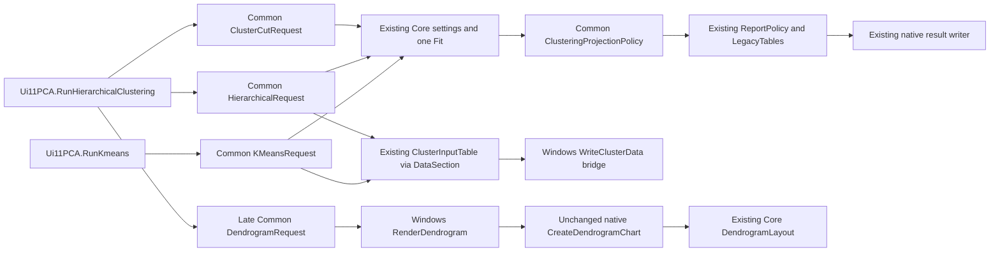

# Batch 04A.19 owner acceptance review

**READY_FOR_OWNER_04A19_ACCEPTANCE_REVIEW — software extraction only.** All 333 new logical managed tests and 12 new Python contracts pass. Full managed/Python suites and historical strict/profile checks remain nonzero, as enumerated below. Native/scientific gates remain blocked. Nothing is staged, committed, merged, pushed, installed, signed or deployed; 04A.20 has not started.

## 1. Verified live entry and authority

The actual clean local `main` was **`5429a46ac706a43c9f57136eef68158decedf89d`**, also the observed local `origin/main` and `codex/04A-18` ref. Its parent is `f539d4e31779a2083d4c135e2784314c0083cff4`; commit time is `2026-11-04T14:34:22+01:00`, tree `c8d491eb30d22a6a348bc5c95a8f2d24791b1b17`. Git is linear here: there is no separate merge commit to invent. The owner's explicit 2026-11-04 acceptance/merge statement supplies acceptance authority; live Git establishes inclusion of the actual 04A.18 production source, tests, dossier and evidence. No remote fetch or publication was performed. The archived pre-merge base was not used as current main.

The initial tracked tree and index were clean, with one worktree. The new `codex/04A-19` branch was created without overwriting an existing branch. Git initially refused sandbox ownership; repository-scoped `safe.directory` was used per invocation, with no global configuration mutation. Creating the authorized branch ref required and received the sandbox's escalation approval. No reset, clean, stash, owner-edit discard or remote-branch change occurred.

AGENTS.md, Master Plan Rev. 2.8 literal 04A.17–04A.20 rows, accepted 17/18 dossiers, corresponding evidence, original 04A.02 case/controls and later amended acceptance were inspected. Official 04A.19 alone governs; stale introductory plan prose and historical pending forms are preserved. The 04A.02 later receipt accepts amended foundation scope and retains the original scientific/native obligations; it is not native permission.

[Entry state](../../evidence/04A19/entry-state.json), [entry validation](../../evidence/04A19/entry-validation.json) and [prechange method inventory](../../evidence/04A19/prechange-method-inventory.json) record the live base, 991 source/project/tool hashes, exact prechange method hashes and actual baseline failures. Exact original clustering methods, options/choices and Data-table policy are retained locally under the new ignored batch root. A private full tracked-source map is separately SHA-pinned. No source hash is inferred from a ZIP.

## 2. Shipping API and ownership



| Path/API | Concrete responsibility |
|---|---|
| `BESHStat.Excel.Common/src/Analysis/MultivariateClusteringRequest.vb` | `MultivariateKMeansRequest`, `MultivariateHierarchicalRequest`, `MultivariateClusterCutRequest`, `MultivariateStartingCentersIntent`, `MultivariateClusterDataSection`, `MultivariateDendrogramRequest`. Detached pre-fit options and provenance; copied legacy options; separate cut/display timing; original-scale centre shape only; existing Data policy and Core layout delegation. |
| `BESHStat.Excel.Common/src/Results/MultivariateClusteringProjection.vb` | `MultivariateClusterObservation`, `MultivariateClusterMerge`, `MultivariateClusterSection`, `MultivariateClusteringProjection`, `MultivariateClusteringProjectionPolicy`. Actual post-fit row/member/variable/centre/merge/leaf axes and ordered existing report sections. |
| `BESHstatNG/src/DM/WindowsMultivariateWorkflowAdapter.vb` | Two `WriteClusterData` overloads consume Data-section positions and the existing table contract. `RenderDendrogram` forwards the original chart arguments to the unchanged native renderer. Existing adapter methods remain available. |
| `BESHstatNG/src/UI/Ui11PCA.vb` | Only the two clustering handler bodies change. Each consumes request configuration, actual data/report projections and optional chart intent. Existing public/Windows entry signatures, acquisition, labels, parsers, importer, defaults and other routes remain unchanged. |

Requests do not claim a fit succeeded. Read-only properties, private copied legacy options, copy-returning option accessors and read-only axis/section lists detach state. Source keys/names/RowIds/labels compose the immutable 04A.17 input intent. Core arrays/models and full raw N×P matrices are not stored in the new plans. Raw cells are borrowed only for an immediate synchronous Data-table write; callers must not retain or mutate borrowed input during the callback. Existing report documents own their usual copied presentation matrices.

Core still owns all preprocessing, standardization constants, RNG/seed resolution, initializations, objective/distances, empty-cluster recovery, convergence, centroids, merges/ties, memberships, leaf order, layout coordinates and wrapResults statistics. Common supplies no second statistical algorithm. The hierarchical projection obtains membership from the existing pure Core cut helper after successful wrapResults; it never calculates a cut/tree itself. There is one Fit per real handler and no additional RNG work. The optional request's layout convenience method delegates to Core; the shipping renderer continues to create its own existing Core layout, with no precomputed duplicate geometry.

## 3. Before/after behavior parity

| Area | Preserved behavior and executable evidence |
|---|---|
| K-means choices | All four initializations; original Core enums and unchanged UI index mapping; k=1/2/3/n and invalid k; one/multiple starts, user-centre actual one start; original iterations/tolerance and all three empty-cluster strategies. Fixed-seed direct Core and request calls compare exact arrays and cluster numbers. One-iteration random partition remains observed nonconverged. |
| Seed provenance | Blank passes `Integer.MinValue`; Core resolves the configured default/time fallback at Fit. Explicit zero remains a real seed. Only returned `RandomSeedUsed` populates post-fit metadata. Seed 0/1/123 replay is tested; unspecified-seed tests observe then replay the returned seed, with no promise that unspecified runs repeat or differ. |
| Starting centres | Original RefEdit address, workbook activation, `ImportInto(..., bStartRow:=True)`, zero-valid/row/column checks and DataDbl sequence remain byte-identical in Windows. Core still receives original-scale k×p values in selected order and performs their single transform. New shape provenance reads no range or cell. Seven host-free tests execute exact frozen post-import validation statements; a SHA contract proves the derivative equals shipping statements. No RefEdit/Excel execution is implied. |
| Distance/preprocessing | Euclidean reporting changes reported distances only; squared-Euclidean SSE/partition remain unchanged. None, sample-SD Z-scores and range scaling, constant/near-constant variables, missing/nonfinite inputs, listwise deletion and all-removed rejection are observed via the same Core. Original/working centres, scales, sizes, SSE and iteration/convergence/seed metadata are hashed or retained without Common recalculation. |
| Hierarchy choices | All seven Core linkage values × seven distance values × three standardizations; UI order is still the original Ward/Complete/Average/Weighted/Single/Centroid/Median mapping. Rejected Ward/Centroid/Median non-Euclidean combinations retain Core class/message/timing. Minkowski 1/2/1.5 and 0/negative/NaN/infinite power outcomes are retained, including genuine exceptions. |
| Cuts | Fit options are configured before host cut parsing, just as before. Both numerical fields retain their host parse boundaries even when disabled. Count validation uses active rows in Core. Heights below/at/above merge boundaries retain equality inclusion, numbering/ties and observed prefix behavior under inversion. |
| Data workbook | A new workbook, Data first; header row 1/body row 2; OriginalRow first, optional RowLabel second, then original selected raw variables/cell CLR types. Source RowIds and optional labels are unchanged. One existing ClusterInputTable call supplies the same matrix. New explicit pointer initialization is 1/1, matching the original new writer; memory-writer blocks and final pointers compare. |
| Report workbook | Original new-workbook writer pattern and actual names `KMeans results` and `Hierarchical results`. Existing ReportPolicy → AnalysisResultDocument → LegacyTables → ProcessListofResultTables preserves cell types, titles, order, header/footer depths, metadata and footnotes. Repeated projection does not append sections or mutate Core arrays/options/report views. |
| Dendrogram | Checkbox off: zero plot requests and no Dendrogram sheet. On: exactly one existing PlotPlan Dendrogram role, sheet `Dendrogram`, A1, width 680.0, height 420.0, title `Hierarchical Clustering Dendrogram`. Height/orientation/label/cut getters are captured after result writing and sheet naming, in original order, including the second cut-height parse. The native chart method is unchanged. All 2×4×3×2 layout/display/cut combinations compare actual Core coordinates/labels/cut lines/cluster polylines. Native style, worksheet/chart lifetime and cleanup remain unobserved. |

K-means section order remains Settings, Fit Summary, Original Scale Centers, conditional Working Analysis Scale Centers and Preprocessing Constants, Observation Assignments, conditional Removed Rows. Hierarchical order remains Settings, Fit Summary, Agglomeration Schedule, Leaf Order, chosen Cluster Membership title, conditional Preprocessing Constants and Removed Rows. The actual Core captions/footnotes, including the inversion-related all-merges wording, are preserved.

SPM, FA/DA, accepted PCA/MCA handlers, standalone labelled/unlabelled CA, six-route selection and prior Common APIs remain unchanged. The dormant C17/C18 CA correction is not activated. Existing tests, Designers/resx, Ribbon/UDFs, importers/RefEdit, native graphics/writer internals, packaging/signing/installers, project targets/packages, Office client code, metadata and owner plan retain entry bytes. [Source preservation](../../evidence/04A19/source-preservation.json) verifies all initial tracked files outside the five authorized modified paths and every unchanged form method.

## 4. Row identity issue remains OPEN and uncorrected

**C19-CLUSTER-ROWID-DISPLAY-01** is reproduced in both clustering families. For source RowIds `101,105,118,131`, deleting input position 2 leaves input ordinals `1,3,4`, physical source rows `101,118,131` and hierarchical active leaves `1,2,3`; new internal IDs are `4,5`. Leaf-order positions are a separate permutation. Duplicate/Unicode labels are display text, never identifiers.

The Data sheet's OriginalRow contains physical source RowIds. Existing Core assignment/membership/removed-row OriginalRow cells contain 1-based analysis input positions. These headings/cells are unchanged. The portable observation map contains the correct physical identity alongside the legacy ordinal and active/removed/leaf/member axes. A future corrected output could select SourceRowId from this mapping, but no output activation or silent heading/cell rewrite is shipped. [Disposition and reproduction](../../evidence/04A19/cluster-rowid-disposition.json) assigns future ownership to 04A.28 / 04A.39–42 or a separately approved timing exception, subject to the original applicable native and visible-behavior owner decision.

No selected label preserves Core `Obs 1`, `Obs 2`, … and omits Data RowLabel. Selected blank labels retain the Windows `Row {RowId}` fallback before capture. These modes, noncontiguous/reordered source rows, deletion, repeated labels and defensive copies are tested.

Two additional candidates remain unmodified: **C19-HIERARCHICAL-NONFINITE-POWER-01** (NaN Minkowski power reaches Fit and throws the current dictionary-key error; positive infinity can return an unvalidated result) and **C19-HIERARCHICAL-INVERSION-CUT-01** (centroid/median points `(-1,0),(1,0),(0,1.8)`, heights 2 then 1.8, cut 1.9 returns three memberships because Core stops at the first higher merge). Neither is repaired or newly blocked in Common/Windows. Future scientific/report owners are 04A.40–41 and, for reporting, 04A.28. See [candidate issues](../../evidence/04A19/candidate-issues.json).

## 5. Same-Core corpus, never a scientific golden

The [versioned corpus](../../evidence/04A19/kmeans-hierarchical-projection-comparisons-v1.json) contains **2,478 executed records**, **1,241 content-addressed payloads**, actual test/TRX links, configuration/OS/TFM/runtime/culture, fixture/source SHA, option/seed/sentinel/effective seed and original-scale centre shape/digest, source/active/removed/merge/leaf identities, labels, membership/centre/scale/schedule/table hashes, section/plot sequence and convergence/exception phase. Report-rejected fits retain available actual Core axes; earlier rejections explicitly have unavailable results. Counts classify outcomes, not scientific success.

Every record is **NOT_GOLDEN / SAME_CORE_COMPATIBILITY_ONLY**. Direct Core versus request calls use identical inputs/options and fixed seeds. Discrete identities/CLR kinds/order and nonfinite classes compare exactly; same-runtime numerical arrays use exact typed digests. Existing table comparison uses finite tolerance `max(1e-9, abs(expected)*1e-9)`, declared before comparison. There is no cluster relabelling, leaf normalization, alternate distance engine or tolerance tuning to erase differences. Synthetic basic values match the read-only historical CSV; edge fixtures, the documented protein example and frozen 17 profiles have explicit provenance roles. The protein screenshots/example claims were not retested.

| Actual corpus classification | Executions |
|---|---:|
| `EXISTING_CORE_REJECTED` | 572 |
| `CORE_RETURNED` | 1,696 |
| `CORE_LAYOUT_RETURNED` | 192 |
| `CORE_NONCONVERGED` | 10 |
| `EXISTING_CORE_REPORT_REJECTED` | 8 |

The 1,224 frozen 04A.17 comparisons (120 Core rejections, 72 FA nonconvergences), 916 frozen 04A.18 projections and 100 original mixed-model captures retain exact payload identities/hashes and status. [Frozen hashes](../../evidence/04A19/frozen-capture-hashes.json), the unchanged original registry and source guard provide byte checks. No old corpus/TestResults is regenerated, reclassified, normalized or promoted. Independent R, native workbook/chart capture, authenticated Office/Mac/browser tests and golden promotion are **NOT_RUN / UNAUTHORIZED**.

## 6. Exact validation accounting and final-source qualification

Both configurations have identical pass/total counts. Logical managed identities deduplicate shared source/class/method/data rows while retaining the accepted typed null/empty cohort weights. Raw framework executions remain separate; linked Common tests, control-mitigation and foundation overlaps are not added twice. Focused/semantic repeats are excluded from aggregates.

| Suite | Entry Debug | Entry Release | Final Debug | Final Release | Final status |
|---|---:|---:|---:|---:|---|
| Core net10 | 1,058/1,058 | 1,058/1,058 | 1,058/1,058 | 1,058/1,058 | 0 |
| Office C# net10 | 505/505 | 505/505 | 505/505 | 505/505 | 0 |
| Office/WASM managed | 45/45 | 45/45 | 45/45 | 45/45 | 0 |
| Common net10 | 3,181/3,186 | 3,181/3,186 | 3,483/3,488 | 3,483/3,488 | 1 |
| Windows net48 | 3,226/3,228 | 3,226/3,228 | 3,559/3,561 | 3,559/3,561 | 1 |
| ControlMitigation | 61/61 | 61/61 | 61/61 | 61/61 | 0 |
| **Distinct logical managed** | 6,152/6,158 | 6,152/6,158 | 6,485/6,491 | 6,485/6,491 | nonzero |
| **Raw managed executions** | 8,076/8,083 | 8,076/8,083 | 8,711/8,718 | 8,711/8,718 | nonzero |
| **Node Office + Help + WASM** | 916/916 | 916/916 | 916/916 | 916/916 | 0 |
| **Python distinct methods** | 706/791 | 706/791 | 717/803 | 717/803 | nonzero |

**New managed tests: 333/333 logical**, comprising 302 Common plus 31 Windows-only cases; raw new executions are 635/635 per configuration. **New Python: 12/12**. The full managed result retains six inherited logical failures/seven raw failures, zero skips and no new managed failure identities. Python retains 86 nonpasses (76 FAIL, 10 ERROR): 85 measured at entry plus one newly triggered frozen 04A.18 method-set assertion. The additional entry failure relative to accepted 18 is its branch/source-pin check on the new branch/current merged main. No old test expectation was edited.

The new persistent Python failure is `test_04a18_projection.Projection18SourceContracts.test_only_three_form_methods_change_and_spm_remains_exact`: its frozen comparison against the 17 base expects only 18's PCA/MCA/CA edits, while 19 legitimately changes the two clustering methods. Current successor hashes verify those are the only new form-body changes; PCA/MCA/CA/SPM remain unchanged. It remains a real FAIL. Other inherited failures include stale branch/publication/source-layout pins, historical unavailable authority/source expectations and the known scientific/input assertions; exact terminal details and separate raw/decoded traceback hashes are in [nonpasses](../../evidence/04A19/nonpasses.json).

Entry and final historical strict/profile exit **1/1**: strict reports the unchanged stale UibyID/NormalPlot review dependency; profile reports INTEGRITY_FAILURE. Strict MkDocs on final Help bytes exits **0**, as did entry. Existing compiler/discovery warnings remain. [Toolchain](../../evidence/04A19/toolchain.json) records configured Python 3.14.7, .NET SDK 10.0.403, Node v24.20.0 and actual runtime/platform metadata; VS2026 MSBuild/VSTest receipts are retained. No restore, network/package install, target change or packaging/signing workflow was used.

All final production bytes were present for both complete full matrices. Afterwards, only new managed-test logging was expanded for fitted-but-report-rejected axes and plot source identities. **Entire affected Common/Windows suites were rebuilt and rerun in Debug and Release on those final test bytes.** A new Python regex literal initially caused two privacy-scanner false-positive failures; its redundant literal was removed, and **all four Python discovery roots reran in both configurations**. Those two exact checks now pass; their earlier real failures remain in raw receipts/development history. No old test was weakened. Current counts select these newer complete components explicitly, with unchanged Core/Office/Node components from the full matrices. Focused final Release is 302/302 Common and 333/333 Windows, and the final new-Python repeat is 12/12, all exit 0.

[Final-source qualification](../../evidence/04A19/final-source-qualification.json), [test inventory](../../evidence/04A19/test-inventory.json), [validation](../../evidence/04A19/validation.json), [development corrections](../../evidence/04A19/development-corrections.json) and [exact commands/receipts](../../evidence/04A19/command-outcomes.json) identify which bytes and complete component runs qualify each result. No source compiled by the final suites changes afterward. Later evidence/dossier/verification bookkeeping receives separate schema/hash/privacy/source guards.

Reproduction from the repository root, using the existing configured interpreter and a fresh exclusive batch run name:

```text
<PYTHON_EXE> -B scripts/verify-04a19.py final --evidence TestResults/04A-19-20261104-run01 --name entry-Debug --configuration Debug
<PYTHON_EXE> -B scripts/verify-04a19.py final --evidence TestResults/04A-19-20261104-run01 --name entry-Release --configuration Release
<PYTHON_EXE> -B scripts/verify-04a19.py final --evidence TestResults/04A-19-20261104-run01 --name final-Debug --configuration Debug
<PYTHON_EXE> -B scripts/verify-04a19.py final --evidence TestResults/04A-19-20261104-run01 --name final-Release --configuration Release
<PYTHON_EXE> -B scripts/verify-04a19.py affected --evidence TestResults/04A-19-20261104-run01 --name final-source-Debug --configuration Debug
<PYTHON_EXE> -B scripts/verify-04a19.py affected --evidence TestResults/04A-19-20261104-run01 --name final-source-Release --configuration Release
<PYTHON_EXE> -B scripts/verify-04a19.py python-tests --evidence TestResults/04A-19-20261104-run01 --name final-python-Debug --configuration Debug --candidate-name final-Debug
<PYTHON_EXE> -B scripts/verify-04a19.py python-tests --evidence TestResults/04A-19-20261104-run01 --name final-python-Release --configuration Release --candidate-name final-Release
<PYTHON_EXE> -B scripts/verify-04a19.py focused --evidence TestResults/04A-19-20261104-run01 --name final-focused-Release --configuration Release --windows
<PYTHON_EXE> -B scripts/verify-04a19.py docs --evidence TestResults/04A-19-20261104-run01 --name final-mkdocs
<PYTHON_EXE> -B scripts/verify-04a19.py historical --evidence TestResults/04A-19-20261104-run01 --name final-authority
<PYTHON_EXE> -B scripts/verify-04a19-publication.py verify
```

These are the exact recorded run names; the harness refuses to overwrite them. A rerun needs a newly initialized batch-qualified destination and unique names. The accepted exact-anchor derivative of `scripts/verify-beshstatng.ps1` invokes PowerShell `-NoProfile -ExecutionPolicy Bypass` with `-Legacy -Wasm -Js -Python -VisualStudio 2026 -PythonExe <PYTHON_EXE>` and each configuration. It redirects TestResults/Codex to the new root, uses --no-restore, isolates tests and bypasses packaging/signing targets. Original and executed script SHA plus minimal diffs are in [execution adaptations](../../evidence/04A19/execution-adaptations.json). Independent suites continue after nonzero exits, and all statuses remain recorded. Office npm tests, Help resolver and WASM `.cjs` Node suites run through actual repo scripts; managed WASM is not treated as browser/native execution.

## 7. Original gates, preservation and publication

**P = NO; N1 = NO GO; N2 = NO; Gate C2 = UNMET. Zero native control releases or obligation discharges.**

| Distinct overlapping population | Controls | Linked OPEN obligations | Restricted controls |
|---|---:|---:|---:|
| Current Ui11PCA declarations/ledger | 147 | 145 | 75 |
| Current standalone CA host declarations/ledger | 39 | 7 | 3 |
| Original PCA native case | 75 blocked | 76 deferred | Historical case set |
| Original mixed-model lineage | 177 | 69 | 67 |

These overlap and must not be added. [Current crosswalk](../../evidence/04A19/original-control-crosswalk.json) rereads original authorities and reconciles actual declaration/obligation IDs and hashes; the 152 combined linked OPEN obligations and original PCA blocked/deferred sets are retained. The wider 1,514 obligations/802 restricted controls and transferred 239/218 sets retain their original lineage. Shared RefEdit xlApp remains UNKNOWN_HIGH with 04A.27/45–47 ownership. No source/unit result is used as native discharge.

C09/C11/C12 corrections remain UNAPPLIED; C13 log-rank earliest-censored-time defect stays OPEN for 04A.40–41; C14 finite-input diagnostics remain candidate-only. C17-CA-NOLABEL-INDEX-01 and C18-CA-NOLABEL-ACTIVATION-01.UNAPPLIED.patch remain dormant/unapplied, including their original native timing gate. PCA biplot and frozen source-layout limitations remain disclosed. No original R reference, numerical golden, native control, authorizing receipt or owner plan is changed.

[Retention](../../evidence/04A19/retention.json) passes for **218,063 initial root historical files and 139 nested files** by full membership, byte size, creation/write nanoseconds and file identity. Frozen payloads, controls and protected source additionally have SHA checks. This is not a claim of rereading every historical byte. All historical TestResults remain locally retained through the end of Phase 04A, without cleanup, compression, relocation or overwrite. New logs/TRX/build observations/site output/drafts are isolated under the ignored `TestResults/04A-19-20261104-run01` root; raw machine-specific receipts are excluded from publication and separately hashed.

The five modified existing paths are Ui11PCA, WindowsMultivariateWorkflowAdapter, the Windows test project and the two Help pages. New production source is limited to the two Common files; new managed source to the two 19 test files. The five new verification/accounting/Python-contract scripts, this dossier and new versioned evidence complete the candidate set. No unapproved existing source path changed; no file was staged. [Publication manifest](../../evidence/04A19/publication-manifest.json) enumerates every exact candidate path/size/SHA/role and Git ignore checks; only its own self-hash is excluded to avoid circularity and is separately checked. [Privacy](../../evidence/04A19/privacy.json) covers the complete candidate set and decoded payloads; public derivative hashes are distinct from private raw receipt hashes. Placeholders replace machine/profile paths. [Final review state](../../evidence/04A19/review-state.json) records diff check, status, index and the ignored-candidate scan. Already tracked Help pages retain inherited broad no-index ignore rules; ordinary candidate trackability passes without changing .gitignore.

## 8. Help amendments and unexecuted native smoke plan

Only `k-means-clustering.md` and `hierarchical-clustering.md` change. They clarify the current physical-row versus analysis-ordinal discrepancy, absent/blank labels, effective seed and same-runtime reproducibility limits, original/working centre scales and one-start user centres, SSE versus reported distance, active cuts/linkage restrictions/inversion behavior, actual result sheet names and truthful Windows-only dialog availability. Metadata, screenshots, sample files, example numerical values, links/redirects and Office client code are unchanged. No synthetic native screenshot or task-pane clustering feature is claimed. [Documentation audit](../../evidence/04A19/documentation-audit.json) pins entry/final Help bytes; strict MkDocs on final bytes exits 0.

The following are **future plans, NOT RUN / UNAUTHORIZED**, requiring original prechange/source/loaded-build attribution and separate owner/native authority:

1. Run fixed-seed zero K-means and original-scale user centres on a disposable workbook with noncontiguous source rows, an interior missing observation and blank/duplicate/Unicode labels. Capture Data versus membership OriginalRow, seed/starts/centre scales, all empty-cluster choices, workbook/result placement, repeated run and failure cleanup. Do not activate the row-ID correction by implication.
2. Run hierarchical count and height cuts, optional dendrogram off/on, both height modes, four orientations and three label modes on a disposable workbook. Capture exact Data/results/Dendrogram sheet sequence, A1/680×420/title, cut colors/labels, inversion behavior, sheet/chart lifetime and cleanup. Existing Core-layout comparisons do not qualify native geometry/styles.

## 9. Proposed bounded owner decision

Accept **only official 04A.19 software extraction**: shipping clustering handlers consume stable detached Common requests, axes/sections and semantic dendrogram intent, preserving Core/Windows behavior with the named nonpasses and qualifications. Retain every scientific/native gate, all original controls/obligations, C19 row-ID and scientific candidates and prior deferred defects. This review grants no independent validation/golden promotion, native execution/release, Git publication or 04A.20 commencement. 04A.28 output remediation, 04A.29–37 graphics, 04A.39–42 scientific/GUI alignment and 04A.45–48 native gates remain outside this batch.

## 10. Complete nonpass identity register

The following are exact final logical identities; each occurs in both configurations. The constant-binomial identity also executes in both Common and Windows, giving seven raw managed failures. Assertion messages and receipt links are in nonpasses.json; none is relabelled passed.

| Managed identity | Disposition |
|---|---|
| `ContingencyAdapterTests.PairedCompatibilityEvidenceIsExplicitlyLegacy_NotACorrectedGolden` | Inherited; unchanged scientific/input/refusal assertion |
| `ProportionsPolicyTests.ExistingEquivalenceCoreDomainAndPairedOverflowAreNotReinterpreted` | Inherited; unchanged scientific/input/refusal assertion |
| `ProportionsPolicyTests.PairedDisjointCountContractAndPureSemanticProjection (0,0,0)` | Inherited; unchanged scientific/input/refusal assertion |
| `ProportionsPolicyTests.PairedDisjointCountContractAndPureSemanticProjection (20,15,40)` | Inherited; unchanged scientific/input/refusal assertion |
| `ProportionsPolicyTests.PairedDisjointCountContractAndPureSemanticProjection (20,30,50)` | Inherited; unchanged scientific/input/refusal assertion |
| `Regression10PolicyTests.ConstantAndSeparatedBinomialPreserveActualFitWarnings (True)` | Inherited; unchanged scientific/input/refusal assertion |

| Python identity | Outcome | Disposition |
|---|---|---|
| `test_04a02_checkpoint11.Provenance11Tests.test_both_authorized_case_pins_pass_and_frozen_false_is_not_owner_decision` | ERROR | Inherited at actual entry |
| `test_04a02_checkpoint12.Diagnosis12Tests.test_both_authorized_case_pins_keep_original_compiler_and_scientific_policy` | ERROR | Inherited at actual entry |
| `test_04a02_checkpoint13.Startup13Tests.test_real_successful_owner_startup_all_pins_and_native_identities` | ERROR | Inherited at actual entry |
| `test_04a02_checkpoint14.Actual14Tests.test_actual_two_owner_publications_and_both_cultures_reproduce` | ERROR | Inherited at actual entry |
| `test_04a11_regression_families.Regression11SuccessorTests.test_unaffected_sources_and_all_old_evidence_are_byte_protected` | ERROR | Inherited at actual entry |
| `test_04a02_checkpoint09.Native09Tests.test_unapplied_patch_routes_every_active_selection_binding_and_guards_workbook` | FAIL | Inherited at actual entry |
| `test_04a02_checkpoint11.Namespace11Tests.test_exact_retained_bytes_reproduce_only_compiler_rejection` | FAIL | Inherited at actual entry |
| `test_04a02_checkpoint12.Diagnosis12Tests.test_exact_owner_bytes_negative_for_frozen_v5` | FAIL | Inherited at actual entry |
| `test_04a02_checkpoint13.Startup13Tests.test_corrupt_receipt_hash_fails_even_with_exit_zero` | FAIL | Inherited at actual entry |
| `test_04a02_checkpoint13.Startup13Tests.test_tampered_stdout_hash_stops_before_parser` | FAIL | Inherited at actual entry |
| `test_04a03_control_mitigation.ControlMitigationSourceTests.test_per_mode_consumers_and_branch_order` | FAIL | Inherited at actual entry |
| `test_04a03_control_mitigation.ControlMitigationSourceTests.test_sealed_sources_are_reconciled_never_rewritten` | FAIL | Inherited at actual entry |
| `test_04a03_control_mitigation.NativeGateNegativeTests.test_review_packet_source_pins_match_current_sources` | FAIL | Inherited at actual entry |
| `test_04a03_selection.UnivariateSelectionSourceTests.test_all_native_lifetime_cancel_write_and_reporting_methods_unchanged` | FAIL | Inherited at actual entry |
| `test_04a03_selection.UnivariateSelectionSourceTests.test_only_two_form_methods_change` | FAIL | Inherited at actual entry |
| `test_04a04_alignment.PairedBlockSourceGates.test_exact_crosswalk_and_authorities` | FAIL | Inherited at actual entry |
| `test_04a04_alignment.PairedBlockSourceGates.test_legacy_geometry_ambiguity_is_not_hidden` | FAIL | Inherited at actual entry |
| `test_04a05_completion_successor.Completion05SuccessorTests.test_independent_candidate_provenance_not_core_or_golden` | FAIL | Inherited at actual entry |
| `test_04a05_completion_successor.Completion05SuccessorTests.test_nonpaired_code_and_unrelated_forms_are_unchanged_from_partial` | FAIL | Inherited at actual entry |
| `test_04a05_completion_successor.Completion05SuccessorTests.test_owner_bound_successor_and_source_hashes` | FAIL | Inherited at actual entry |
| `test_04a05_contingency.ContingencySourceGates.test_historical_ledgers_and_importer_unchanged` | FAIL | Inherited at actual entry |
| `test_04a05_contingency.ContingencySourceGates.test_other_multicol_members_including_04a04_selection_unchanged` | FAIL | Inherited at actual entry |
| `test_04a05_contingency.ContingencySourceGates.test_prior_04a04_whole_file_source_check_remains_frozen_and_disclosed` | FAIL | Inherited at actual entry |
| `test_04a05_contingency.ContingencySourceGates.test_scientific_ambiguity_is_not_a_permanent_portable_wrong_table` | FAIL | Inherited at actual entry |
| `test_04a05_contingency.ContingencySourceGates.test_ui82x2_source_wiring_explicitly_withheld` | FAIL | Inherited at actual entry |
| `test_04a05_contingency.ContingencySourceGates.test_versioned_successor_sources_and_case_boundaries` | FAIL | Inherited at actual entry |
| `test_04a06_assumptions_successor.Assumptions06SuccessorTests.test_actual_form_routes_and_unchanged_native_tails` | FAIL | Inherited at actual entry |
| `test_04a06_assumptions_successor.Assumptions06SuccessorTests.test_importer_udf_designers_core_and_old_tests_unchanged` | FAIL | Inherited at actual entry |
| `test_04a06_assumptions_successor.Assumptions06SuccessorTests.test_native_population_is_union_not_sum` | FAIL | Inherited at actual entry |
| `test_04a06_assumptions_successor.Assumptions06SuccessorTests.test_new_scientific_candidates_are_explicitly_unmodified` | FAIL | Inherited at actual entry |
| `test_04a06_assumptions_successor.Assumptions06SuccessorTests.test_no_duplicate_statistics_in_form_or_windows_adapter` | FAIL | Inherited at actual entry |
| `test_04a06_assumptions_successor.Assumptions06SuccessorTests.test_production_sources_and_exact_open_ledger_lineage` | FAIL | Inherited at actual entry |
| `test_04a07_workflow_successor.Anova07SuccessorTests.test_actual_four_shipping_routes_and_native_bodies` | FAIL | Inherited at actual entry |
| `test_04a07_workflow_successor.Anova07SuccessorTests.test_core_old_tests_importer_udfs_designers_and_help_unchanged` | FAIL | Inherited at actual entry |
| `test_04a07_workflow_successor.Anova07SuccessorTests.test_exact_source_and_original_ledger_rows` | FAIL | Inherited at actual entry |
| `test_04a07_workflow_successor.Anova07SuccessorTests.test_no_fabricated_obligation_for_previously_source_qualified_controls` | FAIL | Inherited at actual entry |
| `test_04a07_workflow_successor.Anova07SuccessorTests.test_restriction_unions_and_timing_exceptions_not_generalized` | FAIL | Inherited at actual entry |
| `test_04a08_authoring_successor.Authoring08SuccessorTests.test_exact_id_crosswalk_retains_original_row_hashes_and_open_counts` | FAIL | Inherited at actual entry |
| `test_04a08_authoring_successor.Authoring08SuccessorTests.test_original_numerics_and_shipping_forms_are_unchanged` | FAIL | Inherited at actual entry |
| `test_04a09_regression_successor.Regression09SuccessorTests.test_exact_six_changed_members_and_unchanged_native_surroundings` | FAIL | Inherited at actual entry |
| `test_04a09_regression_successor.Regression09SuccessorTests.test_frozen_tests_numerics_and_public_04a08_evidence_preserved` | FAIL | Inherited at actual entry |
| `test_04a09_regression_successor.Regression09SuccessorTests.test_real_six_routes_use_common_options_counts_and_reports` | FAIL | Inherited at actual entry |
| `test_04a09_regression_successor.Regression09SuccessorTests.test_runtime_baselines_are_incremental_and_complete` | FAIL | Inherited at actual entry |
| `test_04a10_regression_projection.Regression10ProjectionTests.test_baselines_are_actual_gaussian_and_binomial_and_not_goldens` | FAIL | Inherited at actual entry |
| `test_04a10_regression_projection.Regression10ProjectionTests.test_core_udfs_frameworks_and_accepted_evidence_are_byte_protected` | FAIL | Inherited at actual entry |
| `test_04a10_regression_projection.Regression10ProjectionTests.test_only_two_form_routes_change_and_native_tails_match` | FAIL | Inherited at actual entry |
| `test_04a11_publication.Publication11Tests.test_accepted_dossier_and_dormant_patches_unchanged` | FAIL | Inherited at actual entry |
| `test_04a11_publication.Publication11Tests.test_all_manifests_and_implementation_freeze` | FAIL | Inherited at actual entry |
| `test_04a11_publication.Publication11Tests.test_raw_local_source_pins_and_native_writer_tails` | FAIL | Inherited at actual entry |
| `test_04a11_regression_families.Regression11SuccessorTests.test_exact_six_form_deltas_and_native_writer_tails` | FAIL | Inherited at actual entry |
| `test_04a12_gee_workflow.Gee12WorkflowSuccessorTests.test_exact_source_scope_and_all_old_byte_pins` | FAIL | Inherited at actual entry |
| `test_04a13_survival_workflow.Survival13SourceContracts.test_all_prechange_protected_bytes_except_exact_approved_scope` | FAIL | Inherited at actual entry |
| `test_04a13_survival_workflow.Survival13SourceContracts.test_local_main_ancestry_empty_index_and_dedicated_branch` | FAIL | Inherited at actual entry |
| `test_04a13_survival_workflow.Survival13SourceContracts.test_successor_pins_and_members_reconcile_to_actual_forms` | FAIL | Inherited at actual entry |
| `test_04a14_mixed_workflow.Mixed14SourceContracts.test_branch_base_ancestry_and_empty_index` | FAIL | Inherited at actual entry |
| `test_04a14_mixed_workflow.Mixed14SourceContracts.test_exact_scope_and_external_owner_plan_are_separate` | FAIL | Inherited at actual entry |
| `test_04a14_mixed_workflow.Mixed14SourceContracts.test_original_members_and_successor_pins_are_reconcilable` | FAIL | Inherited at actual entry |
| `test_04a14_mixed_workflow.Mixed14SourceContracts.test_reports_are_consumed_by_actual_writers_and_append_seams` | FAIL | Inherited at actual entry |
| `test_04a15_fitting.Mixed15SourceContracts.test_all_protected_sources_and_new_source_hashes` | FAIL | Inherited at actual entry |
| `test_04a15_fitting.Mixed15SourceContracts.test_branch_ancestry_empty_index_and_exact_existing_scope` | FAIL | Inherited at actual entry |
| `test_04a15_fitting.Mixed15SourceContracts.test_only_actual_shipping_factory_routes_change` | FAIL | Inherited at actual entry |
| `test_04a16_post_estimation.Mixed16SourceContracts.test_branch_base_index_and_exact_scope` | FAIL | Inherited at actual entry |
| `test_04a16_post_estimation.Mixed16SourceContracts.test_unchanged_methods_designers_udfs_and_core` | FAIL | Inherited at actual entry |
| `test_04a17_multivariate.Multivariate17SourceContracts.test_actual_six_handlers_delegate_and_keep_one_calculation` | FAIL | Inherited at actual entry |
| `test_04a17_multivariate.Multivariate17SourceContracts.test_live_base_branch_index_and_protected_sources` | FAIL | Inherited at actual entry |
| `test_04a17_multivariate.Multivariate17SourceContracts.test_native_writer_statements_and_spm_dispatch_stay_identical` | FAIL | Inherited at actual entry |
| `test_04a17_multivariate.Multivariate17SourceContracts.test_public_targets_and_successor_hashes` | FAIL | Inherited at actual entry |
| `test_04a18_projection.Projection18SourceContracts.test_live_branch_index_and_protected_entry_bytes` | FAIL | Inherited at actual entry |
| `test_04a18_projection.Projection18SourceContracts.test_only_three_form_methods_change_and_spm_remains_exact` | FAIL | **NEW frozen 18 method-set assertion; retained FAIL** |
| `test_04a27_geometry_completion.Geometry27CompletionTests.test_compile_targets_and_native_helpers_unchanged` | FAIL | Inherited at actual entry |
| `test_04a27_geometry_completion.Geometry27CompletionTests.test_initial_implementation_and_historical_tests_not_rewritten` | FAIL | Inherited at actual entry |
| `test_04a27_geometry_completion.Geometry27CompletionTests.test_real_consumer_routes_and_udf_exports_preserved` | FAIL | Inherited at actual entry |
| `test_04a27_geometry_completion.Geometry27CompletionTests.test_source_owner_pins_and_all_44_original_rows` | FAIL | Inherited at actual entry |
| `test_04a27_transport_successor.Transport27SuccessorTests.test_core_designer_and_refedit_sources_are_unmodified` | FAIL | Inherited at actual entry |
| `test_04a27_transport_successor.Transport27SuccessorTests.test_exact_successor_and_unapplied_patch` | FAIL | Inherited at actual entry |
| `test_04a02_source_specs.SourceSpecifications.test_all_native_blockers_and_anchored_mappings` | ERROR | Inherited at actual entry |
| `test_capture_contract04a02.CaptureContracts.test_all_239_ledger_rows_identified_with_original_digest_convention` | ERROR | Inherited at actual entry |
| `test_capture_contract04a02.CaptureContracts.test_complete_source_crosswalk_equality` | ERROR | Inherited at actual entry |
| `test_capture_contract04a02.CaptureContracts.test_packet_retains_additional_21_deferred_obligations` | ERROR | Inherited at actual entry |
| `test_investigation06.Investigation06Tests.test_all_239_exact_ids_have_reversible_root_cause_source_maps` | ERROR | Inherited at actual entry |
| `test_capture_contract04a02.CaptureContracts.test_packet_covers_all_original_cases_and_six_gates` | FAIL | Inherited at actual entry |
| `test_investigation06.Investigation06Tests.test_anova_defaults_mapping_remain_explicit_source_facts` | FAIL | Inherited at actual entry |
| `test_investigation06.Investigation06Tests.test_normality_5000_disagreement_preserved_as_review_defect` | FAIL | Inherited at actual entry |
| `test_investigation06.Investigation06Tests.test_pca_has_three_biplot_scales_not_the_old_two_scale_proposal` | FAIL | Inherited at actual entry |
| `test_investigation06.Investigation06Tests.test_refedit_disposal_and_sheetactivate_guards_are_source_not_native_proof` | FAIL | Inherited at actual entry |
| `test_investigation06.Investigation06Tests.test_two_by_two_or_condition_and_no_chart_handler` | FAIL | Inherited at actual entry |

The register includes all FAIL and ERROR identities. Exact inherited/current terminal details remain linked in nonpasses.json; old source pins and missing historical authorities were not replaced with newly generated expectations.
