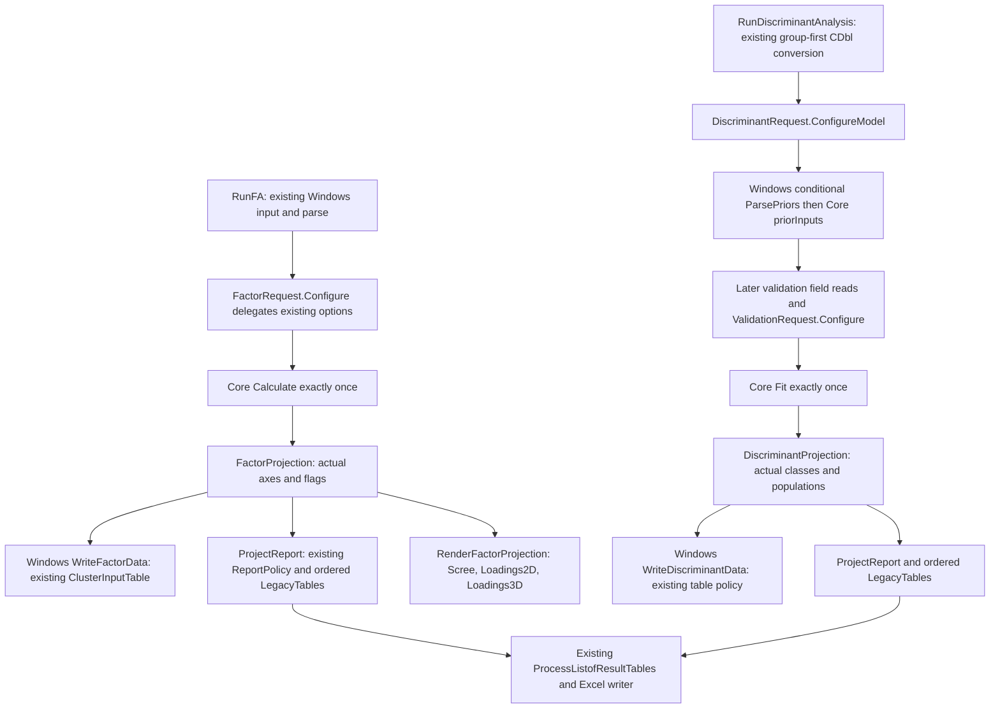

# Batch 04A.20 owner acceptance dossier

## 1. Decision and limits

**READY_FOR_OWNER_04A20_ACCEPTANCE_REVIEW — software extraction only.** Both real Windows FA/DA workflows consume new portable requests and post-fit projections. All new managed and Python tests pass. Historical suites remain nonzero: six logical managed failures and 89 Python nonpasses are disclosed below. There is no scientific/native acceptance, statistical correction, independent oracle validation, or authorization for Git publication/04A.21.

`P = NO; N1 = NO GO; N2 = NO; Gate C2 = UNMET`. Native releases and obligation discharges: **zero**. Native Excel/COM/RefEdit/UIA/chart execution, authenticated Office/browser tests, independent R, installers/signing/deployment and golden promotion are **NOT_RUN / UNAUTHORIZED**.

## 2. Verified authority and branch entry

The actual local `main`, already-present `origin/main`, and accepted `codex/04A-19` pointed to **ae7490bbce241dd8a444fd4d23ba413fb89a36ca**. Its parent is `5429a46ac706a43c9f57136eef68158decedf89d`; tree `d47eee5af1c75d7b07150ccc99f965a91a401a23`. The local commit is dated 2026-11-04T16:02:22+01:00 and contains the shipping clustering integration, tests, dossier and evidence. History is linear; no separate merge commit is invented. Owner-reported formal acceptance governs acceptance status. No fetch/network operation was performed.

Entry was clean before new-batch inventory files were created. One worktree was present. `codex/04A-20` was created from that verified main; HEAD and main remain the same SHA. The index was empty and remains empty. No owner changes were discarded and no stage/commit/merge/push/reset/clean/stash/rebase occurred. Branch-ref creation used the sandbox approval mechanism; subsequent source work stayed within the authorized workspace. The untracked paths in entry-state.json are this batch's initial inventory/tool files, not preexisting owner edits.

Read authorities: all AGENTS.md; Master Plan Revision 2.8 literal 04A.17–04A.21 rows; accepted 17–19 dossiers/manifests; original 04A.02 case/gates/control ledger and later preservation/deferred decisions. The stale plan introduction was left untouched. The literal 04A.20 row requires FA/DA option mapping with statistical choices and result shape outside UI, dependent on 04A.19. No 04A.21 work began.

Entry evidence: [entry-state.json](../../evidence/04A20/entry-state.json), [prechange-method-inventory.json](../../evidence/04A20/prechange-method-inventory.json) and [frozen-capture-hashes.json](../../evidence/04A20/frozen-capture-hashes.json). The inventory pins 1,000 source/project/tool files and 237 frozen authorities/payload sources. Historical publication manifests were audited read-only. Accepted successor-source differences and preexisting line endings are recorded in [historical-manifest-observations.json](../../evidence/04A20/historical-manifest-observations.json). In particular, the old 04A.19 manifest pins `legacy-import-validation-provenance.json` at `cfa37086ad26434fb6dfbfe2a776694149c573d6b61040509ee8f337ac70948c`, whereas actual entry bytes hash `c11b5a5f8035df37dfd5f4a4d6c04432df5607c2092dd3b5d1c515a6885a26d7`; the difference is line endings only. Neither old bytes nor old manifest were rewritten.

## 3. Files, APIs and real shipping call graph

New netstandard2.0 Common source, all `Option Strict On`:

| File | Contract and purpose |
| --- | --- |
| `Analysis/MultivariateFactorDiscriminantRequest.vb` | Copied FactorRequest; phase-separated DiscriminantRequest and ValidationRequest; detached ordered raw prior intent; existing Data table contract and sheet metadata |
| `Results/MultivariateModelProjection.vb` | Array axis roles/shapes, actual section header/body/footer metadata, ordered report composition and plot role |
| `Results/MultivariateFactorProjection.vb` | Actual retained factors, variable/eigen/score/physical-row axes, separate pattern/structure/Phi/transform shapes, Core convergence/iterations and three existing plot requests |
| `Results/MultivariateDiscriminantProjection.vb` | Imported/source/active/removed/training/validation row mapping; Core class order, group/regularization metadata; posterior/score/distance shapes and copied observed-row/predicted-column confusion metrics |

Existing production edits are confined to the two `Ui11PCA` handler bodies and narrow new methods in `WindowsMultivariateWorkflowAdapter`. The Windows test project adds two compile inclusions. Only the FA/DA Help pages change. All old APIs/options/choice parsers and report serialization remain compatible.



Common has no fit, RNG, fold partitioner, extraction/rotation/classifier/confusion algorithm, COM/UI/Office.js or file I/O dependency. It inspects Core only after a successful calculation; no second calculation or extra RNG draw constructs metadata. It retains no raw N×P matrix or Core model. Lightweight identities/shapes and G×G confusion arrays are copied, with read-only collections or copy-returning arrays/options. Immediate writer callbacks borrow raw original cells synchronously without retaining or changing them.

Core `FactorAnalysis.vb` and `DiscriminantAnalysis.vb` remain byte-identical. Their numerical decisions, nonconvergence, missing policy, class/prior normalization, validation and result tables remain authoritative. Windows keeps all control initialization/events/default parsing, group-first importer and ckFirstRow behavior, CDbl/Nothing conversion, worksheet row-label lookup/fallback, exception catches, workbook creation, COM cleanup and native chart lifetime. Source tests compare exact original conversion helper bodies with host-free derivative tests; no real importer/RefEdit ran.

## 4. Before/after behavior parity

| Area | Preserved entry behavior and actual new consumer |
| --- | --- |
| FA defaults | Principal Axis, SMC, ErrorOnMissing, Varimax, Regression; correlation; fixed2 factors; eigen1/variance70; maxiter250, epsilon0.000001; Kaiser checked, Promax4. Constructor/Designer/control events are byte-identical. |
| FA options | All six extraction, three retention, five rotation, three score and both matrix/missing choices pass through old FactorOptions.Configure once. Disabled fields remain read in their old order. Common adds no eager domain validation. |
| FA retention/outcome | Requested mode/value stays separate from actual Core NumberOfFactors. Extraction/rotation flags and iterations copied without declaring success. Pattern, structure, Phi and rotation transform remain distinct, including None/Promax. |
| FA axes | Variables P; actual factors K; loadings/coefficients P×K; scores N_active×K; Phi/transform K×K; working/correlation/anti-image/common/reproduced/residual P×P; AnalysisRowIds are supplied physical source IDs after filtering. |
| FA Data/output | New workbook: `Data` then `Factor analysis results`. Existing ClusterInputTable retains physical `OriginalRow`, no optional RowLabel, original raw CLR cells/column order; header1/body2. Existing report projection/rehydration and processor remain writer owners. |
| FA chart requests | After results, ScreePlot(model), LoadingPlot2D(model), LoadingPlot3D(model), same fitted Core object/order; no new dimension guard/geometry/parameters/sheet behavior. Dispatch source-backed only; charts NOT_RUN. |
| DA inputs/defaults | Group column0 then predictors1..P with j-1 destination; Nothing→NaN else CDbl unchanged. ckFirstRow skip and physical-row label lookup unchanged. LDA/None/ErrorOnMissing/proportional/None validation; regularization1e-8; holdout0.3; folds5; original seed/default enablement unchanged. |
| DA option sequence | Core dataInputs → copied ConfigureModel → only UserSpecified Windows prior parse → priorInputs → later validation fields (even disabled) → copied ConfigureValidation → one Fit. Prior metadata is captured only after priorInputs. |
| DA priors | Existing semicolon/newline and =/: grammar, trimmed labels, CurrentCulture-first/invariant fallback and duplicate handling retained. No Common parser, normalization, label sorting/case folding or new finite check. Ordinal Core class identity/order preserved. |
| DA validation | None/LOOCV/KFold/Holdout and stratification delegate Core. MinValue blank sentinel differs from explicit0. Fixed seeds replay exact folds/cases. Public Core exposes no resolved validation seed: EffectiveSeed remains unavailable; unspecified-seed observations make no independent replay claim. |
| DA axes | Source physical IDs differ from Core 1-based input ordinals; active/removed rows and training/actual validation subsets remain separate. Posterior/raw score/distance columns follow Core class order. Confusion rows observed, columns predicted; Core totals/recall/precision/fraction/percentage copied, never recalculated. |
| DA output | New workbook: `Data` then `Discriminant results`. Optional leading `Row label`, grouping/raw predictors, no new physical RowId column. Actual LDA/canonical vs QDA covariance, scale/validation/removed sections preserve wrapResults order/types/metadata. Zero plots. |

All report sections derive from actual wrapResults at the original Windows timing, after result-sheet creation. ModelReport composes existing MultivariateReportPolicy/AnalysisResultDocument and rehydrates legacy tables in captured section order, preserving titles, header depths, body CLR types, footnotes and p-value formatting. No hand-authored statistical tables or stale appended sections are introduced. Detailed per-profile exact section lists, dimensions and conditional presence are in [fa-da-same-core-comparisons-v1.json](../../evidence/04A20/fa-da-same-core-comparisons-v1.json); request/projection narratives are in [factor-discriminant-requests-v1.json](../../evidence/04A20/factor-discriminant-requests-v1.json) and [factor-discriminant-projections-v1.json](../../evidence/04A20/factor-discriminant-projections-v1.json).

Observed ordinary FA order: Factor Analysis Summary; Correlation/Covariance Matrix; Factorability Diagnostics; KMO / Measure of Sampling Adequacy by Variable; Anti-Image Correlation Matrix; Variance Explained; Communalities; Unrotated Loadings; Rotated Pattern Matrix (rotation name); Structure Matrix (rotation name); Factor Correlation Matrix; Rotation Transformation Matrix; optional Factor Score Coefficients/Factor Scores; Reproduced/Residual Matrix. Core captions in each profile, rather than this description, are authoritative.

Observed DA order: Discriminant Analysis Settings; Group Summary; Group Means (Original Scale); optional working means/preprocessing; LDA pooled covariance/classification/canonical sections or QDA per-group covariance; Training Classification Matrix (Resubstitution); Training Casewise Classification; optional validation matrix/casewise; optional removed rows. No captions/cells are corrected to match prose.

## 5. Same-Core evidence and source identities

[fa-da-same-core-comparisons-v1.json](../../evidence/04A20/fa-da-same-core-comparisons-v1.json) contains **4,068 executed profile records and 2,036 content-addressed payloads** across Debug/Release and net10.0/net48. Every record links its precise executed test and private TRX SHA; payloads include input fixture hash, culture/runtime/options, actual source rows, relevant axes/shapes/classes/sections/plots, flags or exception class/message/phase. Canonical payload SHA is separate from raw receipt SHA.

| Execution classification | Records |
| --- | ---: |
| CORE_RETURNED | 2,860 |
| CORE_NONCONVERGED | 568 |
| EXISTING_CORE_REJECTED | 636 |
| UNSPECIFIED_SEED_OBSERVATION | 4 |

Every profile is **NOT_GOLDEN / SAME_CORE_COMPATIBILITY_ONLY**. CORE_RETURNED means the API returned; it does not assert convergence, finite/statistically valid output, independent validation or scientific acceptance. In particular DA175/176 complete-class priors with NaN/Infinity can return nonfinite report cells; these are explicitly observed and retained under candidate C20-DA-PRIOR-NONFINITE-01. Matching rejected paths are compatibility assertions, never successful statistical fits.

Direct legacy settings and new request settings use identical inputs and original Core. Discrete labels/order/types and same-runtime numerical array hashes are exact; table doubles use declared max(1e-9,abs(expected)×1e-9) with explicit NaN/signed-Infinity class comparisons. No sign/cluster/class/factor/order normalization hides differences. Source-owned Core fixtures and the public protein example provenance are hashed; screenshots/example claims were not retested. The matrix has180 FA extraction×rotation×score×matrix profiles plus46 edge cases in invariant/sk-SK;144 DA method×scale×prior×validation×stratification plus44 edge cases in invariant/sk-SK/de-DE. Targeted tests add copy safety, retention boundaries, parser grammar, identities, seeds, writer and host-conversion checks.

DA reproduction: `DiscriminantSourceOrdinalsConfusionAndCopiesStayIndependent` deletes the first of noncontiguous/reversed source rows; first surviving Core Row=2 maps to a different physical source RowId. Source labels can repeat and are not identity keys. The projection records both identities but existing casewise/removed Row cells remain ordinals. **C20-DA-ROWID-DISPLAY-01 is OPEN/DORMANT/UNAPPLIED**: a future explicit output change needs owner authorization and applicable native prechange/capture gate (04A.28/04A.39–42 or separate timing approval).

FA source scores use actual Core physical AnalysisRowIds. With duplicate supplied IDs and deletion, Core exposes no unique deleted input position. `FactorDeletionUsesCorePhysicalScoreIdsAndDoesNotGuessDuplicateSources(True)` reports ambiguous mapping instead of inventing ordinals; removed count remains Core-owned. This is candidate-only C20-FA-ROWID-AMBIGUOUS-01.

Historical 17/18/19 comparison records **1,224/916/2,478**, prior19's **1,241 payloads**, and **100 mixed-model frozen captures** are unchanged. All72 original FA extraction-nonconvergence identities are copied read-only in [historical-fa-nonconvergence.json](../../evidence/04A20/historical-fa-nonconvergence.json); they remain prior observations, not new regressions or promoted truth. [frozen-capture-hashes.json](../../evidence/04A20/frozen-capture-hashes.json) pins actual entry bytes and final verification. Frozen hashes include prior test/control/evidence sources; no prior corpus was regenerated.

## 6. Deferrals and candidate-only findings

[candidate-issues.json](../../evidence/04A20/candidate-issues.json) records reproduction, proposed interpretation and future owner for the two row/provenance candidates above, nonfinite DA priors, and C20-DA-FOLD-UPPER-BOUND-01. The last is a source-only performance/domain concern: current Core clamps only the lower fold bound and loops configured folds;50/100 were exercised, Integer.MaxValue deliberately was not run. No new upper clamp or scientific rescue was introduced. New candidate corrections activated: **zero**.

Retained OPEN/unapplied: C09/C11/C12 Windows proposals; C13 earliest-censored log-rank defect for04A.40–41; C14 candidate diagnostics; C17-CA-NOLABEL-INDEX-01 and C18 no-label CA activation patch; C19 cluster source-row display, nonfinite-power and inversion/cut issues; frozen PCA/biplot/source-layout failures. No PCA/CA/MCA/clustering/SPM numerical/output/native path changed.

## 7. Validation, exact accounting and final-source qualification

| Stage, each configuration | Logical managed pass/total | Raw framework pass/total | Node pass/total | Python distinct pass/total |
| --- | ---: | ---: | ---: | ---: |
| Entry Debug | 6,485/6,491 | 8,711/8,718 | 916/916 | 716/803 |
| Entry Release | 6,485/6,491 | 8,711/8,718 | 916/916 | 716/803 |
| Final Debug | 6,957/6,963 | 9,626/9,633 | 916/916 | 729/818 |
| Final Release | 6,957/6,963 | 9,626/9,633 | 916/916 | 729/818 |

New tests: **443 Common +29 Windows-only =472 distinct logical managed**, all pass in both configurations; linked Common tests add443 duplicate Windows executions, yielding915 new raw executions per configuration. New Python: **15/15**. Culture iterations are evidence profiles, not extra logical tests. Foundation/control overlap and accepted null/empty cohort identity conventions are retained; raw execution totals are never substituted for distinct totals. Full per-suite memberships/counters and all new test/source/production/fixture links are in [validation.json](../../evidence/04A20/validation.json) and [test-inventory.json](../../evidence/04A20/test-inventory.json).

Core1058/1058, OfficeAddin505/505, OfficeExecution45/45, Common3926/3931, Windows4031/4033 and ControlMitigation61/61 raw executions per final configuration. Common/Windows/FULL verifiers exit1 because historical failures remain; builds exit0. No framework/package/target changes or network restore. Core/Common netstandard2.0 and real Windows net48 host/tests built Debug/Release; existing Office/WASM net10.0 projects retained.

Six inherited logical managed failures (seven raw executions per configuration):

- `ProportionsPolicyTests.PairedDisjointCountContractAndPureSemanticProjection(20,30,50)`, `(0,0,0)`, `(20,15,40)`: original scientific mapping conflict assertion.
- `ProportionsPolicyTests.ExistingEquivalenceCoreDomainAndPairedOverflowAreNotReinterpreted`: expected OverflowException not thrown.
- `Regression10PolicyTests.ConstantAndSeparatedBinomialPreserveActualFitWarnings(True)`: expected NullReferenceException not thrown; executes in Common and Windows.
- `ContingencyAdapterTests.PairedCompatibilityEvidenceIsExplicitlyLegacy_NotACorrectedGolden`: expected6.49310735531625E-08 vs actual0.499559833202511.

Python entry87 nonpasses=77FAIL+10ERROR; final89=78FAIL+11ERROR. Two newly triggered frozen identities are listed first in the appendix:17's old literal acquisition scan raises ValueError (literal ConfigureModel/prior call moved behind request);19's assertion that all non-clustering form methods remain unchanged fails on authorized RunDiscriminantAnalysis. Neither old test was changed; new successor tests prove the preserved shipping sequence. The remaining87 identities are inherited entry branch/source/hash/authority/behavior failures. [nonpasses.json](../../evidence/04A20/nonpasses.json) retains every exact identity, classification, reason, terminal, raw-receipt hash and managed message; appendix lists all Python identities. No nonpass was ignored or relabelled passing.

Historical strict/profile entry and final exits are **1/1**, both UNMET: strict stale UibyID dependency for NormalPlot ConstructorBlock; profile INTEGRITY_FAILURE. Strict MkDocs entry/final **exit0**. Final Help hashes are in [documentation-audit.json](../../evidence/04A20/documentation-audit.json). Native/independent R tests are not substitute executions and remain unauthorized.

Reproducible commands from repository root (configured portable WinPython, public alias `<PYTHON_EXE>`):

```powershell
& '<PYTHON_EXE>' -B scripts/verify-04a20.py entry --evidence TestResults/04A-20-20261104-run01 --configuration Debug --name entry-Debug
& '<PYTHON_EXE>' -B scripts/verify-04a20.py final --evidence TestResults/04A-20-20261104-run01 --configuration Debug --name final-Debug
& '<PYTHON_EXE>' -B scripts/verify-04a20.py affected --evidence TestResults/04A-20-20261104-run01 --configuration Debug --name final-source-Debug
# Repeat the three commands with Release and corresponding names.
& '<PYTHON_EXE>' -B scripts/verify-04a20.py focused --evidence TestResults/04A-20-20261104-run01 --configuration Release --name final-focused-Release --windows
& '<PYTHON_EXE>' -B -m unittest discover -s scripts/tests -p 'test_04a20_*.py' -v
& '<PYTHON_EXE>' -B scripts/verify-04a20.py historical --evidence TestResults/04A-20-20261104-run01 --name final-authority
& '<PYTHON_EXE>' -B scripts/verify-04a20.py docs --evidence TestResults/04A-20-20261104-run01 --name final-mkdocs
& '<PYTHON_EXE>' -B scripts/summarize-04a20.py numerical --prefix final-source
& '<PYTHON_EXE>' -B scripts/summarize-04a20.py inventory --prefix final-source
& '<PYTHON_EXE>' -B scripts/verify-04a20-publication.py verify
```

These are already-executed command forms; receipt names are immutable, so a later rerun must choose fresh batch-qualified names. [command-outcomes.json](../../evidence/04A20/command-outcomes.json) preserves exact sanitized argv, real exits/timings and separate private raw SHA aliases. [execution-adaptations.json](../../evidence/04A20/execution-adaptations.json) preserves original/executed verifier hashes and minimal exact-anchor adaptation. The required verify-beshstatng.ps1 was executed via this derivative because its default would overwrite historical TestResults/Codex, restore packages and enter packaging. The derivative uses offline no-restore, isolated results/assemblies and real host compilation without packaging/signing, continues unaffected suites and preserves nonzero status. JS Office/help-resolver and `node --test BESHStat.WasmSmoke/tests/*.test.cjs` and all four Python discovery roots actually ran; no native smoke was hidden inside the wrapper.

Final source qualification uses the full final matrices plus full affected Common/Windows reruns in both configurations. After initial full runs, two **new test** nonfinite-prior fixtures were corrected to supply every class before injecting NaN/Infinity and record nonfinite cells. Production, Help and Python bytes did not change; both entire affected suites were rebuilt/rerun on final new-test bytes. [final-source-qualification.json](../../evidence/04A20/final-source-qualification.json) pins both initial and qualified snapshots and exact component replacement. Final focused Release443/443 Common and472/472 Windows and Python15/15 are supplemental, excluded from aggregate totals. Earlier dev02 had one new mutation-oracle failure fixed by detaching expected headers through existing report policy; no production numerical correction. [development-corrections.json](../../evidence/04A20/development-corrections.json) records both development changes honestly.

## 8. Original controls, source retention, privacy and repository checks

[original-control-crosswalk.json](../../evidence/04A20/original-control-crosswalk.json) recalculates exact original ID/hash unions: Ui11PCA147 controls/145 linked OPEN obligations/75 restricted original controls; standalone CA39/7/3; union186 distinct controls/152 linked OPEN obligations. `04A02-PCA-NATIVE-01` remains NOT_RUN/BLOCKED with75 blocked control IDs and76 deferred obligations. Broader authority:2,056 controls/1,514 obligations/802 restricted original controls. Mixed-model lineage177 controls/69 direct control obligations/67 restricted controls is preserved; its broader linked graph has100 obligations. These overlapping populations are not summed or conflated.

Historical root223,843 and nested139 TestResults files retain complete initial membership, size, creation/write nanoseconds and file identity. Frozen payload/source/authority files additionally pass SHA-256 checks. This is explicitly **not** a claim that all historical raw bytes were reread. No old log/evidence was cleaned, compressed, moved or overwritten; retention lasts through Phase04A. [retention.json](../../evidence/04A20/retention.json) records the private receipt SHA. Current source-preservation checks verify every unchanged entry tracked file and exact form method hashes: only RunFA and RunDiscriminantAnalysis changed. Prior Common17/18/19 policies, all old tests/dossiers/evidence, Core numerics, writers/importers/RefEdit, native graphics, other form methods/constructor/helpers, UDFs/Ribbon/Designer/resx, installer/signing, Office UI, packages/TFMs, owner plan and authored help metadata remain unchanged.

[source-preservation.json](../../evidence/04A20/source-preservation.json) and [repository-review.json](../../evidence/04A20/repository-review.json) record source hashes, final relative working-tree/untracked candidates, unchanged ignore rules, empty cached diff, diff-stat and `git diff --check` exit0. Raw artifacts are isolated under ignored `TestResults/04A-20-20261104-run01`; public JSON uses stable aliases/placeholders, separate raw SHA references and no private workbook data. [privacy.json](../../evidence/04A20/privacy.json) is a bounded decoded-content/path scan plus review, not a scientific/native gate. [publication-manifest.json](../../evidence/04A20/publication-manifest.json) enumerates exact paths/SHA-256/bytes/roles/trackability; only its own hash is self-excluded to avoid circularity. The separate manifest SHA is printed by the verifier. Publication is owner-review pending, unstaged, uncommitted and unpushed.

## 9. Documentation and future native smoke plan

Only factor-analysis.md and discriminant-analysis.md changed: physical vs input row identity and score/loadings dimensions, retained-factor/convergence interpretation, None-rotation table presence, prior/culture/class order, actual training/validation confusion direction/population, seed unavailability, actual sheet names and lack of DA charts. Authored methods.yml, UDF Help, screenshots, formulas/examples and redirects are unchanged. Strict MkDocs passed on final Help bytes. Portable contracts do not provide FA/DA task-pane commands in Office/Excel Online or Excel for Mac.

Future Windows reference smoke, **NOT_RUN / UNAUTHORIZED**:

1. Acquire known noncontiguous source rows; run FA with listwise deletion, fixed retention then Promax/scores, inspect Data/result source identities, conditional sections and existing scree/2D/3D chart order/lifetime under original native prechange capture controls.
2. Acquire grouping-first DA with header both ways, selected blank/duplicate labels, user priors and seeded k-fold/holdout; inspect Data/result type/order and local-row display, confusion direction and validation population, confirm no DA charts. No current native control is released by this plan.

## 10. Proposed formal owner decision

Accept only **04A.20 software extraction**, subject to independent owner review of the final candidate tree and evidence. Retain every scientific/native restriction, all prior and new candidate-only defects, zero releases/discharges, P NO/N1 NO GO/N2 NO/C2 UNMET, and native/R NOT_RUN. Acceptance and Git publication are separate later owner decisions; no publication or04A.21 action is performed or implied here.

## Appendix: every final Python nonpass identity

The table is identical across Debug/Release. Entry/final exact terminals and reasons are in [nonpasses.json](../../evidence/04A20/nonpasses.json). “Inherited” means measured at this batch's actual clean-main entry, including frozen branch/source pins.

| Identity | Outcome | Disposition |
| --- | --- | --- |
| `test_04a17_multivariate.Multivariate17SourceContracts.test_acquisition_error_order_and_legacy_grammars_preserved` | ERROR | Newly triggered frozen assertion |
| `test_04a19_clustering.Clustering19Contracts.test_all_other_form_methods_and_import_catches_preserved` | FAIL | Newly triggered frozen assertion |
| `test_04a02_checkpoint09.Native09Tests.test_unapplied_patch_routes_every_active_selection_binding_and_guards_workbook` | FAIL | Inherited |
| `test_04a02_checkpoint11.Namespace11Tests.test_exact_retained_bytes_reproduce_only_compiler_rejection` | FAIL | Inherited |
| `test_04a02_checkpoint11.Provenance11Tests.test_both_authorized_case_pins_pass_and_frozen_false_is_not_owner_decision` | ERROR | Inherited |
| `test_04a02_checkpoint12.Diagnosis12Tests.test_both_authorized_case_pins_keep_original_compiler_and_scientific_policy` | ERROR | Inherited |
| `test_04a02_checkpoint12.Diagnosis12Tests.test_exact_owner_bytes_negative_for_frozen_v5` | FAIL | Inherited |
| `test_04a02_checkpoint13.Startup13Tests.test_corrupt_receipt_hash_fails_even_with_exit_zero` | FAIL | Inherited |
| `test_04a02_checkpoint13.Startup13Tests.test_real_successful_owner_startup_all_pins_and_native_identities` | ERROR | Inherited |
| `test_04a02_checkpoint13.Startup13Tests.test_tampered_stdout_hash_stops_before_parser` | FAIL | Inherited |
| `test_04a02_checkpoint14.Actual14Tests.test_actual_two_owner_publications_and_both_cultures_reproduce` | ERROR | Inherited |
| `test_04a02_source_specs.SourceSpecifications.test_all_native_blockers_and_anchored_mappings` | ERROR | Inherited |
| `test_04a03_control_mitigation.ControlMitigationSourceTests.test_per_mode_consumers_and_branch_order` | FAIL | Inherited |
| `test_04a03_control_mitigation.ControlMitigationSourceTests.test_sealed_sources_are_reconciled_never_rewritten` | FAIL | Inherited |
| `test_04a03_control_mitigation.NativeGateNegativeTests.test_review_packet_source_pins_match_current_sources` | FAIL | Inherited |
| `test_04a03_selection.UnivariateSelectionSourceTests.test_all_native_lifetime_cancel_write_and_reporting_methods_unchanged` | FAIL | Inherited |
| `test_04a03_selection.UnivariateSelectionSourceTests.test_only_two_form_methods_change` | FAIL | Inherited |
| `test_04a04_alignment.PairedBlockSourceGates.test_exact_crosswalk_and_authorities` | FAIL | Inherited |
| `test_04a04_alignment.PairedBlockSourceGates.test_legacy_geometry_ambiguity_is_not_hidden` | FAIL | Inherited |
| `test_04a05_completion_successor.Completion05SuccessorTests.test_independent_candidate_provenance_not_core_or_golden` | FAIL | Inherited |
| `test_04a05_completion_successor.Completion05SuccessorTests.test_nonpaired_code_and_unrelated_forms_are_unchanged_from_partial` | FAIL | Inherited |
| `test_04a05_completion_successor.Completion05SuccessorTests.test_owner_bound_successor_and_source_hashes` | FAIL | Inherited |
| `test_04a05_contingency.ContingencySourceGates.test_historical_ledgers_and_importer_unchanged` | FAIL | Inherited |
| `test_04a05_contingency.ContingencySourceGates.test_other_multicol_members_including_04a04_selection_unchanged` | FAIL | Inherited |
| `test_04a05_contingency.ContingencySourceGates.test_prior_04a04_whole_file_source_check_remains_frozen_and_disclosed` | FAIL | Inherited |
| `test_04a05_contingency.ContingencySourceGates.test_scientific_ambiguity_is_not_a_permanent_portable_wrong_table` | FAIL | Inherited |
| `test_04a05_contingency.ContingencySourceGates.test_ui82x2_source_wiring_explicitly_withheld` | FAIL | Inherited |
| `test_04a05_contingency.ContingencySourceGates.test_versioned_successor_sources_and_case_boundaries` | FAIL | Inherited |
| `test_04a06_assumptions_successor.Assumptions06SuccessorTests.test_actual_form_routes_and_unchanged_native_tails` | FAIL | Inherited |
| `test_04a06_assumptions_successor.Assumptions06SuccessorTests.test_importer_udf_designers_core_and_old_tests_unchanged` | FAIL | Inherited |
| `test_04a06_assumptions_successor.Assumptions06SuccessorTests.test_native_population_is_union_not_sum` | FAIL | Inherited |
| `test_04a06_assumptions_successor.Assumptions06SuccessorTests.test_new_scientific_candidates_are_explicitly_unmodified` | FAIL | Inherited |
| `test_04a06_assumptions_successor.Assumptions06SuccessorTests.test_no_duplicate_statistics_in_form_or_windows_adapter` | FAIL | Inherited |
| `test_04a06_assumptions_successor.Assumptions06SuccessorTests.test_production_sources_and_exact_open_ledger_lineage` | FAIL | Inherited |
| `test_04a07_workflow_successor.Anova07SuccessorTests.test_actual_four_shipping_routes_and_native_bodies` | FAIL | Inherited |
| `test_04a07_workflow_successor.Anova07SuccessorTests.test_core_old_tests_importer_udfs_designers_and_help_unchanged` | FAIL | Inherited |
| `test_04a07_workflow_successor.Anova07SuccessorTests.test_exact_source_and_original_ledger_rows` | FAIL | Inherited |
| `test_04a07_workflow_successor.Anova07SuccessorTests.test_no_fabricated_obligation_for_previously_source_qualified_controls` | FAIL | Inherited |
| `test_04a07_workflow_successor.Anova07SuccessorTests.test_restriction_unions_and_timing_exceptions_not_generalized` | FAIL | Inherited |
| `test_04a08_authoring_successor.Authoring08SuccessorTests.test_exact_id_crosswalk_retains_original_row_hashes_and_open_counts` | FAIL | Inherited |
| `test_04a08_authoring_successor.Authoring08SuccessorTests.test_original_numerics_and_shipping_forms_are_unchanged` | FAIL | Inherited |
| `test_04a09_regression_successor.Regression09SuccessorTests.test_exact_six_changed_members_and_unchanged_native_surroundings` | FAIL | Inherited |
| `test_04a09_regression_successor.Regression09SuccessorTests.test_frozen_tests_numerics_and_public_04a08_evidence_preserved` | FAIL | Inherited |
| `test_04a09_regression_successor.Regression09SuccessorTests.test_real_six_routes_use_common_options_counts_and_reports` | FAIL | Inherited |
| `test_04a09_regression_successor.Regression09SuccessorTests.test_runtime_baselines_are_incremental_and_complete` | FAIL | Inherited |
| `test_04a10_regression_projection.Regression10ProjectionTests.test_baselines_are_actual_gaussian_and_binomial_and_not_goldens` | FAIL | Inherited |
| `test_04a10_regression_projection.Regression10ProjectionTests.test_core_udfs_frameworks_and_accepted_evidence_are_byte_protected` | FAIL | Inherited |
| `test_04a10_regression_projection.Regression10ProjectionTests.test_only_two_form_routes_change_and_native_tails_match` | FAIL | Inherited |
| `test_04a11_publication.Publication11Tests.test_accepted_dossier_and_dormant_patches_unchanged` | FAIL | Inherited |
| `test_04a11_publication.Publication11Tests.test_all_manifests_and_implementation_freeze` | FAIL | Inherited |
| `test_04a11_publication.Publication11Tests.test_raw_local_source_pins_and_native_writer_tails` | FAIL | Inherited |
| `test_04a11_regression_families.Regression11SuccessorTests.test_exact_six_form_deltas_and_native_writer_tails` | FAIL | Inherited |
| `test_04a11_regression_families.Regression11SuccessorTests.test_unaffected_sources_and_all_old_evidence_are_byte_protected` | ERROR | Inherited |
| `test_04a12_gee_workflow.Gee12WorkflowSuccessorTests.test_exact_source_scope_and_all_old_byte_pins` | FAIL | Inherited |
| `test_04a13_survival_workflow.Survival13SourceContracts.test_all_prechange_protected_bytes_except_exact_approved_scope` | FAIL | Inherited |
| `test_04a13_survival_workflow.Survival13SourceContracts.test_local_main_ancestry_empty_index_and_dedicated_branch` | FAIL | Inherited |
| `test_04a13_survival_workflow.Survival13SourceContracts.test_successor_pins_and_members_reconcile_to_actual_forms` | FAIL | Inherited |
| `test_04a14_mixed_workflow.Mixed14SourceContracts.test_branch_base_ancestry_and_empty_index` | FAIL | Inherited |
| `test_04a14_mixed_workflow.Mixed14SourceContracts.test_exact_scope_and_external_owner_plan_are_separate` | FAIL | Inherited |
| `test_04a14_mixed_workflow.Mixed14SourceContracts.test_original_members_and_successor_pins_are_reconcilable` | FAIL | Inherited |
| `test_04a14_mixed_workflow.Mixed14SourceContracts.test_reports_are_consumed_by_actual_writers_and_append_seams` | FAIL | Inherited |
| `test_04a15_fitting.Mixed15SourceContracts.test_all_protected_sources_and_new_source_hashes` | FAIL | Inherited |
| `test_04a15_fitting.Mixed15SourceContracts.test_branch_ancestry_empty_index_and_exact_existing_scope` | FAIL | Inherited |
| `test_04a15_fitting.Mixed15SourceContracts.test_only_actual_shipping_factory_routes_change` | FAIL | Inherited |
| `test_04a16_post_estimation.Mixed16SourceContracts.test_branch_base_index_and_exact_scope` | FAIL | Inherited |
| `test_04a16_post_estimation.Mixed16SourceContracts.test_unchanged_methods_designers_udfs_and_core` | FAIL | Inherited |
| `test_04a17_multivariate.Multivariate17SourceContracts.test_actual_six_handlers_delegate_and_keep_one_calculation` | FAIL | Inherited |
| `test_04a17_multivariate.Multivariate17SourceContracts.test_live_base_branch_index_and_protected_sources` | FAIL | Inherited |
| `test_04a17_multivariate.Multivariate17SourceContracts.test_native_writer_statements_and_spm_dispatch_stay_identical` | FAIL | Inherited |
| `test_04a17_multivariate.Multivariate17SourceContracts.test_public_targets_and_successor_hashes` | FAIL | Inherited |
| `test_04a18_projection.Projection18SourceContracts.test_live_branch_index_and_protected_entry_bytes` | FAIL | Inherited |
| `test_04a18_projection.Projection18SourceContracts.test_only_three_form_methods_change_and_spm_remains_exact` | FAIL | Inherited |
| `test_04a19_clustering.Clustering19Contracts.test_live_base_branch_and_empty_index` | FAIL | Inherited |
| `test_04a27_geometry_completion.Geometry27CompletionTests.test_compile_targets_and_native_helpers_unchanged` | FAIL | Inherited |
| `test_04a27_geometry_completion.Geometry27CompletionTests.test_initial_implementation_and_historical_tests_not_rewritten` | FAIL | Inherited |
| `test_04a27_geometry_completion.Geometry27CompletionTests.test_real_consumer_routes_and_udf_exports_preserved` | FAIL | Inherited |
| `test_04a27_geometry_completion.Geometry27CompletionTests.test_source_owner_pins_and_all_44_original_rows` | FAIL | Inherited |
| `test_04a27_transport_successor.Transport27SuccessorTests.test_core_designer_and_refedit_sources_are_unmodified` | FAIL | Inherited |
| `test_04a27_transport_successor.Transport27SuccessorTests.test_exact_successor_and_unapplied_patch` | FAIL | Inherited |
| `test_capture_contract04a02.CaptureContracts.test_all_239_ledger_rows_identified_with_original_digest_convention` | ERROR | Inherited |
| `test_capture_contract04a02.CaptureContracts.test_complete_source_crosswalk_equality` | ERROR | Inherited |
| `test_capture_contract04a02.CaptureContracts.test_packet_covers_all_original_cases_and_six_gates` | FAIL | Inherited |
| `test_capture_contract04a02.CaptureContracts.test_packet_retains_additional_21_deferred_obligations` | ERROR | Inherited |
| `test_investigation06.Investigation06Tests.test_all_239_exact_ids_have_reversible_root_cause_source_maps` | ERROR | Inherited |
| `test_investigation06.Investigation06Tests.test_anova_defaults_mapping_remain_explicit_source_facts` | FAIL | Inherited |
| `test_investigation06.Investigation06Tests.test_normality_5000_disagreement_preserved_as_review_defect` | FAIL | Inherited |
| `test_investigation06.Investigation06Tests.test_pca_has_three_biplot_scales_not_the_old_two_scale_proposal` | FAIL | Inherited |
| `test_investigation06.Investigation06Tests.test_refedit_disposal_and_sheetactivate_guards_are_source_not_native_proof` | FAIL | Inherited |
| `test_investigation06.Investigation06Tests.test_two_by_two_or_condition_and_no_chart_handler` | FAIL | Inherited |
