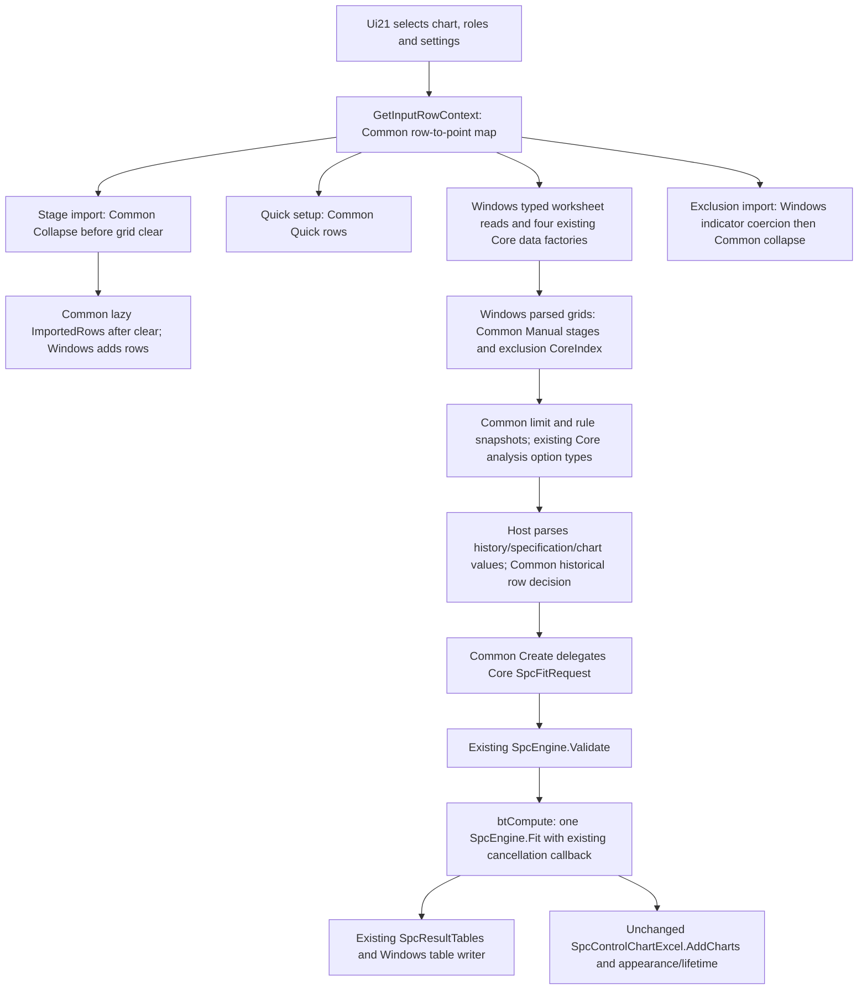

# Batch 04A.21 owner-review dossier

## 1. Decision — software extraction only

**READY_FOR_OWNER_04A21_ACCEPTANCE_REVIEW**. Real `Ui21ControlCharts` request preparation now consumes four focused Common policy files. Core remains the statistical engine and Windows remains the Excel/COM/UI host. No new statistical method, chart family, graphics payload or Office GUI was implemented. Overall historical suites remain nonzero; their identities and process statuses are retained below.

`P = NO; N1 = NO GO; N2 = NO; Gate C2 = UNMET`. **Zero native releases and zero deferred-obligation discharges.** Native Excel/COM/RefEdit/UIA/chart execution, authenticated Office/Mac/browser runs, independent R/oracles, golden promotion, installation/signing/deployment, Git publication and04A.22 are not authorized and were not performed.

## 2. Genuine entry and authority

Live clean `main`, already-present `origin/main` and accepted `codex/04A-20` pointed to **0f1980e5e223cf4770ce2bebe2d5828daa7ac81e**, parent `ae7490bbce241dd8a444fd4d23ba413fb89a36ca`, tree `324cb6ec6f4c3040984b136106aaf29ab6184b07`, commit date2026-11-04T20:01:51+01:00. The actual commit includes the shipping FA/DA handlers, contracts, tests, dossier and evidence. History is linear; owner-reported acceptance and actual source inclusion establish the entry, without inventing a separate merge commit. No fetch occurred.

The initial working tree/index was clean, with one worktree. `codex/04A-21` was created from verified main; current HEAD/main remain that SHA. Only branch-ref creation needed sandbox approval. No existing branch or owner edit was overwritten; no reset/clean/stash/rebase/amend/stage/commit/merge/push occurred. New untracked paths in the entry inventory are the new-batch inventory/tool files created after clean-entry observation. The owner plan, AGENTS and prior records remain untouched.

Authorities: AGENTS.md; literal Master Plan Revision2.8 rows04A.20–24; original04A.01/02 controls/deferrals/native crosswalk/gates; accepted17–20 dossiers/manifests and later timing restrictions. The stale plan introduction was not rewritten. Literal04A.21 is SPC data/phase/exclusion/signal/limits preparation, dependencies04A.02/01.08. Detailed chart-family payload/geometry is04A.22, multivariate SPC04A.23–24 and graphics/native gates later.

[entry-state.json](../../evidence/04A21/entry-state.json) and [prechange-method-inventory.json](../../evidence/04A21/prechange-method-inventory.json) pin **1,011 source/project/tool files** and method-level entry code. [frozen-capture-hashes.json](../../evidence/04A21/frozen-capture-hashes.json) pins **265 frozen authority/evidence files**, including17–20 corpora and original02 records. The private baseline pins every tracked entry file. [historical-manifest-observations.json](../../evidence/04A21/historical-manifest-observations.json) distinguishes accepted successor source and preexisting line endings. In particular, prior19's `legacy-import-validation-provenance.json` remains at actual entry SHA `c11b5a5f8035df37dfd5f4a4d6c04432df5607c2092dd3b5d1c515a6885a26d7`, while its old manifest asserts `cfa37086ad26434fb6dfbfe2a776694149c573d6b61040509ee8f337ac70948c`; this is the previously observed line-ending-only difference. Neither was rewritten.

## 3. Exact source/API inventory and shipping flow

| New Common file | Actual consumers and ownership |
| --- | --- |
| `Analysis/SpcInputPointPolicy.vb` | `FirstDataRow`, `FromWorksheetRows`, `FromRows`, `LogicalPointCount`; detached SpcSourcePointMap/SpcSourcePoint. Real GetInputRowContext and BuildInputData use it. |
| `Analysis/SpcPhaseStagePolicy.vb` | Quick one-based rows, typed collapsed imported intent, lazy block planning, manual zero-based Core stage construction and empty DefinedByStage check. Real quick/import/manual handlers and ParsePhaseText use it. |
| `Analysis/SpcExclusionPolicy.vb` | After host indicator coercion: any-row collapse/all-row reasons; manual CoreIndex before scope parsing. Both real exclusion paths use it. |
| `Analysis/SpcRequestPreparation.vb` | Immutable SpcLimitRequest/SpcRuleRequest scalar/array copies; existing Core option assembly, historical blank-row decision and SpcFitRequest delegation. Real BuildRequest, BuildCustomRules, historical builder and four applicability helpers consume it. |

Existing edits: only16 original Ui21 methods plus Common import and InputRowContext.PointMap field, four compile inclusions in Windows test project, and two narrow paragraphs in control-charts.md. New tests: Spc21Tests.vb, Spc21Fixture.vb, frozen derivative Spc21LegacyPreparation.vb, Spc21AdapterTests.vb and18 Python source/authority/evidence tests. New capture/verification/accounting/publication tools write only batch-qualified paths.



Core calculation/validation/catalog/evaluator/models/SpcResultTables are byte-identical. Common has no numerical estimator, limit formula, distribution quantile, rule evaluator, time-weighted recurrence, RNG, Fit/Validate call, matrix store, filesystem or host dependency. It reuses Core immutable definitions and copy-safe request construction. Existing Core presets already owned their rules; LoadSelectedRulePreset continues to call the authoritative catalog, rather than a redundant Common catalog.

Windows retains all workbook/column selection, VarColumnInfo, Excel Object/numeric/date/error/culture conversion, grid cell parsing/filtering/defaults/events, selection/duplicate/output checks, cancellation UI, workbook/sheet output, native chart appearance and cleanup. Four Core input factories remain exactly in BuildInputData. AdvancedInputs'01.08 SPC typed parser was inspected: its ordered coordinate/matrix contract does not encode this dialog's stacked grouped-point/stage semantics, so it was not forced into an incompatible replacement. No Core adapter change was necessary. No requested production subpath is left blocked; retained host work follows the stated ownership boundary.

## 4. Before/after identity, phase and exclusion parity

| Entry behavior | Shared consumer / preserved result |
| --- | --- |
| Required active header/last-used rows | Common FirstDataRow returns2 iff any required header, otherwise1; original Windows max LastUsedRow loop and no-data check remain. Optional labels/sequence do not extend range. |
| Four layouts | Existing Core IndividualSequence/WideSubgroups/StackedObservations/AggregatedCounts factories, value names, labels, sequence and physical source rows unchanged. |
| Row/group identity | Input row index0, physical worksheet row, logical Core point0 and displayed point1 are separate. Stacked Trim + Ordinal first-seen grouping accepts interleaving, preserves A/a distinction and every source row. |
| First-seen labels/sequence | Core still chooses first-seen subgroup display/sequence. Executed fixture A,B,A,B with rows101,105,118,131 and labels firstA/firstB/lastA/lastB retains two points, first labels/11,12 sequence and grouped source rows. |
| Read chronology | Every action obtains a fresh context. BuildInputData keeps the original second stacked-ID read for Core after context creation; no global cached grid/source state or altered eager/late workbook read promise. Live/volatile workbook behavior was not executed. |
| Quick stages | Exact PhaseI/PhaseII IDs/names, single1..N and split1..last/last+1..N. Historical source uses history for both; otherwise PhaseII references PhaseI. Grid clear still precedes lastPhaseI read/validation. |
| Imported stage/phase | Per-point collapsed agreement checked before clear; phase aliases Trim/ASCII spaces/invariant case as before. Phase-only IDs use per-phase invariant counters, including PhaseI-2/PhaseII-2. Case-sensitive block changes and OrdinalIgnoreCase used-ID rejection retained. |
| Import failure timing | ImportedRows is lazy: after clear, each valid block is added before a later duplicate/no-reference failure. Partial grid state, refresh/quick-selection success timing and errors match old source; no unrelated result workbook is touched. |
| Manual stages | Windows parses fields in original order; Common checks logical last bound then Core constructor at first-1/last-1; empty DefinedByStage error remains last. Core owns overlap/gap/order/reference/cycle/historical behavior. |
| Imported exclusions | Windows coercion unchanged. Any true source flag excludes point; all nonblank trimmed reasons from true and false rows enter Ordinal HashSet. Same-runtime ToArray/String.Join order preserved; no sorting or new cross-runtime enumeration guarantee. |
| Manual exclusions | CoreIndex checks positive and logical upper bound before Windows scope parse, then point-1. Scope1 estimation/2 rules/3 both unchanged. Duplicates are not deduplicated; same point+scope still reaches Core rejection. |
| Missing | Reject/OmitPoint/UseAvailableMeasurements pass unchanged; no Common prefilter/coercion/renumbering. Stages/exclusions refer to original constructed points, not only nonmissing survivors. |

[spc-point-mapping-v1.json](../../evidence/04A21/spc-point-mapping-v1.json), [spc-phase-stage-contracts-v1.json](../../evidence/04A21/spc-phase-stage-contracts-v1.json) and [spc-exclusion-rule-limit-contracts-v1.json](../../evidence/04A21/spc-exclusion-rule-limit-contracts-v1.json) include typed fixtures, API/call-site links and chart matrix. New mappings are detached/read-only and contain only lightweight identities; no second N×P matrix. A40,000-row/2,000-group test exercises ordered linear grouping/collapse preparation without quadratic per-point scans. Original Core SourceRowIndices are never rewritten.

## 5. Rule/limit/missing configuration matrix

| Chart choices (all15 preserved) | Layout / effective options |
| --- | --- |
| Individuals, Moving Range, I–MR | IndividualSequence; ShewhartSigma forced by unchanged UI; selected Core preset/custom rules; missing policy delegated. Specification lines only Individuals/I–MR. |
| X-bar, R, S, X-bar–R, X-bar–S | Wide>=2 measurements or stacked value+ID; ShewhartSigma; selected preset/custom and Core panel applicability. Specification lines X-bar/X-bar–R/X-bar–S. |
| p, np | Aggregated count+sample size; sigma/exact selection and natural clip/retain; historical proportion. Core owns np constant-size admission. |
| c | Aggregated count; sigma/exact and natural policy; historical mean count. |
| u | Aggregated count+exposure; sigma/exact and natural policy; historical mean rate. |
| CUSUM, EWMA, Moving Average | IndividualSequence; effective Shewhart presetNone; intrinsic Core signals retain gap behavior. EWMA/MA eligible specification lines; CUSUM is not. |

Defaults pinned from actual initializer/Designer: sigma3 (0.1..10,2decimals), moving-range2 (2..25), lambda0.2 (0.01..1,2decimals), CUSUM k0.5 (0..25), h5 (0.1..100), head-start0 (0..100), average span3 (2..1000). Bias correction is explicitly checked in Designer. Steady-state has no Checked assignment and retains the standard unchecked control default; this is source inference, not native observation. NumericUpDown/CDbl/CInt timing and selected-combo behavior remain Windows-owned.

None/RuleOneOnly/WesternElectric/Nelson/PaperMontgomeryEightRules/Custom remain catalog-owned. Custom enabled parsed rows retain constructor argument order/code/number/kind/window/minimum/sigma/side/scope/name/Tag description. New snapshots copy definitions without evaluating them; empty enabled custom retains the old error. Seven kinds ×three sides ×seven UI scopes ×minimum2/4 exercise real accepted/rejected Core paths. Phase all/I/II/none, break/skip gap and terminal/entire marking are forwarded unchanged. Unchanged UpdateRuleAvailability/RestoreCustomRules keep saved custom/last Shewhart selections, including temporarily invalid-grid catch; gap remains enabled for time-weighted charts.

All eight sigma estimators, both natural policies and discrete limit modes are captured without formulas. Historical builder still returns empty without parsing rows for EstimateFromPhaseI; otherwise hidden/optional fields are parsed by the unchanged host, then Common skips fully empty unnamed rows or rejects a stage-only empty row before the original Core constructor. Nothing and explicit0 differ. Global/stage historical selection and reference-stage estimates remain Core decisions. Specification/target fields remain distinct from control limits; chart-specific EWMA/CUSUM/MA casts and constructor selection stay unchanged Windows-to-Core calls.

## 6. Same-Core comparisons and candidate-only findings

[spc-same-core-comparisons-v1.json](../../evidence/04A21/spc-same-core-comparisons-v1.json) contains **5,808 execution records,2,904 canonical content-addressed payloads** across Debug/Release, net10.0/net48 and invariant/sk-SK plus the actual default culture recorded by targeted tests. Source public CSV `115controlcharts.csv` has60 ordered rows, Baseline/Monitoring, flag18 and missing variants; its exact source SHA, embedded decimal parsing assumptions, per-profile dataset/variant/request hashes and real receipt hashes are recorded. No private workbook/R/native data is included.

| Classification | Records |
| --- | ---: |
| CORE_RETURNED | 2,988 |
| EXISTING_REJECTION | 2,812 |
| EXISTING_TWO_LEVEL_REJECTION | 8 |

Every record is **NOT_GOLDEN / SAME_CORE_COMPATIBILITY_ONLY**. A returned API is not independent statistical acceptance; a matched rejection remains rejected. Original Core has no SPC convergence algorithm being reclassified here. Prior FA nonconvergence remains frozen in earlier corpora.

The legacy side uses original helper/loop bodies adapted only from host reads/writes to typed arrays/ordered lists. [legacy-preparation-provenance.json](../../evidence/04A21/legacy-preparation-provenance.json) pins the actual entry method bodies and adaptations; the legacy adapter never calls the new preparation policies. Main570 profiles cover15 charts×three missing×six presets plus20×15 input/limit/history/layout negative variants in two cultures. Additional quick/import/manual,294 custom-rule combinations, scopes, history, identity/copy, large mapping and cancellation tests use real shipping policies/Core, not DTO-only echoes. New test inventory links actual source SHA, production symbols, requirement/expectation, fixture, profile IDs and executions.

Numerical/identity tolerance is **exact same-runtime serialized request, all panel/point/parameter/signal, table cell/CLR type/header/footer/p-value metadata/order parity**. Only the three explicitly named execution clock fields (elapsed ms/started UTC/completed UTC) in summary/audit tables use a typed volatile marker; no statistical value, label or point order is normalized. Raw receipts and canonical payload hashes remain distinct. Core report builders, including combined Chart Data, remain authoritative.

**C21-STACKED-ROWCOUNT-VALIDATION-01 — OPEN/CANDIDATE_ONLY/UNAPPLIED:** values1,2,3,4 with A,B,A,B have raw4/logical2. Bare Core exclusion index2 or stage0..3 passes Validate against raw rows, then Fit rejects against constructed chart points. Existing Windows already checks logical bounds earlier; new Common preserves that behavior. Exact executed exception metadata is in the corpus. A broader Core validation-timing/domain correction requires separate04A.22/04A.39–42 ownership and applicable native authorization; no fix activated.

[candidate-issues.json](../../evidence/04A21/candidate-issues.json) retains all earlier issues: C09/C11/C12 unapplied; C13 log-rank OPEN; C14 diagnostics candidate; C17/C18 CA no-label dormant; C19 clustering row/nonfinite-power/inversion; C20 FA/DA row/prior/fold candidates. No older defect or scientific golden was changed. Prior17/18/19/20 comparison corpora and all100 mixed-model captures retain exact entry bytes/status; historical source/payload hashes are in [frozen-capture-hashes.json](../../evidence/04A21/frozen-capture-hashes.json).

## 7. Entry/final validation and exact failure identities

| Stage | Logical managed pass/total | Raw managed pass/total | Node pass/total | Python distinct pass/total |
| --- | ---: | ---: | ---: | ---: |
| Entry Debug | 6,957/6,963 | 9,626/9,633 | 916/916 | 728/818 |
| Entry Release | 6,957/6,963 | 9,626/9,633 | 916/916 | 728/818 |
| Final Debug | 7,971/7,977 | 11,599/11,606 | 916/916 | 746/836 |
| Final Release | 7,971/7,977 | 11,599/11,606 | 916/916 | 746/836 |


New tests: **959 Common +55 Windows-only =1,014 logical managed**, all pass Debug/Release. Linking959 Common tests into Windows produces1,973 new raw framework executions per configuration. New Python **18/18**. Six supplemental net48 host-free comparisons of blank/empty typed subgroup IDs confirm exact legacy/Common exception class/message and physical-row diagnostics in invariant/sk-SK; see [spc-negative-host-seams-v1.json](../../evidence/04A21/spc-negative-host-seams-v1.json). They are compatibility observations, not additional framework test identities. Culture iterations/profile records are not extra logical tests. Source-hash/class/full data-row identity deduplication and original Foundation/Control overlap conventions remain separate from raw counts.

Final raw suites per configuration: Core1058/1058; OfficeAddin505/505; OfficeExecution45/45; Common4885/4890; Windows5045/5047; ControlMitigation61/61. Core/Common netstandard2.0 and actual Windows net48 host/tests built Debug/Release; existing Office/WASM targets and packages unchanged. All `.cjs`/Office/help resolver Node and four Python discovery roots ran with configured portable WinPython3.14.7 `-B`. No restore/network/installer/signing step was used.

Six inherited logical managed failures, seven raw executions per configuration:

- ProportionsPolicyTests.PairedDisjointCountContractAndPureSemanticProjection(20,30,50), (0,0,0), (20,15,40): scientific mapping conflict assertion.
- ProportionsPolicyTests.ExistingEquivalenceCoreDomainAndPairedOverflowAreNotReinterpreted: expected OverflowException not thrown.
- Regression10PolicyTests.ConstantAndSeparatedBinomialPreserveActualFitWarnings(True): expected NullReferenceException not thrown, in Common and Windows.
- ContingencyAdapterTests.PairedCompatibilityEvidenceIsExplicitlyLegacy_NotACorrectedGolden: expected6.49310735531625E-08 versus actual0.499559833202511.

The actual entry Python count was728/818 (90 nonpasses), one additional frozen20 branch pin versus the pre-merge narrative. Final identities/FAIL versus ERROR and every terminal/raw receipt hash are in [nonpasses.json](../../evidence/04A21/nonpasses.json) and appendix; no old source test was edited or silently skipped. New managed failures: zero.

First full-final Debug Python was746/836; Release745/836 due a transient frozen13 privacy candidate-membership race. Its assertion was `Missing public candidate`, with no path/private-value finding recorded; exact vanished path cannot be recovered. [validation-initial-final.json](../../evidence/04A21/validation-initial-final.json) and [transient-validation-observation.json](../../evidence/04A21/transient-validation-observation.json) preserve that real failed run. Complete source discovery was requalified sequentially after managed/Node work settled. Its first Common invocation omitted --candidate-name and produced17 extra missing-observation comparison failures per configuration; those exact attempt identities/statuses remain recorded. Common discovery was then rerun with --candidate-name final-Debug/final-Release, explicitly referencing already executed same-final-source semantic observations. Final counts select all three sequential source roots plus those corrected Common receipts, without changing any frozen test or compiled source. [python-requalification.json](../../evidence/04A21/python-requalification.json) documents the exact stage selection and outcomes. The initial full Release/Debug aggregate exits remain1, and all initial failed receipts remain available.

Historical strict/profile entry/final exits **1/1**, UNMET: stale UibyID dependency for NormalPlot ConstructorBlock; INTEGRITY_FAILURE. Strict MkDocs entry/final **exit0** on pinned Help bytes. Supplemental final focused Release **959/959 Common,1,014/1,014 Windows** and final Python18/18 are excluded from aggregate counts. No compiled production/test/Help bytes changed after the full matrices; [final-source-qualification.json](../../evidence/04A21/final-source-qualification.json) checks all12 final pins and explains Python-only requalification. Earlier ordinary new-test/bootstrap compile and oracle-boundary issues are disclosed in [development-corrections.json](../../evidence/04A21/development-corrections.json); no Core numerical correction occurred.

Reproducible command forms, executed from repository root with public alias `<PYTHON_EXE>`:

```powershell
& '<PYTHON_EXE>' -B scripts/verify-04a21.py final --evidence TestResults/04A-21-20261104-run01 --configuration Debug --name entry-Debug
& '<PYTHON_EXE>' -B scripts/verify-04a21.py final --evidence TestResults/04A-21-20261104-run01 --configuration Debug --name final-Debug
# Repeat with Release and corresponding fresh receipt names.
& '<PYTHON_EXE>' -B scripts/verify-04a21.py focused --evidence TestResults/04A-21-20261104-run01 --configuration Release --name final-focused-Release --windows
& '<PYTHON_EXE>' -B scripts/verify-04a21.py python-tests --evidence TestResults/04A-21-20261104-run01 --configuration Debug --name final-python-Debug --candidate-name final-Debug
# Repeat Python sequentially with Release after Debug completes.
& '<PYTHON_EXE>' -B scripts/verify-04a21.py historical --evidence TestResults/04A-21-20261104-run01 --name final-authority
& '<PYTHON_EXE>' -B scripts/verify-04a21.py docs --evidence TestResults/04A-21-20261104-run01 --name final-mkdocs
& '<PYTHON_EXE>' -B scripts/summarize-04a21.py numerical
& '<PYTHON_EXE>' -B scripts/summarize-04a21.py inventory
& '<PYTHON_EXE>' -B scripts/verify-04a21-publication.py verify
```

Receipt names are immutable; a future rerun must use fresh batch-qualified names. [command-outcomes.json](../../evidence/04A21/command-outcomes.json) records exact sanitized argv, real exits/timings and private raw SHA aliases. [execution-adaptations.json](../../evidence/04A21/execution-adaptations.json) pins original/executed verify-beshstatng.ps1 derivatives: default TestResults/Codex overwrite, implicit restore and packaging were replaced only with offline no-restore, isolated outputs/assemblies, real host compilation without packaging/signing, and continued independent suites with nonzero status retained. This exercises the applicable portable/Legacy/Wasm/Js/Python workflow, including `node --test BESHStat.WasmSmoke/tests/*.test.cjs`.

## 8. Controls, frozen history and protected scope

[original-control-crosswalk.json](../../evidence/04A21/original-control-crosswalk.json) recalculates exact original IDs/hashes/restrictions: Ui21 **208 controls/226 linked OPEN obligations/115 restricted original controls**; Ui22 **182/320/154**. Union390 distinct controls/546 linked obligations; the recorded linked-obligation intersection between these hosts is empty. Original broader authority remains2056 controls/1514 individually deferred obligations/802 restricted original controls. These host/restriction/native-case populations are not added as disjoint groups. Crosswalk carries original per-row/control hashes, source-record hashes, earliest timing, dependent batches, gate/safe-capture/acceptance/ownership fields and exact original renderer/case overlaps. Absence of a direct link is not native clearance.

Original02 native crosswalk's UibyID/Ui82x2/Ui11PCA blocked-control populations do not intersect these SPC host IDs; their restrictions remain unchanged. Ui11 PCA original75-control/76-obligation native case remains NOT_RUN/BLOCKED; prior multivariate147/39 and mixed-model177/69/67 lineage is preserved by frozen authority, never added to SPC totals. All gates remain held and release/discharge counts zero.

[retention.json](../../evidence/04A21/retention.json) verifies **229,312 historical root files +139 nested TestResults files** for complete initial membership, size, creation/write nanoseconds and file identity. Frozen source/payload/control files additionally pass SHA-256. This is not an assertion that every historical raw byte was reread. No history was cleaned, compressed, moved or overwritten; retention continues through Phase04A.

[source-preservation.json](../../evidence/04A21/source-preservation.json) verifies all unchanged entry tracked bytes and method hashes. Exactly16 Ui21 method bodies change; constructor, initialization/events/defaults, source conversions, grid helpers, preset restoration, specification/chart parameter selection, compute/cancellation/writer/native tails stay unchanged. Core SPC engine/models/rules/statistics/calculators/result tables, native renderer, Ui22/SpcMultivariate, every Designer/resx, public UDF/Ribbon/importer/RefEdit, all other analyses, prior tests/evidence/dossiers, metadata/screenshots/data/workbooks, targets/packages/install/signing/Office clients and owner plan remain unchanged.

## 9. Publication, privacy and repository state

[repository-review.json](../../evidence/04A21/repository-review.json) records final relative changed/untracked/ignored-output audits, source/class/method diff scope, empty cached diff and `git diff --check` exit0. Only three preexisting tracked files are modified: Ui21, Windows test project and control-charts.md. Original CRLF/BOM bytes in those Windows/Help files are preserved; Git's CRLF→LF warning reflects repository text conventions, not incidental normalization of untouched source. No owner modification was discarded.

[publication-manifest.json](../../evidence/04A21/publication-manifest.json) is the exact independent candidate enumeration with SHA-256/bytes/roles/tracked/ignored/status. It excludes only its own mutable hash; verifier prints external manifest SHA. [privacy.json](../../evidence/04A21/privacy.json) covers paths and decoded JSON/Markdown/base64/NFKC/case content against local identifiers/profile/drive/SID/credential patterns with bounded manual review. Private raw logs/TRX/source snapshots/drafts remain under ignored `TestResults/04A-21-20261104-run01`, referenced with separate raw hashes; no private workbook data appears. Trackability/privacy is not scientific/native clearance. Index remains empty; nothing staged/committed/merged/pushed.

## 10. Help and future native reference smoke

Only `control-charts.md` gains narrowly scoped Windows row/group identity and stage/exclusion/rule/availability clarification. Existing15-chart descriptions, worked60-row X-bar–R/EWMA/p examples, numerical screenshots/data/workbooks and metadata are retained. [documentation-audit.json](../../evidence/04A21/documentation-audit.json) pins final page/metadata hashes and actual strict MkDocs exits. No Office/Excel Online/Mac task-pane method is claimed, and no04A.22 payload/geometry completion is implied.

Future smoke **PLAN ONLY — NOT_RUN / UNAUTHORIZED**: in an explicitly authorized native environment, import the public60-row X-bar–R example with Baseline/Monitoring and flagged point18; inspect physical row/logical point mappings, PhaseI estimation and frozen PhaseII reference limits, estimation/rule scopes, selected rule/gap/marking and optional five-sheet order; inspect unchanged chart appearance/lifetime and renderer warning path under original native captures. Repeat a stacked A,B,A,B selection with labels/sequence and p or EWMA request. No current control is released by this plan.

## 11. Proposed formal owner decision

Accept **04A.21 shared software extraction only**, subject to independent owner review of this final candidate tree/evidence. Retain all original/native/scientific gates,100 frozen captures and prior corpora, every earlier candidate and C21 candidate, zero releases/discharges and native/R NOT_RUN. Git publication and04A.22 require separate later owner decisions; neither is performed or recommended as an already authorized action.

## Appendix — every final Python nonpass identity

All exact terminals, inherited/new disposition, stage/raw receipt hashes and managed messages remain in [nonpasses.json](../../evidence/04A21/nonpasses.json). A transient first-Release-only failure is listed separately in [transient-validation-observation.json](../../evidence/04A21/transient-validation-observation.json); it is retained even when its sequential rerun passes.

| Identity | Debug | Release | Entry disposition |
| --- | --- | --- | --- |
| `test_04a02_checkpoint09.Native09Tests.test_unapplied_patch_routes_every_active_selection_binding_and_guards_workbook` | FAIL | FAIL | Inherited actual entry |
| `test_04a02_checkpoint11.Namespace11Tests.test_exact_retained_bytes_reproduce_only_compiler_rejection` | FAIL | FAIL | Inherited actual entry |
| `test_04a02_checkpoint11.Provenance11Tests.test_both_authorized_case_pins_pass_and_frozen_false_is_not_owner_decision` | ERROR | ERROR | Inherited actual entry |
| `test_04a02_checkpoint12.Diagnosis12Tests.test_both_authorized_case_pins_keep_original_compiler_and_scientific_policy` | ERROR | ERROR | Inherited actual entry |
| `test_04a02_checkpoint12.Diagnosis12Tests.test_exact_owner_bytes_negative_for_frozen_v5` | FAIL | FAIL | Inherited actual entry |
| `test_04a02_checkpoint13.Startup13Tests.test_corrupt_receipt_hash_fails_even_with_exit_zero` | FAIL | FAIL | Inherited actual entry |
| `test_04a02_checkpoint13.Startup13Tests.test_real_successful_owner_startup_all_pins_and_native_identities` | ERROR | ERROR | Inherited actual entry |
| `test_04a02_checkpoint13.Startup13Tests.test_tampered_stdout_hash_stops_before_parser` | FAIL | FAIL | Inherited actual entry |
| `test_04a02_checkpoint14.Actual14Tests.test_actual_two_owner_publications_and_both_cultures_reproduce` | ERROR | ERROR | Inherited actual entry |
| `test_04a02_source_specs.SourceSpecifications.test_all_native_blockers_and_anchored_mappings` | ERROR | ERROR | Inherited actual entry |
| `test_04a03_control_mitigation.ControlMitigationSourceTests.test_per_mode_consumers_and_branch_order` | FAIL | FAIL | Inherited actual entry |
| `test_04a03_control_mitigation.ControlMitigationSourceTests.test_sealed_sources_are_reconciled_never_rewritten` | FAIL | FAIL | Inherited actual entry |
| `test_04a03_control_mitigation.NativeGateNegativeTests.test_review_packet_source_pins_match_current_sources` | FAIL | FAIL | Inherited actual entry |
| `test_04a03_selection.UnivariateSelectionSourceTests.test_all_native_lifetime_cancel_write_and_reporting_methods_unchanged` | FAIL | FAIL | Inherited actual entry |
| `test_04a03_selection.UnivariateSelectionSourceTests.test_only_two_form_methods_change` | FAIL | FAIL | Inherited actual entry |
| `test_04a04_alignment.PairedBlockSourceGates.test_exact_crosswalk_and_authorities` | FAIL | FAIL | Inherited actual entry |
| `test_04a04_alignment.PairedBlockSourceGates.test_legacy_geometry_ambiguity_is_not_hidden` | FAIL | FAIL | Inherited actual entry |
| `test_04a05_completion_successor.Completion05SuccessorTests.test_independent_candidate_provenance_not_core_or_golden` | FAIL | FAIL | Inherited actual entry |
| `test_04a05_completion_successor.Completion05SuccessorTests.test_nonpaired_code_and_unrelated_forms_are_unchanged_from_partial` | FAIL | FAIL | Inherited actual entry |
| `test_04a05_completion_successor.Completion05SuccessorTests.test_owner_bound_successor_and_source_hashes` | FAIL | FAIL | Inherited actual entry |
| `test_04a05_contingency.ContingencySourceGates.test_historical_ledgers_and_importer_unchanged` | FAIL | FAIL | Inherited actual entry |
| `test_04a05_contingency.ContingencySourceGates.test_other_multicol_members_including_04a04_selection_unchanged` | FAIL | FAIL | Inherited actual entry |
| `test_04a05_contingency.ContingencySourceGates.test_prior_04a04_whole_file_source_check_remains_frozen_and_disclosed` | FAIL | FAIL | Inherited actual entry |
| `test_04a05_contingency.ContingencySourceGates.test_scientific_ambiguity_is_not_a_permanent_portable_wrong_table` | FAIL | FAIL | Inherited actual entry |
| `test_04a05_contingency.ContingencySourceGates.test_ui82x2_source_wiring_explicitly_withheld` | FAIL | FAIL | Inherited actual entry |
| `test_04a05_contingency.ContingencySourceGates.test_versioned_successor_sources_and_case_boundaries` | FAIL | FAIL | Inherited actual entry |
| `test_04a06_assumptions_successor.Assumptions06SuccessorTests.test_actual_form_routes_and_unchanged_native_tails` | FAIL | FAIL | Inherited actual entry |
| `test_04a06_assumptions_successor.Assumptions06SuccessorTests.test_importer_udf_designers_core_and_old_tests_unchanged` | FAIL | FAIL | Inherited actual entry |
| `test_04a06_assumptions_successor.Assumptions06SuccessorTests.test_native_population_is_union_not_sum` | FAIL | FAIL | Inherited actual entry |
| `test_04a06_assumptions_successor.Assumptions06SuccessorTests.test_new_scientific_candidates_are_explicitly_unmodified` | FAIL | FAIL | Inherited actual entry |
| `test_04a06_assumptions_successor.Assumptions06SuccessorTests.test_no_duplicate_statistics_in_form_or_windows_adapter` | FAIL | FAIL | Inherited actual entry |
| `test_04a06_assumptions_successor.Assumptions06SuccessorTests.test_production_sources_and_exact_open_ledger_lineage` | FAIL | FAIL | Inherited actual entry |
| `test_04a07_workflow_successor.Anova07SuccessorTests.test_actual_four_shipping_routes_and_native_bodies` | FAIL | FAIL | Inherited actual entry |
| `test_04a07_workflow_successor.Anova07SuccessorTests.test_core_old_tests_importer_udfs_designers_and_help_unchanged` | FAIL | FAIL | Inherited actual entry |
| `test_04a07_workflow_successor.Anova07SuccessorTests.test_exact_source_and_original_ledger_rows` | FAIL | FAIL | Inherited actual entry |
| `test_04a07_workflow_successor.Anova07SuccessorTests.test_no_fabricated_obligation_for_previously_source_qualified_controls` | FAIL | FAIL | Inherited actual entry |
| `test_04a07_workflow_successor.Anova07SuccessorTests.test_restriction_unions_and_timing_exceptions_not_generalized` | FAIL | FAIL | Inherited actual entry |
| `test_04a08_authoring_successor.Authoring08SuccessorTests.test_exact_id_crosswalk_retains_original_row_hashes_and_open_counts` | FAIL | FAIL | Inherited actual entry |
| `test_04a08_authoring_successor.Authoring08SuccessorTests.test_original_numerics_and_shipping_forms_are_unchanged` | FAIL | FAIL | Inherited actual entry |
| `test_04a09_regression_successor.Regression09SuccessorTests.test_exact_six_changed_members_and_unchanged_native_surroundings` | FAIL | FAIL | Inherited actual entry |
| `test_04a09_regression_successor.Regression09SuccessorTests.test_frozen_tests_numerics_and_public_04a08_evidence_preserved` | FAIL | FAIL | Inherited actual entry |
| `test_04a09_regression_successor.Regression09SuccessorTests.test_real_six_routes_use_common_options_counts_and_reports` | FAIL | FAIL | Inherited actual entry |
| `test_04a09_regression_successor.Regression09SuccessorTests.test_runtime_baselines_are_incremental_and_complete` | FAIL | FAIL | Inherited actual entry |
| `test_04a10_regression_projection.Regression10ProjectionTests.test_baselines_are_actual_gaussian_and_binomial_and_not_goldens` | FAIL | FAIL | Inherited actual entry |
| `test_04a10_regression_projection.Regression10ProjectionTests.test_core_udfs_frameworks_and_accepted_evidence_are_byte_protected` | FAIL | FAIL | Inherited actual entry |
| `test_04a10_regression_projection.Regression10ProjectionTests.test_only_two_form_routes_change_and_native_tails_match` | FAIL | FAIL | Inherited actual entry |
| `test_04a11_publication.Publication11Tests.test_accepted_dossier_and_dormant_patches_unchanged` | FAIL | FAIL | Inherited actual entry |
| `test_04a11_publication.Publication11Tests.test_all_manifests_and_implementation_freeze` | FAIL | FAIL | Inherited actual entry |
| `test_04a11_publication.Publication11Tests.test_raw_local_source_pins_and_native_writer_tails` | FAIL | FAIL | Inherited actual entry |
| `test_04a11_regression_families.Regression11SuccessorTests.test_exact_six_form_deltas_and_native_writer_tails` | FAIL | FAIL | Inherited actual entry |
| `test_04a11_regression_families.Regression11SuccessorTests.test_unaffected_sources_and_all_old_evidence_are_byte_protected` | ERROR | ERROR | Inherited actual entry |
| `test_04a12_gee_workflow.Gee12WorkflowSuccessorTests.test_exact_source_scope_and_all_old_byte_pins` | FAIL | FAIL | Inherited actual entry |
| `test_04a13_survival_workflow.Survival13SourceContracts.test_all_prechange_protected_bytes_except_exact_approved_scope` | FAIL | FAIL | Inherited actual entry |
| `test_04a13_survival_workflow.Survival13SourceContracts.test_local_main_ancestry_empty_index_and_dedicated_branch` | FAIL | FAIL | Inherited actual entry |
| `test_04a13_survival_workflow.Survival13SourceContracts.test_successor_pins_and_members_reconcile_to_actual_forms` | FAIL | FAIL | Inherited actual entry |
| `test_04a14_mixed_workflow.Mixed14SourceContracts.test_branch_base_ancestry_and_empty_index` | FAIL | FAIL | Inherited actual entry |
| `test_04a14_mixed_workflow.Mixed14SourceContracts.test_exact_scope_and_external_owner_plan_are_separate` | FAIL | FAIL | Inherited actual entry |
| `test_04a14_mixed_workflow.Mixed14SourceContracts.test_original_members_and_successor_pins_are_reconcilable` | FAIL | FAIL | Inherited actual entry |
| `test_04a14_mixed_workflow.Mixed14SourceContracts.test_reports_are_consumed_by_actual_writers_and_append_seams` | FAIL | FAIL | Inherited actual entry |
| `test_04a15_fitting.Mixed15SourceContracts.test_all_protected_sources_and_new_source_hashes` | FAIL | FAIL | Inherited actual entry |
| `test_04a15_fitting.Mixed15SourceContracts.test_branch_ancestry_empty_index_and_exact_existing_scope` | FAIL | FAIL | Inherited actual entry |
| `test_04a15_fitting.Mixed15SourceContracts.test_only_actual_shipping_factory_routes_change` | FAIL | FAIL | Inherited actual entry |
| `test_04a16_post_estimation.Mixed16SourceContracts.test_branch_base_index_and_exact_scope` | FAIL | FAIL | Inherited actual entry |
| `test_04a16_post_estimation.Mixed16SourceContracts.test_unchanged_methods_designers_udfs_and_core` | FAIL | FAIL | Inherited actual entry |
| `test_04a17_multivariate.Multivariate17SourceContracts.test_acquisition_error_order_and_legacy_grammars_preserved` | ERROR | ERROR | Inherited actual entry |
| `test_04a17_multivariate.Multivariate17SourceContracts.test_actual_six_handlers_delegate_and_keep_one_calculation` | FAIL | FAIL | Inherited actual entry |
| `test_04a17_multivariate.Multivariate17SourceContracts.test_live_base_branch_index_and_protected_sources` | FAIL | FAIL | Inherited actual entry |
| `test_04a17_multivariate.Multivariate17SourceContracts.test_native_writer_statements_and_spm_dispatch_stay_identical` | FAIL | FAIL | Inherited actual entry |
| `test_04a17_multivariate.Multivariate17SourceContracts.test_public_targets_and_successor_hashes` | FAIL | FAIL | Inherited actual entry |
| `test_04a18_projection.Projection18SourceContracts.test_live_branch_index_and_protected_entry_bytes` | FAIL | FAIL | Inherited actual entry |
| `test_04a18_projection.Projection18SourceContracts.test_only_three_form_methods_change_and_spm_remains_exact` | FAIL | FAIL | Inherited actual entry |
| `test_04a19_clustering.Clustering19Contracts.test_all_other_form_methods_and_import_catches_preserved` | FAIL | FAIL | Inherited actual entry |
| `test_04a19_clustering.Clustering19Contracts.test_live_base_branch_and_empty_index` | FAIL | FAIL | Inherited actual entry |
| `test_04a20_factor_discriminant.FactorDiscriminant20Contracts.test_live_main_branch_index_and_accepted_source` | FAIL | FAIL | Inherited actual entry |
| `test_04a27_geometry_completion.Geometry27CompletionTests.test_compile_targets_and_native_helpers_unchanged` | FAIL | FAIL | Inherited actual entry |
| `test_04a27_geometry_completion.Geometry27CompletionTests.test_initial_implementation_and_historical_tests_not_rewritten` | FAIL | FAIL | Inherited actual entry |
| `test_04a27_geometry_completion.Geometry27CompletionTests.test_real_consumer_routes_and_udf_exports_preserved` | FAIL | FAIL | Inherited actual entry |
| `test_04a27_geometry_completion.Geometry27CompletionTests.test_source_owner_pins_and_all_44_original_rows` | FAIL | FAIL | Inherited actual entry |
| `test_04a27_transport_successor.Transport27SuccessorTests.test_core_designer_and_refedit_sources_are_unmodified` | FAIL | FAIL | Inherited actual entry |
| `test_04a27_transport_successor.Transport27SuccessorTests.test_exact_successor_and_unapplied_patch` | FAIL | FAIL | Inherited actual entry |
| `test_capture_contract04a02.CaptureContracts.test_all_239_ledger_rows_identified_with_original_digest_convention` | ERROR | ERROR | Inherited actual entry |
| `test_capture_contract04a02.CaptureContracts.test_complete_source_crosswalk_equality` | ERROR | ERROR | Inherited actual entry |
| `test_capture_contract04a02.CaptureContracts.test_packet_covers_all_original_cases_and_six_gates` | FAIL | FAIL | Inherited actual entry |
| `test_capture_contract04a02.CaptureContracts.test_packet_retains_additional_21_deferred_obligations` | ERROR | ERROR | Inherited actual entry |
| `test_investigation06.Investigation06Tests.test_all_239_exact_ids_have_reversible_root_cause_source_maps` | ERROR | ERROR | Inherited actual entry |
| `test_investigation06.Investigation06Tests.test_anova_defaults_mapping_remain_explicit_source_facts` | FAIL | FAIL | Inherited actual entry |
| `test_investigation06.Investigation06Tests.test_normality_5000_disagreement_preserved_as_review_defect` | FAIL | FAIL | Inherited actual entry |
| `test_investigation06.Investigation06Tests.test_pca_has_three_biplot_scales_not_the_old_two_scale_proposal` | FAIL | FAIL | Inherited actual entry |
| `test_investigation06.Investigation06Tests.test_refedit_disposal_and_sheetactivate_guards_are_source_not_native_proof` | FAIL | FAIL | Inherited actual entry |
| `test_investigation06.Investigation06Tests.test_two_by_two_or_condition_and_no_chart_handler` | FAIL | FAIL | Inherited actual entry |
