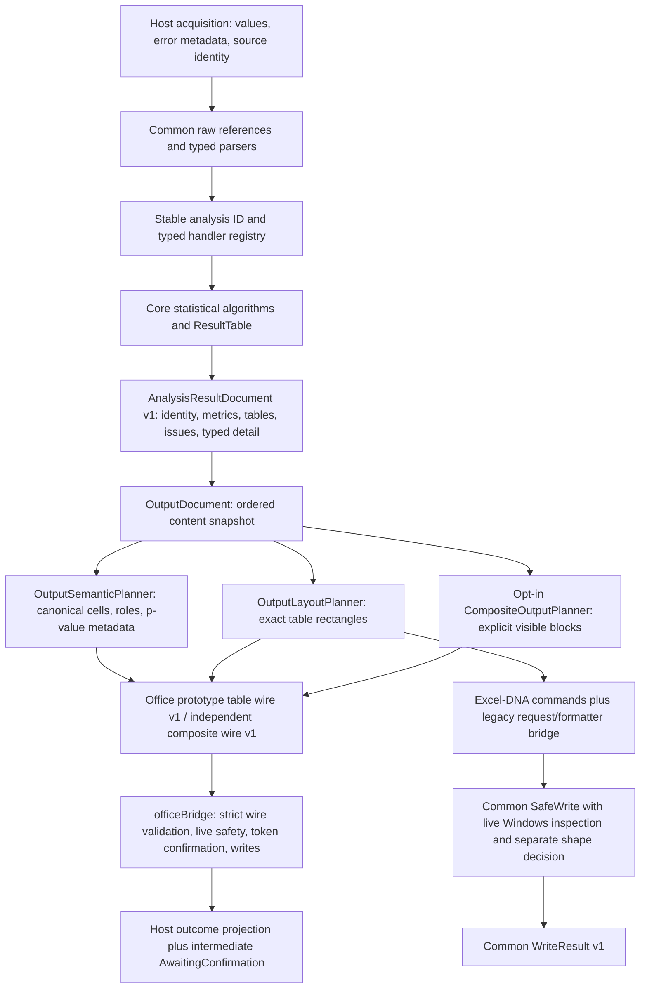

# Gate B — Common v1 output-contract review and freeze proposal

**OWNER DECISION: PENDING. Recommendation: READY WITH DOCUMENTED EXCEPTIONS.**
This proposes acceptance of the scoped Common v1 API and semantic envelope below.
It does not record an owner decision, declare v1 frozen, or authorize 03.01.
Gate B is an architectural decision gate after 02.08, not a numbered batch.
There is no 02.09. The checkpoint remains **222 total / 27 completed / 195
outstanding**, including all **74 Phase 04A batches after 04.07**.

## Baseline, authority and review method

Inspected on 20 October 2026: branch `codex/gate-b`, HEAD
`6b0b931efe2f1a6851bd9efb84289e348e5249d8`. Initial `git status --short`:

```text
 M planning/BESHStatNG_CrossPlatform_MasterPlan.md
```

The existing edit changed the 02.08 roadmap row to COMPLETE. It is retained.
The owner confirms 02.08 accepted, committed and merged into main after live
Windows Excel-DNA and Excel Online acceptance, including the empty CodeName and
false UsedRange/chart-consent fixes. This is **owner-reported live acceptance**;
this review does not reproduce it. The actual checkout is authoritative; no ZIP
was overlaid. Earlier pending wording in the 02.01–02.08 notes is historical and
does not reverse the owner's accepted checkpoint.

Reviewed root AGENTS.md, Revision 1.4 master plan including Phase 04A, all eight
02.xx architecture notes, [shared Excel contracts](shared-excel-contracts.md),
[validation workflow](development-validation.md), production contracts, both host
paths and their tests/fixtures. The companion [per-type inventory](gate-b-common-v1-contract-inventory.md)
records declarations, constructor guards, types/defaults, versions, consumers and
evidence. It inventories every public Common type and the adjacent Core/Windows
boundaries, with explicit exceptions to broad immutability/serialization claims.
Coverage checked against source: **193 Common public declarations plus 13 adjacent
Core/Windows declarations**. The 206 declaration entries classify as **147 frozen
candidates, 10 host adapters/transports, 32 in-memory implementations and 17
legacy/transitional APIs**. Additional internal host surfaces and unresolved future
contracts have their own ledger table; they are not extra frozen DTOs.

The accepted baseline is **1,024 Core + 513 Common + 719 Windows + 318 JS + 32
Python = 2,606**. It agrees with the final corrective evidence in
[02.08](batch-02-08-safe-overwrite-and-write-outcomes.md). Its earlier 656/690
Windows counts and 2,543/2,577 totals precede the accepted corrections; they are
not current baselines. This gate adds six Common compatibility cases, giving
**519 Common and 2,612 total**, freshly verified below.

## Boundary and call chain



`AnalysisResultDocument` owns analysis identity/status and metrics. Output content
complements it; neither output order nor worksheet coordinates replace input row
provenance. Windows currently consumes document/layout and its historical
formatter, **not** the semantic per-cell plan as its production rendering policy.
The Office path consumes the semantic plan and a host projection. A successful
layout/target decision is not consent, live occupancy, or proof that a physical
sheet exists. Neither host offers a transaction or rollback.

The approved scope changes only this proposal, the inventory, one new Common
test file and active master-plan status text. No production DTO, numerical
algorithm, serializer, writer, endpoint, JS payload, dependency or target changes.

## Normative Common v1 proposal

These rules describe the reviewed scope proposed for acceptance. Existing mutable
compatibility types retain their actual behavior; they are not retroactively
converted into immutable DTOs. All enum numeric meanings, stable codes and
published analysis IDs in the inventory are reserved. Constructors/factories
and parser validations remain distinct boundaries.

### Source values, coordinates and identity

Sources: [SpreadsheetContracts.vb](../../BESHStat.Excel.Common/src/Contracts/SpreadsheetContracts.vb),
[range references](../../BESHStat.Excel.Common/src/Contracts/SpreadsheetRangeReferences.vb),
[cell policies](../../BESHStat.Excel.Common/src/Input/CellValuePolicy.vb),
[validation](../../BESHStat.Excel.Common/src/Input/SpreadsheetValidation.vb),
[typed inputs](../../BESHStat.Excel.Common/src/Input/TypedNumericInputs.vb),
[frame/category inputs](../../BESHStat.Excel.Common/src/Input/RectangularCategoricalInputs.vb),
[Core bridge](../../BESHStat.Excel.Common/src/Input/SpreadsheetCoreTableBridge.vb)
and [model compiler](../../BESHStat.Excel.Common/src/Input/ModelInputCompiler.vb).

| Position/identity | Required interpretation |
|---|---|
| Raw `Rows(r)(c)`, frame `Cell(r,c)`, numeric/design arrays, parser role indices | Zero-based collection/array indices. A column option of 0 selects the first source column; optional roles may use documented -1 sentinels. |
| `StartRow/StartColumn` and range bounds | One-based worksheet coordinates. Raw legacy acquisition starts may be 0 for unknown; validated targets require positive starts. ExcelA1 factories enforce Excel limits; HostNative requires explicit coordinates/dialect without interpreting its display text as A1. |
| `SelectedRow/SelectedColumn` in observations/frame cells/issues | One-based offsets into the **original selected rectangle**, including the original heading position. Issue coordinates may be 0 when unspecified. A header excluded from typed Rows does not renumber provenance. |
| `WorksheetRow/WorksheetColumn` | One-based original worksheet position, 0 unknown. With known start, `worksheetRow = StartRow + selectedRow - 1`. Never replace with the dense retained-row index after dropping incomplete cases. |
| Model/advanced/longitudinal row provenance | Original typed observation/frame source row, aligned with complete-case response/design/other roles; not output table row or fitted-model ordinal. CoreDataTable bridge supplies FirstSourceRow/Column, using its existing 1 fallback when unknown, without claiming that fallback was observed. |
| Core p-value addresses | One-based **body-relative** BodyRow/BodyColumn and column annotations; exclude title/top/left headers and footer. These are output annotations, unrelated to original source rows. |
| Output semantic Row/Column and LocalId | Zero-based within complete assembled table; LocalId `row:column` only within ArtifactId. Document/table/composite/source indices are zero-based sequence positions. |
| Layout offsets / host indexes | RowOffset/ColumnOffset zero-based from requested start; nullable when unplaced. Office range API subtracts 1 from absolute bounds once. COM bulk native matrices use one-based native bounds and are validated separately. |
| Source identity | WorkbookId/WorksheetId/SelectionId/SelectionRevision are optional host observations; blank means unknown. Names and qualified addresses are display/reference intent, not globally persistent identity. |
| Output identity | Artifact IDs are document-local ordinal keys. DocumentId/PlanIdentity/TargetIdentity scope executions/documents, not source records. Equal names, shapes or IDs in another instance do not authorize reuse. |

Input cell enum remains Blank=0, Number=1, Text=2, Bool=3, CellError=4. Defaults
permit numeric observations only from finite Number cells, distinguish blank
from explicit empty text, reject numeric-text/Boolean/date conversion unless
explicitly opted in, and preserve native error identity separately from display
spelling. Unknown date basis never silently assumes Excel1900; explicit host
midnight origin is separate, and Excel's phantom 1900 leap day is rejected.
Host-specific A1/date/error interpretation does not become universal spreadsheet
identity. The Core bridge retains missing mask and numeric matrix under the
explicit policy rather than Core's permissive generic string conversion.

**Legacy exception:** `GroupedNumericData` retains caller-owned name/value arrays
and no observation coordinates. Both old and configured grouped parsers end in
that type. Structured diagnostics have locations, but successful grouped output
does not recover rows skipped independently in each group. Do not invent
provenance from group array position. Typed vectors/pairs/frames/model inputs
provide the stronger provenance boundary for future work; grouped API replacement
needs a separately reviewed additive bridge/migration.

### Existing analysis v1 and executable identity

Sources: [AnalysisResultDocument.vb](../../BESHStat.Excel.Common/src/Results/AnalysisResultDocument.vb),
[analysis IDs](../../BESHStat.Excel.Common/src/Analysis/AnalysisIds.vb),
[typed registry](../../BESHStat.Excel.Common/src/Analysis/AnalysisHandlerRegistry.vb),
[options/legacy result](../../BESHStat.Excel.Common/src/Analysis/SpreadsheetAnalysisContracts.vb).

Stable identities remain `anova.oneway` and `nonparametric.kruskal-wallis`.
Legacy SpreadsheetAnalysisKind values 1/2 remain compatibility aliases, not
serialized feature identity. Descriptors/typed registrations determine executable
input/options combinations; authored methods.yml is display/help metadata
authority and cannot register a handler. Type mismatches and unimplemented IDs
reject before execution. Ribbon XML and ExcelFunction declarations retain their
independent Windows registration/export authority.

Analysis v1 has SchemaVersion constant 1; ordered tables, ordinal-sorted unique
metrics, structured warnings/faults and typed detail. Faults determine Failed;
table Index is zero-based. Tables and metrics are captured independently of
subsequent legacy collection mutation. Table matrix copying is shallow at the
analysis boundary; this is not arbitrary-object deep cloning. `AnalysisDetailArtifact`
retains the actual service detail reference and is in-memory only.

`ToContractSnapshot()` is the explicit structural DTO representation: version,
analysis ID/status, table dimensions/sections/annotation lists, metrics,
warnings/faults and detail type name. It excludes table cell Values and raw
detail. Nonfinite metrics use nullable Value plus NumericKind
Finite/NaN/PositiveInfinity/NegativeInfinity; they do not become finite numbers.
Direct construction of the mutable snapshot does not initialize version to 1;
the producer assigns it. Existing five Stage304 goldens protect statistical
metrics, ordered tables, exact stored types and p-value metadata. The output
content model does not replace that envelope or its fixture authority.

### Ordered content, snapshots and cell fidelity

Sources: [OutputDocument.vb](../../BESHStat.Excel.Common/src/Output/OutputDocument.vb),
[OutputCell.vb](../../BESHStat.Excel.Common/src/Output/OutputCell.vb),
[legacy request](../../BESHStat.Excel.Common/src/Output/ResultTableWriteRequest.vb).

OutputDocument requires nonnull artifacts and unique nonblank ordinal,
case-sensitive IDs; explicit constructor order is authoritative. FromAnalysis
emits tables, then warnings, then faults, then caller trailing artifacts in each
source order. IDs use invariant `table-{index}`, `warning-{index}`, `fault-{index}`.
There is no implied intercollection chronology, global uniqueness or stable
identity across changed analysis runs. FromResult reads the captured Document.

OutputTableArtifact snapshots complete Core ToOutputModel matrices, section
counts and exact annotation lists. Values must have zero-based array bounds and
valid section dimensions. Every Model access returns fresh matrix/lists. Allowed
raw values are Nothing, String, Boolean and CLR integer/Single/Double/Decimal
scalars, including raw nonfinite floats; arbitrary objects, arrays, dates, enums,
DBNull and host objects reject rather than stringify. Accepted scalars are
immutable, making matrix cloning sufficient here. Caller concurrent mutation
during snapshot creation is unsupported. Captions do not synthesize rows;
actual headings/titles/footers and padding stay inside the assembled matrix.

| Canonical OutputCell | Fidelity rule |
|---|---|
| Blank | Raw Nothing; distinct from TextCell(""). No numeric zero or guessed missing marker. |
| Number/Binary64 | Finite Double; Single widens, signed zero and binary value retained. NumberCell rejects nonfinite. |
| Number/ExactDecimal | Decimal and every CLR integer stored exactly; no implicit binary64 rounding. |
| Text | Empty, numeric-looking, `#N/A` and `=1+1` strings stay literal text. |
| BooleanValue | Boolean remains distinct from 0/1. |
| Error | Explicit spreadsheet token mapping with original spelling/supplied optional native Integer code/safe detail. Unknown tokens remain Unknown. FromRaw nonfinite floats become NonFinite with number.nan/positive-infinity/negative-infinity codes and no invented native code. |
| Formula | Explicit TrustedFormula expression plus logical language only; rejects blank/control-bearing intent. No parsing/evaluation or automatic execution promise. |

Only fields selected by Kind/NumberKind are populated; other nullable scalar
and reference fields remain Nothing. `OutputCellTable.CellAt` uses zero-based
table coordinates. No new production serializer is proposed.

**Legacy exception:** ResultTableWriteRequest is mutable and its factory retains
the historical literal `#N/A`, `#Pinf`, `#Ninf` normalization, Core number-format
string and target EnsureDefaults behavior. It is a compatibility bridge, not the
lossless OutputCell representation. Windows passes it through the historical
formatter. DTO fidelity does not certify exact Decimal storage by native Excel;
the Office adapter instead refuses every exact value that cannot be represented
losslessly as binary64, including 0.1D and unsafe Int64/UInt64 values. A future
adapter must preserve or explicitly reject unsupported intent, with migration
review before promising stronger legacy native precision.

### P-value metadata and semantic styling

Sources: [semantic styles](../../BESHStat.Excel.Common/src/Output/Styles.vb),
[semantic planner/policy](../../BESHStat.Excel.Common/src/Output/PValuePresentation.vb),
[Core settings](../../BESHStat.Core/src/AppInfrastructure/AppSettings.vb),
[Core display](../../BESHStat.Core/src/DM/ResultWriter/PValuePresentation.vb).

Core owns statistical numeric values and its display policy. Common copies and
normalizes presentation settings (2–16 decimals, default 8; small-value mode
LessThanThreshold=0, ScientificNotation=1, FixedDecimal=2; upper bound True).
Invalid alpha falls back to 0.05 with pvalue.alpha.defaulted. Invalid copied
settings produce pvalue.settings.defaulted. No caller/global settings mutation.
PreviewCultureName Nothing means no preview, empty means explicit invariant,
named cultures such as en-US/sk-SK are explicit; no machine culture is guessed.
Preview can round/project for display, but never replaces the primary number.

P-value targets come from original one-based body column/cell annotations:

```text
arrayRow    = TitleRows + HeaderTopRows + BodyRow - 1
arrayColumn = HeaderLeftColumns + BodyColumn - 1
absoluteRow/Column = placement.Bounds.StartRow/Column + arrayRow/Column
```

Out-of-body annotations are skipped with pvalue.column.invalid/pvalue.cell.invalid
and original zero-based list indices. Valid duplicates and column/cell overlaps
collapse to one target; raw metadata remains untouched. Styles are emitted in
document order and cells row-major. Section precedence is Title, TopColumnHeader,
Footer, LeftRowHeader within body, then Body. A p-value overlay changes number
intent/significance without replacing the section role.

Significance requires a typed numeric probability in [0,1] and **p <= alpha**,
with finite alpha in (0,1). Text/Boolean/blank/error/formula cannot qualify.
Binary64 compares directly; Decimal uses exact rational comparison against the
actual binary64 alpha. Decimal 0.050000000000000003 is above Double alpha 0.05,
even though its preview conversion rounds to that Double. Equality is significant;
the next representable Double above alpha is not. Display threshold boundaries
are separately strict: p < 10^-d and p > 1-10^-d, not significance rules.

Significant cells carry StrongEmphasis and accessibility token `significant`;
warning/fault roles carry `warning`/`fault`. Color is not the sole Common semantic
signal. Title/header/body/footer and number-format intents remain host-neutral;
General has no precision, Numeric/Percentage/Scientific require 0–16 and PValue
2–16. Hosts may explicitly reject unsupported intents. Statistical algorithms,
p-values and their stored numeric precision are unchanged by presentation.

### Layout, composites and target decisions

Sources: [layout](../../BESHStat.Excel.Common/src/Output/OutputLayoutPlanner.vb),
[composite](../../BESHStat.Excel.Common/src/Output/CompositeOutput.vb),
[target planner](../../BESHStat.Excel.Common/src/Output/TargetPlanner.vb),
[capabilities](../../BESHStat.Excel.Common/src/Host/HostCapabilities.vb).

OutputRectangle is positive-area with one-based inclusive bounds. Default layout
stacks complete tables in artifact order, same start column; each subsequent
positive-area start is previous EndRow + 1 + gap (default 1). Zero-row **or**
zero-column tables and nonspatial artifacts retain identity/order but get Nothing
bounds/offsets and consume neither rows nor gaps. No imaginary cell/trailing gap.
UsedBounds is an enclosing envelope, including holes. It is never the union of
owned cells or permission to clear them. Reservations constrain the same logical
scope; collisions/overflow reject without shifting to another location.

Composite intent is separate from the closed OutputArtifactKind family. Every
source artifact occurs exactly once in source order; notes/links may interleave
with distinct item IDs and optional valid source anchors. Tables use captured
dimensions. Diagnostics/plots require explicit dimensions to become visible;
0x0 keeps nonspatial intent. Visible plot placeholders reserve real cells but
promise no chart rendering. Embedded table footers are never duplicated as notes.
Links are narrowly validated HTTPS DNS targets without credentials/custom ports;
both projections deliberately show inactive literal linked text. No navigation,
HYPERLINK formula, native chart definition or speculative plot data is implied.

| Accepted geometry | Exact ordered owned rectangles | Envelope / excluded gaps |
|---|---|---|
| C6 four-table layout | C6:E7; C9:D11; C13:F13; C15:C16 | C6:F16; rows 8,12,14 excluded; union 18 cells, not 44 |
| C10 six-region composite | C10:H13 main table; C15:H15 warning; C17:H24 chart placeholder; C26:H26 note; C28:H28 inactive link; C30:E31 second table | C10:H31; rows 14,16,25,27,29 excluded |

Composite OccupiedRectangles means **planned owned geometry**, not observed
existing workbook occupancy. Item Index and nullable SourceIndex are separate
zero-based sequences. Literal text is retained in full, with wrapping/fixed
dimensions that can visually clip; no truncation or inferred height. Accepted
C6/C10 fixtures and independent .NET/JS/Windows recording tests protect those
geometries.

Destination enum remains CurrentWorksheet=0, NewWorksheet=1, NewWorkbook=2.
Requested and effective destination are identical; no silent fallback. Immutable
decisions snapshot names, starts, selected capability and nullable host facts;
ToTarget returns a fresh mutable DTO only after support is ensured. Requested
new-sheet names are labels; resolved names and physical target identity are
separate. Unknown optional target facts preserve legacy admission but grant no
overwrite permission. Known missing/ambiguous/protected/merged/unwritable targets
reject; live adapters must inspect their execution target.

Windows supports all three destinations through existing host APIs; Office.js
supports current/new sheet and explicitly rejects NewWorkbook even if a false
runtime capability says otherwise. A new worksheet is distinct, never an existing
sheet reused on name collision. Current-sheet composite output remains disabled.
Common/Windows geometry policies include deliberate host limits: Windows refuses
the last worksheet row when the legacy next cursor would be invalid. Basic
capability admission does not waive the stricter per-operation safety API checks.

### Safe inspection, scoped consent and outcomes

Sources: [WriteResult.vb](../../BESHStat.Excel.Common/src/Output/WriteResult.vb),
[Windows target inspection](../../BESHstatNG/src/DM/ResultWriter/ExcelDnaOutputTargetAdapter.vb),
[Windows orchestration](../../BESHstatNG/src/DM/ResultWriter/ExcelDnaSharedOutputPlanAdapter.vb),
[Office bridge](../../BESHStat.WasmSmoke/wwwroot/js/officeBridge.js).

WriteRegion binds artifact ID to exact optional bounds; nonCellMutation can mark
an append-only chart without bounds. WriteIntent snapshots full-payload plan
identity, target scope, optional physical identities, target scalars, ordered
unique nonoverlapping regions and copied reservations/guards. IDs/messages are
bounded and control-free; region lists are limited to 256 and Excel bounds.
Reservations cannot intersect writes. Common guards are additional conservative
inspection intent, **not** permission to clear. The corrected Windows adapter
rejects obsolete broad cell guards and inspects shapes separately.

WriteInspection holds the exact intent instance, Empty/Occupied/Unknown/Rejected,
opaque observation identity, ordered occupied mutating region IDs, value/formula
flags, stable code and safe explanation. Contradictory empty/occupied states
reject construction. Exact planned rectangles are checked, including the second
and supplementary tables; separator-only/distant/format-only contents are not
occupied writes. `=""` counts as occupied even with empty displayed value. Native
errors, Boolean False and numeric zero count. Unknown/incomplete/protected/merged
observations reject rather than asking the user to waive missing verification.

WriteConsent is explicit approval of known occupancy, tied to the **same intent
reference**, observation identity, ordered occupied IDs and value/formula flags.
It is not a preference, transferable bearer permission or persistent ID. One
decision covers the inspected set of exact regions; it does not approve unrelated
regions or later runs. Reinspection precedes the first action. Decline performs
no write actions; stale observation rejects before writes. This is per-region
scope, not a requirement for one modal dialog per cell/table.

**Host enforcement distinction:** Common Authorizes is a pure predicate and does
not consume consent. SafeWrite creates consent locally per Execute invocation;
it has no reusable consent input or token store. The normal Windows orchestration
constructs a fresh intent and obtains fresh consent on each run; its internal
prepared-command class is not itself a single-use authorization mechanism.
Office.js separately stores a complete prepared-plan/context/sheet/
observation snapshot, retains at most eight requests for five minutes, deletes
the token on use, rejects stale/replayed/expired mismatches, and cancels without
another Excel.run. The task pane submits the same prepared plan without rerunning
analysis. Do not serialize Common consent/reference equality as remote approval.

The two accepted Windows corrections remain present: TargetIdentity hashes COM
IUnknown identity with a process nonce, independent of Worksheet.CodeName; its
opaque values are transient within the process/apartment, never persistent
workbook IDs. Cell occupancy reads exact planned Value2 + Formula matrices; it
does not scan UsedRange for chart consent. Append-only charts require a separate
bounded existing-shape/protection inspection and **Add charts?** decision when
shapes exist, followed by revalidation. Shape approval does not set cell-overwrite
approval. Native chart positions remain host-dependent; approved output can
affect anchored shape dimensions through existing Excel layout behavior.

| Final Common state (Int32) | Invariant / typical stable code |
|---|---|
| Completed=0 | All mutating actions observed complete, confirmed in original order; output.completed. Empty/nonspatial execution can complete with no mutation. |
| CancelledByUser=1 | No mutation, no confirmed regions; output.cancelled (Windows chart cancellation uses its separate host code). |
| RejectedBeforeWrite=2 | No mutation/confirmed regions; target/capability, occupancy-unverified or consent-stale code. |
| FailedBeforeWrite=3 | No mutation/confirmed regions; output.host-failed. |
| PartiallyWritten=4 | MutationMayHaveOccurred=True, including an uncertain first operation or created destination with no confirmed cells; output.mutation-uncertain or a specific host/cancellation code. |

WriteResult alone declares outcome SchemaVersion=1. ConfirmationRequired and
OverwriteApproved are nullable: unknown is not False or approval. ConfirmedWritten
contains only observed completions, never invented successes in the failing
block. SafeWrite marks mutation possible **before** invoking an action, never
retries and returns safe messages without copying arbitrary native exception
text. Windows can confirm completed synchronous actions; Office queued/sync
failure conservatively confirms no fabricated committed subset. Requested new
Windows destinations may be created before later inspection/cancellation and
remain; those results are partial, not zero-mutation cancellation.

UndoSupported=False, RollbackAttempted=False and RollbackSucceeded=False.
No rollback, atomicity, cross-client isolation or lock against edits after the
last observation is promised. Per-host safety quotas/API failures fail closed.
Office requires protection/merge inspection APIs for the requested operation;
missing API support does not authorize the write.

## Version boundaries and change control

The source comment in
[OfficeOutputPlanAdapter.vb](../../BESHStat.Excel.Common/src/Output/OfficeOutputPlanAdapter.vb)
explicitly says: “Prototype adapter wire version, NOT the frozen Common v1
envelope (02.08).” Its second comment requires camelCase including null union
fields. This proposal preserves that distinction; equal numeric versions are
not evidence of one protocol.

| Boundary | Current version / compatibility promise proposed |
|---|---|
| Common v1 envelope | Review label for accepted API/value/coordinate/order/safety semantics; no global production JSON serializer. Most constituent types have no version property. |
| AnalysisResultDocument / structural snapshot | Independent v1. SchemaVersion constant 1 emitted to mutable snapshot; omits cells/raw detail. Existing default System.Text.Json test reader ignores unknown optional fields and drops them on rewrite; no unknown-required-field/version negotiation guarantee. |
| OutputSemanticPlan | ReadOnly SchemaVersion=1 on in-memory graph. Six normalized JSON fixtures are a **test-only projection**, not a production wire/deserializer. |
| WriteResult | ReadOnly SchemaVersion=1 on Common outcome envelope. Constructor invariants govern semantics; generic serialization in tests is observation, not a remote consent protocol. Intent/Inspection/Consent have no fake versions. |
| Descriptor ContractVersion/InputSchemaId/OptionsSchemaId | Per-analysis registration/schema metadata (current version 1), independent of output/transport/app versions. CLR Type/delegates are not portable serialized payloads. |
| OfficeOutputPlan / OfficeCompositeOutputPlan | Independent prototype table wire 1 and composite wire 1 nesting table wire 1. Strict exact camelCase keys, numeric destination, symbolic roles/kinds, explicit nulls. New fields currently reject. |
| JS execution response / task-pane projection | Host schemaVersion=1, string outcome states and host addresses; AwaitingConfirmation is intermediate, not an OutputWriteState enum value. Home's private mutable response DTO does not implement Common WriteResult or declare its own version. |
| Excel-DNA adapters | Host behavior, public legacy entrypoints and internal seams; no wire version. Historical formatter/native chart decisions are separate from Common semantics. |
| Core settings / application / installer | Existing BeshStatNgSettings XML Version=3; independent app/assembly/installer release identities. None increments or migrates Common schemas automatically. No such versions changed here. |

**Allowed additive changes require evidence of compatibility, not merely the word
optional.** New optional properties with safe defaults may extend a Common API
where existing construction/reading remains valid. Example: an optional safe
diagnostic hint on the existing analysis snapshot can be ignored by the tested
default reader, but is not retained on round-trip. Do not rely on that reader to
validate required fields or unsupported versions.

New independent artifacts can be opt-in companions using an existing supported
kind/collection or a separately versioned extension path. Existing readers must
continue to receive the old projection/order by default. Do not append unknown
kinds to the closed AnalysisArtifactKind/OutputArtifactKind families and call it
backward compatible; source explicitly requires revision for new analysis kinds.
Composite kind is a separate opt-in family, not a redefinition of that enum.

New capability IDs may describe newly implemented operations; they must not
silently alter existing decisions or advertise unsupported actions. New host
adapters may preserve the existing Common meanings while explicitly refusing
unsupported intent. Backward-readable versioned extension fields are allowed
only where the **specific reader** already supports them or an approved versioned
reader/migration is delivered. Office wire 1 has no general extension bag or
unknown-field tolerance: even an optional Common hint cannot be forwarded there
without a separate adapter/protocol review. No transport change is authorized by
this document.

Breaking changes require explicit **v2 / migration review** before implementation:

- Removing/renaming required properties or changing CLR/wire types; adding
  mandatory fields without compatible defaults; replacing immutable snapshots
  with mutable aliases; changing field casing/null representation in a wire.
- Reusing enum numbers, stable IDs/codes or an existing kind for new meaning;
  changing ordered artifacts/table ordinals or their identity scope.
- Switching one-based/zero-based/body-relative positions, bounds inclusivity,
  original-row provenance, start offsets or owned footprint/gap behavior.
- Numeric-to-text or text-to-numeric coercion, silent Decimal/Int64 rounding,
  changing serialized precision/nonfinite/error/formula intent or native IDs.
- Redefining significance, alpha boundaries/default semantics or replacing a
  numeric p-value with preview text. Statistical numeric changes also require
  Core numerical review and independently justified references.
- Weakening inspection/consent/revalidation, allowing replay/silent target
  fallback, treating unknown as safe, or claiming undo/rollback without an
  implemented and separately verified contract.

For **every future Phase 03–13 and 04A batch**, identify affected ledger entries
and consumers before coding; keep numerical algorithms in Core and orchestration/
semantics in Common. Specify additive or breaking compatibility and each version
boundary affected. Retain old migration inputs, fixtures and field/type/code/
coordinate assertions; add focused old-reader/new-producer and new-reader/old-
producer tests where those readers actually exist. Approved new fixtures are
additive; existing accepted fixtures require explicit owner approval to rebaseline.
Include changed/unsupported host behavior, migration/default policy and accepted
exceptions in release notes. Host runtime claims require host evidence.

**03.01 implication:** create separately versioned application settings/preference
contracts only after independent Gate B acceptance and separate batch approval.
Reuse Core p-value settings/alpha ownership; explicitly test migration from legacy
XML version 3 and effective defaults, without making settings version equal to
output version or persisting execution/COM consent identities. This gate supplies
no settings DTO/store implementation or authorization for it.

**04A implication:** preserve all 74 planned batches and the sequence
04.07 → 04A.01–04A.74 → dependent Phase 05+ work. Windows extractions must reuse
typed source rows, handlers, content/cell/layout/target/safe-write semantics and
Core numerics. Existing legacy formatter differences require explicit migration
tests/approval rather than an unreviewed cleanup. Native charts, full detail DTOs
and a production Office transport remain their planned separate work. No Phase
04A code or dependency/count changes occur here.

## Host compatibility and evidence limits

| Feature / boundary | Windows Excel-DNA | Office.js Excel Online | Future Office.js Mac | Evidence |
|---|---|---|---|---|
| Shared ANOVA/KW algorithms, five fixture results | Core-backed shared handlers; legacy supplements/charts retained | Same Core-backed handlers; smoke UI exposes only its actual options | Compiled services available in principle; runtime unverified | Core/Common/Windows suites; five Stage304 goldens; Windows/Online acceptance owner-reported |
| Table layout/start | Exact planned rectangles; UI new sheet/book retains A1 defaults; current reference may be non-A1 | Current/new sheet explicit starts, including C10; host indexes subtract 1 once | Requires actual API/runtime tests | OutputLayout seven references; C6 actual table wire/trace; adapter recording tests; prior owner C10 acceptance |
| Destinations | Current, new worksheet, actual new workbook | Current/new worksheet; NewWorkbook explicitly rejected, no fallback | No support claim; NewWorkbook stays unsupported in current Office implementation | Common capability/target tests; JS tests; accepted Windows/Online checks |
| P-values and section styles | Historical formatter: numeric-looking text may highlight, historical left-header/footer behavior and green-only cue remain | Common typed-numeric predicate, resolved roles and bold plus green | Semantic intent portable; native formatting unverified | OutputSemantics six fixtures; Windows legacy predicate tests; Office adapter snapshots; no universal visual parity claim |
| Exact Decimal/large integer, errors/formula intent | Legacy raw request/native write behavior, not a new lossless canonical executor | Inexact Decimal/Int64/UInt64, canonical errors and all trusted formulas reject before interop; literal strings escaped | Same adapter limits unless separately implemented/verified | OutputCellTests, OfficeOutputPlanAdapterTests, typed-role JS tests |
| Safe current-sheet overwrite | Exact Value2/Formula reads, modal Yes/No, reinspection; separate shape consent | Exact values/formulas/types, task-pane Overwrite/Cancel, single-use tokens/reinspection; required safety APIs fail closed | Requirement-set/protection/merge behavior unverified | WriteResultTests; 158 Windows shared/composite recording cases; safeOverwrite JS tests; owner-reported 02.08 Windows/Online acceptance |
| C10 composite diagnostic/note/link/plot | Internal recording/insertion seam only; no production form/literal-block renderer | Opt-in synthetic demo, new empty sheet only; literal inactive link/visible placeholder | No runtime acceptance | Three composite wire fixtures; Common/Windows/JS tests; owner-reported Online C10 acceptance from 02.07 |
| Native charts / existing shapes | Existing native charts; host-dependent placement, separate visual-overlap approval | Placeholder only; no native chart parity claim | Unverified/future | Windows source/recording and owner-reported acceptance; prototype fallback fixtures |
| Undo/rollback, concurrent edits | None; creation/partial writes may remain | None; queued/sync failure may be partial | No stronger claim | Explicit False flags and injected-failure tests |

Automated mocks/recording seams do not execute live COM or Office APIs. The full
WASM command builds the smoke harness; it does not launch a browser or establish
a production Office add-in. No fresh live Excel, Excel Online, Mac, x86 runtime,
browser smoke, installer or deployment was run for this docs/test-only gate.
Owner acceptance of 02.08 does not certify untested Mac or all legacy analyses.

## Exceptions, ambiguity and proposed remedies

No accepted fixture drift or new runtime incompatibility was observed. The
recommendation is scoped to the reviewed contracts **with these explicit
exceptions**, not untested feature parity or a final production transport.

| ID / severity | Finding / authority | Smallest separately authorized remedy / priority |
|---|---|---|
| E1 — Medium, accepted legacy divergence | Windows renders through the legacy request/formatter; numeric text significance, header behavior, accessibility cue and native Decimal limits differ from Common/Office. Common semantic plan is not current Windows renderer authority. | Before claiming semantic parity, approve a narrow formatter migration with numeric/text/role/precision tests and live visual acceptance. Preserve current behavior until then; fits the planned Windows output reconciliation, not this gate. |
| E2 — Medium, version boundary | Prototype Office table/composite wire 1 uses strict key sets and a restricted scalar union. It cannot accept arbitrary optional Common fields or new kinds. Source explicitly disclaims equivalence to Common v1. | Keep current projection unchanged; design/version/negotiate a production transport separately when authorized. Add migration reader tests then. No new production serializer or schema patch here. |
| E3 — Medium, legacy provenance/mutation | GroupedNumericData and SpreadsheetAnalysisResult legacy collections retain aliases; grouped data has no per-observation source row. Analysis detail retains a reference; structural snapshot excludes cells/raw detail. | Preserve compatibility and use existing typed provenance inputs for new work. If a migrated grouped/detail consumer needs more, approve an additive typed bridge/detail DTO plus exclusion/alignment/defensive-copy tests. Do not fabricate rows or call existing detail deeply immutable. |
| E4 — Medium, consent ownership | Common consent is a same-instance predicate; Windows creates consent inside each run, while Office separately consumes tokens. Internal prepared commands do not supply a single-use authorization store. COM target tokens are process-local. There is no durable cross-process consent/workbook-ID protocol. | No patch needed for current calls. A future asynchronous/remote executor must separately approve session binding, token consumption and migration tests; never persist current COM/consent IDs in 03.01 settings. |
| E5 — Low, guard policy | Common WriteIntent.Guards remains available; corrected Windows rejects broad guards and separately handles append-only shapes. A Common guard does not imply host support. | Preserve field/API but document host refusal as here. Any future guard consumer must define exact inspection/non-clear behavior and consent scope tests before support is advertised. |
| E6 — Low, historical planning/docs | 02.08 architecture history still contains then-current pending wording/counts; initial plan mixed COMPLETE row with stale 26/196 active checkpoint. | This proposal and minimal active plan updates supersede those historical statuses. Retain historical evidence, 222 total, 27/195, all Phase 04A entries. No extra numbered batch. |
| E7 — Future/unresolved | Full family detail/ChartDocument serialization, durable workbook identity, production settings and Office wire are not implemented/frozen by these generic contracts. | Resolve in their authorized planned batches with clear owners and fixtures. methods.yml, Ribbon XML, UDF declarations, typed registry and Core each retain their existing distinct authority. |

These are documented boundaries, not repairs silently applied to make tests pass.
If the owner requires universal lossless native-cell handling, provenance in the
legacy grouped DTO, every Windows renderer to consume semantic styles, or a final
production Office protocol **as a prerequisite to Gate B**, the gate must instead
be **BLOCKED** on the corresponding separately approved E1–E4 work. This proposal
recommends freezing the existing scoped API/semantics with those exceptions.

## Focused tests, full gate and preservation evidence

Existing coverage already protects all five Stage304 goldens, six OutputSemantics
fixtures, seven OutputLayout references, eight Office table snapshots, C6 write
trace and three C10/secondary composite fixtures. Existing tests cover values/
types/precision, signed zero, Decimal significance, literal formula/error text,
native errors, source rows, defensive copies, invalid geometry, protected/merged
targets, occupied later tables, `=""`, separator sentinels, No/Cancel with zero
workbook mutations, stale/replayed Office consent, distinct chart decisions and
mutation-uncertain partial outcomes. No fixture regeneration was needed.

The new GateBOutputContractCompatibilityTests adds exactly six cases:

- One assertion set for existing enum names/numeric meanings/Int32 backing,
  spanning source/output/analysis/layout-adjacent/safety discriminants.
- Stable safe-write and capability-code literal spellings/types.
- Required canonical scalar and safe-write member names/types/read-only access,
  allowing additional members without silently authorizing them.
- Existing AnalysisResultDocumentSnapshot default reader ignores optional outer
  and nested fields while retaining known fields/version; unknowns are dropped,
  not preserved. No unknown-required-field or Office tolerance claim.
- Two consent cases reject reordered/subset occupied IDs with the same intent,
  token and flags. This closes an ordered-region scope gap in existing tests.

No production serializer, projection fixture, framework/package/test harness,
Windows test rewrite or JS change was introduced. Existing tests were not weakened.
Initial existing focused run: **277 passed**. New focused run: **6 passed**.
Both passed on first compilation. Full script: **exit 0**.

Exact commands run from the project root:

```powershell
dotnet test BESHStat.Excel.Common.Tests/BESHStat.Excel.Common.Tests.vbproj -c Debug --no-restore --filter 'FullyQualifiedName~AnalysisResultDocumentTests|FullyQualifiedName~Stage304ContractSnapshotTests|FullyQualifiedName~OutputDocumentTests|FullyQualifiedName~OutputCellTests|FullyQualifiedName~OutputStylesTests|FullyQualifiedName~PValuePresentationPlanTests|FullyQualifiedName~OutputLayoutPlannerTests|FullyQualifiedName~OutputTargetPlannerTests|FullyQualifiedName~OfficeOutputPlanAdapterTests|FullyQualifiedName~CompositeOutputTests|FullyQualifiedName~WriteResultTests' --logger 'trx;LogFileName=GateB-existing.trx' --results-directory TestResults/Codex/GateB

dotnet test BESHStat.Excel.Common.Tests/BESHStat.Excel.Common.Tests.vbproj -c Debug --no-restore --filter FullyQualifiedName~GateBOutputContractCompatibilityTests --logger 'trx;LogFileName=GateB-new.trx' --results-directory TestResults/Codex/GateB

powershell.exe -NoProfile -ExecutionPolicy Bypass `
  -File .\scripts\verify-beshstatng.ps1 `
  -Python `
  -PythonExe "C:\Users\peter\Desktop\WPy64-31150\python-3.11.5.amd64\python.exe" `
  -Js -Wasm -Legacy -VisualStudio 2026
```

The exact full command was wrapped only to capture both streams without the
historical PowerShell unittest-stderr reporting issue:

```powershell
cmd.exe /d /c 'powershell.exe -NoProfile -ExecutionPolicy Bypass -File .\scripts\verify-beshstatng.ps1 -Python -PythonExe "C:\Users\peter\Desktop\WPy64-31150\python-3.11.5.amd64\python.exe" -Js -Wasm -Legacy -VisualStudio 2026 > TestResults\Codex\GateB\full-gate.log 2>&1'
```

| Suite/build | Accepted 02.08 | Fresh Gate B result |
|---|---:|---|
| Core net10 MSTest | 1,024 | 1,024 passed, 0 failed/skipped |
| Common net10 MSTest | 513 | 519 passed (+6), 0 failed/skipped |
| Windows Framework 4.8 MSTest | 719 | 719 passed, 0 failed/skipped |
| Office.js Node | 318 | 318 passed, 0 failed/skipped; syntax check passed |
| Python tooling/help/discovery | 32 | 22 + 5 + 5 passed |
| **Total** | **2,606** | **2,612 passed** |
| WASM net10 Debug build | Passing | Succeeded, 0 warnings/errors |
| VS2026 Windows Debug build | Passing | Succeeded, 0 compiler warnings/errors |
| Excel-DNA x86/x64 packing | Both passing | Both packed XLLs produced successfully by the legacy build |

Stage304 inventory, authored catalog validation, generated metadata --check and
retired-helper audit passed. No package installation was needed. The historical
non-failing `UTA001 MatrixTestHelpers` discovery advisory remains. Existing TRX
overwrite notices refer to ignored reports. Debug post-build exits at its
non-PreRelease guard; no signing/installer workflow executed. No separate live
XLL load or x86 Excel runtime check was performed or required for this gate.

Local evidence: `TestResults/Codex/GateB/GateB-existing.trx`, `GateB-new.trx`,
`full-gate.log`, protected-byte manifest/backups; full suites use
`TestResults/Codex/{Core,Common,Legacy}.trx`. These ignored local artifacts are
not additional delivery files. A local source-extraction helper assembled the
declaration ledger; it is not a production API scanner or build dependency.

Before builds, 34 tracked fixture/generated files were SHA-256 captured, and
exact bytes of HelpLinks.vb, HelpContext.vb and VersionAttributes.vb were backed
up. Only generated files changed by these builds are archived and restored to
their exact initial bytes. Final comparison protects every accepted fixture,
generated originals, all production source/transport/project files, accepted
histogram changes, signing/installer assets and the Phase 04A companion ledger.
Both historical stashes are retained without apply/pop/drop:

```text
stash@{0}: On main: Generated help files after batch 01.08
stash@{1}: On codex/infrastructure-before-01-08: VS2026 generated help files before infrastructure merge
```

Common/Core remain netstandard2.0, Windows/add-in tests .NET Framework 4.8 and
modern tests/WASM net10.0. Common gained no COM/WinForms/Office.js dependency.
No runtime source changed; the accepted Windows fixes remain protected by the
existing 719-test regression suite. Final `git diff --check` is clean and
status is limited to these four authorized paths (the plan row edit pre-existed):

```text
 M planning/BESHStatNG_CrossPlatform_MasterPlan.md
?? BESHStat.Excel.Common.Tests/src/GateBOutputContractCompatibilityTests.vb
?? docs/architecture/gate-b-common-v1-contract-freeze.md
?? docs/architecture/gate-b-common-v1-contract-inventory.md
```

Git scope checks use command-local ownership exception only, with no global
configuration change:

```powershell
git -c safe.directory=C:/Users/peter/source/repos/BESHstatNG diff --check
git -c safe.directory=C:/Users/peter/source/repos/BESHstatNG status --short
git -c safe.directory=C:/Users/peter/source/repos/BESHstatNG stash list
```

No new live smoke is required for documentation and non-invasive tests. If later
authorized host work changes behavior, reuse two relevant disposable-workbook
checks: Windows ANOVA/KW at F11 with later-table `=""` No/Yes plus separate shape
consent; Excel Online current-sheet Cancel/stale token plus new-sheet C10
six-region geometry. Those are future checks, not claims of fresh execution.

## Independent owner decision

**Recommendation: READY WITH DOCUMENTED EXCEPTIONS (E1–E7). Status: PENDING OWNER
DECISION.** Automated evidence supports freezing the scoped existing Common v1
API/semantic envelope and retaining separately versioned host/legacy boundaries.
Independent acceptance must explicitly include those boundaries or identify the
smallest separately authorized remediation before a freeze is recorded.

Owner decision: **not yet supplied**. Common v1 frozen: **not yet declared**.
03.01: **NOT STARTED / not authorized by this review**. No commit, push, branch
switch/merge, deployment, installer, signing, schema mutation or Phase 04A work.

Proposed commit message, for later owner approval:
`docs(architecture): review Gate B Common v1 output contract stability`
